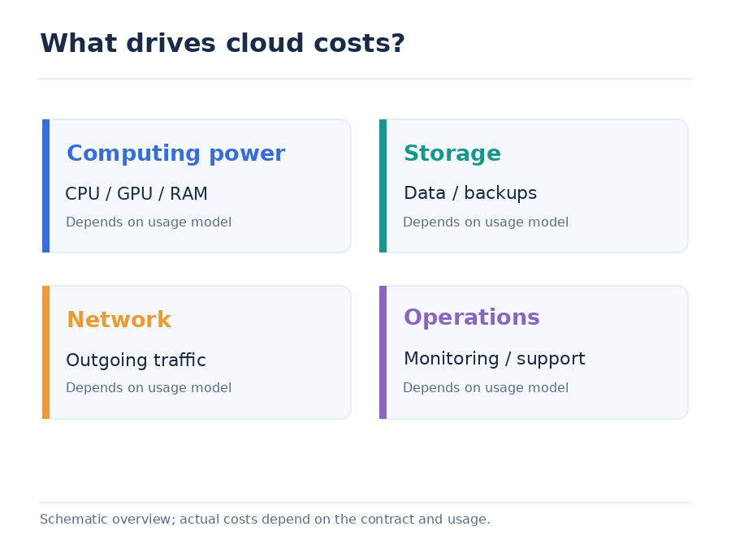

# M4-L4 – Understanding costs {#L4}

**Course area:** M4 – Bachelor’s / transition: Cloud operations

**Level:** Bachelor’s / Master’s bridge

**Prior knowledge:** No fixed prerequisites specified.

## The initial problem: A functioning architecture is not necessarily an economical architecture {#S1}

A self-developed online tool can work extremely well technically and still be uneconomical. A small application might need only one server. If you additionally operate a managed database cluster, a load balancer, several container nodes, an external logging service and an elaborate network, users do not automatically pay more for the function — but running costs increase.

Conversely, a very inexpensive solution can become costly if it constantly fails and creates a great deal of manual work. When operating your own online service, the question should therefore be not only **‘How much does the server cost?’** but also: **‘How much does the complete, reliably usable function cost per month and per actual job?’**

A *cost model* here means a simplified, traceable calculation connecting the resources used with their billing and business value. It is not a description of a specific provider. Particularly with cloud services, costs can arise even when nobody is visiting the website: for reserved capacity, stored data, backups, IP addresses or network components.

``` text
Users / jobs
       │
       ▼
Application + database + files
       │
       ├── Computing time and memory
       ├── Storage space and backups
       ├── Networks and data transfer
       ├── External APIs / AI models
       └── Monitoring, maintenance, support
                        │
                        ▼
             Total cost of the service
                        │
                        ▼
                Cost per service delivered
```

**What problem does cost accounting solve?** It makes expenditure visible, enables fair comparisons and exposes risky assumptions. **When is elaborate financial management unnecessary?** For a single private server, a simple spreadsheet or list of monthly cost items is often sufficient initially. An elaborate financial management system would create additional work without corresponding insight.

## Two fundamental types of cost: Fixed and usage-dependent {#S2}

**Fixed costs** arise within a particular period under consideration even when there is little or no usage. Typical examples include a virtual machine rented monthly, a fixed web hosting plan, a domain, a paid monitoring package or depreciation of purchased hardware. ‘Fixed’ does not mean unchangeable forever: a tariff or contract may be adjusted later.

**Variable costs** increase with measured usage: for example per executed function, gigabyte-month of storage, volume of data processed, computing hour or model call. A service may combine both models. For instance, a managed database service may charge a base amount for the continuously running instance plus additional charges for storage or backup space.

**Marginal costs** are the additional costs of one more job or customer. If spare capacity is available on an already paid-for server, the immediate additional cost of a small job may be very low. However, if the next increase in load requires a second machine, costs rise abruptly. A tariff with fixed tiers does not behave like a fully linear pricing model either.

A useful approximation is:

``` text
Monthly costs = recurring base costs
              + usage charges
              + other operating and support costs

Cost per completed job = attributable total costs
                       / successfully completed jobs
```

Failed attempts, retries and cancelled jobs belong in the total costs. For a service that attempts 10,000 jobs but successfully completes only 8,000, the cost of a usable result should not be calculated by dividing by 10,000. This is precisely why a simple ‘cost per API call’ metric is often insufficient.

## What cloud providers actually charge for {#S3}

### Processor time, instance runtime and memory {#31-prozessorzeit-instanzlaufzeit-und-arbeitsspeicher}




A **CPU** (*Central Processing Unit*, main processor) performs general computations. Some providers charge for the reserved computing capacity of a machine according to its runtime, regardless of whether it operates permanently at 100 per cent. Other services bill actual runtime or invoked functions according to their own pricing model.

**RAM** (*Random Access Memory*, working memory) is often booked together with a machine class. For some serverless services, the selected memory influences the billed unit of computing. Additional RAM may be necessary for a memory-intensive application, but cannot automatically repair a slow database design.

A rented virtual machine may, for example, be billed continuously for as long as it exists or runs — the exact rule depends on the tariff. A short-lived function, by contrast, is often billed only for a measurable execution, plus other components. ‘Pay for usage’ does not mean that the whole system is necessarily free when idle.

### GPU time and AI processing {#32-gpu-zeit-und-ki-verarbeitung}

A **GPU** (*Graphics Processing Unit*, originally a graphics processor) can perform large parallel computations and is particularly important for numerous AI models. It often incurs significantly higher hourly rates than a small CPU instance. What matters, therefore, is not only the hourly price but **how long an expensive GPU is actually occupied**.

An example using a purely hypothetical hourly rate of 8 euros:

$$
\begin{aligned}
\text{3 hours per day, 30 days:}\quad&3\times30\times8\,\text{€}=720\,\text{€}\\
\text{24 hours per day, 30 days:}\quad&24\times30\times8\,\text{€}=5\,760\,\text{€}
\end{aligned}
$$

The calculation illustrates the difference between temporary and continuous provision. It does *not* claim that GPU offerings currently cost eight euros, and does not yet account for CPU, RAM, storage, network, data or licence costs. Even a switched-off GPU instance may continue to incur costs for disks, allocated addresses or storage, depending on the offering.

For **inference** — running an already trained model — you can compute locally, rent a dedicated GPU or use an external **API** (*Application Programming Interface*). External text-model APIs may, for example, charge for input and output tokens. A *token* is a processing unit of a language model; it is not always identical to a whole word. Other AI services charge by images, seconds, computing time or other units. **The unit must be identified from the specific offering before each calculation.**

### Disks, databases and backups {#33-datenträger-datenbank-und-backups}

Stored data may be billed according to capacity and duration. A typical unit is the **GB-month**: one gigabyte occupied for approximately one month. However, not every bill uses the same definition of a gigabyte; tariffs may distinguish decimal GB from binary GiB.

Besides storage space, other factors often count:

- Number of read and write operations and provisioned input/output performance.
- Type of storage, such as fast block storage or less expensive object storage.
- Database storage, transaction logs and managed database operation.
- Snapshots, full backups, versioning and retention.
- Retrieval and recovery charges from certain storage classes.

**A backup is not a free by-product of a database.** If new backups are created daily, data volume and retention duration may become relevant. An apparently inexpensive storage class is not necessarily the most economical for frequent retrieval or long minimum retention periods. Nevertheless, the security of data is not assessed solely on the basis of the storage price (see M3-L6).

### Data traffic and egress {#34-datenverkehr-und-egress}

**Egress** refers to outgoing data traffic from a defined network or service. In particular, transmitting cloud data to users on the public internet may incur costs depending on the tariff. Some providers distinguish between incoming and outgoing data, between regions and availability zones, and between internal and external transfers.

For example, an online service delivers many images of several megabytes each every month. Its CPU costs are low, but the total volume of transferred files may be high. A **CDN** (*Content Delivery Network*, distributed delivery network) can cache data closer to users, but a CDN also has its own cost model — it does not automatically make file transfers free.

In distributed architectures, additional east-west traffic occurs: database replication, synchronisation between zones and data movement between services. Related services should therefore be located sensibly wherever possible; unnecessary large data movements may be more expensive than the actual processing.

### Smaller items that add up {#35-kleinere-posten-die-sich-summieren}

Additional costs may arise for domains and certificate services, DNS requests (*Domain Name System*, name resolution), load balancers, **NAT gateways** (*Network Address Translation*, mediated outbound network access), IP addresses, logs, metrics, notifications, secrets management or special support plans.

One example from vendor documentation: AWS explicitly notes that NAT gateways can incur both time-based and data-based fees and that unused gateways represent an opportunity to save costs. This does not mean that every operator needs a NAT gateway. Rather, it illustrates why the architecture should be simplified **before** unnecessary components are set up.

## How deployment models change the bill {#S4}

The following models were explained technically in M2-L3 and M2-L4. Here we consider the same models economically. The table deliberately contains **no current market prices**.

| Model | Typical billing | What is easily overlooked | Suitable when … |
| --- | --- | --- | --- |
| Conventional web hosting provider | Monthly tariff | Execution limits, database limits, performance limits | A PHP site or small web service can remain simple |
| **VPS** (*Virtual Private Server*) | Usually rented machine capacity | Updates, backup, outages, administration | A manageable application runs continuously |
| **PaaS** (*Platform as a Service*, managed application platform) | Instance, usage, additional services | Database, storage, transfer, limits | Less server operation of your own is desired |
| **Serverless** | Calls, execution time and other consumption measures | Ancillary services, minimum runtimes, peak load, start-up delay | Irregular, short, independent tasks arise |
| Container platform | Nodes/containers plus infrastructure | Base cluster costs, network, observability | Several services must be managed uniformly |
| Kubernetes cluster | Machines, control plane depending on offering, network, storage | Operational effort and idle capacity | Scale and requirements justify complexity |
| Own hardware | Purchase plus ongoing operation | Electricity, ageing, replacement, location, accessibility | Local control or consistent utilisation matters |

A **VPS** is not outdated technology. For a small PHP application or a compact API, it can often provide the best balance of cost and control. A **PaaS** may appear more expensive but reduces certain administrative activities. A serverless model may be economical for irregular usage, whereas a service that is constantly heavily loaded may run more cheaply with reserved capacity. There are exceptions in both directions.

Kubernetes can standardise the management of many application instances. **But it does not solve an economic problem merely by existing.** In particular, a small one-person service may acquire unnecessary complexity, background consumption and troubleshooting through cluster technology.

## Three calculated models — explicitly not provider offers {#S5}

The following **fictitious model prices** illustrate only the calculation method. They are not suitable as a direct basis for a purchase decision; a real calculation must determine prices, free allowances, regions, taxes, runtimes and actual loads afresh.

### Example A: Small, continuously accessible online tool

Suppose a PHP application needs a small virtual server and a local database. We arbitrarily assume:

| Item | Fictitious monthly costs |
| --- | ---: |
| VPS | 12 € |
| External backup retention | 5 € |
| Domain, proportion per month | 1 € |
| Small reserve for additional costs | 3 € |
| **Total** | **21 €** |

With 700 successfully completed analyses per month, this corresponds to **$\frac{21}{700}=0{,}03\,\text{Euro}$** of direct technical costs per result. The calculation excludes working time for maintenance, security updates, customer service, development and business administration. It also omits a second machine for fault tolerance.

If the application runs reliably on a single server, there is no economic reason to turn it immediately into six independent services. If higher load is foreseeable, the first step should be to investigate whether indexes, caching and resource-efficient software can produce improvements.

### Example B: The same function on a managed platform

Fictitious monthly assumptions:

| Item | Fictitious monthly costs |
| --- | ---: |
| Application platform | 18 € |
| Managed database | 11 € |
| File storage and backups | 5 € |
| Data traffic and logs | 4 € |
| **Total** | **38 €** |

In this model calculation, the platform costs 17 euros more than the single VPS. It does **not** follow that it is 17 euros worse. It may save staff time for operations, updates and manual recovery steps; it may also have additional limitations. A fair comparison must consider the same scope of security, availability and backups.

### Example C: Infrequent computing jobs as a serverless function

Suppose a platform were to charge a purely hypothetical 0.40 euros per million calls and 0.000020 euros per billed **GB-second**. The GB-second unit combines allocated memory and execution time. In this model, one job needs 0.5 GB for 0.2 seconds; there are one million jobs per month.

$$
\begin{aligned}
\text{Memory time:}\quad&1\,000\,000\times0{,}5\,\mathrm{GB}\times0{,}2\,\mathrm{s}
   =100\,000\,\text{GB-seconds}\\
\text{Computing component:}\quad&100\,000\times0{,}000020\,\text{€}=2{,}00\,\text{€}\\
\text{Call component:}\quad&\frac{1\,000\,000}{1\,000\,000}\times0{,}40\,\text{€}=0{,}40\,\text{€}\\
\text{Total model function costs:}\quad&2{,}40\,\text{€}
\end{aligned}
$$

These **2.40 euros are not the complete system costs**. The function may need a database, network traffic, authentication, logs and a persistent data store. Some platforms have minimum billing units, fixed fees, free allowances or memory and runtime limits. And a function that runs for ten seconds instead of 0.2 seconds generates 50 times the computing costs at the same fictitious linear rate. The cost profile may therefore change fundamentally under continuously high load.

The example shows both the advantage and the trap of consumption-based billing: costs may be low when idle; without limits, a load spike can increase the bill.

## Own hardware: Costs are more than the electricity bill {#S6}

A home computer, mini-PC or your own AI computer can make cost-effective use of existing computing power — particularly for private processing without permanent public accessibility. However, economic comparisons also include **purchase, depreciation, electricity, wear and operational risks**.

Fictitious example: a computer consumes an average of 90 watts, or 0.09 kilowatts, during the continuous operation under consideration. With 30 days and an explicitly assumed electricity price of 0.30 euros per kilowatt-hour, this gives:

$$
\begin{aligned}
0{,}09\,\mathrm{kW}\times24\,\text{hours}\times30\,\text{days}&=64{,}8\,\mathrm{kWh}\\
64{,}8\,\mathrm{kWh}\times0{,}30\,\text{€/kWh}&=19{,}44\,\text{€ electricity/month}
\end{aligned}
$$

If the device hypothetically cost 600 euros, a simple economic overview could include $\frac{600\,\text{Euro}}{36\,\text{months}}\approx16{,}67\,\text{Euro per month}$. Together, this would already amount to approximately 36.11 euros per month, **excluding** networking, replacement parts, backups, failure precautions, maintenance and working time. An accounting allocation of purchase costs is not an actual monthly cash outflow; it merely makes long-term total costs comparable.

If you already own the computer and would have switched it on anyway, the **additional** cost of individual local tasks may be significantly smaller. If, by contrast, a commercial online service is to be permanently accessible through it, further questions arise: internet connection, public accessibility, power failures, noise and heat, data protection and separation of private and publicly offered systems. A home computer does not automatically replace the infrastructure of a data centre.

**When is self-hosting sensible?** When control, existing hardware, data protection requirements or a well-utilised GPU justify the effort. **When is it unnecessary?** When a service is called only occasionally and reliable public accessibility is more important than saving individual usage fees.

## AI costs: Three fundamentally different approaches {#S7}

For AI applications, at least three approaches should be distinguished:

**External model API:** A provider processes jobs. Depending on the model, charges may be per token, image, minute or execution time. Advantage: no GPU of your own and less model operation. Disadvantage: provider dependency, prices and limits may change; data protection, latency and maximum usage must be assessed.

**Rented GPU for your own model inference:** Your own model runs on a GPU instance. Advantage: more control over the model, data flow and computation method. Disadvantage: costs for runtime, model storage, start-up processes and operations, even when the machine is not fully utilised.

**Local GPU:** Inference takes place on existing hardware. Advantage: no usage-dependent model provider bill and, with local operation, usually no need to send inputs to an external model API. Disadvantage: energy demand, limited graphics memory, hardware wear, maintenance and possibly insufficient availability for external customers.

The decisive metric is not simply ‘price per GPU-hour’ but, for example, **cost per finished, usable image** or **cost per successfully completed video job**. With a slow model, low hourly rates may be offset by long processing times. Conversely, a more expensive, faster system may cost less per result at high utilisation.

``` text
AI job
   │
   ├── External API: billing according to service model
   │
   ├── Rented GPU: runtime + data + operations
   │
   └── Local GPU: electricity + hardware + maintenance
   │
   ▼
Successful result
   │
   ▼
Cost per usable result
```

An AI pipeline may also require multiple model calls: create an image, evaluate it, improve it, derive a video, store it. Discarded intermediate results also cost computing time and potentially API fees. **A business model must factor in the expected proportion of rejected results.**

## Cost traps and unexpected bills {#S8}

Not every increase in costs means more paying users. Typical causes include:

1.  **Unused resources running continuously:** forgotten test instances, databases or cluster nodes.
2.  **Automatic scaling without a practical upper limit:** more instances during abusive or erroneous load.
3.  **Retry loops:** workers or agents trigger infinitely many new tasks because of an error.
4.  **Underestimated data traffic:** large images, video files, backups or transfers between regions.
5.  **Unlimited log and backup retention:** small quantities become large volumes of stored data in the long term.
6.  **Chargeable ancillary services:** load balancers, NAT gateways, monitoring, network components or managed databases.
7.  **Misunderstood free allowances:** after the free quota is exceeded, usage may become chargeable; the exact behaviour is provider-specific.
8.  **Resources not fully terminated:** stopping a machine does not automatically delete all disks, snapshots or addresses.
9.  **Application errors and abuse:** unauthorised API usage or other people's jobs may incur charges despite low legitimate demand.

Cost control is therefore also a matter of **software architecture and security** (see M4-L1 and M4-L3), not just accounting.

## Budgets, alerts, quotas and hard limits {#S9}

A **budget** may initially be a planned maximum amount. Cloud providers usually offer billing views and notifications for this purpose. A **cost alert** reports that a threshold has been reached or is expected to be reached. It is **not inherently an automatic spending block**.

This distinction matters and can be clarified using official sources:

- Microsoft explains that Azure Cost Management budgets trigger notifications but **do not stop resources automatically**.
- AWS notes that billing data and budget notifications may arrive with delays; further costs can arise even after a warning. Specific separate budget actions or spend-limit functions must be assessed for each provider.
- Google Cloud distinguishes between alert-only budgets and **spend cap budgets** available for certain services. An alert-only budget does not limit the bill. Even actual spend caps may interrupt the service and have their own scope. **As of 05.11.2026:** Google describes such limits for one supported service at a time within a project, including Gemini API, Agent Platform, Cloud Run and Cloud Run functions. When the limit is reached, the platform pauses new usage of the affected service; requests already in progress may continue to incur costs. Other services, persistent resources and fixed costs may continue. Enforcement is not instantaneous and overspending may be billed. A spend cap is therefore **not an overall price ceiling for the entire cloud project**. [Google Cloud – Spend Cap Budgets](https://docs.cloud.google.com/billing/docs/how-to/budgets-spend-caps).

There are consequently different levels of protection:

``` text
Cost forecast / budget          → Detect early
Notifications                   → Inform the operator
Technical quotas / rate limits  → Limit usage
Job and customer quotas         → Limit individual sources of costs
Automatic shutdown logic        → If actually available and tested
Bill review                     → Trace the results
```

Examples of technical limits include a maximum permitted number of concurrent GPU jobs, a limited file size, a monthly API quota per user, a fixed upper limit for workers and termination after too many retries. Such measures can prevent a programming error from generating computing jobs without limit. **They nevertheless do not guarantee an absolutely limited bill** if other cost items or delays are not taken into account.

For a small service, a manageable control routine is often sufficient: identify cost centres, set warning thresholds below the desired maximum amount, compare actual bills and incorporate technical limits in the application itself. Additional payment obligations or tax issues must be assessed separately for a real offering.

## Practical cost planning in three stages {#S10}

### Stage 1: Minimum monthly requirements

Initially, one question is enough: which **services actually need to run all the time**? For example, a web application, a database and a backup. All other components are initially treated as optional. This produces a clear list of base costs.

### Stage 2: Three load scenarios

Instead of using a single optimistic figure, three scenarios are useful:

- **Low usage:** only a few jobs, but base costs continue.
- **Expected usage:** average number of successful jobs with normal data volume.
- **High or unusual usage:** many simultaneous jobs, larger files, additional errors and retry attempts.

A price comparison is meaningful only if these scenarios are **comparable** across the alternatives. A highly available Kubernetes cluster and a single VPS without external backup do not offer the same service quality.

### Stage 3: Full costs and value per job

For a commercial application of our own, we add the actual or calculated costs of maintenance, development, support, software licences, payment processing and taxes where applicable to the directly billed cloud costs. This yields **full costs**, or a **Total Cost of Ownership (TCO) assessment**: not just the purchase or rental, but the economic burden over the period under consideration.

The **FinOps Foundation** (*Financial Operations*, collaborative management of technology expenditure and its value) recommends relating expenditure to meaningful units of service. This is called *Unit Economics*. For an analysis tool of our own, this might be ‘cost per successful analysis’. For AI images, it would be ‘cost per usable result’, not merely ‘cost per token’ or ‘cost per minute of server time’.

``` text
Technical resources
        │
        ▼
Direct operating costs
        │
        + Maintenance / support / replacement / other obligations
        │
        ▼
Total costs over a period
        │
        ▼
Allocate to successfully delivered services
        │
        ▼
Cost per analysis, file, customer or AI result
```

**What problem does this metric solve?** It helps identify whether growing revenue is being consumed by technical costs that grow even faster. **When is it unnecessarily elaborate?** For a purely private, non-monetised script, monitoring electricity, storage and any monthly hosting fee is usually sufficient.

## Which solution makes economic sense in which situation? {#S11}

### Example 1: Documentation website and smaller PHP tools

For a relatively static website with a few dynamic functions, conventional web hosting or a small VPS is usually sufficient. The operator needs a domain, web server, secure configuration, a database if necessary, backups and updates. A Kubernetes cluster or GPU server of one's own would probably create no added value. What matters is which functions are actually needed, not which cloud terms sound particularly modern.

### Example 2: Online data analysis with irregular jobs {#beispiel-2-online-datenanalyse-mit-unregelmässigen-aufträgen}

A small web application running continuously can accept requests and place analysis jobs in a queue. When demand is low, a single worker might suffice; additional workers may become economical during load spikes. Alternatively, serverless processing is interesting if the tasks are short and the respective provider's limits are suitable. However, the complete cost chain from invocation, storage and runtime to data output must then be considered.

``` text
Browser → Small web application → Job database
                                     │
                                     ▼
                                   Queue
                                     │
                                     ▼
                              1 worker, later more
                                     │
                                     ▼
                                 Result file
```

### Example 3: Your own AI processing service

Here, an inexpensive web server can trigger expensive purchased GPU or API work. Control must therefore address the **actual cost drivers**: job type, maximum resolution, permitted runtime, utilisation, retries and concurrent jobs. A system that allows uncontrolled recomputation may become uneconomical with just a few users.

A sensible initial model is often a small control API with transparently limited processing. Your own local AI hardware can initially be used for experimentation and private batch work. Only when real demand and load profiles are known is a more precise comparison with rented GPUs or external model APIs worthwhile.

## Price lists, calculators and vendor lock-in {#S12}

Cloud providers make price lists and calculators available. A **pricing calculator** allows configuration and expected usage to be estimated — it does not guarantee the subsequent bill. Microsoft documents, for example, that the Azure Pricing Calculator distinguishes between region, size, service model and usage volume. Prices may also differ because of individual contracts, discounts, reservations and currencies.

**Vendor lock-in**, or dependency on provider-specific functionality, is also economically relevant. A proprietary database or a service available only from that provider may cost time for migration and adaptation in the long term. This does not mean that every managed service should be rejected; the reduction in operational work may well justify the cost of switching.

Before making a real decision, at least the following points should therefore be checked: current tariff and region, billing unit, set-up or minimum costs, free allowance, storage and data traffic, exit and data export costs, security responsibilities, cancellation terms and availability of the functions actually needed.

## Summary and transition to M4-L5 {#S13}

**Cloud costs rarely consist only of ‘the server’.** Computing time, memory, storage duration, data transfer, databases, backups, external APIs, monitoring and operational maintenance together form the actual economic burden. The decisive distinctions are fixed versus variable costs, idle time versus utilisation and direct computing prices versus costs per usable result.

Conventional web hosting or a small VPS may suffice for a small application. PaaS reduces certain operational tasks, serverless may suit irregular jobs, and cluster platforms help at an appropriate scale — but none of these technologies is inherently the cheapest or best. A budget alert is not automatically a hard limit; technical upper limits and bill monitoring are tasks in their own right.

**In M4-L5 – Your own software and cloud offerings**, we connect this cost knowledge with business models: what could you offer, how can demand be assessed, what minimal first versions are conceivable, and when do support, security and ongoing fees exceed the realistic benefit?

## Sources {#S14}

**Last source check:** 04.11.2026

**Checked on 04.11.2026.** The following sources describe provider functions or cost methods. They are **not a price commitment**; this lesson deliberately contains no current list prices.

1.  Microsoft Learn, *Estimate costs with the Azure pricing calculator*: [https://learn.microsoft.com/en-us/azure/cost-management-billing/costs/pricing-calculator](https://learn.microsoft.com/en-us/azure/cost-management-billing/costs/pricing-calculator) – influence of region, configuration, usage volume and contracts on cost estimates.
2.  Microsoft Learn, *Tutorial: Create and manage budgets*: [https://learn.microsoft.com/en-us/azure/cost-management-billing/costs/tutorial-acm-create-budgets](https://learn.microsoft.com/en-us/azure/cost-management-billing/costs/tutorial-acm-create-budgets) – budget notifications do not stop resources automatically; delayed billing data.
3.  Google Cloud, *Create, edit, or delete budgets and budget alerts*: [https://docs.cloud.google.com/billing/docs/how-to/budgets](https://docs.cloud.google.com/billing/docs/how-to/budgets) – alert-only budgets versus supported hard spending limits.
4.  Google Cloud, *Manage spend cap budgets*: [https://docs.cloud.google.com/billing/docs/how-to/budgets-spend-caps](https://docs.cloud.google.com/billing/docs/how-to/budgets-spend-caps) – possible spending blocks for supported services and consequences for accessibility.
5.  AWS, *Managing your costs with AWS Budgets*: [https://docs.aws.amazon.com/de_de/cost-management/latest/userguide/budgets-managing-costs.html](https://docs.aws.amazon.com/de_de/cost-management/latest/userguide/budgets-managing-costs.html) – budget types, alerts and actions.
6.  AWS, *Best practices for AWS Budgets*: [https://docs.aws.amazon.com/cost-management/latest/userguide/budgets-best-practices.html](https://docs.aws.amazon.com/cost-management/latest/userguide/budgets-best-practices.html) – delays and frequency of cost data updates.
7.  AWS, *Cost optimization checks*: [https://docs.aws.amazon.com/awssupport/latest/user/cost-optimization-checks.html](https://docs.aws.amazon.com/awssupport/latest/user/cost-optimization-checks.html) – unused network components and additional data transfer costs.
8.  FinOps Foundation, *Unit Economics*: [https://www.finops.org/framework/capabilities/unit-economics/](https://www.finops.org/framework/capabilities/unit-economics/) – relating costs to technically and commercially meaningful units of service.
9.  FinOps Foundation, *Introduction to Cloud Unit Economics*: [https://www.finops.org/wg/introduction-cloud-unit-economics/](https://www.finops.org/wg/introduction-cloud-unit-economics/) – definition, full costs and relationship between usage and value.

**Not checked:** Specific current VPS, GPU, CDN, API, electricity or storage list prices for a particular provider or contract. These would need to be established separately for a real purchase decision, with date, region and tariff.
