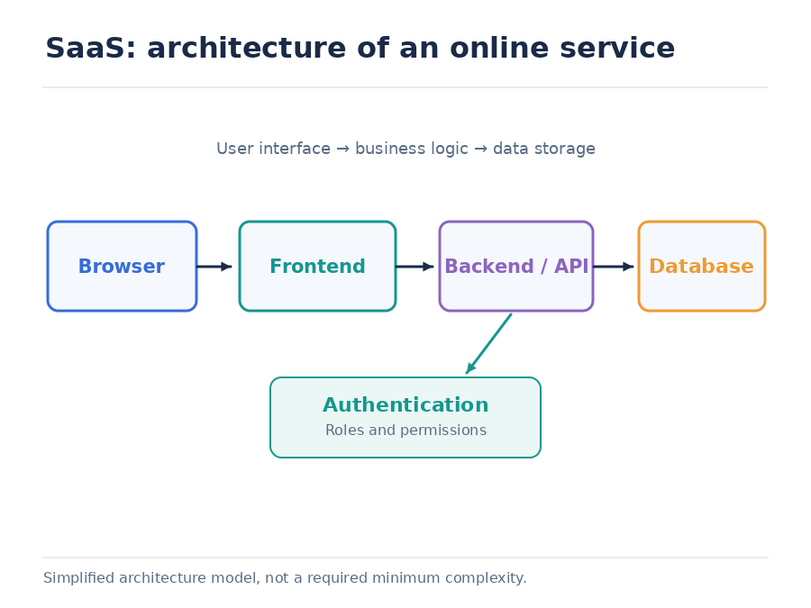

# M4-L5 – Possible software and cloud offerings of your own {#L5}

**Course area:** M4 – Bachelor’s / transition: Cloud operations

**Level:** Bachelor’s / Master’s bridge

**Prior knowledge:** No fixed prerequisites specified.

## Initial problem: A technically possible solution is not yet a product {#S1}

After the lessons on servers, the cloud, databases, reliability and costs, a new question arises: **What could you offer using this infrastructure that other people or businesses would voluntarily pay for?** A developer can operate a database, a web server or an AI worker. But this does not yet create a useful service. Only when an offering solves a real, sufficiently important problem and can be used reliably can it become a product.

Three levels must be distinguished:

1.  **Technical concept:** Analyse a file, generate a report, synchronise data or process an AI job.
2.  **Deployment model:** The program runs locally, on a rented server or on a managed cloud platform.
3.  **Business model:** People pay once, monthly, per request, per user or for a managed service.

The same algorithms can be offered under different business models. A PDF analysis program could be sold as desktop software, rented as a web tool or made available as a programming interface for other applications. Conversely, the same monthly subscription can finance either a simple application or a complex cloud service. **Software as a Service (SaaS)** refers to the provision of software as a usable service; a subscription is a common but not a compulsory feature.

``` text
A user's specific problem
             │
             ▼
       Useful function
             │
     ┌───────┴─────────┐
     ▼                 ▼
Desktop program    Online service
     │                 │
One-off licence   Subscription / request / quota
     │                 │
     └───────┬─────────┘
             ▼
 Support, updates, costs,
 demand and responsibility
```

**What problem does this distinction solve?** It prevents hosting technology from being prematurely equated with a business model. **When is it not needed?** Anyone developing a tool exclusively for their own use or releasing it free of charge does not have to invent a commercial model. Technical solutions can be useful without any intention of generating revenue.

## Model 1: A small online tool as SaaS {#S2}

A **SaaS offering** provides an application over a network. The provider operates and updates the software; customers use it, for example, in their browser. The main benefit to customers is not that the software runs 'in the cloud', but that they can solve a problem without installing software themselves and often from several devices.

{alt="Schematic SaaS architecture with frontend, API, database and authorisation checks"}


Imagine a service that reads large CSV files (*Comma-Separated Values*, simple tabular text files), checks them for errors and generates a report. The first technical implementation can be very straightforward:

``` text
Customer in browser
       │
       ▼
Web application: upload file
       │
       ▼
Validation and analysis module
       │
       ├── Display result
       └── Download report
```

If no accounts or permanent storage are required, this may already constitute the complete product. Later, user accounts, recurring reports and separate customer areas could be added. **Multi-tenancy** means that multiple customers can use the same application without seeing other customers' confidential data. The AWS SaaS documentation addresses specific concepts such as tenant isolation, customer onboarding and user-related cost measurement; however, there is no single correct SaaS architecture for every product.

A first version therefore need not consist of microservices, Kubernetes or a database cluster. A single web server with a properly secured program and a manageable database may suffice.

**Useful** when users have a recurring problem, work on multiple devices or do not want to install updates themselves. **Unnecessary** when a one-off local file conversion is entirely sufficient and no shared operation is needed. **Disadvantage:** The provider takes responsibility for availability, account security, data deletion, troubleshooting and possibly ongoing customer support.

## Model 2: API-as-a-Service – Selling a function rather than an interface {#S3}

**API** stands for *Application Programming Interface*. **API-as-a-Service** means that customers can call a function from their own software. They may not want to operate a dashboard or an additional website at all: their own system should automatically accept data, process them and return a result.

Example: A service analyses the structure of a file and reports typical errors as machine-readable data.

``` text
Customer's software
        │
        ▼
API request with data and access key
        │
        ▼
Authentication + authorisation check
        │
        ▼
Analysis function
        │
        ▼
Structured response to customer software
```

The interface needs a stable description of inputs, results and error states. It must account for versions, access restrictions and protection against abuse. Months later, customer programs may still be calling the API automatically; an ill-considered change to its data format can break numerous integrations. Documented versions and clearly communicated changes can therefore be more important than an attractive interface.

Possible pricing arrangements include a fixed monthly request quota, usage-based charges or prepaid credit. For very computationally intensive jobs, billing must take account of the resources actually consumed. A request taking 20 milliseconds may cost considerably less than image processing that requires several minutes of GPU computing time (*Graphics Processing Unit*).

One security problem is **unlimited resource requests**. Even formally valid requests can overload a service through sheer volume, large files or expensive computations. OWASP (*Open Worldwide Application Security Project*) lists unrestricted resource consumption as a distinct risk in its API security list. Countermeasures include access checks, quotas, file size limits, time limits, queues and, where appropriate, manual approval of costly actions.

**Useful** for clearly definable functions that other programs need repeatedly. **Unnecessary** for a tool whose use requires substantial human interpretation. **Disadvantage:** Interface changes and support for third-party integrations create long-term obligations.

## Model 3: Managed Automations – Recurring work as a managed service {#S4}

With **Managed Automations**, you sell not only a piece of software but a reliably completed task. For example, a small business may need to consolidate data from several systems regularly, identify errors and receive a weekly report.

``` text
Schedule or event
          │
          ▼
   Automation service
          │
   ┌──────┴──────┐
   ▼             ▼
Fetch data      Check inputs
   └──────┬──────┘
          ▼
       Analysis
          │
          ▼
Report + error message + log
```

A **scheduler** (a time-based task planner), workers (background programs that execute tasks) and a small database may suffice. Artificial intelligence is optional: a fixed rule can be more reliable, cheaper and easier to trace for invoice files, directories or tables. AI is more suitable where unstructured texts, classifications or fuzzy patterns need to be processed. Critical results require control mechanisms and, where appropriate, human approval.

The customer often pays for the result, the set-up and ongoing support. This may have a higher perceived value than a licence alone. At the same time, the responsibility for support increases: external data formats change, credentials expire, interfaces are modified and an error can interrupt a necessary business task.

**Useful** for a small number of customers with recurring, clearly described workflows. **Unnecessary** if a simple guide or local script at the customer's premises is sufficient. **Disadvantage:** A highly customised service does not automatically scale; each additional customer may require extra personal effort.

## Model 4: Hosted open-source software with added value {#S5}

**Open source** means that software is released under a licence granting certain rights of use, inspection, modification and redistribution. Depending on the licence, you can operate a hosted service based on that software and sell set-up, updates, maintenance or support, for example.

The benefit to customers may arise from being able to use a powerful free service without installing or administering it themselves.

``` text
Existing open-source project
             │
             ▼
Legally permitted deployment
             │
             ▼
Hosting + set-up + updates
             │
             ▼
Customer receives managed access
```

The **specific software licence** must be checked before any commercial use. 'The source code is on the internet' does not mean 'all forms of exploitation are permitted'. Conditions differ considerably between permissive licences, traditional copyleft licences and licences with network provisions. In particular, the GNU Affero General Public License, version 3 (**AGPLv3**), includes obligations under certain conditions to offer users the corresponding source code of a modified version when they interact with it over a network. This does not imply either that every open-source project has this rule or that hosting in general is prohibited.

Trademark rights, images, bundled datasets and licences for extensions may also require separate consideration. **Useful** for a functioning project that can legally be used and has a genuine maintenance requirement. **Unnecessary** if customers can easily operate the offering themselves or there is no demand for support. **Disadvantage:** You assume responsibility for software whose technical development you do not fully control.

## Model 5: Data analysis, monitoring, media and AI workflows {#S6}

A number of offerings combine the models discussed above. Their practical benefit is what matters, not their classification into a marketing category.

  Offering idea       Practical problem                         Possible small starting point           Typical cost driver
  ------------------- ----------------------------------------- --------------------------------------- -------------------------------------------------
  Data validation     Faulty tables or imports                  Check a file and generate a report      Computing time, support for unusual formats
  Monitoring          Failures or changes noticed too late      Check a few sources regularly           Query frequency, notifications
  Media processing    Convert many images/videos consistently   One file type, one processing profile   Storage, data traffic, CPU/GPU
  AI text analysis    Classify or summarise free text           One clearly defined document type       API requests, model evaluation, data protection
  AI image workflow   Repeatable generation or editing          One standardised job type               GPU time, failed attempts, file storage

Consider an image processing service. Customers upload images and choose a defined processing operation. A web server accepts the job; a worker performs the computationally intensive work and makes the result available for retrieval.

``` text
Browser / API
      │
      ▼
Job submission with size limit
      │
      ▼
Job database + queue
      │
      ▼
CPU/GPU worker
      │
      ▼
Result file with limited retention
      │
      ▼
Status and download for authorised customer
```

The bottleneck may be computation time, GPU availability or outgoing data traffic. Questions also arise concerning upload rights, permitted content, retention periods, retries, data protection, manipulation and the handling of faulty results. A local AI computer can be economically sensible for your own production, but that alone does not make it suitable as a public service: users expect availability, protection of their files and reliable processing times.

**Useful** for well-defined processes with repeatable results. **Unnecessary** for a service that has to interpret every job individually and has no clear quality standard. **Disadvantage:** AI jobs can take an unpredictably long time, fail or produce results that need checking before further use.

## Model 6: Desktop licence with optional cloud synchronisation {#S7}

Not every application needs to become a web application. Locally installed desktop software can still have many advantages: data remain on your own computer, the interface responds without an internet connection and the basic functions incur no ongoing server costs.

A **hybrid architecture** combines this local strength with individual optional online functions. Possible features include licensed software, optional device synchronisation, encrypted backups or a common user account for several computers.

``` text
Desktop application
    │
    ├── Local database (primary operation)
    ├── Local processing (offline possible)
    │
    └── Optional sync service
                 │
                 ▼
           Remote storage
```

Synchronisation, however, is a technical task in its own right. What happens if the same file or record is modified simultaneously on two devices? This requires rules for conflicts and, where appropriate, versions, timestamps or synchronisation at record level. It must also be clear whether the remote storage merely holds additional copies or serves as the authoritative data source.

A **one-off licence** and an **additional cloud subscription** can be separate products. Such a model may suit users who want to remain independent but would pay for particular convenience features.

**Useful** for data-intensive local applications with only occasional synchronisation needs. **Unnecessary** when several users must work simultaneously on shared data and already need a purely server-side application. **Disadvantage:** Windows, Linux or other desktop versions, offline problems and cloud components may all need to be maintained in parallel.

## Billing: What exactly does a customer pay for? {#S8}

The price should match the perceived benefit and the technical cost structure. Typical models include:

  Model              What is paid for?                               Suitable when …                          Problem
  ------------------ ----------------------------------------------- ---------------------------------------- -------------------------------------------------------
  One-off purchase   A permanently usable software version/licence   Product works mostly locally             Subsequent updates and support need funding
  Subscription       Recurring access to the service                 Continuous benefit is provided           Users expect ongoing availability
  Per user           Number of authorised people                     Collaboration is the focus               Shared accounts and roles become relevant
  Per request/job    Actual usage                                    Costs rise roughly with usage            Abuse and unexpected costs are possible
  Credit package     Prepaid units of usage                          Jobs are computationally intensive       Remaining credit, refunds and accounting need clarity
  Support contract   Set-up, monitoring and assistance               Customers buy results and availability   Personal effort limits scaling

A **freemium model** offers a free basic version and paid additional features. This can make access easier, but it is not self-sustaining by default: free users can consume computing power, data traffic and support. Free quotas must therefore be limited just as paid ones are.

According to its official documentation, billing systems such as Stripe provide subscriptions and usage-based methods with usage metering. This is an example of a particular product, **not a technical necessity**, a recommendation to open an account or evidence of the current conditions of a particular plan. A payment provider does not automatically take over product logic, access control, tax obligations and error handling in your own system.

It is important to distinguish two truths: **'A payment transaction has been confirmed'** and **'The customer is entitled to use a particular service.'** The application must record the appropriate entitlement after verified payment events; repeated notifications must not credit the same service more than once. This requires unique event identifiers, traceable records and correction procedures (see M3-L5).

## The actual assessment of a product idea {#S9}

A technical idea becomes economically interesting only when several questions align. As a guide, you can use a conceptual assessment framework – **not as homework**, but as a model of how a developer evaluates possibilities.

### Who needs the solution? {#91-wer-braucht-die-lösung}

'Everyone who has data' is not a precise target group. 'Small businesses that receive supplier files in an unsuitable tabular format every month' describes a more specific problem. The more clearly you identify the user and their situation, the easier it is to determine an appropriate minimal offering.

### What problem does it solve measurably? {#92-welches-problem-löst-sie-messbar}

A tool can save time, prevent errors, support a statutory documentation requirement or improve the quality of a recurring output. What matters is whether the advantage over existing solutions is recognisable. 'Uses artificial intelligence' is initially only a technical property, not a customer benefit in its own right.

### What is the smallest credible version? {#93-was-ist-die-kleinste-glaubwürdige-version}

A **Minimum Viable Product (MVP)** is a minimal, genuinely usable product with which the central benefit can be tested. It is not simply 'something unfinished': security and correct results must not be missing. A data validator could, for example, process a single frequently occurring file type safely instead of already supporting 40 formats unreliably.

### Why should someone pay? {#94-warum-sollte-jemand-bezahlen}

Willingness to pay does not follow from technically interesting functions alone. Customers may already use a free alternative, encounter the problem only rarely or be unable to assess the benefit sufficiently. A service is sustainable only if its revenue justifies its operation given realistic usage and support requirements. Extensive technical scalability proves neither demand nor economic viability.

### What remains to be done even with few customers? {#95-was-bleibt-auch-bei-wenigen-kunden-zu-tun}

Domains, hosting, updates, backups, monitoring, troubleshooting, licensing questions, enquiries, invoices and data protection often become relevant with the first paying customer. A system with few paying users can therefore require more support than expected.

## Model calculation: Revenue is not profit {#S10}

The following example is **entirely fictional**. It describes neither market prices, actual service costs nor profit prospects.

Suppose 40 customers use a small online tool at 15 euros per month each:

  Item per month                                             Example amount
  ---------------------------------------------------------- ----------------
  $40\times15\,\text{Euro}$ customer revenue                 600 euros
  Variable processing costs: $40\times2\,\text{Euro}$        −80 euros
  Server, backups and basic technical costs                  −90 euros
  Payment processing as a model flat fee                     −20 euros
  **Calculated remainder before labour and further costs**   **410 euros**

This remainder is **not the profit**. If we additionally assume five hours of support and maintenance at a purely hypothetical value of 30 euros per hour, the remaining amount falls to 260 euros. Taxes, possible refunds, bookkeeping, development and other costs have not yet been accounted for. If more time is required or there are fewer customers, the service can become unprofitable.

A useful concept is **unit economics**: how much does one successfully delivered service cost, including an appropriate share of common costs? In an AI service, a high failure rate can significantly change this figure. In a managed-service offering, by contrast, the time spent on personal support may dominate.

The number of customers alone is also insufficient for an assessment. Actual usage, cancellations, necessary support and the costs of acquiring new customers matter, among other things. A small service may be technically able to grow tenfold at any time and still become economically worse if jobs cost more than the revenue they generate.

## Security, data protection, contracts and licences {#S11}

As soon as other people use a service, further responsibilities arise. The most important depend on the specific offering:

- **Security:** User accounts, separate customer data, file uploads, access keys, protection against abuse, security updates and recoverable backups.
- **Data protection:** Processing personal data, deletion, retention, access rights and the role of controller or processor under the General Data Protection Regulation (GDPR). The classification depends on the actual decisions about the purposes and means of processing, not the marketing term 'cloud'.
- **Contractual and consumer matters:** A clear description of the service, cancellation, rights of withdrawal where applicable, invoices, support and promised availability. The applicable obligations depend on the type of customer, the country and the specific contractual arrangements, among other factors.
- **Taxes:** Cross-border billing for digital services can raise VAT questions. The EU **One Stop Shop (OSS)** procedure can simplify certain cross-border sales to consumers under its statutory conditions; it is not a blanket tax exemption.
- **Licences and content:** Check rights to source code, models, training data, images, music, fonts and additional libraries separately.
- **AI-specific consequences:** Consider risks arising from incorrect results, confidential inputs, manipulated instructions and unchecked automatic actions. Safety-relevant decisions require appropriate oversight.

Even a very small provider can process personal data and be subject to corresponding obligations. Conversely, not all requirements are identical for every product. The points listed here are **not a substitute for legally binding advice**. Current statutory obligations must be checked separately for a specific undertaking.

## Six ideas as a technical decision-making aid {#S12}

The following table assesses **spaces of possibility**, not real market opportunities. No demand or eventual revenue is assumed for any idea.

  Example                           Who might benefit?                          Minimal technical core                         Main burden                                When not useful?
  --------------------------------- ------------------------------------------- ---------------------------------------------- ------------------------------------------ -------------------------------------------
  Tabular data validator as SaaS    People with recurring import errors         Upload, validation, report                     Data protection, format support            Rare one-off use is sufficiently local
  Analysis API                      Developers with a fixed analysis need       Endpoint, authentication, clear response       Interface maintenance, quotas              No automated integration needed
  Managed report automation         Small teams with routine reports            Data import, schedule, result                  External systems and personal support      Each job remains individual
  Hosted open-source tool           Users without their own IT support          Lawful hosting, updates, help                  Operating third-party software, licences   Self-hosting is already effortless
  AI media processing               Teams with recurring identical media jobs   Job submission, worker, result file            GPU costs, result quality                  No standardisable process
  Desktop tool with optional sync   Individual users with several devices       Local database and voluntary synchronisation   Sync conflicts, two product components     Purely local or purely web-based suffices

For any idea, appropriate building blocks can be selected from the previous lessons: **M2-L1–M2-L3** for deployment, **M2-L4–M2-L5** for containers and scaling, **M3-L1–M3-L6** for data and data security, **M4-L1–M4-L2** for jobs and reliable operation, and **M4-L3–M4-L4** for security and costs.

## From a standalone application to a service – without premature complexity {#S13}

A sensible starting point can be technically very simple:

``` text
Version 1: Local tool
    File → Program → Result

Version 2: Simple online service
    Browser → Web server/application → Database

Version 3: Several concurrent jobs
    Browser/API → Application → Queue → Worker
                                 │
                                 ▼
                            Result store

Version 4: Extension according to need
    additional workers / database replicas /
    separate customer areas – only as needed
```

This sequence **is not a mandatory development path**. Many products sensibly remain at version 1 or 2 for years. Your own VPS (*Virtual Private Server*), conventional hosting or a simple managed platform may suffice. Kubernetes, large database clusters and multiple cloud regions are not signs of greater business maturity if they do not solve a real problem.

For AI offerings, it is also worth distinguishing between **model**, **application** and **service**. A publicly available language or image model is not yet a product of your own. Clearly defined processing, traceable quality checks, appropriate controls and reliable execution can create the actual benefit. The service should not rely on capabilities that the model cannot deliver reliably.

## Summary and transition to the AI section {#S14}

The server and cloud technology learnt in this course opens up a wide range of technical possibilities: local software, paid web tools, APIs, managed automation, hosted open-source projects, data-intensive services and hybrid desktop/cloud products. Not every one of these possibilities requires a cloud provider, a large cluster of servers or artificial intelligence.

The crucial questions remain: **Who benefits from the service? What is the smallest technically reliable scope? Why would someone be willing to pay for it? What obligations and real costs result from it?** The ability to scale a system tells us nothing about whether there is sufficient demand.

This completes course section **D – Cloud operations and economic application**. The next section, **E – Artificial intelligence and robotics**, begins with the historical ideas and explores how formal neuron models developed into modern neural networks, transformers, large language models, agents and eventually systems with perception and action.


## Sources {#S15}


**Date of the technical source review: 04.11.2026.** The following sources substantiate technical and legal foundations. The product examples and fictional figures are teaching models, not statements about real prices, actual demand or profit prospects.

1.  [AWS – Well-Architected SaaS Lens – Definitions](https://docs.aws.amazon.com/wellarchitected/latest/saas-lens/definitions.html) · tenants, isolation, pool/silo models · Last accessed: 2026-11-22
2.  [AWS – SaaS Lens – General Design Principles](https://docs.aws.amazon.com/wellarchitected/latest/saas-lens/general-design-principles.html) · no universal SaaS pattern; onboarding and tenant-related measurement · Last accessed: 2026-11-22
3.  [Stripe – Billing Features](https://stripe.com/billing/features) · subscriptions and usage-based billing as a concrete product example · Last accessed: 2026-11-22
4.  [OWASP – API Security Top 10 – 2023](https://api-security.owasp.org/) · resource abuse, access control and API risks · Last accessed: 2026-11-22
5. [Free Software Foundation – GNU Affero General Public License version 3 (Open Source Initiative)](https://opensource.org/license/agpl-3.0) · Section 13: remote network interaction and offer of corresponding source for modified programs; English licence text, relevance to S5: Hosted open-source software with added value · Last accessed: 2026-11-25
6.  [European Commission – Application of the GDPR](https://commission.europa.eu/law/law-topic/data-protection/information-business-and-organisations/application-gdpr_en) · controllers/processors, particular considerations for small businesses · Last accessed: 2026-11-22
7.  [European Data Protection Board (EDPB) – Data controller or data processor](https://www.edpb.europa.eu/sme/learn-the-basics/data-controller-or-data-processor_en) · roles and obligations · Last accessed: 2026-11-22
8.  [European Union, Your Europe – Mehrwertsteuer – One Stop Shop](https://europa.eu/youreurope/business/finance-and-tax/vat/one-stop-shop/index_de.htm) · cross-border VAT administration under certain conditions · Last accessed: 2026-11-22
9.  [FinOps Foundation – Unit Economics](https://www.finops.org/framework/capabilities/unit-economics/) · cost per business unit · Last accessed: 2026-11-22

**Scope:** This lesson teaches fundamental technical and economic principles, not individual business, tax, licensing or legal advice.
