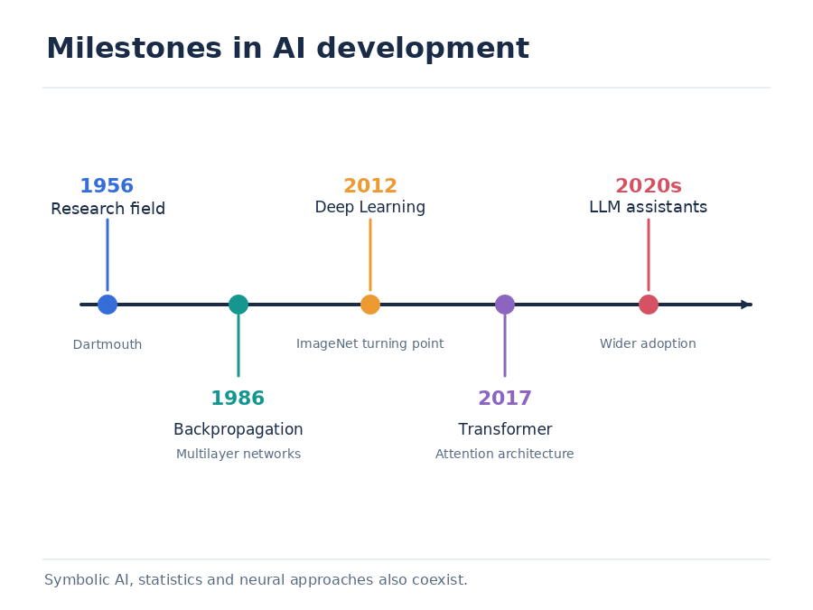

# M5-L1 – Where does artificial intelligence come from? {#L1}

**Course area:** M5 – Bachelor’s: AI fundamentals

**Level:** Bachelor’s

**Prior knowledge:** No fixed prerequisites specified.

## Overview: Not one invention, but several research traditions {#S1}

Modern artificial intelligence did not emerge from a single groundbreaking discovery. It is the result of several ideas pursued over decades: machines should **reason using rules**, **learn from examples**, **search large sets of possible solutions** or **recognise patterns in perception**. Initially, these approaches often existed alongside one another or competed with each other. Only later did systems emerge that combined several methods.

The present-day impression that artificial intelligence is primarily a chat window is therefore a considerable historical simplification. Chess programs, medical expert systems, image recognition, search engines, robotics, statistics and language processing are also part of the history of the field. Many AI systems have no conversational interface at all.

The central question of this lesson is: **What technical problems did researchers have to solve in succession before powerful language, image and AI assistance systems became possible?** The following lessons M5-L2–M6-L7 then examine the technology of these systems in detail.

## What does artificial intelligence mean? {#S2}

**Artificial intelligence (AI)** is a field of research and application in which computer systems are intended to implement capabilities associated with intelligent human behaviour: recognising patterns, processing language, preparing decisions, solving problems or learning from experience, for example. This is a working definition, not a universally valid test of consciousness or human understanding.

We should distinguish five terms from the outset:

| Term | Basic idea | Example |
| --- | --- | --- |
| **Symbolic AI** | Process knowledge using explicitly formulated rules and symbols | Expert system with if-then rules |
| **Machine learning** (ML) | Derive rules or patterns statistically from example data rather than programming every case by hand | Detection of unwanted email |
| **Deep learning** | Machine learning using neural networks, usually with multiple layers | Recognition of objects in images |
| **Generative AI** | Generate new text, images, sounds or other content | A language model writes a report |
| **Large language model** (LLM) | Process and generate language/token sequences with an extensively trained model | A conversational language model |

These terms are **not alternatives at the same level**. Deep learning is part of machine learning; many modern language models use deep learning and can operate generatively. Symbolic methods, in turn, can be used together with an LLM in an application.

A simple sketch of their relationships:

``` text
Artificial intelligence (AI)
│
├── Symbolic methods
│   └── Rules, logic, planning, search
│
├── Machine learning (ML)
│   ├── Classical statistical methods
│   └── Neural networks / deep learning
│       ├── Image and audio models
│       └── Language models, including many LLMs
│
└── Combinations
    └── e.g. language model + tool call + fixed safety rules
```

The sketch shows research directions, not a complete taxonomy with strictly defined boundaries. In particular, search and planning methods can be combined with learning.

**Why is the distinction useful?** It prevents us from mistaking a rigid rule-based program and a data-driven neural network for the same technical principle. **When is it secondary?** For the user of a simple file filter, correct operation matters first; an AI component is not useful simply because it sounds more modern.

## The background: Logic, computing machines and the artificial neuron {#S3}

Long before people spoke of artificial intelligence, mathematics and logic investigated whether thinking could at least partly be expressed in rules. Formal logic describes which statements follow from which premises. Computer science later showed how such rules could be processed by machines.

### 1943 – McCulloch and Pitts {#31-1943-mcculloch-und-pitts}

Warren McCulloch and Walter Pitts published *A Logical Calculus of the Ideas Immanent in Nervous Activity* in 1943. They proposed modelling simple neuron-like units as logical circuits. In the model, the output of a unit depends on its inputs and a specified rule.

**Important:** This was a theoretical model, not a modern language model capable of learning. The main achievement was to bring biological inspiration and formal computability together. Today's artificial neuron is likewise **not a complete representation of a biological neuron**, but a highly simplified mathematical computational unit.

``` text
Input A ──┐
          ├──> formal neuron model ──> output
Input B ──┘       (rule/threshold)
```

Later developments added, in particular, adjustable connection weights and learning methods. M5-L2 explains the numerical calculations in such an artificial neuron.

### 1950 – Alan Turing reframes the question {#32-1950-alan-turing-verschiebt-die-frage}

Alan Turing published the paper *Computing Machinery and Intelligence* in 1950. Rather than becoming stuck on the difficult definition of the word 'thinking', he proposed the **Imitation Game**: a machine is considered through its linguistically mediated responses and the judgement of a human interlocutor.

In a simplified form, this later became known as the **Turing test**. Care is needed here: Turing proposed a particular way of studying machine behaviour. **A successful dialogue proves neither consciousness nor general reliability, factual accuracy or human understanding.** Conversely, failing a dialogue test does not mean that the system is useless for other tasks.

The historical significance is that machine behaviour can be tested experimentally instead of arguing exclusively about philosophical concepts.

## 1955/1956 – Dartmouth and the founding of a research field {#S4}

On **31 August 1955**, John McCarthy, Marvin Minsky, Nathaniel Rochester and Claude Shannon formulated the proposal for the *Dartmouth Summer Research Project on Artificial Intelligence*. The joint research meeting took place in **1956**. Through this undertaking, the term *Artificial Intelligence* became established as the name of a distinct research programme.

The original proposal was remarkably ambitious: language, concept formation, problem-solving and the ability of machines to improve themselves were to be investigated. The authors believed considerable progress could be achieved in a short time. In retrospect, this illustrates a recurring tension in AI research: a goal that is plausible in principle can be technically much harder than initially assumed.

Early researchers were interested not only in artificial neurons. **Symbolic logic, search methods and knowledge representation** also played a central role.

``` text
Mathematics + logic + information processing
                    │
                    ▼
            AI research programme
                    │
       ┌────────────┴────────────┐
       ▼                         ▼
Symbolic programs            Learning models
(Rules, proofs, search)     (Patterns from data)
```

The division into two branches is for teaching purposes: from the outset there were overlaps, other approaches and different conceptions of 'intelligence'.

## Two competing basic ideas: Rules or learning? {#S5}

### Symbolic AI – Writing knowledge down explicitly {#51-symbolische-ki-das-wissen-ausdrücklich-aufschreiben}

A symbolic system stores concepts, facts and rules in a form that a program can process directly. Example: an internal document processing rule states: *If a file has property X and a particular access operation is permitted, it may be assigned to category Y.* The system checks the conditions and applies the rule.

**Problem this approach solves:** Clear rules can be understandable, verifiable and reproducible. Where laws, business rules or defined technical states are decisive, this clarity is often a major advantage.

**Limitation:** Anyone wishing to handle arbitrary images, colloquial expressions or almost infinitely many exceptional situations cannot list every meaningful rule in advance. Even small changes in the world can make large sets of rules difficult to maintain.

### Learning – Deriving behaviour from examples {#52-lernen-das-verhalten-aus-beispielen-ableiten}

A learning system receives example material and a learning method that adjusts internal numerical values. Instead of specifying the rule 'This is what a cat looks like' in thousands of sentences, we allow a model to learn statistical features from suitable example images.

``` text
Examples + learning objective
         │
         ▼
   Learning method
         │
         ▼
Adjusted model parameters
         │
         ▼
New input -> prediction
```

**Problem this approach solves:** Patterns can be captured for which nobody can specify a complete list of comprehensible rules.

**Limitation:** A learned statistical pattern is not automatically correct, causally explained or reliable outside the training distribution. Quality depends, among other things, on the data, learning method, model and evaluation.

Both approaches remain relevant today. In a document platform, a learned model can suggest topics while explicit rules continue to enforce user permissions and deletion deadlines.

## 1958 – The perceptron and the hope of learning machines {#S6}

In 1958, Frank Rosenblatt presented the **perceptron** as a model of information processing capable of learning. A simple variant combines input values with weights, sums their contributions and determines the output using a threshold. During learning, the weights can be adjusted.

``` text
Feature 1 --(weight 1)--┐
Feature 2 --(weight 2)--┼--> Sum + threshold --> decision
Feature 3 --(weight 3)--┘
                         ▲
                     Weights are adjusted
                     using examples
```

This revealed a fundamental difference from pure rule programming: the relevant numbers are not solely specified by the programmer, but can result from training.

A simple perceptron, however, can represent only certain decision patterns, in particular **linearly separable** classes. A well-known problem is that a single-layer linear model cannot represent the **exclusive OR operation (XOR)** correctly. This does not prove that neural networks are unsuitable in principle: multilayer networks with appropriate nonlinear functions can represent more complex patterns.

The practical difficulty at the time was to train such multilayer models reliably and efficiently. Criticism of limited models must not be confused with a general refutation of all neural networks.

## 1960s to 1980s: Expert systems, hopes and AI winters {#S7}

Early successes in tightly constrained tasks led to high expectations. Programs could find logical proofs, solve individual problems through search or apply specialist rules. However, the open world of everyday life is not as manageable as a well-defined game rule or a small artificial problem space.

### What was an expert system? {#71-was-war-ein-expertensystem}

**Expert systems** attempted to represent specialist knowledge explicitly. They typically consisted of a **knowledge base** containing facts and rules and an **inference engine** that applied rules to a specific case. Well-known research areas included chemical structure analysis and medical decision support.

``` text
User input
      │
      ▼
Inference engine <----> Knowledge base (facts and rules)
      │
      ▼
Result or recommendation
```

This architecture can be very effective as long as the domain is clearly bounded and the rules can be maintained.

**Operational problem:** Knowledge must be captured, continually checked and updated. Changes in professional practice, technology or regulations may affect many rules. Moreover, the system knows only what is represented in its knowledge base and inference logic.

### Why do people speak of 'AI winters'? {#72-warum-spricht-man-von-ki-wintern}

**AI winters** are periods in which interest, funding and commercial confidence in certain AI approaches declined. The **1970s** and the **late 1980s/early 1990s** are often cited. The precise boundaries depend on the country, industry and branch of research.

One cause was the gap between predictions and achievable performance: computers were slow, memory was limited, data was difficult to obtain, and many apparently simple problems turned out to be very difficult. Large sets of rules were also expensive to create and maintain.

**Historical caution:** 'Winter' does not mean that all AI research worldwide stopped or that no further progress occurred. Many ideas that became important later originated or matured precisely in periods that received less attention.

### A lesson from the early setbacks {#73-eine-lehre-aus-den-frühen-rückschlägen}

A convincing demonstration does not yet imply a reliable, economical application. We must investigate whether a method can cope with new data, frequent changes, real failure cases and reasonable operating costs. This insight remains relevant to present-day AI systems.

## 1986 – Backpropagation makes multilayer networks easier to train {#S8}

In 1986, David Rumelhart, Geoffrey Hinton and Ronald Williams published the influential paper *Learning Representations by Back-Propagating Errors*. They described a method in which the difference between the desired and computed results is used to adjust the weights of a multilayer network in a targeted manner.

In simplified terms, the process is:

``` text
Training example
       │
       ▼
Network computes an output
       │
       ▼
Comparison with desired result
       │
       ▼
Error information is propagated backwards
       │
       ▼
Weights are adjusted
       │
       └──────── next training round ───────────┐
```

The English term **backpropagation** roughly means *propagation of the error backwards*. More precisely, derivative information is computed backwards through the network; an optimisation method can then change the weights.

**Important historical distinction:** The underlying mathematical ideas and related methods go further back. The 1986 paper was a particularly influential step towards practical adoption, **not the first invention of every form of gradient calculation or automatic differentiation**.

Backpropagation alone did not produce present-day language models. Very large suitable datasets, powerful computers and additional architectural ideas were still missing. But a key obstacle had become smaller: a network could learn to adjust its internal intermediate features, rather than modifying only the final decision layer.

M5-L2 will explain the method using a clear numerical calculation.

## From specialist programs to statistically learning systems {#S9}

From the 1990s onwards, statistical learning methods took on an increasingly significant role in practical applications. Automatic classification, language processing, search and pattern recognition benefited from more data and growing computing power.

This did not mean that every program used neural networks. Many classical methods, such as decision trees or other statistical models, remain useful, particularly for manageable datasets. Heuristic search and explicitly programmed rules also remained important.

A historically notable example is **IBM Deep Blue**, which defeated the reigning world chess champion Garry Kasparov in a match in 1997. Deep Blue used highly specialised search, evaluation methods, computing power and chess knowledge. **It was not a modern large language model.** Its success illustrates that sophisticated behaviour can arise from very different architectures.

A second development was the recognition of data as an important resource. For some tasks, better and more diverse training data can increase progress more than additional hand-written rules. But data alone is not enough: it can be biased, incomplete, erroneous or legally problematic.

## Why 2012 is regarded as a turning point in deep learning {#S10}

Multilayer neural networks existed long before 2012. However, training large models was demanding, and the available data and hardware limited practical performance.

With **AlexNet**, the image classification work of Alex Krizhevsky, Ilya Sutskever and Geoffrey Hinton from **2012**, it became clear how effective deep convolutional networks could be on large image datasets. The work combined a suitable architecture, large labelled training datasets, improvements in training and the parallel computing power of **graphics processing units (GPUs)**. It achieved a striking result in ImageNet image classification.

This did not suddenly invent 'general intelligence'. The performance initially concerned a specific visual task. Its significance lay in the demonstrated practical effectiveness of an entire technical direction and its potential for further tasks.

**Why GPUs in particular?** Many network operations consist of large numbers of similar numerical calculations. GPUs can carry out such calculations in parallel. This considerably accelerated training and later also the execution of many models. Performance and costs, however, still depend on architecture, data transfer, memory size, energy and utilisation.

``` text
Large training datasets
         +
Suitable network architecture
         +
Training method
         +
Parallel hardware (GPU)
         │
         ▼
More powerful deep networks in practice
```

These components reinforced one another. It would therefore be wrong to attribute the success solely to a graphics card or solely to a learning algorithm.

## 2017 – The Transformer architecture {#S11}

Language processing had long been characterised by rule-based methods, statistical models and later **recurrent neural networks**. Recurrent networks process sequences in a form in which earlier processing steps influence subsequent ones. For long texts, learning across widely separated positions can be difficult, and processing can be hard to parallelise.

In 2017, Ashish Vaswani and co-authors published *Attention Is All You Need*. The proposed **Transformer** used attention mechanisms as a central way of processing relationships between parts of a sequence without relying, in its original architecture, on the previously widespread recurrent sequence processing.

**Attention** can be understood as *attention weighting*: when processing one position, other relevant positions are taken into account to different degrees. In modern models, this is a mathematical operation on numerical vectors, not human consciousness or conscious attention.

``` text
Text -> segments (tokens) -> numerical representations
                                    │
                                    ▼
                            Transformer layers
                      Relationships between positions
                                    │
                                    ▼
                           Further numerical output
```

The architecture facilitated certain forms of parallel training and formed an important foundation for numerous later language and multimodal models. It was developed beyond its original application in machine translation.

One distinction is essential: **not every Transformer is a chatbot**, and not every Transformer model predicts only the next word. There are, among others, encoder, decoder and encoder-decoder variants. These differences are explained in detail in M6-L1.

## 2020s – Large language models and conversational assistants {#S12}

A **large language model (LLM)** processes language-like sequences of symbols, usually **tokens**. Tokens are units of a segmentation used by the model, such as parts of words, entire words or sequences of punctuation marks. In many generative LLMs, a central training task is to predict the next token from previous tokens. Through very large numbers of such predictions and parameter adjustments, models emerge that can use complex linguistic patterns.

The research field developed in several stages: extensive **pretraining** on large datasets produced versatile base models. Methods of adapting them to instructions and human preferences made them more useful for conversations and assistance. An important milestone was research into **few-shot learning**: a model can often recognise the intended task from a few examples in the input text without its weights having to be changed each time.

Public perception thus shifted from individual specialist applications to generalisable user interfaces: people could talk to one system about very different tasks rather than opening a separate tool for each task.

But the impression of a single intelligent machine obscures several technical layers:

``` text
User question
    │
    ▼
Application: conversation management, rules, possible tool access
    │
    ▼
LLM: context processing and token prediction
    │
    ▼
Output text
    │
    └── if needed: verification, sources, database or external tools
```

The model has learned parameters; a chat application may additionally use conversation context, retrievable documents, search functions or actual program actions. **An LLM is therefore not identical to the entire assistance software.** Nor does generating a plausible sentence guarantee that the statement is correct.

Terms such as 'knowledge', 'understanding', 'reasoning' and 'consciousness' are operationalised differently in AI and are partly subject to scientific or philosophical debate. For practical technical assessment, it is initially more important to establish which task a system demonstrably performs reliably under which conditions.

## Development at a glance {#S13}

| Date | Milestone | What changed technically |
| --- | --- | --- |
| **1943** | McCulloch and Pitts | Neuron-like logical computational units formalised |
| **1950** | Turing | Machine language behaviour discussed as a testable research problem |
| **1955/1956** | Dartmouth proposal and workshop | AI made visible as a distinct research programme |
| **1958** | Rosenblatt and the perceptron | Learning weighted connections as a concrete model idea |
| **1960s–1980s** | Symbolic systems and expert systems | Explicit rules and knowledge bases for specialist tasks |
| **1970s, late 1980s** | AI winters | Limits of ambitious promises and high development costs became apparent |
| **1986** | Influential backpropagation paper | More targeted training of multilayer networks; earlier foundations developed further |
| **1997** | Deep Blue | Specialised search and substantial computing power at the highest level in chess |
| **2012** | AlexNet | Powerful deep image networks using large datasets and GPUs |
| **2017** | Transformer | Effective attention architecture for sequence processing |
| **2020s** | Large-scale language models and assistants | Versatile text processing, generative models and additional tools |

{alt="Historical timeline of selected AI developments"}


**Note:** This table provides orientation. Many developments occurred simultaneously, and the dates are not exclusive invention dates for all the respective methods.

## What modern AI systems can actually do – and where limitations remain {#S14}

Under suitable conditions, modern models can write, translate and summarise texts, structure information from documents, recognise patterns in images, explain programs or generate new media content. With suitable software they can also use tools, for example searching a database, calling a script or supporting a multistep process.

Limitations remain relevant:

1.  **Factual reliability:** A convincingly worded text may be factually wrong. For current, legal, medical or financial questions, source and plausibility checks are necessary.
2.  **Training and the present:** A model can work only with what its weights, current context and any connected information sources allow. Fluency does not replace access to live data.
3.  **Robustness:** Small changes in inputs, unusual cases or targeted manipulation can degrade results.
4.  **Data protection and security:** Uploaded customer data, API keys or personal documents require appropriate access and processing controls.
5.  **Costs and operation:** Large models require computing power and memory; even locally operated models consume energy and require maintenance of their software environment.
6.  **Responsibility:** When AI prepares a decision or triggers an action, it must be clear who controls it, verifies it and takes responsibility if something goes wrong.

**Especially in robotics**, the boundary between linguistic advice and immediate physical action is important. A language model can suggest a work plan, but safety-critical motor control also requires reliable control systems, sensor checks, limits and emergency shutdown. We discuss this in M6-L7.

## Three application examples: From the old principle to the modern solution {#S15}

### Local media catalogue {#151-lokaler-medienkatalog}

**Traditional approach:** Files and metadata are organised using fixed filename patterns, tags and database queries. With clear rules, this is fast, inexpensive and controllable.

**With AI:** A model suggests topics or descriptions for previously unstructured media. The results are stored as suggestions, not infallible facts. User permissions, file access and final approvals remain deterministic software functions.

**When is it unnecessary?** If all files are already reliably named and categorised, a large neural network would merely add overhead.

### Online analysis tool {#152-online-analysewerkzeug}

**Traditional approach:** Calculations, format checks and database operations follow fixed implemented rules. The results are reproducible.

**With AI:** Natural-language input can translate an analysis request into structured parameters or produce a report. The actual numerical calculations continue to be performed by verifiable software.

**Risk:** Without clear separation, a model could invent numbers or suggest unauthorised data access. The software must check access permissions and input validation independently of the model.

### AI jobs in a server architecture {#153-ki-aufträge-in-einer-serverarchitektur}

**Traditional approach:** A web service accepts jobs, stores them in a database and distributes them to workers through a queue.

**With AI:** A worker loads a trained model, processes the input and stores a result. The remaining infrastructure monitors jobs, limits resources and provides retry and billing logic.

``` text
User -> Web application -> Job database / queue
                                  │
                                  ▼
                           Worker with AI model
                                  │
                                  ▼
                             Result + status
                                  │
                                  ▼
                                 User
```

This illustration connects the AI section with B (servers), C (databases) and D (cloud operations). The AI model is **one component within an operational software system**, not automatically its entire architecture.

## When is each approach appropriate? {#S16}

| Task | Often the natural approach | Why not automatically a large LLM? |
| --- | --- | --- |
| Convert a fixed filename | Clearly defined rules | Fast, understandable, without model costs |
| Calculate an invoice total | Deterministic algorithm | Exact arithmetic should not depend on text probabilities |
| Sort free text by topic | Classical ML or language model | Choice depends on data volume, quality and costs |
| Describe the content of an image | Suitable image/multimodal model | Need for perceptual patterns rather than just rules |
| Search documents | Search index, possibly supplemented by AI | Sources must remain retrievable and verifiable |
| A robot navigates | Sensors, localisation, control, planning | Language generation does not replace safe motion control |

The historical perspective makes clear that different AI approaches solve different problems. An AI system does not become better simply by including as many modern components as possible.

## Summary and transition to M5-L2 {#S17}

The history of AI can be read as a recurring movement between three questions:

- **How can knowledge and inference rules be described explicitly?** This led to symbolic AI, search methods and expert systems.
- **How can programs learn rules from examples?** From this developed statistical learning methods, perceptrons and multilayer neural networks.
- **How can complex models be trained and operated in practice using large datasets?** New learning methods, suitable architectural ideas, GPUs, data infrastructure and distributed systems contributed to this.

Present-day language models stand at the end of this line of development, not outside it. They are powerful, statistically trained components. Their practical usefulness often arises only through an appropriate application, verified data, tools, safety rules and operational concepts.

**Next lesson: [M5-L2 – What is a neural network?](M5-L2.md)** There we examine the artificial neuron, weights, activation functions and layers using a numerical calculation that can be followed step by step. We also explain how a network can learn from errors and why more layers do not automatically produce better results.


## Sources {#S18}

**Last source review:** 4 November 2026

**Subject-specific source review: 4 November 2026.** The focus is on original historical papers and established research archives. The teaching examples, architectural sketches and comparisons are original simplified representations, not quotations from the sources. No claims are made about current product features or provider prices.

1.  **McCulloch, W. S.; Pitts, W. (1943):** *A Logical Calculus of the Ideas Immanent in Nervous Activity*. *Bulletin of Mathematical Biophysics*. [https://doi.org/10.1007/BF02478259](https://doi.org/10.1007/BF02478259)
2.  **Turing, A. M. (1950):** *Computing Machinery and Intelligence*. *Mind*, 59(236), 433–460. [https://doi.org/10.1093/mind/LIX.236.433](https://doi.org/10.1093/mind/LIX.236.433)
3.  **McCarthy, J.; Minsky, M.; Rochester, N.; Shannon, C. (1955; reprint 2006):** *A Proposal for the Dartmouth Summer Research Project on Artificial Intelligence*. [https://doi.org/10.1609/aimag.v27i4.1904](https://doi.org/10.1609/aimag.v27i4.1904)
4.  **Rosenblatt, F. (1958):** *The Perceptron: A Probabilistic Model for Information Storage and Organization in the Brain*. *Psychological Review*, 65(6), 386–408. [https://doi.org/10.1037/h0042519](https://doi.org/10.1037/h0042519)
5.  **Stanford AI100:** Timeline of AI development, including Dartmouth, DENDRAL and Deep Blue. [https://ai100.stanford.edu/about/history](https://ai100.stanford.edu/about/history)
6.  **KU Leuven:** Overview of AI history, expert systems and AI winters (additional context). [https://ai.kuleuven.be/aivooriedereen/en/history](https://ai.kuleuven.be/aivooriedereen/en/history)
7.  **Rumelhart, D. E.; Hinton, G. E.; Williams, R. J. (1986):** *Learning Representations by Back-Propagating Errors*. *Nature*, 323, 533–536. [https://doi.org/10.1038/323533a0](https://doi.org/10.1038/323533a0)
8.  **IBM:** Historical account and technical background of Deep Blue (1997). [https://www.ibm.com/history/deep-blue](https://www.ibm.com/history/deep-blue)
9.  **Krizhevsky, A.; Sutskever, I.; Hinton, G. (2012):** *ImageNet Classification with Deep Convolutional Neural Networks*. *NeurIPS 2012*. [https://papers.nips.cc/paper_files/paper/2012/hash/c399862d3b9d6b76c8436e924a68c45b-Abstract.html](https://papers.nips.cc/paper_files/paper/2012/hash/c399862d3b9d6b76c8436e924a68c45b-Abstract.html)
10. **Vaswani, A. et al. (2017):** *Attention Is All You Need*. [https://arxiv.org/abs/1706.03762](https://arxiv.org/abs/1706.03762)
11. **Brown, T. B. et al. (2020):** *Language Models are Few-Shot Learners*. [https://arxiv.org/abs/2005.14165](https://arxiv.org/abs/2005.14165)
12. **Ouyang, L. et al. (2022):** *Training Language Models to Follow Instructions with Human Feedback*. [https://arxiv.org/abs/2203.02155](https://arxiv.org/abs/2203.02155)

**Context:** The history of research cannot be reduced to twelve papers. These sources are verifiable milestones, not a claim to cover all precursors, alternatives or contributors in full.
