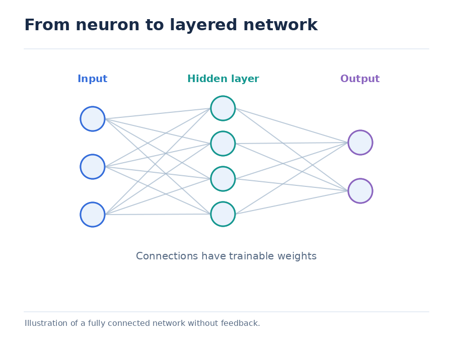
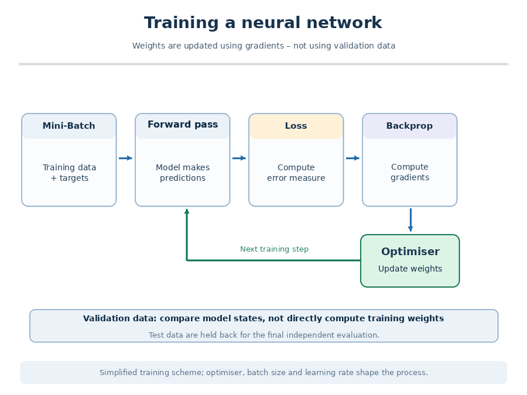

# M5-L2 – What is a neural network? {#L2}

**Course area:** M5 – Bachelor’s: AI fundamentals

**Level:** Bachelor’s

**Prior knowledge:** No fixed prerequisites specified.

## Initial question: How can a machine discover a rule from examples? {#S1}

A conventional program processes data according to explicitly formulated instructions. A photo archive might, for instance, determine whether a file belongs to a particular category using its filename or a tag assigned by the user. But what fixed rule could recognise a cat in a previously unseen photograph? Fur colour, head position, lighting and framing vary constantly. An endless list of special cases is of little help.

An **artificial neural network** is a mathematical model with many adjustable numbers that are adapted using example data. It receives inputs, calculates an output from them and compares that output with a learning objective during training. A learning procedure then changes its internal numbers so that the output fits the training examples better where possible. Ideally, it also recognises relevant patterns in unseen data. This is known as **generalisation**.

The essential point is that a neural network does *not become intelligent by itself* simply because it uses artificial neurons. It computes a function with a very large number of parameters. The task performed by that function depends on the architecture, data, training objective and application. Image recognition, language processing and prediction use similar building blocks but do not necessarily use the same overall architecture.

This lesson makes the internal computations visible. We first examine a single artificial computational unit, then two layers, and finally **one fully worked learning step**. The later lessons M5-L3–M6-L3 explain in more detail how the resulting systems are trained and developed into language models.

## ‘Neuron’ is a metaphor, not a miniature brain cell {#S2}

The historical work of McCulloch and Pitts (1943), and later of Rosenblatt and Rumelhart, Hinton and Williams, provides important starting points (see M5-L1). Nevertheless, a modern artificial neuron is not a detailed computer simulation of a biological nerve cell. Biological neurons are electrochemical, time-dependent cells with feedback connections. The computational unit discussed here essentially consists of **multiplications, additions and a mathematical activation function**.

The analogy is limited: multiple inputs influence an outcome, and the strength of their influence can be changed. This is sufficient for a useful computational model. It does not support conclusions about human consciousness, feelings or thought processes.

``` text
Biological inspiration:             Mathematical implementation:

multiple input signals               numbers x1, x2, ...
         │                                    │
         ▼                                    ▼
processing in a cell                 weighted sum + bias
         │                                    │
         ▼                                    ▼
transmitted signal                   activation function
                                              │
                                              ▼
                                         numerical output
```

The modern term **Deep Learning** refers primarily to training models with multiple processing layers. ‘Deep’ is a property of the mathematical architecture, not a claim about depth in the philosophical sense.

## The smallest calculation: Inputs, weights and bias {#S3}

Suppose that a computational unit is to determine a number from two measurements. The inputs are called `x1` and `x2`. Each has a **weight** (`w1`, `w2`) that determines its influence on the intermediate result. There is also a **bias** (`b`), an adjustable base value or offset.

The basic formula is:

$$
z=x_1\times w_1+x_2\times w_2+b
$$

For two inputs `x1 = 2` and `x2 = 3`, weights `w1 = 0,5`, `w2 = −0,2` and $b = 0{,}1$, the calculation gives:

$$
\begin{aligned}
z&=2\times0{,}5+3\times(-0{,}2)+0{,}1\\
 &=1{,}0-0{,}6+0{,}1\\
 &=0{,}5
\end{aligned}
$$

The **inputs** come from the data to be processed. The **weights and bias values** belong to the model and are changed during training. A weight can be positive or negative: for an input with the same sign, a positive weight increases the sum and a negative one decreases it. The bias allows the behaviour to be shifted without changing the input data.

Is this already learning? No. So far, only a calculation rule has been defined. It becomes a training procedure only when the parameters are deliberately changed on the basis of an error.

### What is a feature? {#31-was-ist-ein-merkmal}

A **feature** is a numerical value received by the model as input. For a simple estimate, these could be a temperature and a time of day. In images, they might be pixel values; in more complex networks, internal representations are also passed on as features.

Real input data must be prepared appropriately. A temperature of `20` and a turnover of `2.000.000` have very different orders of magnitude. Without appropriate **scaling or normalisation**, some features can make optimisation unnecessarily difficult. Preprocessing therefore belongs to the model architecture, even though it is not itself a neuron.

## Why an activation function is necessary {#S4}

The weighted sum `z` is often followed by an **activation function**. It maps the number to a new value. A common example is the **Rectified Linear Unit (ReLU)**:

$$
\begin{aligned}
\operatorname{ReLU}(z)&=\max(0,z)\\
z=1{,}5&\quad\Rightarrow\quad\operatorname{ReLU}(z)=1{,}5\\
z=-0{,}8&\quad\Rightarrow\quad\operatorname{ReLU}(z)=0\\
z=0&\quad\Rightarrow\quad\operatorname{ReLU}(z)=0
\end{aligned}
$$

ReLU lets positive values pass and sets negative ones to zero. Other functions include **sigmoid** (which returns a value between 0 and 1) and `tanh` (which returns a value between −1 and 1). The appropriate function depends on the task, layer and training procedure. Not every type of output neuron needs the same activation function as a hidden layer.

Why is a long chain of weighted sums not sufficient? Because several consecutive linear or affine calculations without an intervening nonlinearity can be combined into **a single calculation of that kind**. More layers would then provide no fundamentally greater expressive power for nonlinear relationships. The activation removes this restriction.

A famous thought experiment is the **XOR operation** (*Exclusive Or*): the output is 1 precisely when exactly one of two binary inputs is 1. A single linear decision cannot correctly separate the four cases. Several suitable computational units and nonlinear activations can represent them, however. This does not mean that a network reliably *learns* any desired rule from arbitrarily little data.

## From neurons to layers and a network {#S5}

A **layer** contains several such computational units that calculate new numbers from previous results. Typically, a distinction is made between an input layer, one or more **hidden layers** and an output layer.

{alt="Feedforward network with inputs, hidden layer and output"}


``` text
Input data                   hidden layer                       output

 x1 ───┬─────────────────> [h1: Sum + ReLU] ─────┐
       │                                        ├──> [Output neuron] → y_predicted
       └─────┐                                  │
             │                                  │
 x2 ─────────┴───────────> [h2: Sum + ReLU] ─────┘

   two features                 two neurons                   one numerical value
```

In this sketch, each of the two hidden neurons receives *both* input values; for clarity, not all connections are drawn separately. This is called a **fully connected layer** (*dense layer*). The internal layer does not necessarily correspond to a concept that humans can name, such as ‘cat’s ear’ or ‘sentence meaning’. Which intermediate patterns it actually represents is an empirical question and often difficult to interpret.

The computation from left to right is called the **forward pass**. It is the normal computational path for a prediction and also the first part of every training step.

How many adjustable numbers does our mini-network have? Each of the two hidden neurons has two weights and a bias: $2 \times  3 = 6$. The output requires two more weights and a bias: `3`. This gives a total of **nine trainable parameters**. The input values themselves are not trainable parameters.

In large models, the parameter count increases sharply. More parameters often increase representational capacity, but also memory requirements, computational cost and the risk of overfitting. The number alone says nothing reliable about the quality or understanding of a model.

## The complete numerical example – the first prediction {#S6}

We now work through *this particular network* in full. All the numbers are invented for teaching purposes; they do not come from a real trained model.

**Given:**

- Inputs: `x1 = 1`, `x2 = 2`.
- Neuron `h1`: weights `0,5` and `0,25`, bias `−0,5`.
- Neuron `h2`: weights `−0,4` and `0,6`, bias `0`.
- Both hidden neurons use ReLU.
- Output neuron: weights `0,8` for `h1` and `−0,25` for `h2`, bias `0,1`.
- The output neuron uses **no additional activation**: it returns an arbitrary real number. Our exercise is a very simple numerical prediction, not a probability estimate.
- The desired **target value** for this single example is $y = 1{,}0$.

### First hidden unit {#61-erste-verborgene-einheit}

$$
\begin{aligned}
z_1&=1\times0{,}5+2\times0{,}25-0{,}5\\
   &=0{,}5+0{,}5-0{,}5\\
   &=0{,}5\\
h_1&=\operatorname{ReLU}(0{,}5)=0{,}5
\end{aligned}
$$

### Second hidden unit {#62-zweite-verborgene-einheit}

$$
\begin{aligned}
z_2&=1\times(-0{,}4)+2\times0{,}6+0\\
   &=-0{,}4+1{,}2\\
   &=0{,}8\\
h_2&=\operatorname{ReLU}(0{,}8)=0{,}8
\end{aligned}
$$

### Output neuron {#63-ausgabeneuron}

$$
\begin{aligned}
y_{\mathrm{predicted}}&=h_1\times0{,}8+h_2\times(-0{,}25)+0{,}1\\
 &=0{,}5\times0{,}8+0{,}8\times(-0{,}25)+0{,}1\\
 &=0{,}4-0{,}2+0{,}1\\
 &=0{,}3
\end{aligned}
$$

With its current nine parameters, the network has therefore calculated the prediction **`0,3`** for the inputs `(1, 2)`. However, the target value is **`1,0`**. The model is thus `0,7` too low.

Anyone who has followed this far already knows the essential calculation involved in making a prediction: *each unit computes a weighted sum, applies an activation where appropriate and passes the result to the next layer.* A large network repeats this principle in a more elaborate form and with many specialised building blocks.

## Making an error measurable: The loss function {#S7}

During training, it is not enough to know *that* the prediction is wrong. An optimisation procedure needs a number expressing how far the result is from the objective. This is the **loss function**. For mathematical reasons, we choose half the squared deviation for our numerical prediction:

$$
\begin{aligned}
\mathrm{Loss}&=\frac12\times{(\text{Prediction}-\text{Target value})}^2\\
 &=\frac12\times{(0{,}3-1{,}0)}^2\\
 &=\frac12\times{(-0{,}7)}^2\\
 &=\frac12\times0{,}49\\
 &=0{,}245
\end{aligned}
$$

The value **`0,245`** describes only the error for our single example and our freely chosen loss function. It is not a general measure of neural network quality. Other tasks require other loss functions: classification often uses variants of **cross-entropy**, while numerical predictions often use squared or absolute errors.

A model with low training loss is not yet a good product. It might have memorised or fitted the training examples too closely and might fail on new data. Separate evaluation datasets are therefore indispensable; more on this later.

## The crucial question: Which number must we change? {#S8}

Our nine parameters influence the result in different ways. We could blindly change an arbitrary weight. However, that would be extremely inefficient, especially with millions of parameters. Instead, we calculate for every parameter **how a small change affects the error**.

Such a local rate of change is called a **derivative**. All the derivatives of the loss function with respect to the parameters together form the **gradient**. The loss function can be imagined as a landscape of elevations: the parameters determine where we stand; the gradient points locally in the direction of steepest ascent. To reduce the error, we move in the opposite direction.

This basic procedure is called **gradient descent**. The size of the step is determined by the **learning rate**. A high learning rate can lead to unstable jumps; a rate that is too low can greatly slow down training. The gradient tells us only about the local neighbourhood. It does **not** guarantee that we will find the global optimum or that every individual step will reduce the loss.

To determine the derivatives efficiently in a multilayer network, we use **backpropagation**: passing derivative information backwards through the already known computations. The mathematical tool is the **chain rule**. ‘Backwards’ refers to the *calculation of the gradients*; the input data or information do not run backwards as in a film.

## Backpropagation in full, without missing calculations {#S9}

We use exactly the parameters and intermediate values from Section 6. The loss function is still $L=\frac12\times{(\hat y-y)}^2$. At the output, the derivative of the loss with respect to the prediction is:

$$
\frac{\mathrm{d}L}{\mathrm{d}\hat y}=\hat y-y=0{,}3-1{,}0=-0{,}7
$$

The symbol `dL/dŷ` means: how does the loss change when the prediction changes slightly? The minus sign here indicates that a larger prediction would initially reduce the error.

### The three parameters of the output layer {#91-die-drei-parameter-der-ausgabeschicht}

The output is calculated from $\hat y=0{,}8\times h_1-0{,}25\times h_2+0{,}1$. Applying the chain rule yields:

$$
\begin{aligned}
\text{Derivative with respect to output weight 1:}\quad
 \frac{\mathrm{d}L}{\mathrm{d}w_{\mathrm{out1}}}
 &=(-0{,}7)\times h_1=(-0{,}7)\times0{,}5=-0{,}35\\
\text{Derivative with respect to output weight 2:}\quad
 \frac{\mathrm{d}L}{\mathrm{d}w_{\mathrm{out2}}}
 &=(-0{,}7)\times h_2=(-0{,}7)\times0{,}8=-0{,}56\\
\text{Derivative with respect to output bias:}\quad
 \frac{\mathrm{d}L}{\mathrm{d}b_{\mathrm{out}}}
 &=-0{,}7
\end{aligned}
$$

A negative gradient means that if we *increase* the parameter slightly, the loss initially decreases. Gradient descent therefore subtracts a negative value, making the number larger.

### What happens to the hidden units? {#92-was-passiert-mit-den-verborgenen-einheiten}

The error is now propagated backwards through the connections. For `h1`, this gives:

$$
\frac{\mathrm{d}L}{\mathrm{d}h_1}=(-0{,}7)\times0{,}8=-0{,}56
$$

For `h2`, the negative output weight gives:

$$
\frac{\mathrm{d}L}{\mathrm{d}h_2}=(-0{,}7)\times(-0{,}25)=+0{,}175
$$

The activation of both hidden neurons was positive (`0,5` and `0,8`). The derivative of ReLU in the positive range is **1**. The information can therefore be propagated backwards here without any additional change. If the respective preactivation were negative, the ReLU derivative would be **0**, and no gradient would return through that unit for the example considered. This very difference explains part of the difficulty of training deep networks.

For `h1` with inputs `(1, 2)`, we now obtain:

$$
\begin{aligned}
\frac{\mathrm{d}L}{\mathrm{d}w_{\mathrm{h1x1}}}&=-0{,}56\times1=-0{,}56\\
\frac{\mathrm{d}L}{\mathrm{d}w_{\mathrm{h1x2}}}&=-0{,}56\times2=-1{,}12\\
\frac{\mathrm{d}L}{\mathrm{d}b_{\mathrm{h1}}}&=-0{,}56
\end{aligned}
$$

For `h2`:

$$
\begin{aligned}
\frac{\mathrm{d}L}{\mathrm{d}w_{\mathrm{h2x1}}}&=+0{,}175\times1=+0{,}175\\
\frac{\mathrm{d}L}{\mathrm{d}w_{\mathrm{h2x2}}}&=+0{,}175\times2=+0{,}350\\
\frac{\mathrm{d}L}{\mathrm{d}b_{\mathrm{h2}}}&=+0{,}175
\end{aligned}
$$

The gradients of **all nine parameters** are now known. We have neither ‘guessed’ feedback nor simply transferred the sign of the error to every weight. The calculation takes account of each parameter's particular path to the output.

### One learning rate, nine simultaneous changes {#93-eine-lernrate-neun-gleichzeitige-änderungen}

We choose the learning rate `0,1`. The update rule for each parameter is:

$$
\text{new parameter}=\text{old parameter}-0{,}1\times\text{its gradient}
$$

Important: all nine gradients were calculated using **the same old parameter values**. Only afterwards are the new values set. In this example, already updated output weights must not be inserted into the previously calculated gradients of the hidden layer.

| Parameter | Before | Gradient | After |
| --- | --- | --- | --- |
| Weight `x1 → h1` | `0,5000` | `−0,5600` | `0,5560` |
| Weight `x2 → h1` | `0,2500` | `−1,1200` | `0,3620` |
| Bias `h1` | `−0,5000` | `−0,5600` | `−0,4440` |
| Weight `x1 → h2` | `−0,4000` | `+0,1750` | `−0,4175` |
| Weight `x2 → h2` | `0,6000` | `+0,3500` | `0,5650` |
| Bias `h2` | `0,0000` | `+0,1750` | `−0,0175` |
| Weight `h1 → output` | `0,8000` | `−0,3500` | `0,8350` |
| Weight `h2 → output` | `−0,2500` | `−0,5600` | `−0,1940` |
| Output bias | `0,1000` | `−0,7000` | `0,1700` |

This completes **one entire training step**. Real training consists of many such steps over many examples, not a single pair of numbers.

## Checking: Is the prediction better now? {#S10}

Let us insert the nine updated values, again with the **same** inputs `(1, 2)`:

$$
\begin{aligned}
h_{1,\mathrm{new}}&=\operatorname{ReLU}(1\times0{,}556+2\times0{,}362-0{,}444)\\
 &=\operatorname{ReLU}(0{,}836)=0{,}836\\
h_{2,\mathrm{new}}&=\operatorname{ReLU}(1\times(-0{,}4175)+2\times0{,}565-0{,}0175)\\
 &=\operatorname{ReLU}(0{,}695)=0{,}695\\
\hat y_{\mathrm{new}}&=0{,}836\times0{,}835+0{,}695\times(-0{,}194)+0{,}170\\
 &=0{,}69806-0{,}13483+0{,}170\\
 &=0{,}73323
\end{aligned}
$$

The new loss is:

$$
\begin{aligned}
L_{\mathrm{new}}&=\frac12\times{(0{,}73323-1{,}0)}^2\\
 &=\frac12\times{(-0{,}26677)}^2\\
 &\approx0{,}03558
\end{aligned}
$$

| State | Prediction | Target | Loss |
| --- | --- | --- | --- |
| Before the step | `0,30000` | `1,00000` | `0,24500` |
| After the step | `0,73323` | `1,00000` | $\approx  0{,}03558$ |

**The error for this single example has decreased.** This demonstrates the mechanism, but proves neither general learning ability nor good predictions for unseen cases. We used one example and adjusted nine parameters to it; a model could easily become tailored to this particular example. With an unsuitable learning rate, another training step might even increase the error. The numbers were independently checked arithmetically.

The most important result of this lesson is this: **training means repeatedly and systematically changing model parameters on the basis of the measured error, not a program rewriting its own rules as text.**

## From a single example to a realistic training process {#S11}

A useful network receives not just one data point, but numerous examples. A typical procedure looks like this in simplified form:

``` text
Training examples
      │
      ▼
Preprocessing / feature representation
      │
      ▼
Forward pass: current weights produce predictions
      │
      ▼
Loss: comparison with learning objectives
      │
      ▼
Backpropagation: derivatives for model parameters
      │
      ▼
Optimiser: update weights and bias values
      │
      └────────────── repeat ───────────────────┐
                                                 │
               Validation / tests <─────────────┘
```



*Figure: Simplified training cycle: a mini-batch produces prediction errors, which yield gradients, and an optimiser changes the weights for later steps. Validation data are used for model selection, not direct gradient calculation; test data are held out.*

In **stochastic gradient descent** (SGD), the model parameters are updated using small subsets of the training data. Such a subset is called a **mini-batch**; the number of examples it contains is the **batch size**. A complete pass through the intended training dataset is called an **epoch**. In **batch gradient descent**, by contrast, the entire training set would be used for a step. In everyday usage, these methods are not always strictly distinguished in terminology.

An **optimiser** is the method used to adjust parameters on the basis of gradients. Simple gradient descent is the basic model; methods such as Adam use additional information from earlier gradients. These are not magical learning methods: they can facilitate optimisation, but they do not eliminate poor data or incorrect learning objectives.

The weights are usually **initialised** appropriately first. If they all start at the same value, symmetric neurons may learn the same patterns and fail to use their additional capacity. Suitable random initialisation and the scaling of activations are therefore practical components of modern network architectures.

### Parameters and hyperparameters {#111-parameter-und-hyperparameter}

**Parameters** are the numbers changed during training, such as the nine weights and bias values in the example. **Hyperparameters** are settings of the training procedure or architecture: learning rate, number of layers, batch size or regularisation strength. They are not learned by the same simple gradient descent applied to the model weights, but are determined through selection, search or higher-level optimisation procedures.

### Training is not inference {#112-training-ist-nicht-inferenz}

After training, the model is usually used for **inference**, that is, applying it to new data. An input passes through the learned layers and produces an output; the weights usually remain unchanged for that individual application. Classifying a photo is inference; adapting the network using photos is training. In certain systems, later adaptation or learning during operation is possible, but it is not automatically part of every normal invocation.

## Generalisation: Doing more than matching training examples {#S12}

The central question is: **what happens when new data look different from previous data?** A network can fit its training data very well and nevertheless perform poorly in the outside world. There are two classical categories of causes.

**Overfitting:** The model also learns random peculiarities of the training data that do not apply to new cases. One example would be a cat-image model that inadvertently uses the colour of the background rather than features of the cat.

**Underfitting:** The model is too simple, inadequately trained or equipped with insufficient features to capture even the basic relationships in its training data. A purely linear network, for instance, is fundamentally unable to solve some nonlinear tasks.

| Observation | Possible interpretation | What to check initially |
| --- | --- | --- |
| Training and validation errors high | Underfitting or difficult data | Features, architecture, training, measurement errors |
| Training error low, validation error much higher | Overfitting or distribution differences | Data splitting, leakage, model complexity |
| Both errors low and stable | Encouraging, but not conclusive proof | Representativeness, new data, edge cases |

### Three separate data roles {#121-drei-getrennte-datenrollen}

A sound development process conceptually separates the data:

- **Training data** are used to calculate gradients and adjust model parameters.
- **Validation data** help with architecture and hyperparameter decisions, monitoring training and selecting among model versions.
- **Test data** are preferably used only at the end for an independent evaluation on previously unused examples.

This split is not a mere formality. If the same almost identical photos appear in training and testing, test performance looks too good. With time-dependent data, random shuffling can leak information about the future into the past. In medical data, several measurements of the same person might appear in different subsets. This is generally called **data leakage**. How data should be split therefore depends on the intended use.

A test dataset does not guarantee the same quality permanently either. When the real environment changes – a different camera, different user behaviour, a new language, new data sources – this is called **distribution shift**. Models must then be monitored again and adapted if necessary.

### How overfitting can be reduced {#122-wie-überanpassung-reduziert-werden-kann}

Approaches include more informative and diverse data, appropriately small models, ending training early (*early stopping*) and **regularisation**. These are procedures intended to prevent the model from adapting its parameters arbitrarily strongly to individual training cases. Examples include weight regularisation and **dropout**, temporarily and randomly masking certain activations during training. These methods do not automatically improve every model; their effectiveness must be assessed using suitable validation data.

## Why are there different network architectures? {#S13}

Our example is a **feedforward network**: information is passed from inputs to outputs in the computation shown. It is suitable as a basis for structured numerical values and many other tasks. Other types of data bring different requirements.

### Convolutional Neural Networks (CNN) {#131-convolutional-neural-networks-cnn}

A **Convolutional Neural Network**, or CNN, often processes spatially structured data using **convolutions**. The same small trainable filter weights are applied at many positions in an image. This is known as **weight sharing**. Compared with fully connected processing of all image positions, it reduces the number of independent weights and exploits the spatial proximity of neighbouring pixels.

``` text
Image (pixel grid)
      │
      ▼
small filter examines different regions in succession
      │
      ▼
feature maps
      │
      ▼
further processing → classification / recognition
```

A CNN has no built-in complete concept of objects. It learns filters whose later combinations can be useful for the task. Historically, CNNs were particularly important for modern image recognition; not every contemporary image model uses this architecture.

### Recurrent neural networks (RNN) {#132-rekurrente-neuronale-netze-rnn}

A **Recurrent Neural Network** (RNN) has a state that feeds into the next step when processing a sequence of elements. This was an important approach for text, speech and time series for a long time. **Long Short-Term Memory (LSTM)** is a well-known extension designed to mitigate certain difficulties with longer-term dependencies.

``` text
Word 1 → [Network state] → Word 2 → [Network state] → Word 3
              │                          │
              └────── information ───────┘
```

This sketch greatly simplifies the recurrent principle. For longer sequences, gradients can become unstable or too small; in addition, the step-by-step dependency makes certain kinds of parallel computation more difficult. These are among the reasons why transformers became particularly important for many language tasks. However, they do not replace every recurrent architecture in every application area.

### Transformers as a later advanced topic {#133-transformer-als-spätere-vertiefung}

A **transformer** processes relationships between input elements with the help of **attention**, among other mechanisms (a mathematical weighting of relationships). It likewise consists of many trainable computational steps, including linear transformations and nonlinear processing units. The principle from our example – parameters, forward pass, loss, gradients and updates – remains the same. Only the architecture and computational paths become more complex. Details follow in M6-L1.

## Why graphics cards often help – and where their limits are {#S14}

The calculation performed by an individual neuron is simple. A large network, however, performs a very large number of multiplications and additions. Many can be grouped into **matrix operations**: instead of computing each connection individually, a numerical library processes entire arrays together.

A **Central Processing Unit (CPU)**, the general-purpose main processing unit, can perform such tasks. A **Graphics Processing Unit (GPU)**, originally designed primarily for graphics calculations, has many parallel processing units and can often carry out suitable matrix operations particularly efficiently. The actual benefit depends on model size, memory access, parallelisability and hardware. A GPU is not a prerequisite for the principle of a neural network to work.

Available working memory and, in GPUs, **video memory (VRAM, Video Random Access Memory)** limit which models and batch sizes can reasonably be executed. Training typically requires extra memory for intermediate values, gradients and optimiser states. It can therefore be considerably more expensive than subsequent inference using the same model.

Not all time is spent on mathematical operations: reading data, transferring them between the processor and graphics memory and communicating between several computers can limit speed. A larger GPU cluster is therefore not automatically more economical than a single suitable computer.

## Three real-world use cases – and when a neural network is unnecessary {#S15}

### Local photo archive {#151-lokales-fotoarchiv}

A user wants to sort photographs by subject. A previously trained network can translate image content into classes or features. **Inference** takes place on the local computer; the network does not necessarily need internet access to sort the photographs. Where the image data remain, however, depends on the application actually used.

``` text
Local image folder → preprocessing → trained image model
                                            │
                                            ▼
                                     features / suggestions
                                            │
                                            ▼
                                     local search and correction
```

**Benefit:** Search can work without manually maintained tags. **Limitation:** The model may confuse subjects, misclassify people or rare objects, and understand data from a different image domain less well. **Costs:** One-off hardware investment, electricity, storage and model updates; possibly licence terms of the model used. **Alternative:** For filenames, EXIF data and explicitly assigned tags, an ordinary database query is often sufficient.

### Small online analytical service {#152-kleiner-online-analysedienst}

An online service is to detect unusual measurements. A neural network could learn complex patterns. However, it needs sufficiently reliable examples, a suitable error measure, good tests and monitoring for false alarms. With manageable datasets, simple statistical thresholds or robust rules can be just as useful and considerably easier to explain.

``` text
Customer → HTTPS/API → validation and normalisation → model → result
                                                        │
                                                        ▼
                                                  logging / monitoring
```

**Operational implications:** Authentication, input retention periods, data protection, model versions, feedback on erroneous decisions and cost per request. Computational load and response time must match the service purchased. When a model is updated, earlier decisions cannot simply be assumed to remain reproducible in the same way; appropriate versioning and documentation help.

### Extensive language or media processing {#153-umfangreiche-sprach--oder-medienverarbeitung}

A more complex service combines several models: first language or image analysis, then classification and finally text output if required. Not every stage has to consist of a large neural network. A rule-based checking step, for example, can reject certain disallowed file formats at much lower cost.

``` text
Job → queue → preliminary check → model A → model B → result storage
        │                            │         │
        └── status/retry             └── measurement of errors and runtimes
```

The concepts from M4-L1 (workers and queues), M4-L2 (monitoring) and M4-L3 (security and data protection) become relevant here. Repeated jobs need unique identifiers; model errors must not be confused with transport errors. **Costs:** Computing time, GPU availability, data transfer, storage, model operation and domain-specific quality control. It is entirely possible to start with an external model API rather than build one's own training infrastructure; this, however, raises contractual, data protection and dependency issues.

## Limitations, risks and responsibility {#S16}

A neural network represents patterns from training data and the training objective. This is both a strength and a limitation.

**Data quality:** Incorrect labels, incomplete data or one-sided examples can distort predictions. A mathematically correct training process does not guarantee a fair or technically correct decision. For sensitive applications, the question of *which* data may be used is just as important as the computational procedure.

**Explainability:** Even if every individual computational step can be traced mathematically, the significance of millions of interacting parameters may be difficult to interpret. ‘The model returned a high numerical value’ is not yet a sound justification for a credit decision or a medical assessment.

**Security:** Input data can be deliberately manipulated. Publicly accessible services additionally face abusive requests and attacks designed to increase costs. Data protection and the ability to delete data must be considered when training data are collected and stored. In particular, training data must not enter freely accessible logs or external services without checks.

**Maintenance:** The model can lose quality as a result of new data or changing conditions. Suitable performance measurements, model and dataset versions, alerting and re-evaluation if necessary are therefore important. Models require not only computing power during training but also a sustainable operating plan.

**Cost-effectiveness:** A neural network is not automatically the best or cheapest solution. If a problem can be reliably solved with an SQL filter, a regular expression, a clearly defined business rule or a simple statistical model, an AI component may only generate higher costs, additional ways to fail and more maintenance.

## The basic terms at a glance {#S17}

| Term | Meaning in one sentence |
| --- | --- |
| Neuron | Computational unit that weights inputs and produces an output value |
| Weight | Trainable influence of an input |
| Bias | Trainable offset in a computational unit |
| Activation function | Often nonlinear transformation of a neuron's result |
| Layer | Group of computational units at one processing stage |
| Parameter | Model number adjusted through training |
| Forward pass | Calculation from inputs to prediction |
| Loss | Number measuring the error according to the chosen task |
| Gradient | Local derivatives of the loss with respect to the parameters |
| Backpropagation | Efficient backward calculation of these derivatives |
| Learning rate | Step size of parameter updates |
| Inference | Applying learned parameters to an input |
| Generalisation | Useful performance on previously unseen data |

## Conclusion and transition to M5-L3 {#S18}

A neural network is a **composed, trainable mathematical function**. Using inputs, weights, bias values and activation functions, it calculates an output in the forward pass. During training, this is compared with a learning objective. Backpropagation calculates how the parameters influence the error; an optimiser adjusts the numbers. Our fully worked example shows that an error of `0,245` *can* fall to about `0,03558` after a single learning step – without proving good performance on new examples.

The procedure explains the core of many modern AI models. But it does not yet explain **where suitable learning examples come from, what kinds of learning objectives exist or why a language model can be trained without explicitly labelled sentences**. The next lesson builds on this: **M5-L3 – How machines learn**. It covers supervised, unsupervised, self-supervised and reinforcement learning, as well as training data and evaluation.


## Sources {#S19}


**Technical sources checked on 04.11.2026.** The numbers worked out in full here are independently chosen teaching values, not external performance figures. The following sources explain the basic architecture, as well as training and generalisation procedures; examples from manufacturers are not used as evidence for general performance claims.

1. [Rumelhart / Hinton / Williams (1986) – Learning representations by back-propagating errors](https://www.cs.toronto.edu/~hinton/absps/naturebp.pdf) · p. 533: weight updates and internal representations; scan of the original publication on Hinton’s university page, Nature 323, 533–536, DOI 10.1038/323533a0 · Last accessed: 2026-11-25
2.  [Google, Machine Learning Crash Course – ‘Neural networks: Nodes and hidden layers’](https://developers.google.com/machine-learning/crash-course/neural-networks/nodes-hidden-layers) · Simple network nodes, weights, bias, hidden layers and linear limitations · Last accessed: 2026-11-22
3.  [Google, Machine Learning Crash Course – ‘Neural networks: Activation functions’](https://developers.google.com/machine-learning/crash-course/neural-networks/activation-functions) · Nonlinearity, sigmoid and ReLU · Last accessed: 2026-11-22
4.  [Google, Machine Learning Crash Course – ‘Neural Networks: Training using backpropagation’](https://developers.google.com/machine-learning/crash-course/neural-networks/backpropagation) · Gradient calculation, vanishing/exploding gradients, ReLU and dropout · Last accessed: 2026-11-22
5.  [PyTorch, ‘Build the Neural Network’](https://docs.pytorch.org/tutorials/beginner/basics/buildmodel_tutorial) · Layers, parameter matrices, forward processing and outputs · Last accessed: 2026-11-22
6.  [PyTorch, ‘Automatic Differentiation with torch.autograd’](https://docs.pytorch.org/tutorials/beginner/basics/autogradqs_tutorial.html) · Computational graphs and automatic differentiation for gradients · Last accessed: 2026-11-22
7.  [Google, Machine Learning Crash Course – ‘Overfitting’](https://developers.google.com/machine-learning/crash-course/overfitting/overfitting) · Training/validation error and the limits of generalisation · Last accessed: 2026-11-22
8.  [TensorFlow, ‘Overfit and underfit’](https://www.tensorflow.org/tutorials/keras/overfit_and_underfit) · Underfitting, overfitting and regularisation · Last accessed: 2026-11-22

The basic arithmetic in Sections 6–10 was independently checked. The teaching text and architecture drawings were independently produced; the archive contains no third-party images or training datasets.
