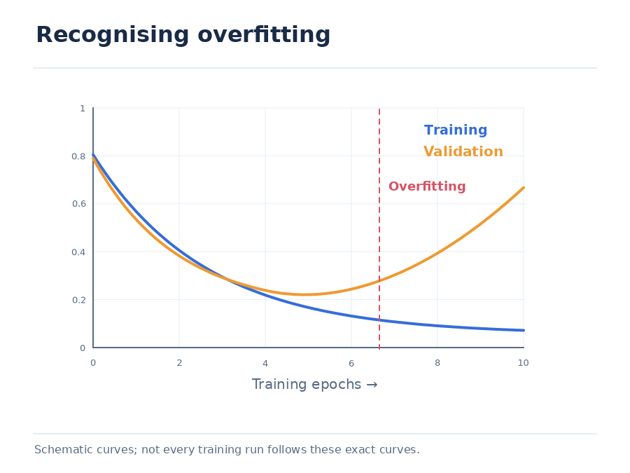
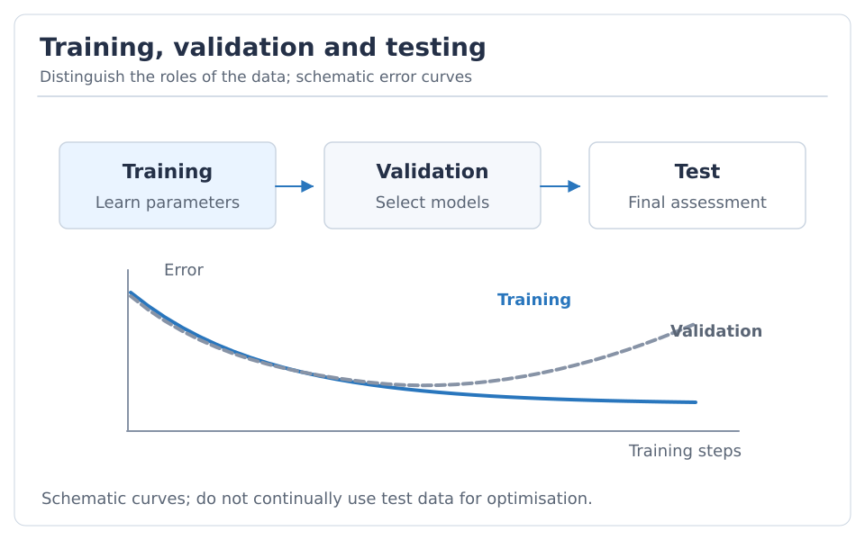

# M5-L3 – How machines learn {#L3}

**Course area:** M5 – Bachelor’s: AI fundamentals

**Level:** Bachelor’s

**Prior knowledge:** No fixed prerequisites specified.

## A new question after M5-L2: Who tells the network what to learn? {#S1}

M5-L2 showed how a neural network processes numbers and how the error in a prediction feeds back into its weights. An example training step reduced a loss value. But this has not yet explained **where the correct result comes from** against which the network is compared. Does someone have to label every single image by hand? Can a model learn something without such labels? And how does a system learn when it is supposed not only to classify images but also to choose actions?

These are questions about the **learning task**, not simply about the structure of the network. *Machine learning*, or **ML**, encompasses methods that obtain patterns, relationships or action strategies from data and feedback instead of programming every decision rule directly. A neural network is one possible model family. There are also decision trees, linear models, nearest-neighbour methods and other techniques. Not every ML procedure requires deep learning.

The central distinction is as follows:

- In **supervised learning**, a specified target result is known for the learning examples.
- In **unsupervised learning**, we look for structures without such target labels.
- In **self-supervised learning**, learning targets are generated from the available data themselves.
- In **reinforcement learning**, the consequences of actions are evaluated through reward signals.

This classification describes **types of learning signals**. It is not a list of necessarily separate products. A large AI system can use multiple methods in succession or in combination.

## Conventional programming rules versus learned relationships {#S2}

A traditional application can decide: ‘If the file extension is `.jpg`, treat the file as an image.’ This is an explicitly programmed rule. Another task is: ‘Which images show a dog?’ Size, colours and shape are insufficient on their own. Learning from examples may be useful here.

``` text
Conventional rule:
Input → fixed rule formulated by a human → output

Learned model:
Training data → learning procedure → model parameters
                                         │
New input ───────────────────────────────┤
                                         ▼
                                 prediction/decision
```

In learning, the **model parameters** are the adjusted numbers, such as the weights of a network. During subsequent use, these parameters are usually not changed with every request. Applying a trained model is called **inference**. An image recognition program can therefore classify a thousand photos in succession without automatically learning from them. A chat with a language model is likewise not equivalent to retraining its weights. The differences are discussed in detail in M6-L2.

ML is particularly attractive when there are many variations that are difficult to capture using explicit rules. It is not, however, automatically better for deterministic calculations. The VAT rule of a clearly defined billing system normally belongs in understandable application code, not in a statistical prediction model.

## What a learning dataset consists of: Examples, features, labels {#S3}

A **dataset** is initially just an organised collection of observations: measurements, images, texts, audio recordings, events or numbers that have already been processed. A **training example** is a unit processed by a learning procedure, such as a photo with accompanying information or a single row in a table.

The descriptive inputs are called **features**. For the price of a used car, these might be age, mileage and model. The desired result is called the **target value** or **label**, for example, the actual sale price achieved. A label need not be a category: a number, a text passage or a measured event can also serve as a learning target.

| Example | Features | Possible target |
| --- | --- | --- |
| Used car | Year of manufacture, mileage, model | Sale price |
| Email | Content, sender features | ‘Spam’ or ‘not spam’ |
| Photo | Pixels, image region | ‘Dog’, ‘cat’, ‘other’ |
| Production plant | Sensor readings over the last few minutes | Fault in the next time window |

Rows in a table are not meaningful training data simply because there are many of them. They can contain measurement errors, duplicates, chance relationships or biased samples of reality. A common misconception is already apparent here: **more data do not automatically mean better data.**

For language models there is an additional term: a **token** is a unit into which a tokeniser breaks down text. It may be a word, part of a word, a punctuation mark or another sequence of characters. Tokens are not semantic labels assigned by humans. They serve as a computational representation and, depending on the learning objective, also as prediction targets. Tokenisation is discussed in detail in M6-L1.

## Supervised learning: Practising with examples that have known answers {#S4}

**Supervised learning** uses inputs with associated target values. The system is to learn a relationship that can also be applied to new, previously unseen inputs.

``` text
Training example A: Photo A + label "cat" ─┐
Training example B: Photo B + label "dog" ──┼→ model training
Training example C: Photo C + label "dog" ──┘       │
                                                    ▼
                                             learned parameters
                                                    │
New photo (without known label) ────────────────────┘
                                                    ▼
                                             predicted class
```

The two common basic tasks are **classification** and **regression**. Classification chooses a category or estimates probabilities for categories: is an email spam? Does an image belong to ‘dog’ or ‘cat’? Regression estimates a numerical value: what temperature is expected? Approximately how high is consumption?

During training, the prediction is compared with the known target. A **loss function** expresses the deviation as a number. Depending on the model and optimisation procedure, the parameters are adjusted so that this loss decreases on training data. The computational idea from M5-L2 – forward pass, error, gradients, parameter changes – applies directly here. However, not every supervised ML method uses backpropagation.

**Where do labels come from?** They can be assigned by humans, come from measurements, be derived from reliable business processes or be generated automatically using rules. Their origin is crucial. If two people assess the same recording differently, this is not a problem a network can simply make disappear. The model also learns the ambiguities and inconsistencies in those labels.

A well-fitting model recognises statistical patterns. It does not prove that its categories are philosophically unambiguous or that its decisions are causally correct. A high value in a general test table is therefore not sufficient for medical, legal or safety-critical applications.

## Unsupervised learning: Structure without predefined target classes {#S5}

In **unsupervised learning**, no separately supplied target value exists for each example. We look for recurring structures, similarities, groups or compact representations.

An illustrative case is a music archive containing tracks for which no genre labels are stored. Tempo, acoustic features and other properties might allow groups of similar tracks to be formed. A common method for this is **clustering**, the algorithmic formation of groups.

``` text
Many tracks with features
        │
        ▼
Define a similarity measure
        │
        ▼
Clustering procedure
        │
        ├── Group A: similar feature profiles
        ├── Group B: different feature profiles
        └── Group C: other similarities
```

In the familiar **k-means method**, a number `k` of groups is specified. The procedure assigns points according to their proximity to group centres and repeatedly adjusts these centres. This works only within the framework of the chosen distance measure, feature representation and assumptions of the method. A group is not automatically a musically ‘true’ genre. A poorly chosen feature can distort the grouping: files with the same bit rate might be close together even though they have little in common musically.

Other unsupervised applications include **dimensionality reduction** – replacing a large number of features with fewer summarising numbers – and exploring unusual patterns. Not all anomaly detection is unsupervised; some methods are trained specifically using labelled failure cases.

Unsupervised learning has an important limitation: without predefined target categories, a discovered grouping cannot simply be rated as ‘95 per cent correct’. We examine the quality, stability, domain plausibility and usefulness of the groups for the actual purpose. *Unsupervised* therefore does not mean *without evaluation*.

## Self-supervised learning: When the data themselves provide training questions {#S6}

For many tasks, human labelling of all examples would be unaffordable. Large quantities of text, for example, are available without tables specifying a desired answer for every sentence. Nevertheless, they contain a natural structure: words and tokens occur in an order and in context.

**Self-supervised learning** uses this structure to derive learning objectives **from the data themselves**. It is a form of learning without external labels specified by humans for every instance of the task. ‘Self’ does not mean that the model freely chooses its own objectives: developers define the training task.

A simple example is predicting masked parts of a text:

``` text
Original:       "The little dog sleeps in the garden."
Training text:  "The little [MASKED] sleeps in the garden."
Learning target: predict the original masked token
```

The answer comes from the original text, not from a separately created label. This idea is used, among other things, in **masked language modelling**. The research model **BERT** made pretrained text representations using masked tokens an important approach.

Another common training objective is predicting the **next token** in a sequence:

``` text
Observed sequence: "The little dog"
Desired target:    next token in the original sequence
```

Given the large number of possible continuations, the task can be demanding. The model is therefore forced to learn many linguistic regularities. However, it does not automatically learn which statement is true in the outside world. A statistically plausible sentence can be factually incorrect. This is precisely why token prediction must not be equated with verified factual knowledge.

Self-supervised methods are not limited to language. Image models can reconstruct parts of an image or learn comparable representations from differently modified views of the same image. In audio and video, learning signals can also be formed from sequences or partially masked content. The particular training objective determines which properties the representation preferentially captures.

## Reinforcement learning: Acting and learning from consequences {#S7}

So far, the training examples have essentially been predetermined data. In **reinforcement learning** (**RL**), an acting system influences its next observation through its own actions. An **agent** selects an **action** in an **environment**. A new state or observation and a **reward** follow.

``` text
            ┌───────────────────────┐
            │ Agent                 │
            │ Strategy / policy     │
            └───────────┬───────────┘
                        │ action
                        ▼
            ┌───────────────────────┐
            │ Environment           │
            │ e.g. game/simulation  │
            └───────────┬───────────┘
                        │ observation + reward
                        └───────────────────► Agent
```

The **policy** is the action strategy: which action should be selected in an observed situation? The objective is typically not just the reward of the next step, but a good **cumulative reward** over a sequence of steps. Sometimes it is worth sacrificing a short-term advantage to achieve a better result later.

**Exploration** means also trying actions that are not yet well known. **Exploitation** means choosing an action that has been promising so far. A system that exclusively repeats familiar actions may fail to learn a better strategy; a system that only experiments may act inefficiently or dangerously.

Example: A simulated warehouse vehicle receives points for correctly reached destinations and penalties for unnecessary journeys. It can test different routes. But a poorly formulated reward can lead to absurd strategies. If points are awarded only for ‘as many journeys as possible’, it might generate unnecessary trips. This phenomenon is called **reward hacking**: the system optimises the measurement signal rather than the intended objective.

In real robotics, uncontrolled experimentation involves physical risk. Developers therefore use simulation, safety rules, intervention limits and conventional control engineering. Reinforcement learning is not a licence for a language model to issue dangerous motor commands directly. The division of tasks between AI and safety-critical control follows in M6-L7.

## Transfer learning: Bringing prior knowledge to a new task {#S8}

In **transfer learning**, capabilities or representations from an earlier learning phase are used for a new task. An already trained image model can, for example, serve as the starting point for recognising particular machine parts. It is then not necessarily necessary to learn every visual structure from scratch.

**Pretraining** produces more generally reusable parameters. **Fine-tuning** adapts an existing model using further training data for a narrower purpose. Depending on the procedure, all weights, only selected weights or additional small groups of parameters are adjusted.

``` text
Broad initial dataset
           │
           ▼
    general pretraining
           │
           ▼
    existing base model
           │
   additional suitable examples
           ▼
         fine-tuning
           │
           ▼
    model for a narrower purpose
```

Transfer learning is no guarantee: a model pretrained on ordinary daylight images may be unsuitable for thermal images, medical imaging or substantially different production environments. It can inherit unwanted biases from the source domain. And it differs from mere **prompting**: a new question or instruction does not itself change the stored model weights. These differences are examined systematically in M6-L3.

## Why embeddings play a central role {#S9}

Machines cannot directly process words, images or customers as ‘meaning’. They need a numerical representation. One simple representation of a category uses a separate position for every possible entry: **one-hot encoding**. With very many categories, such vectors become large and sparse; moreover, they express no proximity between similar concepts.

An **embedding** is a learned or otherwise computed representation as a numerical vector in an often more compact space. The vector can capture properties that are useful for the training objective. A greatly simplified, explicitly invented representation is:

``` text
"cat"   → [0,8;  0,3; -0,1]
"dog"   → [0,7;  0,2; -0,2]
"table" → [-0,4; 0,9;  0,6]
```

The three values are **not real model values and not a fixed standard of meaning**. In real models, vectors can have many dimensions. Under a particular model and training definition, their distance or angle may express something about similarity. This is useful for search systems, recommendations and later retrieval-augmented generation (RAG) systems.

Three limitations are important. First, ‘similarity’ depends on the learning objective: the German word ‘Bank’ can mean a financial institution or a bench. Second, a suitable vector does not itself produce a reliable logical conclusion. Third, embeddings can contain sensitive attributes or allow sensitive inferences; storing them is not automatically harmless. M6-L1 shows how token embeddings become transformer inputs, and M6-L4 explains their role in document search.

## The training process: Not one example, but many passes {#S10}

Typical training starts long before the first weight change. Data must be selected, prepared, checked and converted into a numerical space suitable for the model. In supervised learning, repeated comparisons with target values follow.

``` text
Data sources
    │
    ▼
Check rights, quality and purpose
    │
    ▼
Separate training, validation and test data appropriately
    │
    ▼
Prepare features/tokens
    │
    ▼
Model training on training data
    │
    ├─ prediction
    ├─ calculate loss
    ├─ adjust parameters
    └─ next examples
    │
    ▼
Model selection using validation data
    │
    ▼
Final test on untouched test data
    │
    ▼
Operation, monitoring and retraining if necessary
```

In neural networks, examples are frequently processed in **mini-batches**: groups of multiple examples from which an optimisation step is calculated. An **epoch** usually means that the examples designated for a training round have been processed once. Not every training setup is epoch-based; other counting methods are common with continuous data streams or very large text collections.

An **optimiser** chooses how weights are changed on the basis of the error. The **learning rate** influences the step size. **Hyperparameters** are settings of the learning procedure or architecture – for example, learning rate, batch size or number of layers – and in ordinary training are not themselves learned in the same way as the model weights.

Example with freely chosen numbers: with 1,000 training examples and a batch size of 100, ten batches would be needed for a complete pass, provided no special remainder or omission of examples has to be taken into account. Five such epochs would correspond to 50 batch passes. This is a **numerical illustration**, not a recommendation for a particular model. Large models may use completely different data volumes, batch definitions and training schedules.

## Why training, validation and test data are separated {#S11}

Good training performance does not prove that the model can handle new situations. A person can memorise an examination answer and still not master the subject. Similarly, a model can reproduce many training examples without responding usefully to new data. We therefore distinguish between:

{alt="Training and validation error in possible overfitting"}


{alt="Three separate datasets for training, model selection and final evaluation, with schematic training and validation error curves below."}

Training, validation and testing have different roles; the error curves are schematic.

- **Training data:** Used to learn parameters.
- **Validation data:** Used to compare variants and hyperparameters during development.
- **Test data:** Preferably left untouched until the final evaluation.

An often illustrated split is 70/15/15; it is **not a law of nature or a general requirement**. An appropriate split depends on data volume, time dependencies, rare events and the actual application.

A photo archive may contain twenty almost identical photos of the same animal. If fifteen enter training and five enter testing, the evaluation may mainly measure recognition of that photo series. For recognising unfamiliar animals, it would be better not to distribute related image series or animals across both datasets. In time series, a test period from the future should often not be mixed with information that was not yet available at the time of an earlier prediction.

This problem is called **data leakage**: information from the subsequent test or from the future inadvertently enters training or selection. Even normalisation that calculates its mean from *all* examples, including the test, can already leak information. The same applies if, after observing a disappointing test result, improvements are made until the test looks good. The supposedly independent test has then effectively become part of development.

**Generalisation** means that a model works reliably on new examples from the intended application domain. This must be demonstrated with realistically separated data; it does not follow automatically from model size or low training error.

## A numerical example: Why 99 per cent accuracy can be misleading {#S12}

Suppose a service must identify the ten genuinely fraudulent cases among 1,000 fictional transactions. A completely useless system that reports everything as non-suspicious is **correct 990 times**, giving **99 per cent accuracy**. However, it detects **not a single case of fraud**.

Now consider another, also entirely invented model:

| Actual case | Model reports ‘fraud’ | Model reports ‘no fraud’ |
| --- | --- | --- |
| Fraud (10 cases) | 8 true positives | 2 false negatives |
| No fraud (990 cases) | 12 false positives | 978 true negatives |

The four cells form a **confusion matrix**. Various measures can be calculated from it:

- **Accuracy:** $\frac{8+978}{1\,000}=98{,}6\,\%$.
- **Precision:** $\frac8{8+12}=40\,\%$. Of all cases flagged as suspicious, 40 per cent are actually fraudulent.
- **Recall:** $\frac8{8+2}=80\,\%$. Of all genuine fraud cases, the model finds 80 per cent.
- **F1 score:** harmonic mean of precision and recall; here $\frac{2\cdot0{,}4\cdot0{,}8}{0{,}4+0{,}8}\approx53{,}3\,\%$.

The second model has **lower accuracy** than the useless first one, but detects eight out of ten relevant cases. Which solution is better depends on the cost of missed fraud and false alarms. False alarms may unfairly burden people; missed cases can cause damage. Human review processes and appropriate thresholds are therefore also needed. **A single evaluation metric never tells the whole story.**

In regression, other metrics are considered, such as mean absolute error. For language models, these include prediction losses, task-specific tests and human ratings. A language model that achieves a good value on its training objective therefore need not be able to calculate reliably or reproduce every source correctly.

## Benchmarks and the difficulty of fair comparisons {#S13}

A **benchmark** is a standardised test or collection of tasks intended to make models comparable. Benchmarks are helpful because mere advertising claims such as ‘intelligent’ or ‘understands everything’ are not verifiable performance descriptions. A benchmark score, however, applies only under its specific conditions.

Evaluation questions include: which data were used? Is the test representative? Which languages and user groups occur? Were solutions or near duplicates already used in training? How many attempts was the system allowed? Were external tools used? Was computing time limited?

If a benchmark is repeatedly consulted during development, a model can be indirectly tailored to it. The score then loses some of its ability to describe performance on genuinely unseen cases. This applies both to conventional ML models and to large language models.

Important failure modes are **overfitting**, **underfitting** and **distribution shift**. The latter arises when new cases differ from the data on which the model learned or was tested: different cameras, changed language, new procedures, a changed customer base or rare exceptional situations.

Particularly in operation, **training-serving skew** can occur: data are processed differently during training than during actual inference. If a prediction service interprets dates as days in training and as seconds in operation, for example, well-trained parameters do not help. Different model versions, missing values and shifted data distributions must therefore be monitored.

## What does learning mean – and what does it explicitly not mean? {#S14}

The term ‘learning’ easily leads to misconceptions. A neural network does not collect human experiences from which understanding automatically arises. It adjusts numbers according to an optimisation objective. Conventional ML methods may involve other forms of parameter estimation or rule formation; nevertheless, the objective remains mathematically defined.

Three distinctions are particularly important:

**Correlation is not causation.** If many heating system failures occur in winter in training data, a model may use the season as a strong indicator. It does not follow that the calendar causes the failure. The actual causes could be temperature, maintenance or load. If the system is used in a different environment, the relationship may disappear.

**Pattern recognition is not automatically factual knowledge.** A language model can confidently complete a common phrase even though the statement is false. Linguistic fluency and factual correctness are different criteria.

**Feedback during use is not automatically training.** A star rating, thumbs-up or corrected chat text may serve as a subsequent training signal in a separate process, depending on the application and data policy. The current inference, however, initially computes using the existing model parameters.

These distinctions help avoid exaggerated expectations and plan appropriate control measures.

## Three practical examples using different learning methods {#S15}

### Example A: Local photo and media archive

A local archive contains many images that are to be searchable by similarity. Instead of defining all categories beforehand, an already trained image model could generate **embeddings** for the images. A search tool then finds nearby vectors. For automatically assigning user-defined categories, some labelled examples and a supervised model could additionally be useful.

``` text
Private image files → local image encoder → embedding vectors
                                                │
Query image ────────→ local image encoder ──────┤
                                                ▼
                                          similar images
```

**When is less sufficient?** If only filenames, locations and simple tags are searched, a conventional local index is much easier to operate. An AI model requires computing time, storage space and appropriate usage rights. For private photographs, locally processed information is often easier to control than an unreviewed external upload. The system must also make false similarities and misleading categories apparent.

### Example B: Small online analytical service

A service is to detect whether technical measurements indicate an imminent device failure. If reliable fault logs exist, a **supervised classifier** is a natural option. Without such labels, anomaly detection can draw attention to unusual patterns, but cannot prove that these patterns are genuine failures.

``` text
Device measurements → cleaning → model → risk indication
                         │                  │
                         │                  ▼
                         │              human review
                         ▼
               training + evaluation
               on separate data
```

Measurement data from the same device and the same time must not be scattered across testing and training in a way that artificially improves evaluation. A model change requires versioning, monitoring and the ability to return to a proven version. False alarms consume attention; missed failures can cause costly interruptions. Operation therefore remains a **software and organisational problem**, not merely a question of neural networks.

### Example C: Language model for documents and AI jobs

A provider has many documents whose content it wants to make accessible through a language model. A large language model may previously have been **pretrained** on very many text sequences using self-supervised token prediction. It does not need to be trained from scratch again for business document search.

A leaner solution can connect an existing model to a documented search function: an index finds relevant passages and passes them to the model to formulate an answer. This procedure is called *retrieval-augmented generation* (**RAG**) and is explained in detail in M6-L4. It does not automatically change the model weights.

``` text
Own documents → authorised index ──────┐
                                       ▼
User question → search → relevant passages → existing language model
                                               │
                                               ▼
                                     answer with source references
```

The architecture must respect document access rights, check consent or valid legal bases, limit storage and API costs, and make the source attribution visible. Fine-tuning would be a different decision requiring justification; it guarantees neither the currency of documents nor the correctness of individual answers. For small collections, even conventional full-text search may be the best solution.

## Costs, environment, rights and responsibility in training {#S16}

Training consumes resources: computing time on a **Central Processing Unit (CPU)** or **Graphics Processing Unit (GPU)**, working memory or graphics memory, data transfer, storage media, electricity and cooling. How expensive a procedure is depends enormously on model size, data volume, algorithm, hardware and repetitions. A small tabular model may be trainable locally in a short time; pretraining a large language model is on an entirely different scale. The term ‘AI’ alone cannot yield **credible figures for costs or energy use**.

There are also indirect costs: checking data quality, correcting erroneous labels, managing model versions, performing tests, explaining results, handling complaints and investigating unwanted decisions. Then there is ongoing **inference** – even an already trained model consumes resources whenever it is used. The economic question is therefore not only ‘How much does training cost?’, but also ‘What demonstrated benefit does a correctly handled case deliver?’ The general cost models from M4-L4 still apply.

**Data protection:** Training data may contain personal information. Depending on the processing, the General Data Protection Regulation (GDPR) requires, among other things, a valid legal basis, purpose limitation, data minimisation and suitable safeguards. Publicly accessible data are not exempt from data protection requirements merely because they are public. An embedding can also reveal information about a person; numerical form alone does not automatically make data anonymous.

**Copyright and usage rights:** Permission to store data does not automatically mean that every kind of model training with those data is permitted. Contracts, database rights, licences, copyright rules and any exceptions for text and data mining must be assessed separately. The specific legal questions depend on the jurisdiction, type of data and use; this lesson is not legal advice.

**Fairness and representativeness:** If certain user groups, dialects or devices are barely represented in training data, model performance for these groups may be considerably worse. Sensitive applications therefore require appropriate subgroup analyses and careful domain-specific review. A formally high average score does not eliminate this problem.

**Security and maintenance:** Data and models are valuable resources. Training data can be manipulated (*data poisoning*), stored models compromised, interfaces abused and confidential content inadvertently disclosed. Access, sources, model versions and recovery procedures must therefore be protected. This responsibility disappears neither through self-supervised learning nor through the use of an external model API.

## Which type of learning fits when – and when does none fit? {#S17}

| Objective | Natural approach | Typical difficulty |
| --- | --- | --- |
| Predict a known category or number | Supervised learning | Good labels, representative data |
| Group similar objects | Unsupervised learning | Choosing useful features and groups |
| Learn general representations from raw text | Self-supervised learning | Large data and computing volumes, quality of the learning objective |
| Optimise the consequences of actions | Reinforcement learning | Safe exploration, reward design |
| Specialise existing model capabilities | Transfer learning / fine-tuning | Differences between source and target domains |
| Apply an exact calculation rule | Conventional program code | Model and test the rule correctly |
| Search one's own text files | Full-text search, possibly RAG | Rights, currency, source attribution |

This table is a **decision aid**, not a fixed assignment. An image model can, for example, be pretrained using self-supervised learning and then fine-tuned under supervision. A robotics system can combine learned perception, a trained movement strategy and fixed programmed safety limits.

Especially for small projects, ask about the problem first, then choose the technology. A good search box, an SQL index, a clear user interface or a simple statistical analysis may provide more practical value than a specially trained neural network.

## Summary and transition to M6-L1 {#S18}

Machines do not learn in just one way. The decisive factor is **which signal controls a model change**: known target values, unlabelled structures, prediction tasks derived from the data or the consequences of actions. Transfer learning can reuse previously trained parameters. This explains why modern AI systems are often developed in multiple stages: pretraining on broad data, adapting to a task, testing separately and then deploying in a controlled manner.

Every learning procedure involves questions of data quality, computing requirements, fair evaluation, leakage, security and usage rights. Embeddings connect data with numerical spaces; benchmarks help with comparison, but do not replace realistic evaluation. Good training scores are not yet a promise that a model understands the world causally or behaves reliably under new conditions.

The next lesson, **M6-L1 – From language processing to transformers and LLMs**, shows how tokens, embeddings and sequence models lead to the transformer architecture. Building on this, M6-L2 explains step by step how a large language model calculates its output during a conversation.


## Sources {#S19}

**Last source review:** 04.11.2026

**Checked on 04.11.2026.** The linked sources are primary documentation and original research; the examples, diagrams, metrics and illustrative training data in this lesson were independently produced. The fictional case numbers given are not model benchmarks or provider performance figures.

1.  **Google, Machine Learning Crash Course.** Official introduction to ML tasks, datasets, classification, neural networks, embeddings and model operation: [https://developers.google.com/machine-learning/crash-course/](https://developers.google.com/machine-learning/crash-course/)
2.  **Google, ‘Datasets: Dividing the original dataset’.** Training, validation and test sets, separation and generalisation: [https://developers.google.com/machine-learning/crash-course/overfitting/dividing-datasets](https://developers.google.com/machine-learning/crash-course/overfitting/dividing-datasets)
3.  **scikit-learn, ‘Common pitfalls and recommended practices’.** Data leakage, preprocessing, cross-validation and safe test separation: [https://scikit-learn.org/stable/common_pitfalls.html](https://scikit-learn.org/stable/common_pitfalls.html)
4.  **Google, ‘Introduction to clustering’.** Unsupervised clustering, similarity measures and k-means: [https://developers.google.com/machine-learning/clustering](https://developers.google.com/machine-learning/clustering)
5.  **Hugging Face, ‘Masked language modeling’.** The learning objective of predicting masked tokens from textual context: [https://huggingface.co/docs/transformers/tasks/masked_language_modeling](https://huggingface.co/docs/transformers/tasks/masked_language_modeling)
6.  **Devlin, Chang, Lee and Toutanova (2018), ‘BERT: Pre-training of Deep Bidirectional Transformers for Language Understanding’.** Original research on pretrained text representations: [https://arxiv.org/abs/1810.04805](https://arxiv.org/abs/1810.04805)
7.  **OpenAI, ‘Spinning Up – Key Concepts and Terminology’.** Agent, environment, actions, policy, reward and cumulative reward: [https://spinningup.openai.com/en/latest/spinningup/rl_intro.html](https://spinningup.openai.com/en/latest/spinningup/rl_intro.html)
8.  **Google, ‘Embeddings’.** Numerical vectors, one-hot encoding and limitations of large sparse representations: [https://developers.google.com/machine-learning/crash-course/embeddings](https://developers.google.com/machine-learning/crash-course/embeddings)
9.  **Google, ‘Embeddings: Obtaining embeddings’.** Learned vectors, static and contextual representations: [https://developers.google.com/machine-learning/crash-course/embeddings/obtaining-embeddings](https://developers.google.com/machine-learning/crash-course/embeddings/obtaining-embeddings)
10. **Google, ‘Classification: Accuracy, recall, precision, and related metrics’.** Definitions and limitations of classification metrics: [https://developers.google.com/machine-learning/crash-course/classification/accuracy-precision-recall](https://developers.google.com/machine-learning/crash-course/classification/accuracy-precision-recall)
11. **Google, ‘Production ML systems: Monitoring pipelines’.** Checking for training-serving skew and changes in production: [https://developers.google.com/machine-learning/crash-course/production-ml-systems/monitoring](https://developers.google.com/machine-learning/crash-course/production-ml-systems/monitoring)
12. **Google, ‘Production ML systems: When to transform data?’.** Comparison of preprocessing during training and inference: [https://developers.google.com/machine-learning/crash-course/production-ml-systems/transforming-data](https://developers.google.com/machine-learning/crash-course/production-ml-systems/transforming-data)

**Scope:** The technical teaching sources do not establish a specific data protection assessment for an individual case. Legal obligations require a separate review of the particular project and the applicable regulations.
