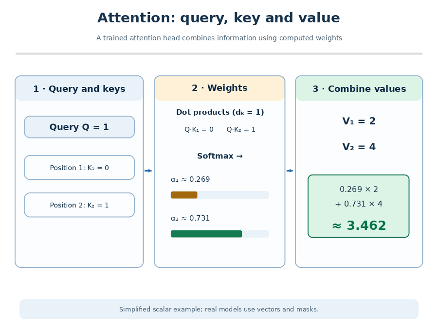

# M6-L1 – From language processing to transformers and LLMs {#L1}

**Course area:** M6 – Specialisation: AI and robotics

**Level:** Bachelor’s / Master’s (elective)

**Prior knowledge:** No fixed prerequisites specified.

## Why language is a difficult problem for computers {#S1}

In M5-L2 we saw how neural networks calculate with numbers; M5-L3 explained the learning objectives on which they are trained. We now consider why **language** in particular is so difficult to process. A sentence does not consist of a single, fixed-order feature vector. It is a sequence of characters and words that refer to one another. A word can refer to different things depending on its surroundings. Negation changes a statement even though only a small word is added. And a question can connect information from widely separated parts of a long text.

Example: “The key is on the table. After Anna had left the room, Paul picked **it** up.” To understand “it” correctly, we need more than the last two words. We must take earlier parts of the sentences and their context into account. At the same time, the order cannot be arbitrary: “dog bites human” and “human bites dog” contain similar words but make different assertions.

**Natural Language Processing (NLP)** encompasses not only text generation, but also search, classification, translation, information extraction and speech recognition. A **language model** in the narrower sense estimates statistical properties of sequences of words or tokens. A modern **Large Language Model (LLM)** is a large trained language model; many widely used LLMs today are based on variants of the transformer architecture. Transformers are not necessarily language models, however, and not all NLP methods need a transformer.

The guiding question of this lesson is: **How did research progress from simple probabilities for sequences of words to networks in which each text element can take other text elements into account with different weights?**

## The first idea: Language models that count word sequences {#S2}

Imagine a collection of newspaper articles. If the sequence “Good morning” occurs frequently, a program can learn that the word “morning” is probable after “Good”. This can be useful for a short continuation. **n-gram models** were historically widespread: they consider sequences of *n* units, such as words.

A **bigram** comprises two consecutive units, a **trigram** three. The model uses frequencies to estimate probabilities. A greatly simplified rule for a bigram would be:

> Probability of “morning” after “Good” = number of occurrences of “Good morning” / number of all observed word continuations after “Good”.

The calculation is easy to follow. A small collection with 80 occurrences of “Good morning” and 100 occurrences of “Good” followed by another word would yield an unadjusted estimate of $\frac{80}{100}=0{,}8$. Real systems need additional **smoothing** methods so that rare or unobserved word sequences are not invariably regarded as impossible.

``` text
Corpus containing many texts
        │
        ▼
Count frequencies of word sequences
        │
        ▼
Table: How often does B follow A?
        │
        ▼
Estimate the probability of a following word
```

The limitation is the **restricted history**. A trigram uses only a few immediately adjacent units. In a long sentence it cannot directly take important information from the beginning into account. Increasing *n* greatly increases the number of possible combinations; many occur scarcely or never in the training data. This is an example of **data sparsity in high-dimensional spaces**: almost identical statements can appear as completely different table entries because of a single word change.

Nevertheless, n-grams are not “wrong” or obsolete in the sense of being useless. For manageable predictions, simple autocompletion, analysis of character sequences or as a baseline, such methods can be sufficient. What matters is that a statistical counting method does not yet possess a freely learnable, context-dependent vector representation.

## From tables to vectors: Translating words into numbers {#S3}

Neural networks need numbers. Text is therefore first broken into units and represented numerically. An early method would be **one-hot encoding**: each word has a place in a long vector; exactly one place is set to 1. “Cat” and “kitten” are then not automatically close to each other, even though they may be semantically related.

**Embeddings**, in contrast, are learnt numerical vectors. Their coordinates are adjusted during training so that they are useful for the task. The vectors can represent similarities and relationships. An embedding is not a dictionary definition or proof that a word has a particular meaning. It is a model-dependent mathematical representation.

``` text
Text: "The cat sleeps."
      │
      ▼
Tokenisation: [The] [cat] [sleeps] [.]
      │
      ▼
Token IDs:    [ 8 ] [217] [ 904 ]  [3]   (invented IDs)
      │
      ▼
Embedding table: each ID has a numerical vector
      │
      ▼
Sequence of vectors → neural network
```

The written token boundaries are **only an example**. A particular tokeniser could split “sleeps” into several parts or account for spaces differently. The numbers 8, 217, 904 and 3 are invented and do not correspond to any claimed real model.

### Why not simply treat each word as one unit? {#31-warum-nicht-einfach-jedes-wort-als-eine-einheit}

A language has new proper names, spelling variants, technical terms and compound words. A huge dictionary of whole words would be difficult to keep complete. **Subword tokenisation** splits rare words into more frequent components. In **Byte Pair Encoding (BPE)**, in simplified terms, frequently co-occurring character sequences are combined into units. Other tokenisers choose different rules. Models can thus process words that never occur as individual complete tokens in their vocabularies.

The idea became well known in neural translation partly through Sennrich, Haddow and Birch (2016); **SentencePiece** by Kudo and Richardson (2018) is a well-known method and implementation for tokenisation from raw text. \[1\]\[2\]

A token is therefore **not always a word**. This has consequences for text length, memory requirements and costs: a long German technical term can yield more tokens than a short English word. A fixed character count is not a reliable substitute for the token count of a specific model.

## Recurrent neural networks: Reading language step by step {#S4}

The next fundamental idea was to process texts **sequentially**. A **Recurrent Neural Network (RNN)** has an internal state. With each new token, it combines the current input vector with the state from the previous step. It calculates a new state from them.

``` text
Token 1 ──► [RNN step] ── State 1
                               │
Token 2 ───────────────► [RNN step] ── State 2
                                          │
Token 3 ─────────────────────────► [RNN step] ── State 3
```

The state can be imagined as a **continually revised summary**. The system processes “The”, then “cat”, then “sleeps”, adapting its internal representation. Unlike a simple n-gram, the information need not be limited to exactly two or three preceding words.

The difficulty emerges in practice: the network must learn which details to retain over many steps. During training, the error is backpropagated through the network steps unfolded in time, often called **Backpropagation Through Time (BPTT)**. Over many steps, gradients can become very small (*vanishing gradients*) or very large (*exploding gradients*). In particular, assigning causes to much later predictions becomes difficult.

### LSTM: A more targeted treatment of memory states {#41-lstm-ein-gezielterer-umgang-mit-erinnerungszuständen}

**Long Short-Term Memory (LSTM)** describes a recurrent architecture presented in 1997 by Sepp Hochreiter and Jürgen Schmidhuber. It works with special state and **gate** mechanisms that control which information is stored, passed on or forgotten. Certain longer dependencies can thus be learnt more easily than with a simple RNN. \[3\]

An LSTM is not merely a larger memory block. The gates themselves are trainable calculations. Nor is it guaranteed to remember arbitrarily long texts completely and without error. In addition, classical recurrent processing retains a dependence between steps: the state for step 50 requires earlier states to have been calculated. This makes parallelisation across text positions more difficult.

For manageable time series, sensor sequences or certain local tasks, RNNs and LSTMs can still be suitable. For very large language models, by contrast, another architecture has proved particularly influential.

## Encoder and decoder: Transferring one sentence into another {#S5}

Before explaining the transformer, we need two roles: **encoder** and **decoder**. An encoder processes an input and produces an internal representation. A decoder uses information to generate an output from it. This need not be a translation; a summary or a different text sequence is also suitable.

An early neural **Sequence-to-Sequence model (Seq2Seq)** for translation, for instance, used two LSTMs: the first read the source sentence, the second generated the target sentence. The original paper by Sutskever, Vinyals and Le (2014) is one of the early pioneering examples. \[4\]

``` text
Source text: "The cat sleeps"
          │
          ▼
      [Encoder]
          │
    Intermediate representation
          │
          ▼
      [Decoder]
          │
          ▼
Target text: "Die Katze schläft"
```

In early approaches with **a single fixed intermediate vector**, that vector had to summarise the entire source sentence. This can work for short sentences. If the text becomes longer, an **information bottleneck** arises: individual details can be lost in the compressed representation. The solution was not simply to keep making that one vector larger.

## Attention: Not taking everything into account equally {#S6}

**Attention** is a mechanism that allows a model to access different parts of a sequence with different degrees of emphasis in a calculation. In translation, generating a German word might depend particularly strongly on certain English words.

In 2014 Bahdanau, Cho and Bengio described an influential mechanism for neural translation: instead of relying solely on a fixed intermediate vector, the decoder can weight several encoder states differently. \[5\]

``` text
Source words:    The      cat     sleeps
                  │        │        │
Encoder states:   E1       E2       E3
                  │        │        │
                  └──┬─────┼───┬────┘
                     │ Weighting
                     ▼
Decoder generates:  "Katze"  (illustrative strong reference to "cat")
```

The weights arise from trained calculations; the programmer need not write a fixed mapping rule for every pair of words. Importantly, **attention is not conscious attention** and on its own does not provide secure evidence of a human-interpretable explanation. It is a mathematical way of weighting relevance within a computational operation.

The architecture of 2017 did not simply adopt this idea, but used it in a largely new arrangement.

## 2017: The transformer changes the architecture {#S7}

In 2017 Vaswani and co-authors published **“Attention Is All You Need”**. In it they proposed a **transformer** for sequence-to-sequence tasks that dispenses with recurrent and convolutional layers at its core, using attention mechanisms instead. The original model had both an encoder and a decoder. \[6\]

The important technical advantage: **During training, many positions in an existing sequence can be processed simultaneously within a layer.** The previous state need not be calculated first for each position, as in the classical RNN. The calculations can be formulated as matrix operations, for which parallel hardware such as **Graphics Processing Units (GPUs)** is well suited.

This does not eliminate all sequentiality. An autoregressive decoder generating text must still use the tokens already generated as the basis for the next one. Transformers are therefore often well suited to parallelisation during training and the processing of given inputs, but **output generation token by token** remains fundamentally stepwise.

Simplified principle of a transformer block:

``` text
Vectors for all tokens
          │
          ▼
 Take positional information into account
          │
          ▼
       Multi-head attention
          │
   Residual connection + normalisation
          │
          ▼
 Position-wise feedforward networks
          │
   Residual connection + normalisation
          │
          ▼
 Updated vectors for all positions
          │
       further blocks ...
```

This diagram is **conceptual**. The original transformer arranged layer normalisation differently from many later variants; modern models differ in details. The common functional ideas matter, not an invariant block template for every present-day product.

## Self-attention: A word takes other words in the same text into account {#S8}

The distinctive feature of **self-attention** is that the information compared and weighted comes from **the same sequence**. In a sentence, the representations of “key”, “table” and “it” can be related to each other. Unlike a rigid n-gram, the possible relationships are not fundamentally limited to a few immediately adjacent positions.

Three vectors are calculated for each position using learnt parameters:

- **Query (Q)** – a mathematical request: which information would be relevant for this position?
- **Key (K)** – a key for comparison: how well does another position match this query?
- **Value (V)** – the value whose information contributes to the weighted result.

These words are **metaphors for three numerical vectors**. A query is not a ready-made user question, and a key is not a database key as in module M3. All three vectors arise through trained linear projections of the input representations. The three projections can yield different numbers even when they originate in the same token vector.

``` text
                    Token vectors
                           │
             ┌─────────────┼─────────────┐
             ▼             ▼             ▼
           Q vectors     K vectors     V vectors
             │             │             │
             └─────► Comparison ◄─────────┘
                         │
                  Weighting per position
                         │
                         ▼
             Weighted sum of the V vectors
                         │
                         ▼
                 New representations
```

For one attention head, similarity scores are first calculated from the query and keys, usually using **dot products**. These scores are then scaled and converted using **softmax** into non-negative weights that sum to 1. A sum of the value vectors is formed using these weights.

For multidimensional vectors, the standard formula is:

$\operatorname{Attention}(Q,K,V)=\operatorname{softmax}\!\left(\frac{Q\cdot K^{\mathrm T}}{\sqrt{d_k}}\right)\cdot V$

Here $d_{k}$ is the number of dimensions of the key vectors. Division by $\sqrt{d_k}$ prevents large dot products as the vector dimension increases from leading to extremely peaked softmax values. Softmax is calculated row by row over the permitted key positions. Mathematically disallowed positions are **masked** beforehand and thus receive weight 0. \[6\]

This looks complicated at first. In essence it means: **Compare different pieces of information, convert the comparison scores into weights and mix the contents according to these weights.**

## A fully reproducible numerical example of attention {#S9}

We consider only two text positions and exactly **one one-dimensional attention head**. All numbers are invented so that the calculation can be checked by hand. This is not a realistic trained transformer or an actual interpretation of language.

Suppose the second position under consideration is allowed to access the first and itself. The following applies:

| Quantity | Position 1 | Position 2 |
|---|---:|---:|
| Key `K` | 0 | 1 |
| Value `V` | 2 | 4 |

Let the query value of the second position be **$Q = 1$**. Since the key dimension is $d_{k} = 1$, $\sqrt{d_k}=1$.

**Step 1 – Calculate comparison scores:**

- For position 1: $1 \times  0 = 0$.
- For position 2: $1 \times  1 = 1$.

**Step 2 – Apply softmax:**

Softmax uses the exponential function `exp`. Our values give:

- $\text{Weight }1=\frac{\exp(0)}{\exp(0)+\exp(1)}=\frac1{1+2{,}71828\ldots}\approx0{,}26894$.
- $\text{Weight }2=\frac{\exp(1)}{\exp(0)+\exp(1)}\approx0{,}73106$.

The two weights sum to approximately 1. Position 2 receives greater consideration in this example.

**Step 3 – Mix the values using the weights:**

$0{,}26894 \times  2 + 0{,}73106 \times  4 \approx  3{,}46212$

The result of the attention calculation for the second position is therefore approximately **3.46212**. It is neither the key nor a copy of the value 4. It is the weighted representation composed from the values.

**What this example shows:** Attention mixes information on the basis of a learnt comparison. It does **not** show that the model “understands” why the second position should take the first into account. In real networks Q, K and V are much larger, arise from trained matrices and are calculated for all positions. The computational operation is the same fundamental idea.



*Figure: The graphic depicts **precisely the invented numerical example from section 9**: $Q = 1$, $K = (0, 1)$, $V = (2, 4)$, $d_{k} = 1$. The weights are rounded, so the rounded calculation may differ very slightly from the more accurate result. The illustration explains a mathematical operation, not human attention or a fully trained model.*

## Why multiple attention heads are useful {#S10}

**Multi-Head Attention** uses several differently learnt Q, K and V projections in parallel. Each **head** generates its own weightings and its own result. The results are then combined and processed by another trained projection.

One can imagine different heads learning different relationships: local syntax, recurring names or clues from earlier sections, for example. This is an **illustrative possibility**, not a built-in assignment of roles. A head is not manually designated as a “grammar head” and is not necessarily unambiguously interpretable.

``` text
Token vectors
  ├──► Attention head 1 ──┐
  ├──► Attention head 2 ──┼──► Combine ──► Projection
  └──► Attention head 3 ──┘
```

Several heads extend the possibilities for different relationships, but cost computing power and memory. Nor is a head an independent complete language model. The heads are trained as parts of a shared model.

## Positional information: The order must not disappear {#S11}

The self-attention calculation alone has no natural reading direction. If the positions of a sequence were merely permuted together, without additional information the essential relationships would simply be permuted accordingly. The network therefore needs **positional information** to treat “human bites dog” differently from “dog bites human”.

The transformer of 2017 used so-called **positional encodings** that were added to the token embeddings. The original paper also described sinusoidal patterns. Other transformer variants use trained position vectors or relative or rotary positional information. For understanding the principle, the following is sufficient:

``` text
Token ID ──► Token embedding ─────┐
                                  ├──► Position-aware vector
Position ──► Positional information ┘
```

The position is not the same as the word's meaning, however. Only the combination of token information, positional information and repeated context-dependent processing enables the model to form relationships between distant parts of a text.

## Feedforward layers, residual connections and normalisation {#S12}

Attention alone does not constitute a complete transformer network. A typical block also contains a **feedforward network**: a small neural subnetwork applied to each position. It further processes the information exchanged through attention; it usually includes a nonlinear activation function. “Position-wise” means that the same kind of subcalculation is applied across positions – even though each position has different input values.

**Residual connections** carry inputs around sub-blocks and add them back in. This allows information and gradients to flow more easily through many layers. **Layer normalisation** stabilises numerical ranges inside the network. \[6\]

Several such blocks are stacked. The model updates the representations of a position several times. While early layers might capture narrower local relationships, later layers can combine further relationships from already processed representations. This is not a rigid, guaranteed hierarchy: the patterns actually learnt depend on training and the specific architecture.

## The three fundamental transformer families {#S13}

Not every transformer consists of the same complete encoder-decoder pair. The distinction is decisive for determining which tasks a model is particularly well suited to.

| Variant | Which positions may a position take into account? | Typical tasks | Research example |
|---|---|---|---|
| **Encoder-only** | With bidirectional attention, input positions on both the left and right | Classification, extraction, representations | BERT |
| **Decoder-only** | With causal attention, only current and earlier positions of the generated sequence | Continuous text generation | GPT family |
| **Encoder-decoder** | Encoder sees the input; decoder generates output step by step and can take encoder states into account | Translation, summarisation, text transformation | Original transformer, T5 |

This classification is useful, but not complete. There are hybrid forms, different attention patterns and model families combining capabilities across several modalities. “Encoder = understanding, decoder = writing” is also only a **rough mnemonic**. A decoder-only model can answer questions and analyse text; it is not confined to writing fictional stories.

### Encoder-only: BERT as an example {#131-encoder-only-bert-als-beispiel}

**Bidirectional Encoder Representations from Transformers (BERT)** was introduced in 2018. Bidirectional processing allows an input position to take information from both the left and right into account when constructing its representation. Pre-training used, among other things, a **masked language modelling** objective: hidden text units are to be predicted from their surroundings. This is particularly suitable for learning representations and adapting them to downstream tasks. \[7\]

A BERT-like encoder is not automatically the ideal model for the free, continuous generation of longer texts. Its pre-training objective and attention pattern differ from those of a causally trained decoder.

### Decoder-only: GPT-like text generation {#132-decoder-only-gpt-artige-textgenerierung}

**Generative Pre-trained Transformer (GPT)** denotes an important family of autoregressive language models. *Autoregressive* in this context means that the model learns to calculate a distribution for the **next** token from a previous token sequence. A **causal attention pattern** prevents a position during training from accessing later target positions that are yet to be predicted.

``` text
Input / output so far:
  [The] [cat] [sleeps]
           │
           ▼
  Decoder-only transformer
           │
           ▼
  Probabilities for the next token
           │
           ▼
  Selected next token: [.]  (invented)
           │
           ▼
  Next round with [The] [cat] [sleeps] [.]
```

This simplified diagram omits the internal caches. How **prefill**, individual output steps, logits, temperature and sampling interact during conversation is the central topic of M6-L2. It is already important to note that when responding normally, **the weights are not retrained merely because a user enters a sentence**.

### Encoder-decoder: Specialised mapping from input to output {#133-encoder-decoder-spezialisierte-abbildung-von-eingabe-auf-ausgabe}

In an encoder-decoder model, the encoder processes a complete input and the decoder generates the output from it. Attention in the decoder can access not only the output positions generated so far, but also the encoder states. The latter is often called **cross-attention**: Q then comes from the decoder, while K and V come from encoder states.

``` text
Source text ─► [Encoder: self-attention] ──► Encoder states
                                             │
                                             ▼ (cross-attention)
Start token ─► [Decoder: causal self-attention] ─► Target token 1
                                                         │
                                                   Target token 2 ...
```

A well-known research architecture in this family is **T5 (Text-to-Text Transfer Transformer)**. It treats numerous language tasks as transformations of text into text. This makes the architecture illustrative for translation, rephrasing and summarisation. \[8\]

## Why “transformer” and “LLM” do not mean the same thing {#S14}

A **transformer** is first and foremost an architecture for a neural network. It can be trained with different data and objectives, for example for image processing, language understanding, translation or generation. An **LLM**, by contrast, describes a large model trained on language data with corresponding capabilities. Many LLMs are based on transformers, but the term transformer encompasses far more applications.

Neither does “large” have a universally binding parameter threshold. The number of trainable **parameters** is an important measure of size, but not the sole quality characteristic. Other factors are data quality, data quantity, architecture, training method, available computing power, target task and the kind of evaluation. “More parameters” does not automatically mean “better at every task”.

In **pre-training**, very many model parameters are adapted on the basis of an extensive learning task. In autoregressive language models this is often prediction of the next token in a text sequence. The target values derive from the existing texts themselves – a form of self-supervised learning from M5-L3.

For example:

``` text
Training text:    The cat sleeps on the sofa.
Learning pair 1:  [The]                 → [cat]
Learning pair 2:  [The, cat]            → [sleeps]
Learning pair 3:  [The, cat, sleeps]    → [on]
...                (didactic illustration only)
```

Real training uses efficient methods to evaluate many positions in parallel as learning targets. The visible sentence is just a small example; it cannot establish the quality or lawful usability of immense training corpora. Research on GPT-3 showed in 2020 how a large autoregressive transformer can be used for different tasks through pre-training and examples in the input. \[9\]

## What constitutes the “knowledge” of a language model – and what does not {#S15}

After training, the parameters contain numerous learnt statistical relationships. The model can reproduce facts, use syntax, abstract patterns and in many cases formulate sensible conclusions. Nevertheless, it contains **no conventional database** in which each learnt sentence lies as a separate, directly retrievable record with a reliable provenance note.

The distinction has practical significance:

- A database can read a specific booking using an identifier in a targeted way and under defined consistency rules.
- A language model calculates a suitable output from its current context and learnt parameters. This output may be correct, incomplete or false.
- A language model can additionally use a database or search function **as an external tool**; this is a separate system architecture and is explained in M6-L4.

An LLM can assert numbers, titles or names with great linguistic confidence without being able to substantiate them reliably. This problem is often called **hallucination**. It does not result from a single mathematical mechanism; training data, learning objectives, evaluation, input context and system design also play a role. A convincing text therefore does not replace a verifiable source.

### Context is not identical to permanent memory {#151-kontext-ist-nicht-identisch-mit-dauerhafter-erinnerung}

A model can use information from a supplied text in the **context window**. This information influences its response in the current computational run without requiring changes to model weights. Externally stored conversation notes, databases or documents are another, separate component of an AI product. M6-L2 examines the distinction between weights, context and external memory in detail.

## Computational effort: The price of possible relationships {#S16}

In simple dense self-attention over a sequence with `n` positions, comparisons are calculated between very many pairs of positions. The pure number of these pairwise relationships typically grows approximately as **$n^{2}$**. Doubling the sequence length can therefore approximately quadruple the effort for pairwise attention comparisons. Overall model effort also depends on vector dimensions, number of layers, batch size, implementation and hardware; the short formula **does not describe all costs of the system**.

Another operational resource is the **video memory (VRAM)** of GPUs. Model weights and temporary computational values may reside there. When generating long texts, cached attention states can also require memory. Modern implementations improve memory efficiency and sometimes use other attention patterns, so a theoretical $n^{2}$ relationship cannot provide **a current GPU price or a binding memory requirement**.

Not every service needs a large model on its own GPU. A small text classifier on a server or local keyword search can be cheaper, faster and easier to control. Conversely, very long contexts, many concurrent users and large models place greater demands on throughput, latency and operation. The actual hardware and inference architectures are discussed in more depth in M6-L6.

## Three practical cases: Which technology would make sense? {#S17}

### Local media archive: Finding categories and metadata {#171-lokales-medienarchiv-kategorien-und-metadaten-finden}

A person manages many local images and their associated descriptions. The aim is to sort the texts by topic and find similar descriptions.

``` text
Local file list → metadata and descriptions
                          │
                          ▼
              Text encoder / embedding model
                          │
                          ▼
              Vectors + local search function
                          │
                          ▼
                 Display similar entries
```

An encoder-like model or a specialised embedding model may be sufficient here. A generative LLM is **not strictly necessary** for pure similarity search. This potentially saves hardware and costs and reduces the risk of freely invented texts. Local operation makes it easier to keep data under one's own control; however, model packages, metadata, indices and backups must be maintained.

### Online translation or summarisation service {#172-online-übersetzungs--oder-zusammenfassungsdienst}

A small service accepts a text and produces a shortened or translated version. An encoder-decoder model or a suitable generative decoder model can be considered for this.

``` text
Browser → HTTPS/API → application server
                          │
                          ▼
                     Job queue
                          │
                          ▼
                    Model worker
                          │
                          ▼
                 Result + status store
                          │
                          ▼
                       Browser
```

The model type is only one decision. Error retries, data protection, maximum text length, rate limits, usage rights and traceable billing are also necessary. For confidential documents, the operator must know **which texts reach which external provider**. For very small volumes, a controlled existing API may be more economical than one's own GPU servers; for other volumes and requirements, local processing may have advantages. This cannot be generally determined without specific load data.

### Document-based AI assistant for technical manuals {#173-dokumentengestützter-ki-assistent-für-technische-handbücher}

A company wants to answer questions about an internal manual. An LLM can generate linguistically appropriate responses, but this is not the same achievement as demonstrable access to the current version of the manual.

``` text
Internal documents ─► Preparation/indexing ─────┐
                                                 ▼
User question ──────► Search for relevant passages
                                                 │
                                                 ▼
                                 Retrieved texts as context
                                                 │
                                                 ▼
                                  Generative language model
                                                 │
                                                 ▼
                                  Answer with verifiable sources
```

This is the fundamental idea of **Retrieval-Augmented Generation (RAG)**, generation with document retrieval. RAG is not a special attention head and provides no automatic guarantee of truth. The search can return incorrect passages, the model can misinterpret them, and unauthorised access to internal content must still be prevented. The specific architecture follows in M6-L4.

## When a transformer is excessive {#S18}

The historical path through n-grams, RNNs, attention and transformers does **not** mean that the newest or largest architecture must be used for every text task. The task determines the choice:

- For a **fixed word list** or a clearly defined spelling rule, a simple program may be sufficient.
- For **keyword search**, conventional search indices can provide a precise and affordable solution.
- For **structured data with unambiguous rules**, a database system from module M3 is often more appropriate than a language model.
- For **many variable text forms**, a trained encoder may be useful.
- For **free text generation and open-ended questions**, a suitable generative transformer frequently makes sense, but requires quality controls.

Evaluation should consider not just output examples but also **error rate, traceability, latency, data protection, maintenance effort, energy requirements and total costs**. If an answer influences legal, medical or other consequential decisions, “sounds convincing” is an insufficient quality criterion. Long inputs can also represent sources of error, even when they are technically within an allowed context window.

## Precisely correcting common misconceptions {#S19}

**“Transformers read every word one by one like a human.”** No. Many parts of existing input sequences can be calculated in parallel. The autoregressive output of new tokens in particular proceeds stepwise.

**“Attention proves what the model thought.”** No. Attention weights are computational values, not a general explanation of the cause of a decision.

**“Every token corresponds to exactly one word.”** No. Depending on the tokeniser, a token can be part of a word, a character, punctuation or another element.

**“Encoders understand, decoders can only write.”** Too simplistic. The models are designed around different learning objectives and information flows. Decoder-only systems can also analyse texts.

**“During chat, the model automatically learns new facts in its weights.”** No. Immediate context processing must be distinguished from targeted training.

**“A good completion is a database query.”** No. An LLM can produce plausible but false statements without current external sources.

**“Transformers never need sequential processing again.”** No. In autoregressive models the next output position still depends on the tokens generated so far.

**“More parameters always mean better answers.”** No. It depends on training, data, architecture, tasks and measurement methods.

## The overall picture: Development in a single diagram {#S20}

``` text
n-gram model
  │  counts limited word sequences
  ▼
Word vectors + neural language models
  │  learn features from data
  ▼
RNN / LSTM
  │  carries an internal state forward step by step
  ▼
Seq2Seq encoder/decoder
  │  transforms input sequences into output sequences
  ▼
Attention
  │  weights relevant states rather than just one fixed vector
  ▼
Transformer (2017)
  │  builds on self-attention, positions and feedforward blocks
  ├── Encoder-only: representations / classification
  ├── Decoder-only: autoregressive text generation
  └── Encoder-decoder: input-to-output tasks
         │
         ▼
Large pre-trained language models and specialised AI systems
```

This timeline establishes a didactic relationship and does not claim that all older methods have disappeared. The architectures coexist for different purposes. Nor does an LLM consist only of “attention”: tokenisers, embeddings, positional methods, many trained layers, learning objectives, data, operating systems and hardware are part of the complete solution.

## Summary and bridge to M6-L2 {#S21}

We have seen why language requires both **order** and **long-range relationships**. n-gram models estimate probabilities using short sequence fragments. RNNs and LSTMs carry a state along the sequence. Encoder-decoder networks can convert texts into other texts; early variants suffered from the bottleneck of fixed intermediate vectors. Attention enables weighted access to different positions. The transformer of 2017 processed such relationships without recurrent core layers and became the basis for many subsequent language models.

The most important concepts can now be distinguished: **tokenisation** splits text into computational units; **embeddings** represent them as vectors; **positional information** indicates the order; **self-attention** mixes information depending on context; **encoders** and **decoders** differ in their information flow and learning task; **pre-training** adapts model weights to large amounts of data.

**Next lesson [M6-L2 – What happens when you talk to an LLM?](M6-L2.md)** M6-L2 follows a specific request from input through tokeniser, context window and preliminary calculation (*prefill*) to the repeated selection of output tokens (*decoding*). **Logits, sampling, temperature, top-p, key-value cache, quantisation and GPU memory** are then connected to one another. M6-L1 explained the architecture; M6-L2 shows how it operates in a real application.

## Sources {#S22}

**Last source check:** 04.11.2026

**Subject-matter review: 04.11.2026.** Historical statements refer to the respective publication years cited; the linked technical documentation may change subsequently. The text is an original didactic summary, not a translation of the sources. Small numerical values and process scenarios were created for this lesson.

1.  **Sennrich, Haddow & Birch (2016), “Neural Machine Translation of Rare Words with Subword Units”.** Original from the Association for Computational Linguistics (ACL): [https://aclanthology.org/P16-1162/](https://aclanthology.org/P16-1162/) – Subword units and BPE in neural translation.
2.  **Kudo & Richardson (2018), “SentencePiece: A simple and language independent subword tokenizer and detokenizer for Neural Text Processing”.** ACL: [https://aclanthology.org/D18-2012/](https://aclanthology.org/D18-2012/) – Method for tokenisation from raw text.
3.  **Hochreiter & Schmidhuber (1997), “Long Short-Term Memory”.** *Neural Computation*: [https://doi.org/10.1162/neco.1997.9.8.1735](https://doi.org/10.1162/neco.1997.9.8.1735) – LSTM and problems of long-term dependencies.
4.  **Sutskever, Vinyals & Le (2014), “Sequence to Sequence Learning with Neural Networks”.** NeurIPS: [https://papers.neurips.cc/paper_files/paper/2014/hash/5a18e133cbf9f257297f410bb7eca942-Abstract.html](https://papers.neurips.cc/paper_files/paper/2014/hash/5a18e133cbf9f257297f410bb7eca942-Abstract.html) – LSTM-based encoder-decoder for sequences.
5.  **Bahdanau, Cho & Bengio (2014, published 2015), “Neural Machine Translation by Jointly Learning to Align and Translate”.** [https://arxiv.org/abs/1409.0473](https://arxiv.org/abs/1409.0473) – Attention weighting across encoder states.
6.  **Vaswani et al. (2017), “Attention Is All You Need”.** [https://arxiv.org/abs/1706.03762](https://arxiv.org/abs/1706.03762) and [https://research.google/pubs/attention-is-all-you-need/](https://research.google/pubs/attention-is-all-you-need/) – Transformer, scaled dot-product attention, multi-head attention, positional encoding and encoder-decoder structure.
7.  **Devlin et al. (2018), “BERT: Pre-training of Deep Bidirectional Transformers for Language Understanding”.** [https://arxiv.org/abs/1810.04805](https://arxiv.org/abs/1810.04805) – Bidirectional encoders and pre-training objective.
8.  **Raffel et al. (2020), “Exploring the Limits of Transfer Learning with a Unified Text-to-Text Transformer”.** *Journal of Machine Learning Research*: [https://www.jmlr.org/papers/v21/20-074.html](https://www.jmlr.org/papers/v21/20-074.html) – T5 and the text-to-text principle.
9.  **Brown et al. (2020), “Language Models are Few-Shot Learners”.** NeurIPS: [https://papers.neurips.cc/paper/2020/hash/1457c0d6bfcb4967418bfb8ac142f64a-Abstract.html](https://papers.neurips.cc/paper/2020/hash/1457c0d6bfcb4967418bfb8ac142f64a-Abstract.html) – GPT-3 as an autoregressive language model.
10. **Hugging Face, “How do Transformers work?” and “Transformer Architectures”.** [https://huggingface.co/learn/llm-course/en/chapter1/4](https://huggingface.co/learn/llm-course/en/chapter1/4) and [https://huggingface.co/docs/course/chapter1/6](https://huggingface.co/docs/course/chapter1/6) – Continuously maintained educational documentation on encoder, decoder and encoder-decoder models, checked 04.11.2026.
