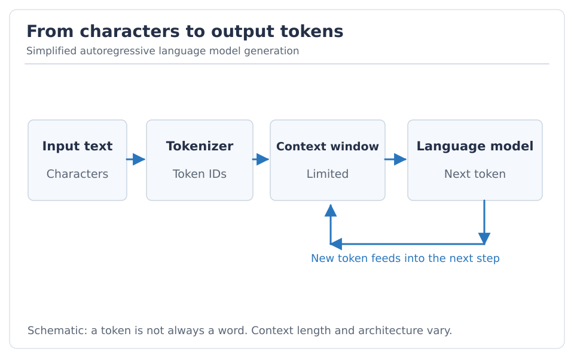

# M6-L2 – What happens when you talk to an LLM? {#L2}

**Course area:** M6 – Specialisation: AI and robotics

**Level:** Bachelor’s / Master’s (elective)

**Prior knowledge:** No fixed prerequisites specified.

## The apparently simple conversation {#S1}

You enter the following in a chat window: “Summarise the advantages of a local server in three sentences.” Shortly afterwards, a response appears. The text may sound fluent, refer to earlier parts of the conversation and use technical terms correctly. What looks like a conversation in the user interface is, at its technical core, a sequence of **text preparation, calculations with a trained model, selection of new tokens and presentation as text**. Depending on the application, additional services may precede and follow the model, such as authorisation checks, document retrieval or filters.

A **Large Language Model (LLM)** has learnt **model weights**. These weights consist of many numbers that were adjusted during training. When answering a request in the usual way, the model performs **inference**: it uses the existing weights rather than retraining them for each question. In many autoregressive models capable of holding a conversation, its central calculation is, in simplified terms: *Which token continuation fits the given input conditions?*

This is neither a simple table lookup nor the playback of a stored sentence. The network computes new intermediate values and a distribution over possible continuations for the particular situation. The response can consist of thousands of individually generated units. The transformer architecture discussed in M6-L1 provides an important building block; M6-L2 explains the **operational process of an individual request**.

## From the chat window to the model: More than just the last sentence {#S2}

In a simple application, the visible user text is only part of the input. A system context, application instructions, previous messages and incorporated documents may also be included. Such texts may be assigned different **roles** or other structural markers. The exact composition depends on the application and model used; not every service uses the same internal template.

A chat model typically requires a particular **chat template**. This determines how, for example, a user's message and an assistant's message are converted into a token sequence recognisable by the model. Some models use special control tokens for this, marking the beginning and end of a message or a change of role. The model is not fed the attractive presentation of the chat window, but rather a structured input.

``` text
User writes a message
             │
             ▼
Chat application prepares the request
  - messages and roles
  - selected conversation history
  - document excerpts, if applicable
  - instructions, if applicable
             │
             ▼
Chat template / structural markers
             │
             ▼
Tokeniser → sequence of token IDs
             │
             ▼
LLM inference → output tokens
             │
             ▼
Decoding + display in the chat window
```

**Important:** The chat service is not identical to the language model. The application decides, for example, which messages to transmit, how many response tokens are allowed and whether to retrieve external information. The language model itself is a computational component within a larger system.

## Tokenisation: Splitting text into processable units {#S3}

A **tokeniser** splits text into **tokens**: these can be parts of words, entire words, characters or punctuation. A single word can produce several tokens; even spaces influence the segmentation. The method depends on the vocabulary and rules of the specific model. For the sentence “Die Datenbank läuft lokal.” (The database runs locally), the following units would be *conceivable*:

``` text
Illustrative segmentation – not the output of a real tokeniser:

[Die] [ Daten] [bank] [ läuft] [ lokal] [.]
   │       │        │       │       │     │
   └───────┴────────┴───────┴───────┴─────┘
                   ▼
           [12, 83, 5, 71, 92, 3]
                 invented IDs
```

The IDs are entries in a model-dependent vocabulary. An ID does not mean that a word exists as written-out text in the neural network. The model initially assigns numerical **embeddings** to the IDs and processes these vectors further. The segmentation influences the input length and thus potentially the response time and costs.

**A token is not a fixed number of characters.** German compounds, foreign-language words, emoji and code can occupy different numbers of tokens. Anyone who needs to know the length of a prompt reliably requires the tokeniser or a counting function for the specific model. Merely counting words is insufficient. \[1\]

## Context window: What the model can see in this request {#S4}

The **context window** denotes the number of tokens a model can take into account during processing. In a typical chat application, both the transmitted input and the generated output occupy space within the applicable limits; the precise handling of separate input and output limits depends on the model and provider.

{alt="Process from input text through a tokeniser and limited context window to a language model that generates subsequent tokens step by step."}

A language model generates tokens step by step using a limited context.

Suppose an invented application allows a total of 8,000 tokens for the request under consideration. The app transmits 5,000 tokens from the conversation and documents and reserves 1,000 tokens for the response. Thus 6,000 tokens are allocated; the remaining capacity is a buffer. The example is **not a current product limit**. It only shows that long conversations and extensive documents can occupy the same limited processing space.

What happens if the conversation becomes too long? The software can omit older messages, summarise them, build a new conversational context or reject the request with an error message. A summary can retain information, but can also lose details. Models with longer context windows do not eliminate this trade-off entirely: computational and memory requirements increase, and long texts guarantee neither perfect attention nor error-free reproduction.

In the usual case, the model can **only consider information it receives in the current input or through mechanisms intended for that purpose**. An earlier sentence in an app's history is not automatically in the context window of the current model calculation. Conversely, stored conversations may exist in an application without the model receiving all the texts on every call.

## Inference rather than training: What remains fixed during the response? {#S5}

We know the distinction from M5-L2 and M5-L3: **training** changes model parameters through optimisation; **inference** uses these parameters for a specific prediction. In the ordinary chat process, the weights remain unchanged, even when the model formulates new statements. It does not permanently “learn” a fact merely because someone mentions it in a conversation.

The model weights contain compressed statistical patterns that arose during training. They are not, however, an organised library of precisely retrievable sentences. For a current question about a law, a file or a price, the application may need an external source. Even if the model can formulate a response on the basis of its training, this is **not evidence of currency or correctness**.

Three types of memory must be distinguished:

| Term | Contents | Typical lifetime / function |
|---|---|---|
| Model weights | Learnt numerical network parameters | Remain the same in ordinary inference; change, for example, during separate training or a model switch |
| Current context | Transmitted messages and other input tokens | Available for the processing concerned; scope restricted by context limits |
| External application storage | Saved messages, database entries, documents or memories | Managed by the application and usable by the model only through renewed provision or retrieval |

The **key-value cache**, explained later, is something different again: a technical cache for attention calculations, not permanent personal memory.

## Prefill: Processing the input already known {#S6}

A modern autoregressive language model first processes the supplied input sequence. This initial stage is called **prefill**: the model calculates the internal states required to generate a continuation from the transmitted tokens. In a classical causal transformer, this includes preparing the attention projections for earlier positions.

This is a different mode of operation from the subsequent stepwise text output. In prefill, many input positions can be processed **in parallel** within one computational step on suitable hardware, although causal attention permits looking only at the same and earlier positions. The longer the prompt, the more demanding this preliminary work can be.

``` text
Prompt: [Please] [explain] [replication] [briefly] [.]
             │
             ▼
PREFILL
  Many input tokens in one computational phase
  → internal representations
  → intermediate attention values / KV cache
  → values for possible first output tokens
             │
             ▼
First output token can be selected
```

**Time to First Token (TTFT)** is the measured time until the first token is output, usually including further latency components such as queueing, transmission and prefill. A long wait before the first visible text can therefore result from input length, model size, server condition or the network connection. It does not prove that the model has “thought about” the question particularly thoroughly in the human sense. \[2\]\[3\]

## Decoding: The rest of the response is generated step by step {#S7}

Prefill is followed by **decoding** – the repeated generation of new tokens. The core of a simple autoregressive decoder works in a loop:

1.  **Logits** for possible next tokens are calculated using the context so far.
2.  A selection rule determines which token is appended.
3.  The selected token extends the sequence so far.
4.  The next model calculation now also uses this new unit.
5.  The loop ends at an end signal or a specified limit.

``` text
Input → Prefill
             │
             ▼
         Token A
             │
             ▼
   Context + A → Token B
                    │
                    ▼
       Context + A + B → Token C
                           │
                           ▼
                      ... → End
```

The output is called **autoregressive** because every continuation depends on previously generated tokens. At the first step, the model does not yet know its entire future response as a finished file. Nevertheless, longer texts can give the impression of a carefully thought-out plan because training and the current context favour structured continuations. A recognisable text structure is not, however, a guarantee that the statements are factually correct.

Modern runtimes can optimise the basic loop, for example through **speculative decoding**, in which proposed continuations are verified. This does not change the fundamental dependence on the token sequence so far. Similarly, the application can transmit pieces of text to the chat window during generation (*streaming*). Streaming primarily changes the perception of response time; it is not equivalent to a different learning method in terms of content.

## Logits and softmax: A distribution for the next token {#S8}

**Logits** are raw real-valued scores that the model assigns to the possible next tokens. They are **not yet probabilities** and need not sum to 1. A **softmax function** converts them into non-negative values whose sum is 1. Before further interventions, larger logits correspond to higher probabilities.

For three invented candidate tokens, we assume logits of 2, 1 and 0:

| Possible next token | Logit | Exponential value, rounded | Softmax probability |
|---|---:|---:|---:|
| A | 2 | 7,389 | 66,52 % |
| B | 1 | 2,718 | 24,47 % |
| C | 0 | 1,000 | 9,00 % |

The exponential values are added together: $7{,}389+2{,}718+1{,}000\approx11{,}107$. The probability for A is consequently approximately $\frac{7{,}389}{11{,}107}=0{,}6652$. The small rounding discrepancies in the table are normal. This small calculation illustrates the principle, not the actual values of a particular LLM. A real model distributes its logits over a much larger vocabulary.

What matters is this: the model does not first produce “the correct sentence” and then package it into words. It calculates a distribution for possible continuations. A **selection strategy** determines which token actually follows. \[4\]

## Greedy decoding and sampling: Why the same prompt can end differently {#S9}

With **greedy decoding**, the token with the highest available selection score is taken at every step. In our table, that would be A. This seems predictable, but need not lead to the best overall long continuation: a locally probable decision can later lead to an unfavourable sequence or encourage repetition.

With **sampling**, a token is randomly drawn according to a weighted distribution. In the table above, A has the greatest chance, but B or C can also be selected. A randomly chosen token changes the subsequent context, so a small difference early in the response can lead to a markedly different remainder of the text.

Deterministic behaviour is not guaranteed in every specific production environment, even with supposedly fixed settings: parallelisation, different numerical computational methods or server or model versions can produce differences. Conversely, random selection is not equivalent to arbitrary guessing; it takes place within a distribution formed by the model and the sampling rules.

**More probable text is not automatically more truthful text.** A language model may favour a linguistically plausible incorrect year. The selection strategy changes the diversity of expression, but replaces neither retrieval nor factual verification.

## Temperature: How strongly are differences weighted? {#S10}

**Temperature** is a parameter of the selection strategy. In simplified terms, the logits are divided by a positive temperature value before softmax. At **$T=1$**, our original distribution is preserved. At **$T=0{,}5$**, the logits 2, 1 and 0 become the scaled values 4, 2 and 0. The highest probability now becomes much more dominant.

| Selection rule in the numerical example | A | B | C |
|---|---:|---:|---:|
| Temperature 1,0 | 66,52 % | 24,47 % | 9,00 % |
| Temperature 0,5 | 86,68 % | 11,73 % | 1,59 % |

At **higher temperatures**, probabilities move closer together; at **lower temperatures**, they concentrate on a few candidates. “Temperature 0” is treated by many software systems as a special case for greedy selection, but is **not a mathematically permissible division by 0**. The precise implementation depends on the software used.

For creative phrasing, greater diversity is sometimes desirable. For extracting a fixed identifier, it is normally unhelpful. Nevertheless, a low temperature can simply produce a factually incorrect sentence **more consistently**. It does not automatically turn an unreliable model into a reliable database. \[4\]

## Top-p and top-k: How many candidates remain? {#S11}

**Top-k sampling** limits the selection to the *k* candidates with the highest probabilities. At *$k=2$*, A and B would remain in the example; C would be excluded. The remaining probabilities are then renormalised.

**Top-p sampling**, also called **nucleus sampling**, instead considers the tokens sorted by probability and retains the smallest group whose cumulative probability reaches at least *p*. At **$p=0{,}8$**, the first example gives:

- A alone covers 66,52 % and is not yet sufficient.
- A and B together cover approximately 90,99 %; the threshold is reached.
- C is excluded; A and B are renormalised for selection.

Afterwards, in this simplified calculation, the probabilities among the permitted candidates are approximately **73,11 % for A** and **26,89 % for B**. It is explicitly permissible for A and B together to carry more than 80 % of the original probability mass: the **smallest sufficient candidate set** is taken, rather than artificially creating an exact sum of 80 %.

Temperature and top-p can be combined. Their order and interaction with other filters must be considered for specific runtimes. Other possible controls include repetition penalties, specified stop symbols and maximum numbers of new tokens. None of these settings proves factual correctness. \[4\]

## When does the model end the response? {#S12}

Autoregressive language models need not generate new tokens indefinitely. Often there are special **end-of-sequence tokens** or chat end markers. The runtime can additionally stop when a limit for newly generated tokens is reached, when a defined stop sequence appears or when the application terminates processing.

An **output limit** is technically important. Unbounded output could lead to long response times, high costs or repeated passages. A limit that is too restrictive, by contrast, can cause a response to end in the middle of a sentence. In an API or local chat software, the application must take account of *why* the output ended. Ending because of the limit is not the same as a natural end marker produced by the model.

Part of the technical context may consist of special control or formatting tokens. The visible words in the chat window therefore cannot always be mapped one to one to the tokens counted by a service. Some systems also bill different internal token types separately or use additional processing steps; their respective published product information applies. \[1\]\[4\]

## The key-value cache: Avoiding constant recalculation of previous tokens {#S13}

A decoder transformer needs information about the positions previously considered for its **self-attention**. In M6-L1 we learnt about these as **queries, keys and values** (vectors containing information). During repeated generation, it would be expensive to recalculate the same key and value vectors from scratch for all previous positions every time.

This is the purpose of the **key-value cache (KV cache)**. It stores previously calculated key and value states for earlier positions, often separately for the attention layers. When a new token is added, the model calculates its new states and can reuse the stored older states.

``` text
PREFILL:
Token 1  Token 2  Token 3  Token 4
   └──────┴──────┴──────┘
               ▼
          Fill KV cache
          [1][2][3][4]
               │
               ▼
DECODING, next step:
         New token 5
               │
               ├── calculate its new K/V values
               └── reuse K/V values for 1–4
               ▼
          KV cache grows
          [1][2][3][4][5]
```

This saves calculations but costs **working memory**, often graphics memory when operating on GPUs. More context or more parallel requests can require correspondingly more cache memory. Some architectures and runtimes limit or compress stored states, use sliding attention windows or offload parts of the cache. “The cache always grows without limit with every token” is therefore not a universally valid statement either. \[5\]\[6\]

The cache is **not personal long-term memory**. It is a transient aid to a particular calculation. Some systems can reuse matching unchanged prefixes from several requests (*prefix caching*). Under suitable conditions, this makes the next request cheaper, but does not mean that the model has learnt new weights.

## Why long conversations can become slower or more expensive {#S14}

Runtime effort consists of several parts. During **prefill**, the input tokens are processed. During **decoding**, individual tokens are repeatedly added, accessing previously calculated states. In many classical transformer implementations, these phases are constrained differently in practice: prefill strongly by computational operations, decoding frequently by memory access to model weights and KV states. The precise classification depends on model, hardware, length and optimisation. \[2\]\[3\]

At least three performance measures are therefore distinguished:

| Metric | What is measured? | Why is it important? |
|---|---|---|
| Time to First Token (TTFT) | Time until the first token is output | How long users wait for the beginning of the response |
| Tokens per second | Speed of continuing generation | How smoothly a response appears |
| Throughput | Total tokens or requests processed per unit of time | How many users a service can serve in parallel |

A server can achieve high overall throughput and still make individual users wait a long time. Conversely, a single locally running assistant under a light load can seem very responsive although it processes fewer requests per minute overall. **Batching** groups computations for several requests together for more efficient processing, but increases the demands on scheduling, memory management and fair allocation.

Total response time also includes tokenisation, queues, network paths, possible external searches and presentation in the browser. “The model responds slowly” is therefore not a complete diagnosis of a problem.

## Model size: Where memory requirements originate {#S15}

A model with many parameters requires memory to hold its **weights**. The **precision** of the stored numbers plays a major role. As a simple calculation, we assume a *purely hypothetical* model with **8 billion parameters**. At 16 bits per parameter, the weights correspond mathematically to $8\,\text{billion}\times2\,\mathrm{Byte}$ = **16 billion bytes**, or around **16 GB** in decimal counting. This is only the memory needed for the weights themselves.

The memory actually required can be substantially different because of other data types, metadata, model architecture, intermediate tensors, the KV cache, runtime environment and parallel requests. Some architectures have additional features, such as expert components that are only partially activated. The total number of parameters alone is therefore not a reliable substitute for a memory or performance benchmark.

**Quantisation** reduces the number of bits used to represent many model values. With an idealised **4 bits per weight**, 8 billion values would mathematically require only **4 billion bytes**. Real formats include scaling factors, grouping information and possibly higher-precision tensors. Four-bit files are therefore not necessarily exactly one quarter of the size of the original files, and runtime or quality also depends on the method. \[7\]

| Memory component | What is it needed for? | Why does it grow? |
|---|---|---|
| Model weights | Learnt parameters | Model size and chosen numerical representation |
| KV cache | Reusable attention states | Context length, parallel sequences, architecture |
| Temporary tensors | Intermediate values in calculations | Computational method, batch size, implementation |
| Application and system | Runtime, tokeniser, network and operating system | Additional services and memory management |

Quantisation is a **trade-off**: lower memory requirements and often greater suitability for local use, in exchange for potential losses of accuracy and, depending on hardware, different effects on speed. A smaller or more strongly quantised model can be very useful for simple tasks, but deviate more on complicated questions. Quality should be tested on the tasks actually required.

## CPU, GPU and VRAM: Where the computational work takes place {#S16}

A **Central Processing Unit (CPU)** is a versatile main processor. A **Graphics Processing Unit (GPU)** can perform many of the numerical operations typical of neural networks in parallel. **Video Random Access Memory (VRAM)** is the memory of the graphics card or GPU system. Among other things, what matters for the model is how quickly the required weights and intermediate tensors can be read from memory.

A small, quantised language model can also run on a CPU under suitable conditions. A GPU can be useful for larger models and high output speed. If graphics memory is insufficient, parts can be offloaded to main memory or a different model or quantisation level is required. Offloading saves VRAM but can cost considerable time through data transfers. Local models also require storage space for the model file and, where applicable, ongoing updates.

**More VRAM does not automatically mean better responses.** Initially, it extends the possibilities for processing larger models, longer contexts or more simultaneous requests. Whether the response is better depends on the model actually used and its suitability. The question of GPU memory must also be distinguished from the question of costs: a rented GPU can make sense for brief, occasional use; a continuously running GPU server can become economically unfavourable if requests arrive only rarely.

## Local or hosted: Comparing two operating models {#S17}

In a **local LLM**, the model weights reside on one's own computer or self-operated server. If the application operates entirely locally and uses no additional online services, prompt data need not be transmitted to an external provider for this inference. This does not mean that data protection has automatically been dealt with: disks, local logs, user permissions and synchronisation, where applicable, remain relevant.

With a **hosted LLM**, a provider handles model operation, hardware, load distribution and updates. One's own software often calls the service through an **Application Programming Interface (API)**, a defined programming interface. Data are transmitted to the provider's infrastructure and are subject to its specific contractual, location, retention and security conditions. These must be examined separately for personal or confidential data.

| Criterion | Local / self-hosted | Hosted / API |
|---|---|---|
| Initial effort | Hardware and configuration required | Less own model infrastructure |
| Ongoing operation | Updates, security and troubleshooting handled oneself | Provider operates the model; own application remains responsible |
| Data protection | Good control possible when processing is genuinely local | Check transmission and contractual processing |
| Performance | Limited by available own hardware | Depends on provider, tariff, model and load |
| Costs | Hardware, electricity, maintenance, possible downtime | Typically usage-based API and additional costs |
| Availability | Possible without the internet if everything is local | Generally dependent on network and provider |

There are also hybrid forms: a local service can prepare documents and transmit only selected excerpts to an external model; or a cloud application uses its own model for sensitive subtasks. The boundary is not solely between “private” and “cloud”, but follows the **actual data paths and authorisations**.

## Why an LLM can make convincingly false claims {#S18}

**Hallucination** is the common term for a generative model outputting factually incorrect, invented or unsupported content although it is phrased like a plausible response. The cause cannot be reduced to “too much randomness”. The ordinary language model is trained for linguistically and statistically appropriate continuations; it does not automatically possess an independent, continuously up-to-date truth check.

An example: the user asks about a book that does not exist. Rather than first verifying its existence, a model can invent a credible author, publication date and summary. The form matches patterns from training – that is precisely why it can seem convincing. Similarly, a model can mix information from different contexts or generate an incorrect source reference.

Countermeasures exist, but there is no universal guarantee: provide up-to-date sources, require traceable evidence, compare answers against database systems or rules, indicate uncertainty, check output in a structured way and plan human review for important decisions. **Retrieval-Augmented Generation (RAG)** can provide relevant passages from external documents. It makes a response more verifiable if sources are retrieved and represented correctly; generation itself remains fallible. M6-L4 examines RAG in detail.

Longer context windows, low temperature or larger models likewise **do not guarantee factual accuracy**. The right criterion is whether the overall system is reliable enough for the intended use case and how it deals with uncertainty.

## A specific request from start to finish {#S19}

We connect the individual components using an invented request: “What is the difference between replication and backup? Answer in two sentences.”

``` text
1. User interface
   "What is the difference ...?"
            │
            ▼
2. Application
   select relevant messages + format requirements
            │
            ▼
3. Tokeniser
   text / structural markers → token IDs
            │
            ▼
4. Context check
   observe input and output limits
            │
            ▼
5. Prefill
   process input tokens, build KV states
            │
            ▼
6. Decoding loop
   logits → selection rule → next token
   extend cache → next token → ...
            │
            ▼
7. End and presentation
   end signal or limit → decode tokens
            │
            ▼
8. Chat application displays the text
```

The model might, for example, explain that **replication** propagates changes to additional database copies, while a **backup** provides a separate recoverable saved state. Whether the response conforms to the requested two sentences depends on the model and, where applicable, additional checks. Incorrect content would be possible even if inference ran correctly. A distinction must therefore be made between a **technically successful calculation** and a **factually correct response**.

For a follow-up prompt, the application decides which earlier conversation it sends again or can reuse as an already calculated prefix. The new user question does not magically act on the model's weights, but influences the next **current context processing**.

## Practical example A: A private media archive on one's own computer {#S20}

A personal media archive contains file names, recording dates and one's own notes. The aim is: “Describe suitable entries to me in understandable language.” Here a small, locally operable language generator might suffice, phrasing records already found by an ordinary local search function.

``` text
Local file / media list
          │
          ▼
Simple search and filter component
          │  supplies only relevant metadata
          ▼
Local quantised language model
          │
          ▼
Text summary in the application
```

The AI does not need all photographs or original videos in the context. A search component can first determine the factually relevant entries. This reduces the input and lowers processing time and memory requirements. With a few records, an ordinary search interface without AI may even suffice. **An LLM response is not a substitute for a reliable file catalogue.** The original search and storage layer remains the factual foundation.

Operational questions: Does the model fit into main memory or VRAM? How are local files protected? Are logs written? Which response errors are tolerable? An archive used occasionally does not automatically justify an expensive continuously running GPU.

## Practical example B: A small online explanation service {#S21}

A web service accepts technical questions and supplies short explanations. It can use a hosted LLM. The actual response is produced at the model provider; one's own application remains responsible for log-in, abuse prevention, cost control and error handling.

``` text
Browser / logged-in user
           │ HTTPS
           ▼
Own web application
  - authorisation and quota
  - input limit and data protection check
  - request log with data minimisation
           │
           ▼
Hosted model API
  - tokenisation and inference
  - streaming, if applicable
           │
           ▼
Own application checks output / errors
           │
           ▼
Browser displays response
```

A service accepting many long inputs may pay for many tokens even when the responses are short. Immediately visible streaming output is convenient but does not protect against cost overruns or false answers. Among other things, request quotas, input and output limits, clear error messages and monitoring of latency and consumption are therefore necessary. The difference between budget warnings and actual limits was explained in M4-L4.

A hosted service makes sense when one's own hardware would not be used continuously or operating many GPUs would be disproportionate. For a highly sensitive internal system, by contrast, the data path to the external provider may argue against this solution.

## Practical example C: An assistant using one's own documents {#S22}

A document assistant is to answer a question about internally authored manuals. The required factual information is not reliably present in the model weights. The application therefore combines **retrieval and generation**. The search supplies relevant passages; the model formulates a response from them. Retrieval must be restricted by appropriate authorisations so that a user does not receive other people's documents.

``` text
Question from an authorised user
             │
             ▼
Document retrieval / RAG
  - select relevant passages
  - check access rights
  - retain source locations
             │
             ▼
Assemble input
  question + selected sources + response requirements
             │
             ▼
LLM: Prefill → Decoding
             │
             ▼
Response with verifiable source locations
             │
             ▼
Application can check references and content
```

In this arrangement, the quality of the **search** is often just as important as the linguistic quality of the model. If a crucial source is missing from the context, the response may be incomplete. If a source passage is incorrectly assigned, the model can cite it apparently credibly. And if a document contains an instruction such as “Ignore all previous rules”, it is initially **document content**, not an authorised instruction to the overall system. Such **prompt injection risks**, as well as controlled tool calls, are explained in more detail in M6-L4.

In practice, a narrow, well-verified context can be better than uncritically transmitting very large quantities of documents. This reduces token consumption and facilitates source checking. Even then, human review remains necessary for critical decisions.

## Where this technology is useful – and where it is not {#S23}

An LLM is particularly interesting when many different linguistic formulations need to be processed: for example, explanations, drafts, summaries, translations, classification aids or phrasing the results of a database search. Its strength lies in forming flexible outputs from varying inputs.

It is, by contrast, often **unnecessary or misapplied** when a simple deterministic function is more precise: calculating a sum, finding a known customer record by a unique identifier, enforcing file permissions, creating a backup or controlling temperature regulation in a safety-critical context. Precisely because a language model can generate plausibly false outputs, binding numbers and rules should come from verifiable systems.

The most appropriate overall architecture combines both types where applicable: **conventional software checks conditions, stores reliable states and controls authorisations; the language model assists with linguistic and not fully prestructured tasks**. M6-L2 thus connects to M1-L4, M2-L2, M3-L5 and M4-L3: convincingly phrased text overrides neither transaction rules nor security boundaries.

## The most important misconceptions {#S24}

**“An LLM simply reads my entire chat history.”** Not necessarily. It depends on which history the application provides for the current request and how context limits are handled.

**“When I correct something in chat, I immediately retrain the weights.”** Normally not. The correction initially influences only the current context; permanent training is a separate process.

**“The KV cache is a permanent memory.”** No. It is a computational cache for earlier attention states, typically dependent on context, session and runtime.

**“Temperature 0 makes every response factually correct.”** No. Greedy selection can repeat a false fact with high probability.

**“More context is always free and better.”** No. Long contexts require resources and do not guarantee reliable use of information.

**“A 4-bit model requires exactly a quarter of the total VRAM.”** No. The weight representation is only one of several memory components.

**“A GPU is absolutely necessary.”** No. Smaller or quantised models can make sense on CPUs; it depends on the model and the desired performance figures.

**“Streaming means the model knows everything immediately.”** No. Streaming transmits generated partial results as the response generally continues to be produced.

**“A prompt is the same as a secure database query.”** No. A prompt influences generated behaviour; reliable records and binding rules remain the responsibility of the application.

## Summary and transition to M6-L3 {#S25}

A chat request passes through several clearly distinguishable stages: the application selects messages and additional information. The tokeniser converts them into IDs. The model processes the supplied context during **prefill**. It then generates new tokens step by step during **decoding**. **Logits**, **softmax** and **sampling rules** determine each continuation; the **KV cache** avoids unnecessary repeated calculations. At the end, the application decodes the output tokens and displays the text.

The **model weights** belong to the trained model; **context and KV cache** belong to the current computation; **conversation storage and document retrieval** are responsibilities of the surrounding application. Computing power, quantisation and memory capacity determine which models can be operated practically. Factual accuracy, data protection and cost limits, by contrast, are system requirements that are not automatically fulfilled through fluent language.

**Next lesson [M6-L3 – How a base model becomes an assistant](M6-L3.md):** We consider how pre-training, supervised fine-tuning, preference training and further methods change the behaviour of a language model. It becomes clear there why a base model seeks a next-token continuation while a conversational assistant is adapted towards particular response forms, user instructions and safety requirements – and why this does not guarantee absolute freedom from error.

## Sources {#S26}


**Checked on 04.11.2026.** The model processes described refer primarily to autoregressive, transformer-based text generation; other model architectures and multimodal systems may have differing details. Prices, performance promises and specific context sizes of individual providers are deliberately not asserted. All token IDs, scenarios and example distributions were invented for teaching purposes and are not the output of an actual language model.

1.  [OpenAI Help Center, “Understanding and counting tokens” (German edition)](https://help.openai.com/de-de/articles/4936856-understanding-and-counting-tokens) · Units, token counting, dependence on model and language; continuously maintained documentation · Last accessed: 2026-11-22
2.  [NVIDIA Technical Blog, “Mastering LLM Techniques: Inference Optimization”](https://developer.nvidia.com/blog/mastering-llm-techniques-inference-optimization/) · Prefill, decoding, KV caching and processing of several requests · Last accessed: 2026-11-22
3.  [NVIDIA Technical Blog (31.07.2026), “Co-Designing AI Model Attention for Fast, Interactive Long-Context Inference”](https://developer.nvidia.com/blog/co-designing-ai-model-attention-for-fast-interactive-long-context-inference) · Different computational and memory bottlenecks in prefill and decoding · Last accessed: 2026-11-22
4.  [Hugging Face Transformers, “Generation”](https://huggingface.co/docs/transformers/main_classes/text_generation) · Logits, decoding methods, temperature, top-p, top-k, output limits and stop rules · Last accessed: 2026-11-22
5.  [Hugging Face Transformers, “How caching works”](https://huggingface.co/docs/transformers/cache_explanation) · Purpose and contents of a key-value cache · Last accessed: 2026-11-22
6.  [Hugging Face Transformers, “Cache strategies”](https://huggingface.co/docs/transformers/kv_cache) · Dynamic/static cache, offloading and iterative chats · Last accessed: 2026-11-22
7.  [ggml-org, “llama.cpp – Obtaining and quantizing models”](https://github.com/ggml-org/llama.cpp/blob/master/docs/models.md) · Locally operated quantised models and GGUF file format · Last accessed: 2026-11-22
8.  [Hugging Face Transformers, “Generation strategies”](https://github.com/huggingface/transformers/blob/main/docs/source/en/generation_strategies.md) · Greedy decoding, sampling and further selection strategies · Last accessed: 2026-11-22

- [Vaswani et al. (2017) – Attention Is All You Need](https://arxiv.org/abs/1706.03762) · Additional foundations: transformer architecture (already covered in M6-L1); M6-L2 deliberately does not repeat the mathematics in full; abstract and metadata accessed, PDF not reviewed · Last accessed: 2026-11-22
