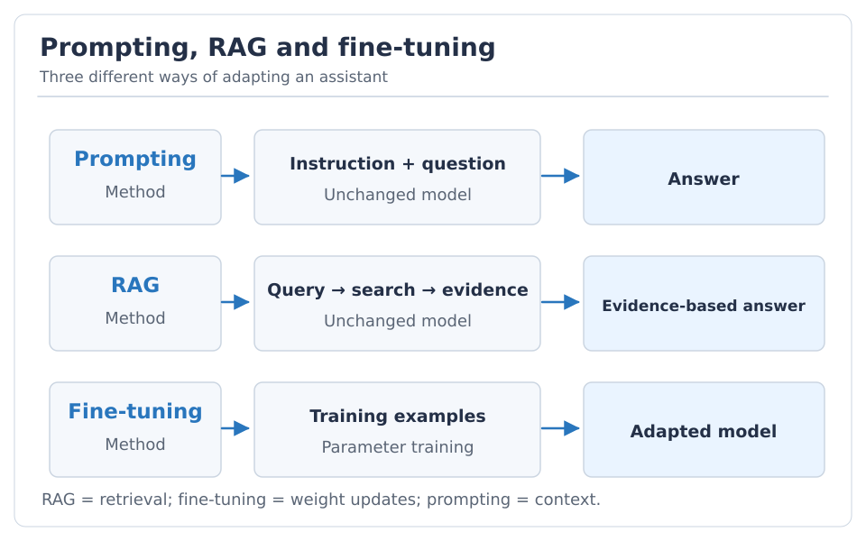

# M6-L3 – How a base model becomes an assistant {#L3}

**Course area:** M6 – Specialisation: AI and robotics

**Level:** Bachelor’s / Master’s (elective)

**Prior knowledge:** No fixed prerequisites specified.

**Learning objective:** Understand why a large language model is not yet a reliable conversational assistant after pre-training; which data and optimisation methods change its behaviour; how Supervised Fine-Tuning, Reinforcement Learning from Human Feedback and Direct Preference Optimization differ; when inexpensive adapter-based adaptation is sufficient and which safety and quality checks remain necessary.

**Context:** M6-L1 described the transformer architecture, and M6-L2 the processing of a chat request during operation. M6-L3 considers a different point in time: **How is a model trained and subsequently adapted before it is used?** Later, M6-L4 examines how an application provides documents and tools without retraining the model each time.

## The initial problem: A language model can continue text, but cannot automatically provide good assistance {#S1}

Imagine a person who has read millions of books, web pages and excerpts from conversations, but has never explicitly learnt how to respond to someone seeking advice. They could imitate language extremely well and yet respond to the request “Summarise this text in three sentences” by continuing the instructions. This distinction is important for language models.

A **base model** (*Base Model* or *Foundation Model*, depending on the context) is an already trained model that can, for example, calculate suitable text continuations. It has learnt statistical patterns, expressions and relationships. This does not mean that it reliably follows instructions, always reports facts correctly, verifies sources or can distinguish permissible tasks from impermissible ones.

An **assistant model** (*Assistant Model*, often *Instruct Model*) is a model whose behaviour has additionally been adapted to tasks, dialogues and desired response patterns. For example, it should:

- answer a question rather than continuing to write similar questions indiscriminately;
- respect the requested length, language and output format;
- express appropriate qualifications when uncertain and ask questions when necessary;
- recognise problematic demands and observe limits;
- maintain continuity with previous messages in a multi-turn conversation.

The most important insight is: **Pre-training primarily imparts a general language modelling capability; post-training influences how that capability is used in responses.** This distinction is didactically useful, even though real modern model pipelines combine many additional stages and not every company uses the same approach.

### Two different responses to the same beginning

The text “The capital of France is“ may simply be the beginning of a sentence to complete for a base model. In contrast, a user input such as ”What is the capital of France?“ calls for a direct answer from an assistant: ”Paris.”

This contrast is a **schematic illustration**, not a measured comparison of two specific models. Base models can also be prompted to produce helpful answers; assistant models can also misunderstand, assert false facts or only partially fulfil an instruction.

## Overview: Training in several stages {#S2}

A frequently encountered basic architecture looks like this:

``` text
Raw data: books, web pages, specialist texts, code, dialogues ...
                         |
                         v
       Rights checks, selection, filtering, preparation
                         |
                         v
                Tokenisation + pre-training
                         |
                         v
                     BASE MODEL
                         |
                         +-----------------------+
                         |                       |
                         v                       v
          Good example responses       Rated response pairs
                 |                             |
                 v                             v
        Supervised post-training       Preference optimisation
                 |                             |
                 +-------------+---------------+
                               |
                               v
                       ASSISTANT MODEL
                               |
                               v
              Evaluation, testing, approvals
                               |
                               v
             Application: chat, API, local service
                               |
                               v
               Ongoing monitoring and improvements
```

The process need not be linear. An organisation can, for example, initially train under supervision, then work with preferences and repeat individual steps. Other methods use automatic or rule-based feedback, additional training objectives or quite different optimisation strategies. **There is no single mandatory recipe for all today's LLMs.**

A chronological distinction is useful here:

- **Pre-training:** extensive basic training on many texts and possibly other data types.
- **Post-training:** more targeted behavioural adaptation, for example for helpful instruction-following or specific skills.
- **Inference:** the finished model processes a particular prompt and generates a response; normally its weights are not altered in the process.
- **Operational improvement:** subsequent, separately planned model or system updates following evaluation and approval.

An ordinary chat therefore does not automatically change the trained model parameters. Whether conversation contents are used for future training at all depends on the service concerned, its settings and its legal framework, and must not be assumed as a general rule.

## The raw data: Quantity alone is not sufficient {#S3}

**Training data** are the examples on which the model changes its weights. In large language models, these can be texts from different sources. Difficult decisions arise before a single training calculation takes place: Which data may be used? Which languages and topics are included? What quality problems or personal data do they contain? How strongly are individual perspectives represented?

Typical preparation steps include:

1.  **Clarify origin and permission.** Check data sources, usage rights, licences, consent and data protection requirements. Public accessibility does not automatically mean that the data may be used without legal restrictions.
2.  **Filter for quality.** Detect obvious spam, machine-reproduced text patterns, empty documents and badly damaged content as far as possible.
3.  **Reduce duplicates.** Repeated texts can overweight individual contents and distort data partitioning or evaluation.
4.  **Handle sensitive information.** Personal information, secrets or confidential documents require suitable protection and exclusion procedures.
5.  **Design the data mixture.** Different languages, subject areas, styles and levels of difficulty influence the model's later capabilities.
6.  **Keep training and test material separate.** A later comparison is less meaningful if its tasks were already included in training.

Preparation is not infallible: filters can remove valuable minority languages, overlook undesirable content or reinforce existing social biases. More data therefore does not automatically mean better data.

**From the perspective of a small software project**, there is a considerable difference between millions of general text documents for basic training and a few hundred carefully prepared examples for a very specific task. The former is typically an extensive research and infrastructure undertaking; the latter may suffice for targeted adaptation under suitable conditions – but success and the required amount of data cannot be guaranteed in general.

## Pre-training: The model learns probability patterns {#S4}

For **autoregressive** language models, a fundamental learning objective is next-token prediction. A *token* is a processing unit that may represent a word, part of a word or a pattern of characters. The model sees a sequence of previous tokens and calculates probabilities for a continuation.

A simple model calculation:

``` text
Training example:  "The sun rises in the east ..."
Previous context:  "The sun rises in the"
Expected token:    "east"   (greatly simplified here)
Model estimate:    P("east") = 0,20

Error signal:      Loss = -ln(0,20) ≈ 1,609
```

The **loss function** assesses how well the model predicts the expected continuation. After adjustments to its weights, in a hypothetical next attempt it might assign a probability of 0,50 to that same token:

``` text
New estimate:     P("east") = 0,50
New loss:         -ln(0,50) ≈ 0,693
```

A smaller loss in this teaching example means that the correct token has become more probable. The numbers are **freely chosen and mathematically verifiable**; they are neither measurements of a real LLM nor a promise that a single optimisation step causes such changes.

The actual training is performed by **backpropagation** (backward calculation of gradients) and an optimisation method that changes weights in small steps. M5-L2 examines this foundation in detail. Across many texts, grammar, technical terms, recurrent solutions to problems and statistical relationships in the world can thus be learnt.

Nevertheless, the learning objective remains decisive: good text prediction is **not identical to an obligation to carry out a request truthfully, safely and in the correct format**. A model can generate a convincing continuation even though the statement is false. This is precisely where post-training comes in.

## Supervised Fine-Tuning: Demonstrating good responses {#S5}

**Fine-tuning** means adapting an existing model in a targeted manner through additional training. A widespread variant is called **Supervised Fine-Tuning (SFT)**, a form of supervised post-training.

The model receives examples with an input and a desired output. Such demonstrations can be written by specialists, carefully selected or generated and reviewed under controlled conditions.

``` text
Input:
  "Explain the difference between backup and replication
   to a beginner in three sentences."

Good target response:
  "A backup is a separate copy used to restore earlier data.
   Replication keeps another database copy up to date for
   ongoing operation. A replicated deletion error can affect
   both copies; replication therefore does not replace a backup."
```

In simplified terms, SFT increases the probability of the target response tokens under the corresponding context. The software can be configured to calculate the training loss only over the **assistant response**, rather than over the input. How this is implemented depends on the model, conversation format and training software; the Hugging Face TRL documentation explicitly describes these variants.

### Instruction tuning and SFT are related, but not synonymous

**Instruction tuning** emphasises the *purpose of the training examples*: the model is to understand and follow task instructions such as “explain”, ”translate“, ”compare“ or ”answer as a table”.

**SFT** describes the *learning method*: supervised adaptation based on desired outputs. Instruction tuning is often performed as SFT on instruction-response pairs. But SFT can equally be used for specialist styles, structured outputs or other specific target tasks.

Good example data demonstrate not only correct facts, but also **appropriate response forms**. A teaching assistant needs short definitions and accessible analogies, for example; a system for standardised invoice data instead needs precisely defined fields. The same base model can tend towards very different behaviour patterns through different data.

### Limits of merely demonstrating responses {#grenzen-des-blossen-vormachens}

Two responses can both be factually defensible, but differ considerably in politeness, caution, clarity or usefulness. SFT with a single example response does not directly specify how a model should **choose between two plausible alternatives**. It can also adopt undesirable stylistic conventions from example data and overlook rare situations. Preference methods address this.

## Preference data: Not just right or wrong, but better or worse {#S6}

Imagine the request: “How do I back up a small customer directory?” The model generates two candidates:

- **Response A:** “A daily copy is always enough. Keep it on the same server.”
- **Response B:** “Make regular backups stored separately and test restoration. The frequency depends on how much data loss is acceptable.”

In a carefully designed dataset, raters would probably prefer response B. It is more precise and takes possible failures into account. What matters, however, is **why** it is preferred: not simply because it is longer, but on the basis of a defined evaluation criterion.

A preference example typically contains:

``` text
Prompt:       "How do I back up a small customer directory?"
Preferred:    Response B
Rejected:     Response A
Reason:       B addresses external backup and restoration.
```

People can rank several responses or compare them in pairs. Machine-generated and verified assessments also exist. Such signals contain **value judgements and assumptions about tasks**, not an objective formula for truth. Which responses are considered good depends on language, context of use, safety requirements and the raters.

A model must not simply learn that “long answers are always better”. Ratings therefore need to be investigated for biases such as length preferences, confident phrasing, unwarranted agreement and inadequate subject-matter verification.

## RLHF: Learning with human feedback {#S7}

**Reinforcement Learning from Human Feedback (RLHF)** is a form of reinforcement learning using human feedback. A classic, widely cited variant was described in the work on **InstructGPT** (Ouyang et al., 2022).

The method can look like this:

``` text
                  Many prompts
                       |
                       v
                 Pre-trained model
                       |
                       v
                    SFT model
                       |
                       v
              Several candidate responses
                       |
                       v
                 Human comparisons
                       |
                       v
                   Reward model
                       |
                       v
        RL optimisation of the language model
                       |
                       v
                   Adapted model
```

A **reward model** is itself a trained system. It is intended to estimate from comparisons an evaluation that correlates with human preferences. A **reinforcement learning** (RL) method then changes the language model so that its responses receive more favourable ratings on average.

One applicable family of optimisation methods is **Proximal Policy Optimization (PPO)**. *Policy* here refers to the model's strategy, that is, its probability distribution over possible responses. The optimisation must take care not to move the model too far away from a usable starting version. In the literature, this is often implemented by limiting the deviation from the reference distribution, for example using the Kullback–Leibler divergence (KL divergence).

Why is such a limit useful? A system trained on a single reward metric might find ways to increase that metric **without actually helping people better**. This problem is often called **reward hacking** or the **Goodhart effect**: when a metric becomes a training objective, it can lose its informative value.

**Important:** RLHF is not a claim that all model responses are individually approved by humans. It concerns training feedback that statistically affects later behaviour. Nor does every modern assistant service use precisely the older InstructGPT pipeline; methods continue to evolve.

## DPO: Direct optimisation for preferred responses {#S8}

**Direct Preference Optimization (DPO)** was introduced in 2023 by Rafailov and co-authors. It addresses the same fundamental problem: the model should make preferred responses more probable than less desirable ones.

The most important didactic difference from the classic RLHF pipeline described above is:

- In the **classic RLHF variant**, a separate reward model is first trained and the language model is subsequently optimised using an RL method.
- With **DPO**, preferred and rejected response pairs are used directly in a special training loss function. A separate reward model and separate RL loop are not required for the basic method.

``` text
Prompt + response A + response B + preference "B better"
                           |
                           v
                         DPO loss
                           |
                           v
                Adjustment of model weights
                           |
                           v
         Model tends to favour B-like behaviour
                in comparable situations
```

DPO is therefore **not** the same as SFT with the preferred response. The mathematical objective compares the relative probabilities of both responses and includes a **reference policy** to steer the desired adaptation. The detailed proof is not required for this reading course; it is documented in the original paper.

### A comprehensible preference example

Suppose 16 knowledgeable people compare two candidate responses. Twelve choose B, four A. In this **fictional example**, 12 out of 16, or **75 per cent**, prefer response B.

Initially, this is only an observation about those ratings. It does **not** mean that after DPO the model will output B with 75 per cent probability, that B is right in every situation or that 16 votes would achieve sufficient training quality. The actual adaptation depends on, among other things, the model, training method, data mixture and reference distribution.

DPO and RLHF are **families of methods with different technical costs and properties**, not a universal ranking. DPO simplifies certain training steps in particular, but does not replace carefully prepared data, tests and subsequent checks. Newer methods also combine supervised training, preference optimisation and other learning signals.

## Full fine-tuning, LoRA and parameter-efficient adaptation {#S9}

In **full fine-tuning**, all or very many model weights can in principle be updated. This offers scope for adaptation, but requires memory for parameters, gradients and often additional optimiser states. The model version must also be suitably stored and deployed for operation.

**Parameter-Efficient Fine-Tuning (PEFT)** trains only a relatively small number of new or selected parameters. One well-known method is called **Low-Rank Adaptation (LoRA)**, adaptation using matrices of low rank.

In simplified form:

``` text
Large, pre-trained weight matrix W
            |
            +--> remains unchanged (frozen)
            |
            +--> small trainable matrices A and B
                          |
                          v
                 effective change ΔW = B × A
                          |
                          v
                 adapted calculation W + ΔW
```

Instead of changing every entry of a large matrix, LoRA learns a compact correction. This is not merely ZIP compression, but a **different learning architecture**: the base matrix remains frozen while additional matrices are trained. Different adapters for different tasks can therefore be used with the same base version.

A **didactic dimensional example** explains the idea without claiming real model sizes:

- A square matrix with 1,000 rows and 1,000 columns has **1,000,000** entries.
- Two LoRA matrices of rank 8 require a total of **$1\,000\times8+8\times1\,000=16\,000$** entries.
- For this **single modelled matrix block**, that is only **1.6 per cent** of the entries of a fully trainable million-entry matrix.

This figure is **not the overall VRAM saving of a real model**. Other model layers, the number of adapted matrices, activations, optimiser states, data preparation and runtime determine the actual requirement. Parameter-efficient also does not automatically mean that a new skill is learnt without loss of quality.

### QLoRA as a related idea

With **QLoRA**, the memory load of the frozen base model weights is reduced through **quantisation**, a more compact numerical representation, while a LoRA-like adapter is learnt. The purpose is to make adaptation of larger models easier on limited hardware. The conditions and possible losses of quality depend on the implementation, model and task. Quantisation during adaptation must be distinguished from quantisation during subsequent model operation (see M6-L2).

## What should be adapted – and what should not? {#S10}

Four very different techniques are frequently confused in projects.

| Method | What changes? | Suitable for what? | Not automatically suitable for what? |
|---|---|---|---|
| **Prompting** | Only the current instruction and its context | Tone, objective, format, individual examples | Permanent changes to weights |
| **Retrieval-Augmented Generation (RAG)**, *generation with document retrieval* | The application provides retrieved external information when required | Current manuals, internal documents, traceable sources | New model weights or automatically correct interpretation of sources |
| **SFT / LoRA** | Model parameters or adapter weights | Stable response format, specialist style, defined recurring tasks | Guaranteeing consistently up-to-date knowledge |
| **Preference training (e.g. RLHF/DPO)** | Trained response behaviour | Distinguishing helpful from less helpful response forms | Guaranteeing truth, safety and fairness |

Example: a documentation service receives a new operating manual tomorrow. Does its model need post-training? **Normally not.** The current manual can be made available for a request through controlled document retrieval. If, on the other hand, the service needs to output data in a very specific structure on a lasting basis, targeted adaptation might be useful – provided that prompting and strict programmatic validation are insufficient.

**A good principle:** For **changing facts**, usually consider document retrieval and database access first; for **recurring behaviour**, try good prompts, examples and fixed program rules first, followed by fine-tuning if appropriate. This distinction is a design heuristic, not a law of nature.

## Evaluation: How can we tell whether the model has actually improved? {#S11}

**Evaluation** is the systematic assessment of model responses using previously defined criteria. A new model version may express itself more elegantly whilst performing important tasks worse. “Sounds good” is therefore unsuitable as the sole quality criterion.

A transparent evaluation process distinguishes at least four dimensions:

1.  **Task success.** Are facts, calculations, classifications and output formats correct?
2.  **Behaviour.** Does the model follow appropriate instructions, recognise ambiguity and express uncertainty?
3.  **Safety and responsibility.** Does it respect sensitive data, access limits, abusive requests and dangerous misinformation?
4.  **Operation.** What are the response time, resource requirements, robustness and costs in the relevant load profile?

Data should remain separated into **training**, **validation** and **test** sets. Ideally, the test set serves as an independent assessment, not hidden optimisation instructions. If the model already knows the test tasks or very similar variants, **data contamination** occurs. High test results can then give a false picture of generalisation capability.

### Mini-example: Better averages can conceal problems

A team tests two fictional assistants on 100 requests:

| Test group | Number | Old model correct | New model correct |
|---|---:|---:|---:|
| Standard questions | 80 | 70 | 76 |
| Rare specialist questions | 20 | 16 | 13 |
| **Total** | **100** | **86** | **89** |

The new model improves the overall score from **86 to 89 per cent**. At the same time, it deteriorates on rare specialist questions from **$\frac{16}{20}=80\,\%$** to **$\frac{13}{20}=65\,\%$**. For a service that particularly needs to be reliable in special cases, this decline may outweigh the overall improvement.

The numbers are invented and serve only to illustrate the calculation. For a robust assessment, sample size, uncertainty, categories and specific causes of errors would also have to be examined. A small random set is not sufficient for far-reaching safety promises.

### Comparing models

One possible method is **blind evaluation**: people see responses without knowing the model name and assess them according to uniform criteria. Automatic checks can test structured outputs, calculation results or the presence of important facts. Additional human specialist reviews can be used for open-ended responses.

**LLM-as-a-Judge** refers to the use of a language model to evaluate other model outputs. This can scale up evaluation, but is itself prone to error and affected by the same problems as other LLMs: stylistic preferences, biases, overlooked technical errors and instability. Such an evaluator does not replace independent specialist review.

## Red teaming, guardrails and model cards {#S12}

**Red teaming** is the targeted search for vulnerabilities. In AI systems, for example, one tests contradictory instructions, manipulated texts, attempts to disclose protected information, false source citations and abusive tasks. The aim is to discover errors **before** production use.

**Guardrails** refers to additional protective mechanisms surrounding a model. These can include:

- an application that checks access to customer data independently of the model;
- fixed schema checks for invoices, metrics and programming interfaces;
- limits on costs, number of tool calls and execution times;
- content checks or filters before or after a response;
- human approvals before risky or irreversible actions;
- monitoring, privacy-conscious logging and a way to shut down the system when anomalies occur.

Guardrails are **not identical to model training**. Good safety behaviour on the part of a model helps, but must not replace technical access control. A language model should not decide on its own whether a user may read another customer's data; that decision belongs in verifiable software and authorisation systems (see M4-L3).

A **model card** documents the purpose, origin and characteristics of a model version: intended use, unsuitable applications, test methods, known limitations, languages considered and, where appropriate, safety information. Model cards do not make a model a guaranteed good product, but facilitate accountable selection and responsibility.

The **generative AI supplement to the AI Risk Management Framework** of the US National Institute of Standards and Technology (NIST) describes systematic risk management for generative systems. Such guidance replaces neither the examination of a specific use case nor applicable law.

## Why even a trained assistant can make false statements {#S13}

Post-training changes the probabilities of certain behaviours. But it does not turn the model into a system that automatically checks every factual assertion against a reliable database.

Several sources of error remain:

**Outdated information:** Training data reflect a particular point in time. New prices, legal changes or current events do not appear in the weights by themselves.

**Conflicting sources:** Training data can already contain different statements; the model need not recognise which of them is correct.

**Incorrect preferences:** People sometimes prefer a confident, elegantly worded but factually false answer.

**Generalisation errors:** Performance on unfamiliar tasks or in unfamiliar languages can be weaker than on known tests.

**Overfitting and forgetting:** In additional training, a model may reproduce desired examples too strongly or partially lose earlier abilities (*catastrophic forgetting*). Countermeasures are possible, but not automatically effective.

**Incomplete safety boundaries:** Even careful post-training can reach its limits with new or unusual inputs. The application must retain its independent control mechanisms.

**Conclusion of this section:** A higher probability of good responses does not mean one hundred per cent reliability. In important applications, findings, calculations and approvals must be verifiable through suitable external procedures.

## The technical and economic cost of training {#S14}

Large-scale **pre-training** is often one of the most resource-intensive undertakings in AI development: data collection, rights clearance, storage, compute clusters, graphics processors, networks, distributed optimisation, energy and technical failure handling must be organised. Once generated, model weights can later be used for inference on other hardware.

**SFT on an existing model** is conceptually much smaller, but can still be expensive for large models. The memory required includes activations, gradients, optimiser states and training data in addition to weights. Full fine-tuning often requires more resources than LoRA adaptation. Preference training adds ratings, candidate generation, comparison data and further computational steps.

Economic considerations include not only GPU hours, but also:

- quality assurance and expert assessment of training examples;
- rights clearance, data cleaning and secure storage;
- repetition of failed training runs;
- independent test datasets and safety evaluation;
- management and versioning of model versions;
- regular re-evaluation in the light of new tasks, requirements and attack patterns;
- costs of subsequent production operation.

An apparently inexpensive training run makes no economic sense if the responses it produces are uncontrollable or require substantial reworking. Conversely, a small, clearly delimited task may be better solved without additional training through rules, prompting or document retrieval. **Current specific GPU prices or flat-rate costs cannot be derived from this lesson**; they depend on provider, model and load.

## Three practical scenarios {#S15}

### Scenario A: Local media archive with understandable explanations

A locally operated program already knows photographs, file names and its own keywords. The owner wants natural-language explanations: “Why was this image classified as a possible duplicate?”

The simplest solution initially involves **no new model training**. The application provides the relevant metadata in a prompt and has a suitable model generate an understandable formulation. The actual duplicate check remains a traceable software function. If a very specific writing style is regularly required, a small adapter can be considered later. For sensitive private data, access boundaries, local operation or deliberately selected processing paths are more important than impressive training methods.

``` text
Local files -> analysis program -> verified metadata
                                          |
                                          v
                                  Prompt with context
                                          |
                                          v
                               Language model -> explanation
```

**Why not an RLHF project here?** The benefit for a manageable local use case would probably be small compared with the effort of establishing reliable assessments and training processes.

### Scenario B: Specialist assistant for a small online service

A SaaS service (*Software as a Service*, software provided online) answers questions about its own product. Users need correct information about features and current operating procedures.

The texts change regularly. **Verified documents with RAG** are therefore often a better foundation than training in every change to the manuals. The model should identify source passages and indicate uncertainty. SFT may be useful in addition if the service needs to generate precisely structured step-by-step responses on a lasting basis.

``` text
Customer question -> authorisation check
                           |
                           v
                 Search current manuals
                           |
                           v
                 Relevant verified passages
                           |
                           v
                 Assistant model -> draft response
                           |
                           v
                 Source/rule checks -> output
```

An error in the model must not result in customer data from someone else's account entering the context. This is secured **before the model** by software access rights. Source currency, data protection, error rates and costs per request must also be monitored for the service.

### Scenario C: Recurring AI analysis as a service

A provider wants to generate reports on documents or media files. The output must conform to a particular schema, for example `category`, `reason`, `location` and `review status`.

A **small reference set** of genuine, lawfully usable cases is a good starting point. It enables prompting and an unmodified model to be measured. If the format is frequently not observed despite programmatic checks, **SFT or LoRA** on verified examples may be useful. A preference method would be a later option if differences between good and bad justifications can be assessed reliably.

The provider must nevertheless not sell the results as legally, medically or financially binding facts without review. The right operational architecture combines clearly defined application criteria, orderly request processing (M4-L1), data storage (C), security measures (M4-L3) and measurable product quality (M4-L2).

``` text
Request -> queue -> worker -> model -> schema check
                                           |
                             invalid ------+---> error handling/rework
                                           |
                             valid --------+---> database + result display
```

**Cost trap:** More training does not necessarily mean lower total operating costs. Improved error rates can save effort; additional model versions, checks and maintenance can increase it.

## Decision aid: Which stage does a project really need? {#S16}

The smallest sensible solution rarely begins with the most demanding training method.

{alt="Comparison of prompting, retrieval-augmented generation and fine-tuning, with separate data flows."}

Prompting, RAG and fine-tuning intervene at different points.

| Initial question | Natural first step |
|---|---|
| “I want a different tone and a concise answer.” | Try a better prompt and clear output specifications |
| “The latest manuals should be taken into account.” | Document retrieval/RAG and an updating process |
| “The assistant should always return the same data fields.” | Application schema and validation, SFT if necessary |
| “I have many verified specialist responses and a stable pattern.” | Consider SFT or LoRA, evaluate independently |
| “Several possible responses are correct, but one is significantly more helpful.” | Examine preference data and, where appropriate, DPO/RLHF |
| “Only authorised users may change data.” | Binding access checks in the application, not merely model training |
| “A specialist decision must be guaranteed to be correct.” | The model alone is insufficient; rule-based or specialist verification is necessary |

The decision also depends on the **model licence**, available weights, hardware, training data, data protection, the ability to carry out quality assurance and the relationship between error costs and operating effort. Not every model provider offers fine-tuning or weights for independent adaptation.

## Common misconceptions {#S17}

**“An instruct model contains all responses as verified facts.”** No. It has learnt to respond in particular ways; its statements still need verification.

**“SFT is the same as RLHF.”** No. SFT learns from demonstrated target responses; classic RLHF can exploit ratings through a reward model and RL optimisation.

**“DPO is ordinary SFT with better examples.”** No. DPO compares preferred and rejected response probabilities relative to a reference.

**“LoRA reduces every memory requirement to 1.6 per cent.”** No. The previously calculated 1.6 per cent applies solely to a freely chosen matrix example, not to the entire training or inference hardware.

**“User feedback changes the model weights immediately.”** Normally not. Inference, chat context, application memory and model training are distinct processes.

**“If a response is preferred in human tests, it is factually true.”** No. Preference and factual accuracy must be evaluated separately.

**“Good model safety rules replace access rights.”** No. Databases, APIs and tools must enforce authorisations independently.

**“Every project needs its own base model.”** No. An existing model, good data and a sound application are often economically more sensible.

## Summary and transition to M6-L4 {#S18}

**Pre-training** imparts broad patterns about texts to a language model. **Supervised Fine-Tuning** demonstrates desired response behaviours; **instruction tuning** is a typical use of such examples for instruction-following. **Preference training** uses comparisons between several responses. In a classic **RLHF** pipeline, these evaluations initially serve to train a reward model, which subsequently steers RL optimisation. **DPO** uses preference pairs directly for weight optimisation, without the basic method requiring a separate reward-model and RL loop.

**LoRA** and other PEFT methods reduce the number of trainable parameters and can make adaptation more affordable. Yet none of these methods automatically turns a model into a demonstrably accurate source of knowledge. Data provenance, independent tests, risk analysis, model cards, guardrails, ongoing quality control and conventional software authorisations remain important.

The next lesson **M6-L4 – AI with knowledge, tools and agents** moves from **adapting the model** to the **architecture of the overall system**. We consider how an application retrieves up-to-date documents, provides search results as context, calls programming interfaces and carries out tasks in a controlled manner – without necessarily changing model weights.

## Sources {#S19}

**Last source check:** 04.11.2026

**Technical primary sources checked on 04.11.2026.** The stages are presented as widespread concepts, not as a disclosure of the non-public training pipeline of a particular current provider model. The examples, numerical values, distributions and architectural decisions are constructed for teaching purposes; they are not empirical model measurements or price quotations.

1.  **Ouyang et al. (2022), “Training language models to follow instructions with human feedback”, NeurIPS 35.** [https://papers.neurips.cc/paper_files/paper/2022/hash/b1efde53be364a73914f58805a001731-Abstract-Conference.html](https://papers.neurips.cc/paper_files/paper/2022/hash/b1efde53be364a73914f58805a001731-Abstract-Conference.html) – historical example of SFT, preference ratings, reward models and RLHF; evaluation limitations.
2.  **Rafailov et al. (2023), “Direct Preference Optimization: Your Language Model is Secretly a Reward Model”, NeurIPS 36.** [https://papers.neurips.cc/paper_files/paper/2023/hash/a85b405ed65c6477a4fe8302b5e06ce7-Abstract-Conference.html](https://papers.neurips.cc/paper_files/paper/2023/hash/a85b405ed65c6477a4fe8302b5e06ce7-Abstract-Conference.html) – DPO objective function and distinction from reward-model/RL pipelines.
3.  **Hu et al. (2021/2022), “LoRA: Low-Rank Adaptation of Large Language Models”.** [https://arxiv.org/abs/2106.09685](https://arxiv.org/abs/2106.09685) – frozen base matrices and trainable low-rank correction matrices.
4.  **Dettmers et al. (2023), “QLoRA: Efficient Finetuning of Quantized LLMs”.** [https://arxiv.org/abs/2305.14314](https://arxiv.org/abs/2305.14314) – quantised, frozen weights with LoRA adapters; original technical paper.
5.  **Hugging Face, “LoRA – PEFT Conceptual Guide”.** [https://huggingface.co/docs/peft/main/en/conceptual_guides/lora](https://huggingface.co/docs/peft/main/en/conceptual_guides/lora) – method and adapter principle; continuously maintained software documentation.
6.  **Hugging Face TRL, “SFT Trainer”.** [https://huggingface.co/docs/trl/en/sft_trainer](https://huggingface.co/docs/trl/en/sft_trainer) – formats for instruction/response data, learning from assistant outputs, PEFT support.
7.  **Hugging Face TRL, “DPO Trainer”.** [https://huggingface.co/docs/trl/dpo_trainer](https://huggingface.co/docs/trl/dpo_trainer) – DPO using preferred and rejected response pairs; reference model and training.
8.  **Mitchell et al. (2019), “Model Cards for Model Reporting”.** [https://research.google/pubs/model-cards-for-model-reporting/](https://research.google/pubs/model-cards-for-model-reporting/) – transparent documentation of intended use, quality and limitations.
9.  **US National Institute of Standards and Technology (NIST, 2024), “Artificial Intelligence Risk Management Framework: Generative Artificial Intelligence Profile”.** [https://www.nist.gov/publications/artificial-intelligence-risk-management-framework-generative-artificial-intelligence](https://www.nist.gov/publications/artificial-intelligence-risk-management-framework-generative-artificial-intelligence) – risk management and systematic evaluation of generative AI.
10. **OpenAI, “Aligning language models to follow instructions” (2022).** [https://openai.com/index/instruction-following/](https://openai.com/index/instruction-following/) – historical context for instruction-following and limitations of InstructGPT.

**Connections within the course:** M5-L2 (gradients/backpropagation), M5-L3 (learning types/tests), M6-L1 (transformer), M6-L2 (inference/context), M4-L2 (operational quality), M4-L3 (security/data protection) and M6-L4 (RAG/tools/agents).
