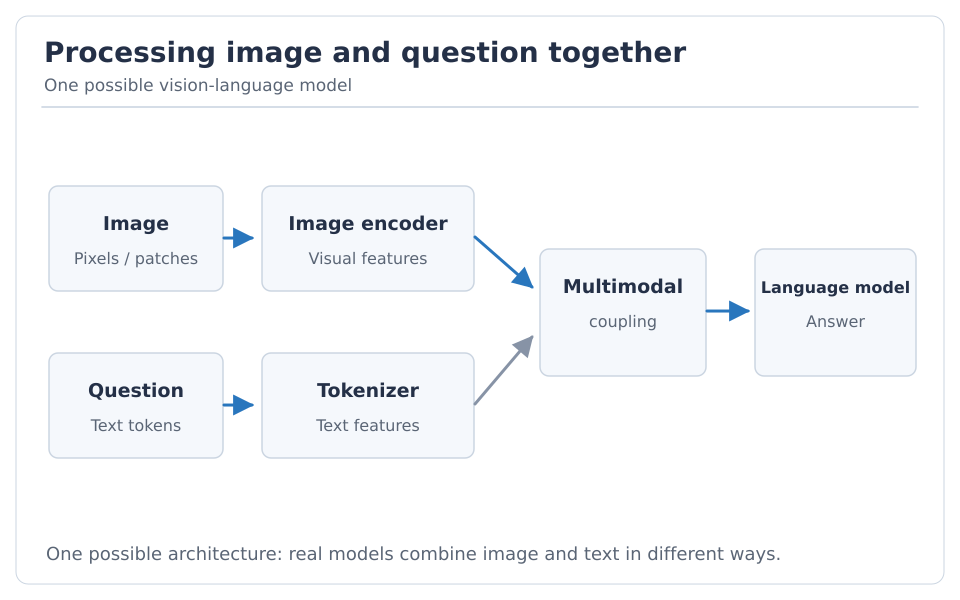

# M6-L5 – Multimodal AI: images, video and audio {#L5}

**Course area:** M6 – Specialisation: AI and robotics

**Level:** Bachelor’s / Master’s (elective)

**Prior knowledge:** No fixed prerequisites specified.

## Learning objective: how a computer understands and generates different media {#S1}

In M6-L1 and M6-L2, we learnt how text models break words into *tokens* and generate predictions step by step. M6-L4 showed how a language model can be supplemented with document retrieval and tools. Now we broaden our perspective: an AI system should not merely read a sentence, but might also describe a photograph, summarise a film, understand spoken language or generate a scene with images and sound from a draft text.

The term for this is **multimodal**. A *modality* is a form of information: text, a still image, sound, video or, for example, sensor data from a robot. **Multimodal artificial intelligence** combines at least two such forms – as input, output or both.

The crucial point is not that everything becomes the same. A photograph consists of spatial colour values, sound consists of vibrations varying over time, and video consists of a time-ordered sequence of images. Each modality has its own properties, encodings, sources of error and hardware requirements. Modern applications therefore use either several specialised models or models with shared or interconnected representations.

We consider five questions: how are media represented as numbers? How does a model find relationships between images and text? How does a diffusion model generate new images? What changes for video and audio? And how can these building blocks be combined into a useful, secure production system?

## An image is not simply a sentence with different words {#S2}

A computer initially receives images as files, not as meanings. An image file may, for example, contain compressed information from which a decoder reconstructs a raster of pixels. In an RGB image, RGB stands for **red, green and blue**. Each pixel usually has three colour components. The representation $1024 \times  1024 \times  3$ means 1,024 image columns, 1,024 rows and three colour channels.

Assuming one byte per channel, the uncompressed case gives:

$$
1\,024\times1\,024\times3=3\,145\,728\,\mathrm{Byte}=3\,\mathrm{MiB}
$$

*MiB* is a mebibyte, or 1,048,576 bytes. The calculation refers only to the raw image values. A JPEG file can be much smaller due to lossy compression. An alpha channel, colour depth and metadata also change the size.

A network could theoretically process every colour value individually. For many image tasks, however, this is impractical. Instead, images are often divided into smaller **patches** or processed with convolution operations. A patch is a small rectangular piece of an image. A *Vision Transformer* converts such patches into numerical vectors and processes their relationships with attention, as introduced in M6-L1.

``` text
Image file
   |
   v
File decoder and preprocessing
   |
   v
Image raster -> patches / visual features
   |
   v
Image encoder -> feature vectors
   |
   +--> Image search / classification
   +--> Language model for image questions
```

An **encoder** here transforms inputs into internal representations. It does not read an image as a human does, but calculates features that have become useful for a task during training. Whether a small inscription, an unusual object or a fine detail is retained depends, among other things, on resolution, preprocessing and the model. A high model score for ‘cat’ does not prove that a cat is actually in the image.

## From image features to shared meaning with text {#S3}

How can the text input ‘red locomotive in front of a station’ lead to a suitable image, even though the query consists of words and the answer consists of pixels? An important idea is to train on text and images in such a way that their numerical representations become **comparable**.

The research on **CLIP** (*Contrastive Language–Image Pre-training*) demonstrated a widely used approach: a text encoder and an image encoder are trained with matching and non-matching image–text pairs. The representations of matching pairs should be closer together in the shared vector space than those of mismatched pairs. This training method is called *contrastive learning*.

``` text
Text: ‘a red bicycle’ ---> Text encoder ----> Vector T
                                                  |
                                                  v
                                          Compare similarity
                                                  ^
                                                  |
Photo of a bicycle ------> Image encoder ---> Vector B
```

A program can thus find the most similar image vectors for a text query. This is related to retrieval from M6-L4, except that the query can consist of text and the result can be an image. Similarity is learnt statistically. Two semantically related media items may be similar in vector space, but this guarantees neither a complete description, nor truth, nor legal permission to use them.

A **shared embedding space** is not essential for every multimodal system either. Some applications have separate processing paths and only combine their results later. Others use shared or coordinated components. A single product can hide various models behind a unified interface.

The boundary between *recognition* and *understanding* is particularly important: if a model reliably recognises a cat, it does not follow that it can determine the photographer’s intention, the context of a scene or the authenticity of the image. Evidence from the image must be distinguished from plausible additions based on training patterns.

## Vision-language models: asking questions about images rather than merely classifying them {#S4}

A **vision-language model (VLM)** is designed for joint image and language tasks. For example, it can describe a scene, answer questions about diagrams or analyse visual elements in a document. Several technical designs are possible.

{alt="Simplified multimodal model: an image is processed by an image encoder. Text questions pass through a tokeniser; both information streams flow to the multimodal coupling and a language model."}

Image and text inputs need different preprocessing; the diagram shows only one possible architecture.

One illustrative variant links an image encoder to a large language model (LLM). A **projector** or **bridging component** converts the image features into a form that the language model can use as additional input. Research architectures such as **BLIP-2** and **LLaVA** demonstrate different variants of such connections.

``` text
Image ----> Image encoder ----> Image features --+
                                                 |
                                Projector / multimodal coupling
                                                 |
Question -> Text tokeniser ----------------------+--> Language model --> Answer
```

The drawing is a conceptual model, not a universal blueprint. Some systems use special *cross-attention* layers, others process visual tokens directly alongside text tokens in a model; still others are more tightly unified. The important point is that the language model can only work with the features it actually receives from the image path.

For example, a photograph shows a handwritten label next to a medication package. An image AI might recognise the package but misread the handwriting. A linguistically convincing sentence does not establish reliable text recognition. In invoices, safety warnings or medical documents, incorrect details can matter. Such tasks may require specialised **optical character recognition (OCR)**, additional checking rules or a human comparison.

A second problem is **spatial association**. ‘To the left of the red object’ is not a purely verbal question. The model must correctly identify objects and positions. With many small elements, overlapping objects or unfamiliar perspectives, spatial relationships can be confused. Image understanding cannot therefore be evaluated solely by appealing image descriptions.

### Distinguishing image understanding, image search and image generation

An image recognition system answers a question about an existing image. Image search finds suitable media in an index. A generative image model, by contrast, creates image data that need not be present in the original image. A single service may offer all three functions, but the underlying tasks differ.

| Task | Input | Output | Typical check |
| --- | --- | --- | --- |
| Image search | Text or reference image | Existing files | Are the images found actually relevant? |
| Image description | Image and question | Text | Is the statement supported by the image? |
| Image classification | Image | Category and score | Are misclassifications acceptable? |
| Image generation | Text and optional constraints | New image | Does it meet the requirements and usage rights? |
| Image editing | Original image and requested change | Modified image | Do protected, unchanged regions remain correct? |

## Diffusion: an image emerges through gradual refinement {#S5}

In text models, an answer is often generated autoregressively: one token follows another. For images, a different method has become important: **diffusion models**. The underlying idea may initially seem unusual: during training, noise is progressively added to image data. The model learns how to move from a corrupted state towards plausible image data.

In generation, a simplified diffusion process begins with a noise pattern. The trained model repeatedly estimates which portion of the noise, or which cleaner state, is appropriate for the intended result. A **sampler** organises these steps. The result is a new image, not a file copied from the internet – although this does not in principle rule out unwanted memorisation of particular training examples or rights issues.

``` text
Text prompt --> Text encoder -------------------------+
                                                      |
Random initial state ---------------------------------+-->
                                                      |
                   Repeated denoising steps           |
                      Noise -> less noise             |
                                                      v
                                                  Image data
```

The diagram omits many mathematical details. In a particular system, denoising does not necessarily operate directly on all pixels. The work of **Rombach and colleagues** on *Latent Diffusion Models* demonstrates how the computationally expensive generation process can be shifted into a compressed feature space.

### The latent space and the autoencoder

A **latent space** consists of learnt numerical representations that are often more compact than the full image raster. An **autoencoder** has two parts: an encoder compresses an input; a decoder reconstructs the appropriate output form from it. Compression is not the same as a lossless ZIP archive: details may be lost.

For latent diffusion, the simplified architecture is:

``` text
                     Training image
                          |
                          v
                  Image encoder (VAE)
                          |
                          v
                      Latent space
                          |
                  Noise and learning
                          |
                        Model
                          ^
                          |
                   Text conditioning

Generation: randomness in latent space
       -> many model-guided steps
       -> image decoder
       -> finished image
```

**VAE** stands for *Variational Autoencoder*; not every method necessarily uses exactly the same autoencoder architecture. Depending on the architecture, text conditioning enters image processing, for example, via *cross-attention*. ‘Conditioning’ generally means that generation is influenced by additional information. This information can also be a reference image, a mask, a sketch or a depth map.

### Text-to-image and image-to-image

In **text-to-image**, a text prompt describes the desired scene. The model creates a plausible representation. In **image-to-image**, an existing reference is added; the degree of change determines how strongly the new image differs from the original. In **inpainting**, a limited region of an image is regenerated. In **outpainting**, the visible image space is extended beyond its original boundary.

Products do not always use these terms consistently. The important question is *which information the model should retain*. An advertisement might contain a precisely specified product name or logo. A generative method can approximate colours and shapes well and still alter individual letters or proportions. For exact logos, legally relevant markings or technical drawings, traditional image editing can be more reliable.

The **number of generation steps** is not a universal quality measure either. It depends on the model and sampler. More steps do not necessarily produce a better image under all circumstances. A ‘seed’ – an initial value for the random number generator – also makes results reproducible only under sufficiently similar model, software and hardware conditions. A seed is not a reliable backup of the finished medium.

## Why diffusion must not be equated with all image AI {#S6}

Not every generative image model uses diffusion. Earlier and still relevant families include **generative adversarial networks (GANs)**, in which generator and discriminator networks are trained against each other. There are also autoregressive image models that predict visual tokens, and other generative designs. ‘Image AI’ names the task, not the necessary architecture.

What they have in common is that the models learn statistical structures from training data and derive new examples from them. None of these methods thereby automatically possesses a complete physical simulation of the world depicted. An image of a mechanical gearbox can be photorealistic without the gears actually meshing correctly. Assessing technical functionality would need additional modelling, rules or simulation.

Similarly, training with many photographs does not make generated images photographic evidence. An authentic photograph and a synthetic image may look similar. Their origin must be assessed independently of visual appearance.

## Video: more than many individual images {#S7}

Video contains time-ordered images known as **frames**. A film with 24 frames per second contains 24 image states each second. But the individual images cannot be generated arbitrarily. Viewers expect a person to remain the same person in the next shot, the camera to move coherently and objects not to disappear without reason.

If we sent the same text prompt independently to an image model for every frame, clothing, faces, shadows or the spatial arrangement could change constantly. This is called **temporal inconsistency**. Video AI must therefore learn not only spatial image structures but also *relationships across time*.

``` text
Description / initial image / optional motion constraints
                          |
                          v
                   Video generation model
                      Space + time jointly
                          |
                          v
               Temporally related frames
                          |
                          v
                   Video file with codec
```

The research paper **Video Diffusion Models** shows an early approach to extending image diffusion with temporal dimensions and coherent video sequences. Other systems use spatiotemporal tokens, successive blocks or separate motion components. It is not necessary for all frames to be generated in one computational step.

### Why video can be so data-intensive

An illustrative *theoretical* storage example using the uncompressed RGB image from Section 1:

$$
\begin{aligned}
\text{1 Frame:}\quad&1\,024\times1\,024\times3\,\mathrm{Byte}=3\,\mathrm{MiB}\\
\text{1 Second:}\quad&24\,\text{Frames}\times3\,\mathrm{MiB}=72\,\mathrm{MiB}\\
\text{1 Minute:}\quad&60\times72\,\mathrm{MiB}=4\,320\,\mathrm{MiB}\approx4{,}22\,\mathrm{GiB}
\end{aligned}
$$

These are **not figures for the file size of a generated video or for graphics memory usage**. Real video files are typically heavily compressed; internal model states, latent data, attention memory, sound and intermediate steps operate at different scales again. The numerical example only demonstrates why the temporal dimension adds data and computation.

### What temporal consistency means in practice

Four kinds of relationships must be distinguished:

1.  **Identity:** A character should retain recognisable features across several shots.
2.  **Object permanence:** An object that has been put down should not disappear without a cause.
3.  **Motion:** Position and direction should change sensibly over time.
4.  **Scene logic:** Lighting, perspective, events and cause and effect should be consistent.

A model can generate impressive movements for a few seconds and still fail with complex hand interactions, long stories or precise motion sequences. A *prompt* is no guarantee of continuous geometry or physics. For product demonstrations, real measurements or safety-critical simulations, a visually plausible sequence must not be used as a technical reference without verification.

Video can also be an **input** to AI: a system searches for scenes, creates subtitles, detects motion events or summarises a meeting. It often uses selected frames, audio tracks and, where appropriate, timestamps. Which parts of the video are actually taken into account is crucial to the significance of the result. Anyone who examines only every tenth image may miss brief events.

## Audio: why sound is yet another kind of signal {#S8}

**Audio** is a sequence of measurements varying over time. In simplified terms, a microphone records changes in air pressure as an electrical voltage; an analogue-to-digital converter turns them into numerical values. The **sampling rate** states how many measurements are recorded per second. At 16,000 samples per second, 16,000 temporal values are produced per channel per second before compression or other processing takes effect.

For audio tasks, three functions must be distinguished:

- **Automatic speech recognition (ASR):** sound is converted into written text.
- **Speech synthesis**, or *text-to-speech (TTS)*: text is converted into spoken language.
- **Audio understanding / audio generation:** the system recognises, for example, music, noises or speaker changes, or generates sound even without a specified wording.

A speech recognition system can turn a spoken question into text that is then passed to a language model. Another system can connect acoustic features directly with linguistic or other representations. Both are multimodal applications – but not necessarily technically the same.

### From vibrations to features

Speech and audio networks often do not simply receive long lists of raw measurements. For many models, the values are divided into short time segments, frequency components are calculated and displayed in a **spectrogram**. A spectrogram shows which frequency components occur at which times. A Mel scale more closely reflects particular properties of human pitch perception; a **Mel spectrogram** is therefore a commonly used intermediate audio representation.

``` text
Microphone / audio file
         |
         v
   Samples and preprocessing
         |
         v
Spectrogram or audio encoder
         |
         +----> ASR -> text
         +----> Sound classification
         +----> Multimodal analysis
```

The example **Whisper**, documented in *Robust Speech Recognition via Large-Scale Weak Supervision*, illustrates a powerful approach to speech transcription. However, names, numbers, technical terms, accents and overlapping speakers may still be recognised incorrectly. For quotations, contracts or medical decisions, the recording should be checked against the transcript.

### Text-to-speech: a voice must emerge, not just a sentence

**Speech synthesis** combines linguistic content with rhythm, pronunciation, voice and sound. In a classic neural design, a model first predicts acoustic features. A **vocoder** generates an audible waveform from them. The well-known research model **Tacotron 2** uses this two-stage approach: text → Mel spectrogram → waveform.

``` text
Text
  |
  v
Pronunciation, pauses and acoustic features
  |
  v
Mel spectrogram
  |
  v
Vocoder / audio generator
  |
  v
Speech output
```

More recent methods may use other intermediate representations or more direct token-to-audio methods. The architecture is therefore a teaching example, not a claim that all modern voices are generated in this way.

Pronunciation is not everything. For a convincing voice, **prosody** (stress, pauses, melody), speaking rate, intonation and sometimes emotion form part of the result. A friendly-sounding voice, however, says nothing about the correctness of what is spoken. Voice and the substance of an answer are separate quality characteristics.

The **generation of non-speech sound** – music, background noises, acoustic scenes – has additional requirements. An audio model may convincingly generate short sound fragments and still fail to maintain a long musical form or precise temporal synchronisation. Research approaches such as **AudioLM** treat audio data using methods inspired by language models; ‘language model’ here does not mean that audio samples are simply written words.

## Real-time conversations require their own system architecture {#S9}

Imagine a voice-controlled application. The user asks: ‘What is the camera showing right now?’ The service must process audio and image signals, generate an answer and perhaps speak. Several processing steps lie behind what seems to be a single conversation:

``` text
Microphone --------> Speech recognition -+
                                         |
Camera ------------> Visual features -----+--> Dialogue logic
                                         |       |
Context / data ----> Knowledge retrieval -+       v
                                           Multimodal model
                                                  |
                                                  v
                                             Answer text
                                                  |
                                                  v
                                             Speech synthesis
                                                  |
                                                  v
                                               Loudspeaker
```

This is a **pipeline** of specialised components. Other systems can process speech and images together more tightly and generate response audio directly. For planning a service of one's own, the separation is nevertheless useful: each component has its own error rate, runtime, permissions and data storage.

**Latency** is the waiting time until the first usable response is produced. One prolonged internal step can delay the entire conversation. **Streaming** means that intermediate results – for example, the first parts of a transcript or audio segments – are passed on before the whole task is complete. This may improve the user experience, but can complicate corrections if a provisional transcription changes later.

Real-time operation is therefore not simply a property of the AI model. It depends on the microphone, network, compression, model hardware, queues, output and cancellation logic. In a local offline system, the network round trip is eliminated, but the available hardware may be too slow. A cloud service may have more powerful GPUs but needs network connectivity and may process sensitive media outside the device.

## Production pipeline: several media types, several responsibilities {#S10}

A media production can consist of many individual AI steps. Consider a short information video. A text model produces a draft; image or video generation creates scenes; speech synthesis reads the script; a separate application combines sound and images. Quality depends not only on the model, but also on the interfaces and checks between steps.

``` text
Editorial text / storyboard
             |
             +----> Scene description -> image/video model ---+
             |                                                |
             +----> Narration script --> TTS / audio file ----+
             |                                                |
             +----> Schedule, rights, sources ---------------+
                                                              |
                                                              v
                                                    Video editing / muxing
                                                              |
                                                              v
                                                  Visual review and approval
                                                              |
                                                              v
                                                  Export + provenance notes
```

*Muxing* means packing several media streams – such as image and sound – into a shared container. A production pipeline should be able to retry failed steps without accidentally overwriting finished results. It needs unique job identifiers, version information, intermediate storage and a traceable association between prompt, source file, model version and final result. These operational questions connect M6-L5 with the job and worker architecture from M4-L1.

### Which errors can occur

An image model delivers the wrong resolution. A video model generates a scene in which the character suddenly wears different clothes. Speech synthesis stresses a proper name incorrectly. A new version of the subtitles is no longer synchronised with the audio track. If the steps are linked without checks, the overall result can formally exist as a file yet still be unusable in substance.

It helps to **archive intermediate results separately**: approved text, image references, generated variants, audio tracks, subtitles, project file and final version. A model change may alter the results even though the original prompt remains unchanged. Reproducibility is therefore a quality aspect in its own right, not something that is automatically guaranteed.

## Three detailed application examples {#S11}

### Example A: local media archive

A private image and video collection is to be searched by terms: ‘All photographs with a steam locomotive’ or ‘The clip in which the camera pans across a bridge’. A relatively simple architecture can store metadata and visual embeddings in a local index. The actual image remains on the owner's hard drive. For videos, thumbnails and timestamps may be stored.

``` text
Local media files -> metadata / thumbnails
                              |
                              v
                         Image encoder
                              |
                              v
                          Search index
                              ^
                              |
                          Search term
```

Advantage: the original files need not be transferred to an external service. Disadvantage: a large collection needs space for indices and sometimes lengthy initial processing; this can take time on an ordinary PC. For exact filenames or recording dates, a classic database query without AI is often sufficient. Embeddings can help with semantic search. A visual description nevertheless remains fallible.

The project can search private and shared media separately and check permissions before display. An AI model must not replace access control. Face recognition should not casually become a mandatory function either: it processes particularly sensitive features and can have far-reaching privacy consequences.

### Example B: online audio and image analysis service

A small web application accepts media uploaded by customers. A worker generates transcripts, image descriptions and a searchable summary. The customer sees the processing status and can correct the result.

``` text
Customer upload -> Rights check -> Private object storage
                                      |
                                      v
                                   Job queue
                                      |
                                      v
                                CPU/GPU worker
                            /        |        \
                           /         |         \
                        ASR     Image analysis  Summary
                           \         |         /
                            \        |        /
                                Result check
                                     |
                                     v
                            Customer-specific retrieval
```

The service needs file size limits, retention rules, logging, secure deletion and protection against excessive use. If media are sent to an external model provider, the data flows, contractual conditions, retention issues and any data transfers form part of the architectural decision. An unsuccessful job must not repeatedly incur high GPU costs indefinitely; retries need limits.

From a business perspective, the question is: what does a successfully processed package of audio or video minutes cost, including hosting, storage, model usage and support? Here the fundamentals connect with M4-L4 on cloud costs. A single fixed figure would be misleading, because model size, data type, resolution, load and provider vary widely.

### Example C: creative image, video and audio production

A small production team wants to create a short animated explanatory piece from an editorial draft. It needs an approved visual style, recognisable characters, a consistent narrator and accurate textual content. One possible system uses a storyboard and checked reference images for each scene, producing short video segments and separate audio elements from them.

The seemingly simplest plan – ‘one prompt, one finished film’ – is not always the most reliable for controlled work. Changes to a single line of text might otherwise alter large parts of the output unpredictably. A modular pipeline allows targeted post-production, manual cuts and reuse of individual approved scenes. At the same time, more coordination and intermediate files are required.

Quality checking concerns three levels: **factual accuracy** (is the statement correct?), **visual and acoustic continuity** (does everything fit together?) and **rights and provenance** (may the references, music, voice and motifs be used in this way?). Only after these checks is the project ready for publication.

## Computational requirements, memory and operation {#S12}

Multimodal systems can be particularly resource-intensive. A model for image analysis must process high-resolution inputs; image generation often runs many iterative computational steps; video adds a temporal dimension; real-time audio must arrive with little delay. Three resources must be distinguished:

- **Computing power:** Many matrix operations run efficiently on graphics processing units (GPUs).
- **Memory:** Model weights, inputs and intermediate results must fit into main memory or graphics memory. *VRAM* denotes graphics memory.
- **Data transport and storage:** Original media, intermediate files, indices and exports occupy disk space and may involve network transfers.

A more heavily quantised model may need less memory, but its quality and supported computational paths need checking. For video models, the number of frames, image resolution and sequence length may also weigh heavily. Simply counting model parameters therefore does not explain actual costs.

A **batch** processes several jobs together. This can improve throughput but may also increase waiting times. For interactive speech, low latency is often more important than maximum batch throughput. For overnight image indexing, overall throughput is more important. These different objectives prevent there being one optimal operational architecture.

A pragmatic comparison:

| Operation | Benefit | Limitation |
| --- | --- | --- |
| Local computer | Direct control over files; offline use possible | Limited performance and memory; own maintenance |
| Single rented GPU server | More powerful, predictable development environment | Costs may arise even when idle |
| Hosted AI API | No need to operate own model | Provider’s pricing, usage model and data flow |
| Several specialised workers | Different jobs can be distributed scalably | More complex coordination, monitoring and access control |

Not every small media catalogue needs a large multimodal model. Often a combination of a classic search database, image previews and occasional AI analysis is cheaper and simpler.

## Data quality, consistency, rights and labelling {#S13}

A model is shaped by its training data and evaluation method. Incompletely labelled images, erroneous transcripts, biased data compositions or poorly matched image–text pairs can impair quality. For visual models, unusual lighting, blurred photographs, small objects and cropped images also play a role. Audio processing can fail due to dialects, reverberation, background noise and speaker changes. Video adds problems involving occlusion, camera motion and jumps in time.

**Rights and consent** must be distinguished from these issues. The technical ability to reproduce an image, a voice or a film style is not a general permission to use it. Copyright, personality rights, data protection, contractual licence conditions and the context of use must be clarified before production. Special care is needed, particularly when imitating a real voice or person. This lesson provides technical guidance, not individual legal advice.

### Provenance evidence: what C2PA can do

The **Coalition for Content Provenance and Authenticity (C2PA)** develops technical specifications for machine-verifiable information about the origin and editing of digital media. Corresponding **Content Credentials** can contain provenance or editing claims that are cryptographically bound and verifiable. This is useful for the transparency of a production chain.

There are two limitations: existing provenance evidence does not in itself prove the factual truth of the image content. And the absence of provenance evidence does not prove that the medium is unchanged or authentic. Metadata may be missing following conversions or along publication routes; even correctly signed media can show staged or misleading content.

### European transparency requirements – updated on 5 November 2026 {#europäische-transparenzanforderungen-aktualisiert-am-05112026}

Article 50 of the **EU AI Act** (Regulation (EU) 2024/1689) contains different transparency obligations for **providers** and **deployers** of certain AI systems. According to the European Commission, the corresponding obligations generally apply from **2 August 2026**. Subject to the respective legal conditions, these include, for example, informing people about direct interaction with AI, machine-readable marking of synthetic content by providers, and disclosure obligations for certain deepfakes and published AI texts on matters of public interest by deployers. Exceptions – for example, for certain texts under editorial responsibility – must also be examined separately.

**Precise transitional boundary:** According to the European Commission's FAQ, the temporary grace period until **2 December 2026** applies exclusively to the **marking and detectability obligation under Article 50(2)** and only to AI systems **placed on the market before 2 August 2026**. This is **not a general extension of all transparency obligations**. According to the FAQ, content generated before 2 August 2026 does not need to be marked retrospectively. For a real application, the current consolidated text of the regulation, the specific roles and the applicable exceptions must be checked.

A technical provenance standard such as C2PA is not automatically equivalent to full compliance with all legal obligations. Conversely, technical labelling does not mean that use, consent or copyright issues have been resolved. When publishing a service of one's own, the applicable current regulations and the specific role of the deployer must be checked.

### Security and misuse

Multimodal data can be not only incorrect, but also manipulative. An image with the overlaid instruction ‘Ignore all previous rules’ or an audio recording with a hidden instruction to act can constitute **prompt injection**. If the AI is to derive tool actions from it, the same protection principles apply as in M6-L4: external content is data, not automatically authorised instructions. Only the application sets permissions; critical actions may require human approval.

Uploaded files can also be harmful or technically defective. A secure system limits formats, file sizes, processing time and access rights, and processes unknown media in isolation where possible. This is normal software security – even if the media analysis itself uses state-of-the-art AI.

## How to evaluate quality meaningfully {#S14}

A sweeping statement such as ‘The model makes good images’ is insufficient. The metric depends on the task:

- **Image search:** Are the desired files among the first results? How many relevant images are missed?
- **Image questions:** Does the answer match visible, verifiable details? Is uncertainty stated correctly?
- **Speech recognition:** Which words are omitted, replaced or added? What about proper names and different ways of speaking?
- **Speech synthesis:** Are pronunciation, intelligibility, prosody and the desired voice appropriate?
- **Video:** Are identity, temporal motion and scene coherence maintained over longer sequences?
- **Generation overall:** Are requirements met without violating approvals, rights or safety requirements?

A representative test set should include real problem cases: blurred images, rare objects, brief overlays, indistinct speech, background noises and different accents. Human evaluations can be useful but are subjective; automated metrics alone do not capture all errors. In particular, the technical feasibility of an output must not be confused with its actual usability.

For one's own service, a separate error log would be useful: *incorrect content, damaged medium, excessive latency, inappropriate rights, missing labelling, interrupted processing*. This shows whether a problem lies in the model, the workflow or operations.

## Bridge to mathematics and elective topics {#S15}

Relevant mathematical topics such as Fourier analysis, linear algebra, probability and optimisation can be used for further study.

- **Linear algebra:** vectors and matrices for image–text embeddings, attention and latent spaces.
- **Probability and statistics:** noise distributions, model training, error rates and evaluation.
- **Analysis and optimisation:** derivatives, gradients, loss functions and training.
- **Signal processing:** discrete-time signals, frequency analysis and spectrograms.
- **Numerical mathematics:** approximations, accuracy and memory requirements of model computations.

Computer science electives can later provide two different levels of depth: **Bachelor’s electives (M8–M10)** on computer vision, audio signal processing and media computing, and **possible additional Master’s electives** on probabilistic generation, multimodal representation, model evaluation and research architectures. The topics mentioned are educational follow-on opportunities; not every topic has a lesson of its own. The Master’s core M7 remains organisationally separate.

## Summary and transition {#S16}

Multimodal AI combines different data types, but does not make their differences meaningless. Image encoders, embeddings and vision-language models help recognise and connect visual content with text. Diffusion models generate images step by step and can work in a compressed latent space. Video generation adds temporal relationships to spatial ones; speech processing distinguishes transcription, speech synthesis and general audio signals.

A real application usually needs more than a model: file decoders, preprocessing, job scheduling, intermediate storage, quality checking, permissions, rights checking and, where appropriate, traceable provenance information. Often it is precisely this software environment that determines whether a technically impressive model can be used reliably.

**Next step [M6-L6 – AI infrastructure and distributed computation](M6-L6.md):** We examine when CPUs and GPUs are sufficient, how models are distributed across graphics memory, individual computers and several nodes, and why throughput, response time, data traffic and costs determine the architecture of an AI service. [M6-L7](M6-L7.md) on robotics then follows.

## Sources {#S17}


**Technical sources checked on 4 November 2026 for underlying technical assumptions and publicly accessible primary publications.** The calculation examples and architectural sketches were formulated independently. None of the research approaches mentioned should be equated with the implementation of all current provider products.

1.  [Radford et al. (2021), “Learning Transferable Visual Models From Natural Language Supervision” (CLIP)](https://arxiv.org/abs/2103.00020) · contrastive image–text representations. · Last accessed: 2026-11-22
2.  [Li et al. (2023), “BLIP-2: Bootstrapping Language-Image Pre-training with Frozen Image Encoders and Large Language Models”](https://proceedings.mlr.press/v202/li23q.html) · linking image encoder and language model. · Last accessed: 2026-11-22
3.  [Liu et al. (2023), “Visual Instruction Tuning” (LLaVA)](https://arxiv.org/abs/2304.08485) · image-supported instruction processing. · Last accessed: 2026-11-22
4.  [Ho, Jain & Abbeel (2020), “Denoising Diffusion Probabilistic Models”](https://arxiv.org/abs/2006.11239) · diffusion and gradual denoising. · Last accessed: 2026-11-22
5.  [Rombach et al. (CVPR 2022) – High-Resolution Image Synthesis with Latent Diffusion Models](https://openaccess.thecvf.com/content/CVPR2022/papers/Rombach_High-Resolution_Image_Synthesis_With_Latent_Diffusion_Models_CVPR_2022_paper.pdf) · Abstract and section 3: latent space, autoencoders and text conditioning · Last accessed: 2026-11-25
6.  [Ho et al. (NeurIPS 2022) – Video Diffusion Models](https://proceedings.neurips.cc/paper_files/paper/2022/hash/39235c56aef13fb05a6adc95eb9d8d66-Abstract-Conference.html) · Abstract: video diffusion and temporal coherence · Last accessed: 2026-11-25
7.  [Radford et al. (ICML 2023), “Robust Speech Recognition via Large-Scale Weak Supervision”](https://proceedings.mlr.press/v202/radford23a.html) · speech recognition (Whisper). · Last accessed: 2026-11-22
8.  [Shen et al. (2018), “Natural TTS Synthesis By Conditioning WaveNet On Mel Spectrogram Predictions”](https://research.google/pubs/natural-tts-synthesis-by-conditioning-wavenet-on-mel-spectrogram-predictions/) · two-stage synthesis and vocoder. · Last accessed: 2026-11-22
9.  [Google Research (2022), “Google Research, 2022 & beyond: Language, vision and generative models”](https://research.google/blog/google-research-2022-beyond-language-vision-and-generative-models/) · context for AudioLM. · Last accessed: 2026-11-22
10. [C2PA – Technical Specification 2.3](https://spec.c2pa.org/specifications/specifications/2.3/specs/C2PA_Specification.html) · § 1.2–1.3: cryptographically verifiable provenance assertions, not an assessment of their truth · Last accessed: 2026-11-25
11. [European Union – AI Act, Article 50](https://ai-act-service-desk.ec.europa.eu/en/ai-act/article-50) · Transparency rules, exceptions and date of application; the regulation remains legally binding · Last accessed: 2026-11-22
11. [European Commission – Transparency obligations under Article 50](https://digital-strategy.ec.europa.eu/en/faqs/transparency-obligations-under-article-50-ai-act) · Explanations of transparency obligations, exceptions and date of application; the regulation remains legally binding · Last accessed: 2026-11-22
12. [European Commission, Guidelines of 20 July 2026 on Article 50](https://digital-strategy.ec.europa.eu/en/library/guidelines-transparency-obligations-providers-and-deployers-ai-systems) · roles and application of transparency obligations · Last accessed: 2026-11-22

The statements on law provide general context, not binding advice for an individual case. No specific prices, guaranteed model capabilities or purported current video lengths of individual products are stated.
