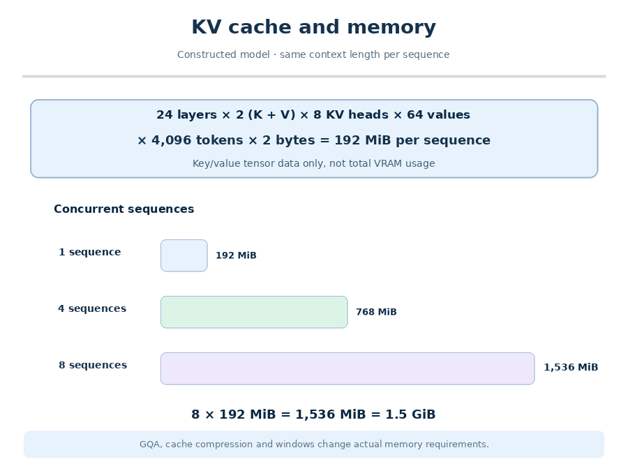
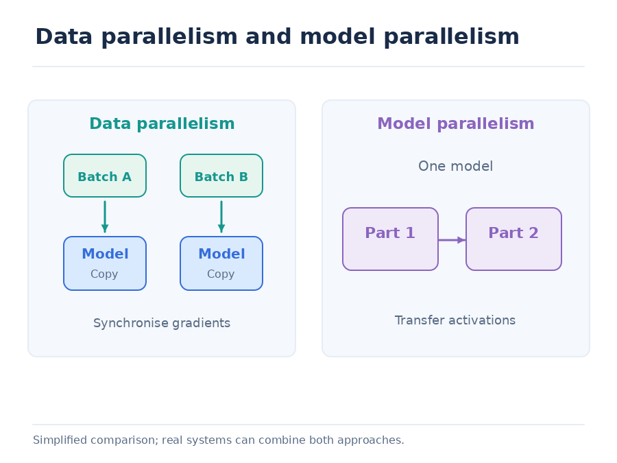

# M6-L6 – AI infrastructure and distributed computation {#L6}

**Course area:** M6 – Specialisation: AI and robotics

**Level:** Bachelor’s / Master’s (elective)

**Prior knowledge:** No fixed prerequisites specified.

## Learning objective: why an AI model is also a computational and operational problem {#S1}

In M5-L2, we encountered a neural network as a mathematical sequence of computational operations. M6-L2 showed how a large language model (LLM) generates an answer token by token. M6-L3 explained pre-training and post-training; M6-L5 took us from text to images, sound and video. Now we consider the side that is hardly visible in a chat interface: **how are the models actually run on computers?**

A neural network can theoretically be described as a computational procedure. In practice, it requires processors, main memory, graphics memory, storage devices, network connections, software and, for public services, reliable job management. A well-trained model does not thereby automatically become a fast, affordable or privacy-compliant service.

The central question is therefore not ‘How many servers can I switch on?’, but **which part of the process requires which resource, and where is the actual bottleneck?** A small image analysis job on a home computer requires something different from training a large model or serving many chat users simultaneously.

This lesson first explains training and inference, then CPUs, GPUs, memory and response times. We then compare several forms of parallelisation, trace a distributed AI processing pipeline and decide when one machine is sufficient. All calculations are teaching examples, **not current performance or price figures from a manufacturer**.

## Training and inference are two different phases of work {#S2}

**Training** means that a model processes examples, calculates an error and changes its parameters using optimisation methods. In large neural networks, a training step includes a forward pass, the backward computation of gradients (*backpropagation*) and an update of the weights. In addition to the model weights, intermediate results, gradients and often optimiser states are needed. A training run can involve many such steps; reproducibility requires data versions, random initialisation, software versions and checkpoints.

**Inference**, by contrast, means using already learnt weights to classify an image, generate text or transcribe an audio file, for example. Normally, the model weights do not change as a result of an ordinary chat response. This is the most important difference between learning and using the finished model.

For an autoregressive language model, inference divides roughly into two phases:

1.  **Prefill:** The model processes the input tokens and calculates the intermediate representations needed for subsequent processing.
2.  **Decoding:** The model generates new tokens one after another; a *key-value cache (KV cache)* can store reusable attention information.

``` text
                       MODEL DEVELOPMENT
Training data -> Forward pass -> Error -> Backward pass
                    ^                         |
                    +---- Update weights <----+
                              |
                              v
                        Save model version
                              |
                    PRODUCTION MODEL OPERATION
User query -> Tokeniser -> Prefill -> Decoding -> Answer
                                  |
                               KV cache
```

Training typically requires more memory and additional computation compared with a single inference using the same model. Inference for many people can nevertheless demand substantial resources overall. **Training costs and operating costs must not be confused.** Users of a hosted model API usually do not have to train a model themselves; the provider supplies the model infrastructure and charges for use according to its business model.

## CPUs, GPUs and other accelerators {#S3}

The **central processing unit (CPU)** is the general-purpose main processor. It coordinates the operating system, executes many different program instructions, performs database and network logic and can also compute neural networks. It is flexible; a CPU solution makes sense particularly for small models, light workloads or an existing computer.

The **graphics processing unit (GPU)** was developed for graphics calculations and is now also designed for numerous numerical operations of the same kind. Many neural networks consist of large matrix multiplications and vector operations that can be heavily parallelised. A GPU can have suitable computational units and specialised functions for these operations. However, this does not mean that every AI task runs faster on every GPU: small tasks, frequent data transfers, poorly supported operations and poor utilisation can cancel out the advantages.

There are also specialised AI accelerators, such as tensor processing units (TPUs) and neural processing units (NPUs). Which software runs on them depends on the respective runtime libraries, operators and drivers. The term ‘AI chip’ alone guarantees neither suitability for a particular model nor a specific speed.

A typical workflow separates general program logic from numerically expensive model operations:

``` text
File / user request
        |
        v
CPU: validate, decode, prepare, coordinate jobs
        |
        v
GPU / accelerator: perform model computations
        |
        v
CPU: validate, save and return result
```

In image and video processing, file decoders, video filters and data transfer can also become bottlenecks. In an AI chat, tokenisation, database access and security are generally not the largest computational items, but can influence perceived response time. One should therefore **measure the entire workflow**, not just the model computation itself.

## Memory: RAM, VRAM, SSD and bandwidth {#S4}

**Random access memory (RAM)** is a computer's general volatile main memory. **Video random access memory (VRAM)** denotes graphics memory available to the GPU. A **solid-state drive (SSD)** is a persistent storage device. These three locations serve different purposes, although model weights can theoretically be moved between them.

``` text
SSD / persistent storage: model files, data, checkpoints
              |
              v
RAM / main memory: operating system, preparation, buffers
              |
         Data transfer
              v
VRAM / graphics memory: active weights, intermediate tensors, KV cache
              |
              v
GPU performs numerical operations
```

Some computers have shared memory instead of strictly separate RAM and VRAM. Some programs can move parts of a model between CPU, GPU and storage (*offloading*). Nevertheless, **being stored persistently on an SSD is not the same as being readily available for every computational operation.** Repeated loading can cause considerable delays.

Two properties contribute to the outcome: **capacity** and **memory bandwidth**. Capacity answers the question of whether the weights and working data fit at all. Bandwidth describes how much data can be transferred between memory and computational units per unit of time. In certain inference tasks, the movement of weights or the KV cache is the limiting factor, even if enough computational units are available in theory. Other tasks are limited primarily by computational operations. Specialists refer to these as *memory-bound* and *compute-bound* respectively.

Simply stating theoretical computing power can therefore be misleading. Drivers, kernel implementation, model architecture, precision, context length and the number of concurrent requests also change the outcome.

## Numerical example: does a model fit into graphics memory? {#S5}

Let us assume a purely **fictitious model with seven billion parameters**. A parameter is a stored numerical value learnt during training. For this teaching example, we initially assume each parameter is stored in two bytes. Two bytes correspond to 16 bits; in practice, different numerical formats exist, such as FP16 and BF16.

$$
\begin{aligned}
7\,000\,000\,000\,\text{Parameters}\times2\,\mathrm{Byte}
 &=14\,000\,000\,000\,\mathrm{Byte}\\
 &\approx14{,}0\,\mathrm{GB}\quad(\text{decimal})\\
 &\approx13{,}04\,\mathrm{GiB}\quad(\text{binary})
\end{aligned}
$$

This is **only the calculated size of the model weights**. In reality, token embeddings, additional model components and memory management details may be added, as well as the KV cache, intermediate tensors, runtime environment and reserved memory. The exact size depends on architecture and implementation. A graphics card with exactly 14 GB of usable memory would therefore not automatically be sufficient for this hypothetical example.

In a simplified four-bit representation, the idealised quantity of weights alone falls to one quarter:

$$
\begin{aligned}
\frac{7\,000\,000\,000\,\text{Parameters}\times4\,\mathrm{Bit}}{8}
 &=3\,500\,000\,000\,\mathrm{Byte}\\
 &\approx3{,}5\,\mathrm{GB}\quad\text{or}\quad3{,}26\,\mathrm{GiB}
\end{aligned}
$$

This is a **theoretical lower bound for the encoded weights in this simplified model**, not the actual total memory usage. Depending on the method, real quantisation requires additional scaling values, grouping information and computational buffers; some layers retain higher precision. Quantising the weights does not automatically eliminate the KV cache either.

**Quantisation** means storing or processing numbers in a representation with fewer bits. This can save memory and be useful on suitable hardware. However, accuracy, model quality or speed may suffer or behave differently depending on the method. A smaller file is no universal guarantee of a faster response.

For **training**, the weight storage alone is even less likely to suffice: in addition to active parameters, gradients, optimiser states and activations needed for the backward pass must be considered, among other things. Depending on the method, these may amount to various multiples of the weights alone. It would be misleading to claim one fixed multiplier for all types of training.

**Decision rule:** First measure the specific model and its runtime, or check reliable resource requirements. A parameter count alone is only the beginning of a memory estimate.

## Latency, throughput and concurrent users {#S6}

For an interactive AI service, it is important not only **whether** an answer is produced but **when** it begins and how rapidly subsequent pieces of text follow.

- **Latency:** The delay of a request, for example until the first visible character or the complete answer.
- **Time to first token (TTFT):** Time from the beginning of the request to the first generated output token. Input processing, queuing and prefill can contribute to it.
- **Time per output token (TPOT):** Time for each subsequent output token during decoding; many measurements use an average value.
- **Throughput:** Amount of work completed per unit of time, for example output tokens per second across all active requests or fully answered requests per minute.
- **Concurrency:** Number of requests in the system at the same time; it is not the same as the number of GPU cores actually working simultaneously.

A service can deliver high overall throughput yet keep individual users waiting for a long time. Conversely, a single request can be answered very quickly while many concurrent users together form a queue. Both **objectives** must therefore be considered, and appropriate thresholds defined for actual user requirements.

### Batching: combining several requests

**Batching** refers to combining several examples or computational jobs for joint processing. This can improve utilisation of the available hardware during model execution. There is a difference between a fixed batch and **continuous batching**: an inference server can admit new requests into ongoing work and remove completed requests without waiting for an inflexible batch to finish in its entirety.

``` text
Requests A, B, C arrive
          |
          v
Queue / scheduler
          |
          v
Joint GPU execution for suitable active requests
          |
          +--> A finished: space becomes available
          +--> D can join
          +--> B and C continue
```

This is a simplified architectural principle. Whether it is efficient depends on the model, memory, prompt length, newly generated tokens, batch limits and implementation. A large batch can increase throughput, but also change memory requirements and waiting times for individual jobs.

**An example without purported hardware measurements:** If ten jobs arrive and a system permits only one at a time, nine will initially wait. A server designed for several active requests can schedule them differently. The actual time saved cannot be calculated from this alone. Computing power, available memory bandwidth and job lengths remain crucial.

## Making inference more efficient: KV cache and model serving {#S7}

We know the **key-value cache** from M6-L2. It holds certain attention intermediate results from preceding tokens so that an autoregressive model need not recompute them all for the next token. The size of this cache depends, among other things, on model architecture, numerical format, token count and number of concurrent sequences.

### Worked KV cache teaching example

The weights alone from Section 4 remain about the same for an identical model. In contrast, in a conventional **unbounded full-attention cache architecture**, the KV cache grows with the stored token positions. For a single hypothetical decoder model, we assume **24 layers**, **8 key/value heads**, **64 values per head**, **4,096 stored token positions**, **2 bytes per value** and separate key and value tensors. This gives:

$$
\begin{aligned}
 &24\,\text{layers}\times2\,(\text{key and value})\times8\,\text{KV heads}\\
 &\quad\times64\,\text{values}\times4\,096\,\text{tokens}\times2\,\mathrm{Byte}\\
 &=201\,326\,592\,\mathrm{Byte}=192\,\mathrm{MiB}\quad\text{per sequence}
\end{aligned}
$$

Eight independent sequences with the same lengths and this simplified layout would require **1,536 MiB = 1.5 GiB** of KV tensor data alone – **in addition** to weights, working memory and other runtime buffers. This is **not a measurement of a particular model**. GQA (*grouped-query attention*, shared key/value heads), limited attention windows, quantised caches, prefix reuse and other cache strategies change the actual memory requirement. Conversely, reserved capacity, batching and fragmentation can increase it. The documented tensor dimensions in Hugging Face Transformers provide the basis for this calculation of size alone.



*Figure: calculated order of magnitude of the **key-value tensor data alone** in the hypothetical model: 192 MiB for one sequence, 768 MiB for four and 1.5 GiB for eight. Model weights and runtime buffers are not included. Real caching methods such as GQA, quantised caches or limited context windows can change actual memory usage.*

This explains a typical problem: a model fits into memory for a single short conversation; with long contexts and many concurrent users, the same memory may no longer suffice. **Memory planning must therefore consider the actual usage scenario.**

A specialised **inference server** or *serving engine* handles, among other things, accepting and scheduling requests, setting up the model, batching, cache management and streaming results. The open-source project **vLLM** is an example. It documents *PagedAttention*, a block-oriented method of managing KV cache memory, and continuous batching, among other features. Other engines have their own technical priorities. None of these implementations is a mandatory prerequisite for every local or production AI application.

``` text
Chat app / API
      |
      v
Access control + rate limit
      |
      v
Inference scheduler -----> Waiting requests
      |
      v
Serving engine: model, batching, KV cache
      |
      v
GPU / CPU / accelerator
      |
      v
Response stream -> Application -> User
```

A *prefix cache* can reuse repeated common parts of prompts when suitable methods are employed. However, this requires appropriate cache keys and isolation: confidential content must not be exposed between different customers by incorrectly shared caches. Caches are also volatile accelerators, not reliable long-term storage for user knowledge.

## Not every form of parallelisation means the same thing {#S8}

When using the word **‘distributed’**, we must first establish **what is distributed**: independent jobs, training examples, model weights, individual computational steps or complete model instances. Different architectures result from this.

{alt="Comparison of data parallelism and model parallelism"}

### A: many independent jobs – task parallelism

A media archive is to classify a hundred images. If each image can be processed independently, several workers can each take on a separate image. Each worker needs the necessary model resources. It is not necessary to divide the model itself across computers.

``` text
Job queue --+--> Worker 1: image 1 --> result
            +--> Worker 2: image 2 --> result
            +--> Worker 3: image 3 --> result
```

This corresponds to the queue/worker principle from M4-L1. It is often the **simplest way to increase throughput**. On a single computer, one can first use a sensible number of concurrent processes; additional machines become worthwhile only with sufficient load and separable tasks.

### B: data parallelism in training

**Data parallelism** here means that several computational units each have a **complete copy of the model** and process different parts of the training data. Gradients are then combined so that the model copies continue training consistently.

``` text
                 Training data
                  /      \
                 v        v
             GPU 1       GPU 2
             Model A     Model A
             Sub-batch 1 Sub-batch 2
                 \        /
                  Gradients
                    |
             AllReduce / exchange
                    |
                 Update weights
```

A widely used technical implementation is **Distributed Data Parallel (DDP)** in PyTorch. **AllReduce** denotes a communication method in which the participants combine values and receive the combined result. The **NVIDIA Collective Communications Library (NCCL)** provides optimised communication operations for this purpose on supported NVIDIA hardware.

Data parallelism can accelerate training as long as data supply and communication do not consume the gains. **However, it does not solve the problem of the complete model copy not fitting onto one GPU.** Four GPUs with identical complete copies initially quadruple the model weights stored overall, not the available memory for a single model copy.

### C: model parallelism – dividing one model computation across several devices

In **model parallelism**, portions of model computation or parameters are distributed across several devices. Two important variants are:

- **Tensor parallelism:** Certain large matrix and tensor operations are divided between devices; data reconciliation is often necessary during a model layer.
- **Pipeline parallelism:** Different groups of layers reside on different devices; intermediate results are passed on in succession. Several microbatches can pass through the pipeline at staggered times.

``` text
Tensor parallelism:
      One model layer
        /        \
      GPU 1     GPU 2  -> Combine partial results

Pipeline parallelism:
  Input -> GPU 1: layers A -> GPU 2: layers B -> Output
```

This does not automatically make the model faster. Intermediate results must be transferred between devices. Depending on the architecture, synchronisation and communication can incur considerable costs. Particularly for a single small request, partitioning can cause unnecessary delays. However, it can enable operation of a model that does not fit on one device.

**Model sharding is not database sharding:** M3-L3 dealt with distributing records across database nodes. Partitioning a neural network concerns the parameters and computational operations of one mathematical model. A model is not a collection of independent customer records.

### D: fully sharded data parallelism (FSDP)

**Fully sharded data parallelism (FSDP)** combines properties of data parallelism with partitioned storage of model parameters and associated training states. Rather than retaining complete copies of every state in each process at all times, parts are distributed. Parameters can be gathered for required computational sections and memory released afterwards.

Depending on configuration, this saves memory per device but requires additional transfers and careful coordination of computational phases. PyTorch documents the newer **FSDP2** interface `fully_shard` for this purpose. FSDP is not an identical alternative to every other parallelisation strategy; training software can combine several methods.

### E: expert parallelism in mixture-of-experts models

A **mixture-of-experts (MoE)** model contains several specialised subnetworks known as experts and a selection component that activates certain experts for a computational step. **Expert parallelism** can distribute these experts across different devices. This brings its own challenges: uneven load distribution, message traffic between devices and keeping memory available. Not every LLM is an MoE model; in a traditional *dense* network, no such experts are selected.

### What is worthwhile and when?

| Situation | Obvious strategy | Important limitation |
| --- | --- | --- |
| Many independent media jobs | More workers / task parallelism | Queue, memory per worker |
| Model fits completely; training should process more data | Data parallelism with gradient reconciliation | Every copy needs memory |
| Model does not fit on one device | Model sharding, tensor/pipeline parallelism, FSDP depending on task | More communication, complex operation |
| Many AI chat users with a model that fits | More serving replicas, intelligent batching | Each replica consumes model resources |
| Expert-based model | Expert parallelism where appropriate | Routing and uneven expert utilisation |

No single strategy is automatically the best for every workload. Measurements with typical jobs precede a decision.

## The network becomes part of the computing machine {#S9}

In an ordinary web service, the network connects the user to the server. In distributed training, it can become **part of a single mathematical computation**: gradients, parameters or activations are exchanged between training steps. The more frequent and larger the exchange, the more clearly bandwidth and latency influence overall duration.

Within a computer, there are data paths between CPU, RAM and GPUs. Connections such as PCI Express (PCIe), NVLink or comparable links may be used between several GPUs. Between computers, high-performance networks such as Ethernet with suitable infrastructure or InfiniBand can be used. Actual execution depends heavily on devices and network topology; the name of a particular connection alone reveals no end-to-end performance.

A model layer divided across several computers could be computationally faster but wait for a slow connection at each step. Tasks are therefore organised, as far as possible, to require little communication or to allow communication and computation to overlap.

**An important failure case:** If a node fails, a joint model computation or synchronised training group does not simply continue running on the remaining nodes. The specific system needs a defined failure model, restart and, where necessary, a new distribution of computational work. A slow machine can also slow down an otherwise fast group.

## Distributed training: from dataset to checkpoint {#S10}

Training with several devices involves more than simultaneous computation. Traceable data versions, training control and saved model states are needed.

``` text
Versioned dataset
         |
         v
Preprocessing / distribution to workers
         |
         v
Training control / scheduler
         |
         v
GPU group: forward and backward passes
         |
         v
Gradient exchange / state update
         |
         +--> Metrics and validation checks
         |
         +--> Checkpoint in persistent, access-controlled storage
         |
         v
Validated new model version
```

A **checkpoint** is a saved state from which training can later be resumed as accurately as possible. True resumption may require not only weights but optimiser states, counters, random states and information about data ordering. A model file alone may enable inference, but not necessarily exact resumption of training.

In distributed training, the training state can be partitioned across participants. Frameworks such as PyTorch therefore offer **distributed checkpointing**. This allows states to be saved across several processes and, where necessary, redistributed differently during restoration. Checkpoints must be inspected and regularly tested for recoverability. The principles from M3-L6 apply here: a successfully written file does not prove that restoration has been successfully tested.

Data provenance and rights also matter: a training cluster may process large amounts of personal or copyrighted content. Technical parallelism does not replace legal or ethical review. Reproducibility therefore also includes data approvals, documented filters, model versions and independent quality control.

## Distributed inference: more replicas or a partitioned model? {#S11}

In **distributed serving**, finished models are provided to answer requests. Two fundamentally different solutions are possible.

**Variant A: several complete model instances.** A router distributes user requests across different servers, each holding a copy of the model. This is often attractive when the model fits on a single server and the number of concurrent users increases.

``` text
                  API / router
                  /          \
            Replica 1       Replica 2
            Model X         Model X
            GPU A           GPU B
```

**Variant B: one model instance uses several devices.** If a model is too large for a GPU, the serving engine can partition the computation using tensor or pipeline parallelism.

``` text
                 API
                  |
                 Engine
                /     \
           Model part A  Model part B
              GPU A        GPU B
                  \       /
                    Joint result
```

These variants can be combined: for example, two complete replica groups whose individual models each require two GPUs. However, this increases coordination requirements, hardware costs and possible failures. More GPUs do not guarantee that response time will be halved.

Larger serving systems can also schedule **prefill and decoding** separately so that different resources can be used in a more targeted manner. Platforms such as Ray Serve LLM document corresponding architectures. This is an advanced option, not essential standard equipment for a small AI project.

## Queue, scheduler, worker: a production pipeline {#S12}

Recall M4-L1: a **worker** is a process that handles a job. A **queue** is a waiting line. A **scheduler** decides when and on which available resource work is executed. For many media jobs, this principle remains important regardless of the AI model used.

Consider a service that transcribes uploaded videos, evaluates individual scenes and generates a summary:

``` text
Web application / upload
        |
        v
File storage + metadata database
        |
        v
Job queue / scheduler
        |
        +--> CPU worker: decode video tracks
        |
        +--> GPU worker: speech recognition
        |
        +--> GPU worker: image/scene analysis
        |
        +--> Model worker: text summary
        |
        v
Validate and store results, finish job
        |
        v
Download / display for authorised users
```

Not every step requires a GPU. A single computer could host all the workers for small amounts of data. Only sufficiently high load or special requirements for isolation, availability and computing resources justify further machines.

**Important operational rules:**

- Each job receives a traceable identifier and state: accepted, in progress, completed or failed.
- A repeated job must not silently produce duplicate charges, files or external actions; idempotency from M3-L5 helps here.
- If the queue is overloaded, the system must be able to reject, delay or throttle requests. This is **backpressure**, or backlog control.
- Not every failed job should be retried indefinitely. Corrupted files and invalid permissions require different handling from a temporary hardware fault.
- CPU, RAM, VRAM, GPU and storage usage must be attributable to the job or tenant if costs and misuse are to be limited.

An orchestration system such as **Kubernetes** can provide GPUs as schedulable resources on suitably configured cluster nodes. Vendor-specific **device plugins**, for example, serve this purpose. Kubernetes cannot by itself reshape an oversized model to run on just any GPU; model partitioning and serving strategy are tasks for additional software.

## Monitoring: what should actually be measured? {#S13}

Without measurements, every observed delay invites speculation. An AI service therefore needs specific metrics in addition to conventional server metrics.

| Observation | Possible meaning | Why caution is needed |
| --- | --- | --- |
| Queue length and waiting time | Job intake temporarily exceeds processing | Brief load spike is not permanent overload |
| TTFT and TPOT | Start and progression of text output | Different prompt lengths affect comparability |
| GPU utilisation | Proportion of time with certain active computational work | High utilisation does not automatically mean good overall efficiency |
| VRAM occupancy and cache usage | Memory scarcity for model, context and users | Free VRAM alone does not guarantee fast inference |
| Success rate / error types | Pipeline stability | Factually incorrect answers may be technically ‘successful’ |
| Energy and compute time per result | Operational resource consumption | Differences in result quality must not be ignored |
| Model version / input class | Comparability of quality metrics | A new model may be worse in certain subgroups |

For a public service, the conventional basic rules from M4-L2 and M4-L3 also apply: logs without unnecessary personal content, access control, alerts, updates, backups, restoration tests, permissions and documented approvals. Automatic restart can replace a crashed process, but does not remedy systematic model failure or incorrect data access permissions.

One should also distinguish **technical metrics** from the **quality of AI output**. A service with 99.9% successful HTTP responses could still deliver many factually incorrect summaries. Quality checks need representative content and human or other independent references.

## Comparison of five deployment forms {#S14}

| Form | Typical advantage | Typical limitation | Sensible when ... |
| --- | --- | --- | --- |
| Local CPU computer | Already available, straightforward data sovereignty | Often slow for large models | Small/offline tasks suffice |
| Local PC with GPU | No need for external model API | VRAM, electricity, purchase, maintenance | Frequent local operation is desired |
| Rented GPU machine | Computing resource available temporarily | Runtime, storage and transfer costs | Variable, clearly calculable computational jobs occur |
| Managed model API | No need for own GPU operation | Provider dependence, prices, data flow, limits | Own application's usefulness is the priority |
| Multi-node AI cluster | Large models and high concurrent load possible | Complex orchestration, network, failures and costs | Demonstrated load or model size justifies it |

A **home AI system** is not automatically cheaper simply because there is no hourly GPU bill. Hardware purchases, electricity, cooling, failures, maintenance and noise are real costs. Conversely, the cloud is not automatically cheaper: continuously running resources can incur considerable fixed costs.

A data protection assessment does not depend on the word ‘local’ or ‘cloud’ alone. A local computer may be inadequately secured; an external service may offer appropriate technical and contractual safeguards. The specific data flows, access rights, deletion periods, contracts and actual operating practices are decisive.

## Economic viability: a deliberately fictitious cost example {#S15}

Let us assume an image analysis service with 200 jobs per month. In a simplified scenario, each job needs an average of three minutes of exclusive GPU compute time. Then:

$$
\begin{aligned}
200\,\text{jobs}\times3\,\text{minutes}&=600\,\text{minutes}\\
\frac{600\,\text{minutes}}{60}&=10\,\text{GPU hours}
\end{aligned}
$$

If the rented GPU costs **2 euros per hour in this entirely invented calculation**, the GPU runtime alone would mathematically cost 20 euros. This is **not a verified market price**. Depending on the provider, an actual calculation also includes minimum billing times, waiting and startup times, storage, downloads, data traffic, CPU workers, databases, backup, taxes and support.

Another difference: a permanently running server may pay for resources even during idle periods. A worker started only for jobs may incur lower idle costs, but longer startup times, different storage and data transfer costs or unfavourable minimum runtimes.

At least three questions are therefore useful:

1.  How much does a **successfully completed result in substantive terms** cost, rather than just a started job?
2.  How does the calculation change at low, normal and high load?
3.  Which **hard upper limits** for concurrent jobs, compute time and spending are technically enforceable?

Budget alerts alone are often not a hard stop. Rate limits, project quotas, job runtime limits and shutdown mechanisms must be planned and tested separately. For a small application, lower technical utilisation with clearly limited costs is often more sensible than highly complex infrastructure.

## Three practical examples {#S16}

### Example 1: a private media archive on one's own PC

A person manages many photographs and videos and wants to recognise subjects, generate short descriptions or convert speech tracks into text. The files should, where possible, not leave the person's own device.

The first stage needs no AI cluster. A local program can decode files sequentially, run models on the CPU or existing GPU, store results in the local index and skip files already processed. Insufficient GPU resources can be compensated for by small models, suitable quantisation or slower background processing – not every method suits every model.

``` text
Local files -> CPU preparation -> Local AI process
                                         |
                                         v
                                  Metadata / search index
```

**Limitation:** Processing thousands of high-resolution video files may take a long time. A queue on the same computer and scheduled background processing periods are often the next sensible step. A distributed GPU cluster would initially be excessive here. Regular file backups, the ability to correct misclassifications and a traceable dataset are important.

### Example 2: a small document-supported online assistant

A service answers questions about approved technical texts. M6-L4 explained retrieval-augmented generation (RAG): the application searches for relevant documents, passes them to the model as context and identifies sources. For infrastructure purposes, document retrieval and model inference are different services.

``` text
User -> API / permissions check -> Document search
                                  |
                                  v
                            Context passages
                                  |
                                  v
                      Model API or own inference server
                                  |
                                  v
                          Answer with source references
```

**Decision:** At low load and without a mandatory requirement for self-hosting, an external model API under suitable contractual terms may be simpler. For confidential data, special control or sustained use, an own inference server could be sensible if sufficient expertise and operational resources are available.

**Failure cases:** Missing source documents, excessively long context, token limits, overload, unauthorised document access and hallucinations. Permissions checking must determine which documents a user may see before the search even begins; a fast GPU server does not remedy unauthorised data disclosure.

### Example 3: a growing media processing service with AI workers

A company receives many video jobs simultaneously. Each video requires transcription, scene classification and an explanatory report. The work is divided into interdependent steps: the media are first technically prepared, then the AI models are run, and afterwards the results are checked and saved.

``` text
Upload / authorisation
       |
       v
Persistent file storage + job database
       |
       v
Queue -> CPU preprocessing
       |
       +--> GPU worker group A: transcription
       +--> GPU worker group B: image/video analysis
       +--> Language model: draft report
       |
       v
Checking / approval / storage / notification
```

Here, division by **independent media jobs** can be more important than complicated tensor parallelism. Different worker groups can be scaled separately; if only the number of videos with long audio tracks increases, image analysis need not automatically be doubled.

**Risks:** A GPU fails; a customer file is corrupt; a job is delivered twice; a defective model version produces poor reports; incorrect permission assignments mix customer content. Traceable state transitions, test datasets, secure job identifiers, privacy review, approvals, monitoring and suitable recovery processes help address these problems. Expected scaling must be measured against real queues and costs per usable result.

## Security, data protection and organisational boundaries {#S17}

AI infrastructure often processes particularly large amounts of varied material. A single error in permission checks can cause greater damage than a computational error. The architecture therefore includes:

- **Identity and authorisation:** Which person or service may use which model and view which files?
- **Tenant isolation:** Can different customers affect one another through shared storage, caches, logs or job identifiers?
- **Data minimisation:** Are only truly necessary data passed to models, logs, error diagnosis and external providers?
- **Secrets:** API keys and access credentials must not end up in model responses, freely accessible configurations or files.
- **Model and software supply chain:** Where do weights and container images originate? Are versions and permissions documented?
- **Protection against misuse:** Can large inputs, excessively long outputs or repeated jobs cause unexpected costs?
- **Operational recovery:** What happens after a failure of the queue, file storage or a GPU? How is an interrupted job retried correctly?

A *prompt injection* attack from M6-L4 cannot be prevented simply by adding graphics memory. A language model must not acquire discretionary permissions to data or tools. Likewise, a scheduler must not skip security checks merely to process a job more quickly.

## Bridge to mathematics and Bachelor’s/Master’s electives {#S18}

The infrastructure question is closely related to familiar mathematical topics:

- **Linear algebra:** Matrix multiplications and tensor decompositions explain which parts run in parallel on accelerators.
- **Analysis and optimisation:** Gradients, derivatives and numerical methods form the training step.
- **Probability and statistics:** Performance and quality measurements require appropriate samples and reliable comparisons.
- **Discrete mathematics and graphs:** Dependencies between jobs, resource planning and communication networks can be modelled as graphs.
- **Queuing models:** Arrival rates, processing times, backlogs and utilisation influence experienced waiting time.

These are **provisional subject connections** to the separate mathematics course. Its actual module identifiers and current progress have not yet been verified; this lesson does not claim automatic synchronisation.

For computer science electives, a later distinction may be useful: **Bachelor’s electives (M8–M10)** cover, for example, computer architecture, parallel programming and measurement of simple services in more depth. **Possible additional Master’s electives** can address distributed gradient optimisation, fault tolerance, network topologies, model partitioning and reliable performance models. The electives remain separate; M6-L6 belongs exclusively to module M6.

## Summary and transition to M6-L7 {#S19}

AI is not just a model, but a composite technical system. Training requires a backward pass and additional states; inference uses stored weights, processes inputs and generates results. CPUs organise varied tasks, GPUs accelerate suitable parallelisable computations. RAM, VRAM, storage devices and data paths have different capacities and speeds.

More devices can be used in different ways: distributing independent jobs across workers, using data parallelism during training, partitioning parameters and model operations across devices or operating many complete inference replicas. **More hardware is not an automatic solution for memory bottlenecks, substantive errors or unclear requirements.** For small tasks, a simple single computer often remains the best solution.

A production service also needs queues, permissions, cost limits, monitoring, recovery and quality checks. Only when measurements reveal the bottlenecks should the architecture grow.

**Next lesson [M6-L7 – Robotics: from the language model to the acting machine](M6-L7.md).** We will see how computers and AI models not only process texts and media, but intervene in the physical world through sensors, actuators and control loops. Especially there, the distinction between slower high-level planning and safety-critical immediate control is crucial.

## Sources {#S20}

**Last source check:** 4 November 2026

**Technical sources checked on 4 November 2026.** The sources explain documented architectural principles and interfaces; their specific options, versions and hardware support can change. The example values for memory and costs are independent, explicitly simplified calculations. No current hourly cloud prices, GPU performance values or internal implementations of proprietary provider products are claimed.

1.  **PyTorch, DistributedDataParallel:** [https://docs.pytorch.org/docs/stable/generated/torch.nn.parallel.DistributedDataParallel.html](https://docs.pytorch.org/docs/stable/generated/torch.nn.parallel.DistributedDataParallel.html) – complete model replicas, gradient reconciliation and data distribution tasks.
2.  **PyTorch, FSDP2 / `fully_shard`:** [https://docs.pytorch.org/docs/main/distributed/fsdp.fully_shard.html](https://docs.pytorch.org/docs/main/distributed/fsdp.fully_shard.html) – partitioning model parameters and associated communication operations.
3.  **PyTorch, Distributed Training Overview:** [https://docs.pytorch.org/tutorials/distributed.html](https://docs.pytorch.org/tutorials/distributed.html) – data, tensor and other parallelisation strategies.
4.  **PyTorch, Distributed Checkpoint (DCP):** [https://docs.pytorch.org/tutorials/recipes/distributed_checkpoint_recipe.html](https://docs.pytorch.org/tutorials/recipes/distributed_checkpoint_recipe.html) – saving and resuming sharding-based training.
5.  **NVIDIA, NCCL:** [https://developer.nvidia.com/nccl](https://developer.nvidia.com/nccl) and [https://github.com/NVIDIA/nccl/blob/master/docs/userguide/source/usage/collectives.rst](https://github.com/NVIDIA/nccl/blob/master/docs/userguide/source/usage/collectives.rst) – AllReduce, AllGather and other collective communication operations.
6.  **Hugging Face Transformers, Bitsandbytes:** [https://huggingface.co/docs/transformers/main/quantization/bitsandbytes](https://huggingface.co/docs/transformers/main/quantization/bitsandbytes) – resource-saving 8-/4-bit quantisation and its implementation-dependent properties.
7.  **vLLM, official documentation:** [https://docs.vllm.cc/en/latest/index.html](https://docs.vllm.cc/en/latest/index.html) – inference server, PagedAttention, continuous batching and serving functions.
8.  **Ray Serve LLM:** [https://docs.ray.io/en/latest/serve/llm/index.html](https://docs.ray.io/en/latest/serve/llm/index.html) and [https://docs.ray.io/en/latest/serve/llm/architecture/overview.html](https://docs.ray.io/en/latest/serve/llm/architecture/overview.html) – multi-node serving and different parallelisation methods.
9.  **Kubernetes, GPU Scheduling:** [https://kubernetes.io/docs/tasks/manage-gpus/scheduling-gpus/](https://kubernetes.io/docs/tasks/manage-gpus/scheduling-gpus/) – GPU scheduling using device plugins.
10. **Ray Serve, Autoscaling:** [https://docs.ray.io/en/latest/serve/autoscaling-guide.html](https://docs.ray.io/en/latest/serve/autoscaling-guide.html) – load-oriented scaling of serving replicas.

These sources are evidence for the methods described, **not** for the performance of a particular private computer. Price and memory examples must be recalculated before a real acquisition or booking, with the specific model, actual hardware available and relevant offer.

**Additional technical source on the KV cache calculation (5 November 2026):** Hugging Face Transformers, *How caching works*, [https://huggingface.co/docs/transformers/cache_explanation](https://huggingface.co/docs/transformers/cache_explanation) ; *Cache strategies*, [https://huggingface.co/docs/transformers/kv_cache](https://huggingface.co/docs/transformers/kv_cache) – multidimensional key/value tensors, growing cache and alternative cache strategies.
