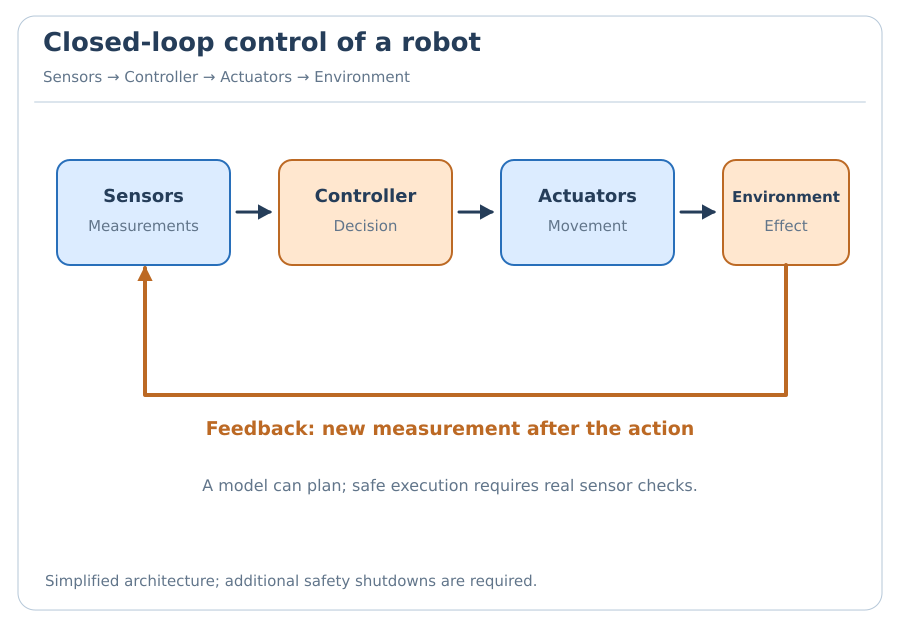
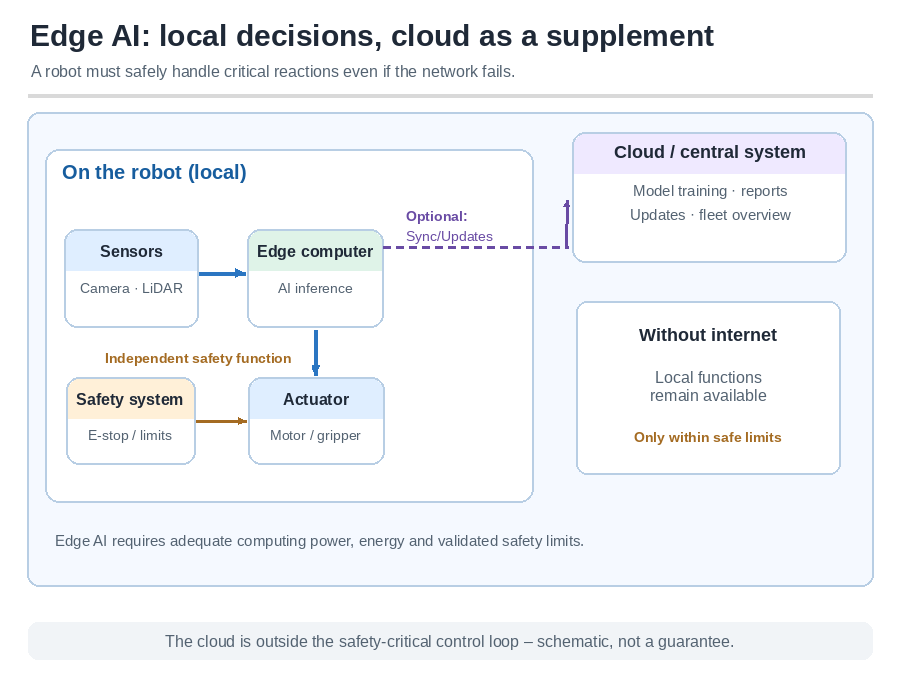

# M6-L7 – Robotics: from the language model to the acting machine {#L7}

**Course area:** M6 – Specialisation: AI and robotics

**Level:** Bachelor’s / Master’s (elective)

**Prior knowledge:** No fixed prerequisites specified.

## Learning objective: why a good answer does not yet produce a safe action {#S1}

A language model can explain how a robot might retrieve a glass from a table. A real robot, however, must **know where the glass actually is**, move its arm there, respond to resistance, avoid people and grasp the glass without endangering either humans or the machine. These are physical requirements: an incorrectly predicted word can be corrected; an incorrectly controlled motor may already cause damage.

In M5-L2 to M6-L3, we learnt how neural networks compute and generate answers. M6-L4 connected AI with tools and verifiable program steps. M6-L5 dealt with cameras and audio; M6-L6 with the necessary computing resources. In this final main lesson, we put everything together. **Robotics** is not simply a language model with wheels or arms, but a combination of mechanics, electronics, computer science, mathematical modelling, perception, control and safety engineering.

We follow the path from a request such as ‘Bring me the red box’ through sensors and localisation to movement and the feedback ‘Task completed’. We see which decisions a model may support, which must be calculated reliably and which safety mechanisms should remain independent of the AI. The text is a **reading course**: no robot hardware, ROS installation or programming environment is required.

All the following architectural and numerical examples are educational models, not specific design or safety approvals. The technical project and standards sources were checked on **4 November 2026**.

## Automation, software agents and robots: three different things {#S2}

**Automation** initially means only that a system performs a task according to fixed rules. An automatic irrigation system, for example, switches on a valve at certain measured values. This can operate entirely without learning AI.

A **software agent** can process information, pursue goals and act via defined program interfaces. A scheduling assistant, for example, checks a calendar and proposes a booking. It acts on a digital state, but not directly on the physical environment. M6-L4 showed why such steps also require permissions and controls.

A **robot**, in the sense relevant here, is a programmable technical system that receives sensor information and acts physically through **actuators** such as motors, grippers or valves. An industrial robotic arm can perform highly precise, repeated motion without machine learning. An autonomous transport robot, by contrast, must perceive its environment and make decisions under changing conditions.

| System | Perceives | Acts | Particular risk |
| --- | --- | --- | --- |
| Fixed automated machine | Switches, fixed measurements | Predetermined sequence | Hardware or rule-set malfunction |
| AI software agent | Files, APIs, texts | Digital actions | Incorrect data changes, permission violations |
| Conventional robot | Sensors, position values | Physical movement | Collision, crushing, property damage |
| AI-assisted robot | Sensors plus learnt models | Physical movement following validated planning | Perception errors and additional AI uncertainty |

A robot does not become intelligent simply by understanding a chat; nor is a simple industrial robot any less a part of robotics because it does not use a language model.

## How robotics has developed {#S3}

Early mechanical automata performed fixed sequences of movement. With electric drives, digital control and industrial manipulators, automation developed into repeatable machine control. Conventional robotics developed methods for **kinematics**, **dynamics**, pose estimation, control and motion planning. These fundamentals remain valid even when modern systems use neural networks.

In a conventional industrial robot, an engineer can, for example, configure target positions, permitted speeds and defined procedures. The controller executes them and monitors relevant feedback. A mobile robot additionally needs the ability to estimate its own position in an environment and account for obstacles. Modern methods of computer vision, machine learning and, later, language and image models extend these capabilities.

The historical development therefore cannot be described as replacing control with AI, but as **building layers**:

``` text
Fixed mechanics + drives
          ↓
Electronic control + feedback loops
          ↓
Maps, sensor fusion, autonomous navigation
          ↓
Learnt perception and motion models
          ↓
Language, task planning and multimodal AI
```

The lower layers do not disappear when a powerful model is added at the top. Someone who understands a chatbot therefore knows only some of the prerequisites for a mobile robot.

## Physical structure: sensor, computer, actuator, energy {#S4}

The basic architecture is straightforward:

``` text
  ENVIRONMENT
     │
     ▼
[SENSORS] ── Measurements ──► [COMPUTER / CONTROLLER]
     ▲                                  │
     │                                  ▼ Commands
     └──── Motion, pose ◄──────── [ACTUATORS]
                   ▲                    │
                   └──── ENVIRONMENT ◄──┘

Separate: power supply, emergency stop / safety functions,
          protective circuits and operating controls.
```

**Sensors** convert a physical state into measurement signals. An **encoder**, for example, measures the rotation of a motor or joint. An **inertial measurement unit (IMU)** measures accelerations and rotational movements, usually with accelerometers and angular-rate sensors. A camera provides images; **LiDAR** (*Light Detection and Ranging*) measures distances using light. Ultrasonic or contact sensors can report certain nearby obstacles. Force and torque sensors help estimate the interaction between a gripper and an object.

**Actuators** produce motion or other physical effects: electric motors turn wheels or joints, grippers close, and valves control pneumatic or hydraulic drives. Between a digital setpoint and the actual motion lie motor drivers, mechanics, inertia, friction and possibly gears. A control command is therefore not equivalent to the result.

A **microcontroller** is a small specialised computer that performs tasks close to the hardware, such as reading an encoder and rapidly controlling a motor. A more powerful computer processes camera images, calculates routes or runs neural networks. A system can combine several computers with clearly distributed responsibilities.

Lastly, every robot needs energy: a battery, mains supply or another source. Energy consumption, charging time, heat, wear and maintenance are not peripheral considerations. A machine that calculates a perfect route but loses power on the way does not fulfil its task.

## Open-loop control is not closed-loop control: the feedback loop {#S5}

In **open-loop control**, a command is issued without continuous feedback on the actual result. An example would be ‘Switch on the motor for two seconds’. The machine still does not know whether the wheel actually turned despite a possible obstruction.

A **closed-loop control system**, by contrast, uses measurements and corrects deviations between the setpoint and the actual value. It typically contains a controller, a plant to be controlled and measurement feedback:

``` text
Target position: 90°
       │
       ▼
[Comparison] ── Error ──► [Controller] ──► [Motor + joint]
    ▲                                          │
    │                                          ▼
    └──────── Encoder ◄─────────────── Actual position
```

If the joint is at 82°, its position still differs from the target of 90° by 8°. The controller can respond to this. A simple **proportional controller (P controller)** produces a control input according to the deviation. Further terms are often added, as in a **proportional-integral-derivative controller (PID controller)**. The integral term accounts for accumulated deviations; the derivative term responds to their rate of change. These methods require suitable tuning: an excessively strong response can cause oscillation, while an overly weak one can produce sluggish motion.

Not every robot needs a PID controller for every subtask. The crucial principle is **measurement → comparison → correction**. Higher-level AI may decide that an arm should grasp an object. The actual joint movement must meanwhile be implemented using suitable, temporally reliable control technology.

Independently, safety monitoring can establish that a speed or operating area is impermissible and trigger a safe response. An ordinary language model does not perform this safety function.

## Real-time means predictable, not merely fast {#S6}

A robot lives in a world that does not wait. A hand moves, a person steps onto the path, an object starts to slip. In addition to the computational result, the **time** at which it becomes available therefore matters.

In this context, **real-time** means that a response must occur within specified time limits. It does not automatically mean ‘as few milliseconds as possible’, but rather **predictable deadlines**. With a hard real-time requirement, a missed deadline already constitutes a failure. Other tasks tolerate fluctuations, such as retrospective analysis of a camera image or a spoken response.

A theoretical workflow could combine different timescales:

- Low-level hardware: often short, regularly observed cycles for motors and sensors.
- Local navigation: recurring perception and adjustment of motion commands.
- AI task planning: occasional, relatively expensive computations with potentially variable response times.
- Fleet management: reports and jobs over a network that may temporarily fail.

This order is an **educational layered model**, not a specification of required cycle times. An ordinary cloud API, whose response arrives at some point after a network round trip, is not suitable as the sole authority for time-critical motor control. Particularly during internet loss or high server load, a locally managed safe response must remain possible.

## A small numerical example: recognition alone is not enough to stop {#S7}

Suppose a mobile robot travels at **0.8 metres per second**. Hypothetically, **0.15 seconds** elapse between detecting an obstacle and the start of effective deceleration. During this delay, it already travels:

{alt="Robotic feedback loop: sensors provide measurements to the controller, the actuators affect the environment, and repeated measurement provides feedback."}

Simplified robotic feedback loop from measurement to action and back again.

$0{,}8\,\mathrm{m/s}\times0{,}15\,\mathrm{s}=0{,}12\,\mathrm{m}$.

Under the additional, highly simplifying assumption of constant deceleration of **$1{,}6\,\mathrm{m/s}^2$**, the braking distance alone is:

$\frac{v^2}{2a}=\frac{{(0{,}8\,\mathrm{m/s})}^2}{2\times1{,}6\,\mathrm{m/s}^2}=0{,}20\,\mathrm{m}$.

Together, this gives **a calculated minimum of 0.32 metres before coming to a standstill** under the idealised assumptions. **This figure is not a permissible safety distance.** Real safety distances must, among other things, account for sensor detection limits, measurement uncertainty, detection of people, friction, gradients, load, fault conditions, safety margins and appropriate standards-based methods. Such a distance cannot be determined for a real robot solely from this elementary calculation.

Nevertheless, the example shows something fundamental: even the best obstacle recognition is of little use if time elapses between perception and physical effect. Perception, communication, control, braking mechanics and safety architecture must therefore be considered together.

## Perceiving the world: from measurement points to objects {#S8}

A camera initially provides pixels, not ‘a red box within reach’. An image model can derive object classes, outlines, depth cues or image regions from them. In certain applications, size, distance, orientation and uncertainty must also be estimated. The actual **pose** of an object describes its position and orientation in a coordinate system.

A LiDAR can produce distance measurements. Obstacles or geometric structures can be derived from them. An encoder provides motion information, while an IMU sensor provides information about acceleration and rotation. Every sensor has weaknesses: cameras suffer in difficult lighting conditions, reflective surfaces can complicate certain distance measurements, and wheel odometry drifts when wheels slip. More sensors do not automatically eliminate these problems.

**Sensor fusion** combines several information sources into a more robust state estimate. How *certain* an estimate is also matters. A plausible position is not necessarily a reliably known position. A system should not respond to high uncertainty with unjustified confidence.

``` text
Camera ─────────────► Object recognition ─┐
LiDAR ──────────────► Obstacles ──────────┤
Wheel encoders ─────► Motion ─────────────┼──► State estimation
IMU ────────────────► Rotation / tilt ────┘            │
                                                       ▼
                                            Map + position + uncertainty
```

There is a difference between a model saying ‘There is probably a cup in the image’ and a gripper being guided to its handle with centimetre accuracy. In the second task, pixel interpretation, depth estimation, coordinate calculations and mechanics come together.

## Where am I? Localisation, maps and SLAM {#S9}

A mobile robot must know its position in an environment. **Localisation** means estimating its own pose relative to a map or known reference system from sensor data. **Mapping** means creating or updating a map. **Simultaneous Localization and Mapping (SLAM)** combines both tasks: the system simultaneously estimates its position and builds a representation of its environment.

Why is this difficult? When the robot moves, its wheel encoders move. But wheels may spin. A camera sees a corridor whose structure might also occur on other floors. People put down boxes, doors open, furniture is moved. The robot must not conclude from an old map that the route is still clear.

SLAM can use camera images, LiDAR or other sensors. The specific methods differ considerably. Some combine recognised places with a correction of previously accumulated position errors – for example, when returning to a familiar location. An **occupancy map**, for example, distinguishes free, occupied and unknown space; other representations store metric points, lines, semantic objects or three-dimensional geometry.

The map is not the world. Even if a route was clear yesterday, someone may have put a chair there today. Mobile robots therefore need both longer-term memory of their environment and current obstacle perception.

## From a target position to a physically feasible motion {#S10}

**Path planning** determines a possible sequence of spatial positions from the start to the goal, accounting for obstacles, prohibited zones and other constraints. However, a route on a map does not yet determine the speed at which the wheels should be controlled.

A **motion controller** follows a planned path and adjusts speed or steering commands according to the current position. **Local planning** accounts for new obstacles and short-term changes. A higher-level navigator monitors the process and decides whether a route must be recalculated or the motion cancelled.

``` text
Goal: storage shelf 4
        │
        ▼
[Localisation + map] ──► [Global path planner]
                                │
                                ▼
Current obstacles ────────► [Local planning / controller]
                                │
                                ▼
                            [Wheel drive]
                                │
                                ▼
                       Position + sensor feedback
                                │
                        back to localisation
```

In robotics, **kinematics** (the relationship between joint configurations and positions) and **dynamics** (forces, accelerations, inertia) are crucial. A mobile robot cannot move sideways arbitrarily if its wheel geometry does not permit it. An arm may be unable to reach a target position because its joints have limits or an obstacle is in the way. A text command such as ‘Drive straight through the door’ is therefore not a finished motion plan.

## Manipulation: grasping is harder than moving a cursor {#S11}

A robotic arm has several **joints** and an **end effector**, such as a gripper or tool. **Forward kinematics** calculates the pose of the end effector from the joint configurations. **Inverse kinematics**, conversely, attempts to find suitable joint configurations for a desired pose. Several solutions may be possible – or none at all.

Collisions must also be avoided: with the table, the arm itself, the workpiece and people in the workspace. A purely geometric route may be insufficient if a heavy object significantly changes the dynamics. A gripper must also account for material, shape, friction and the required grasping force.

An understandable manipulation chain is:

``` text
Recognise object
   → Estimate object pose and grasp possibilities
   → Calculate reachable arm configuration
   → Plan collision-checked trajectory
   → Execute controlled motion
   → Check grasp contact, force and success
   → On failure, stop safely or replan
```

This is the difference between a **symbolic goal** and **motor implementation**. A language model might propose ‘Grasp the bottle by its body, not its cap’. That is a task idea. The correct configuration, force limitation and movement must, however, be determined within the robotic system using its sensor data and validated limits.

## ROS 2 as a toolkit for robotic software {#S12}

Despite its name, **Robot Operating System 2 (ROS 2)** is not a standalone operating system like Windows or Linux, but a software framework with communication mechanisms, tools and reusable robotics components. It supports dividing a system into **nodes**. Each node can, for example, provide sensor values, analyse images, manage a map or execute navigation jobs.

ROS 2 nodes communicate, among other ways, through three types of interface:

1.  **Topics** – continuous message streams following the publish/subscribe principle. Example: a sensor repeatedly publishes distance measurements; several other nodes subscribe to them.
2.  **Services** – request and response for a typically brief operation. Example: ‘What configuration is currently set?’ or ‘Calculate a single inverse kinematics solution’.
3.  **Actions** – longer-running tasks with a goal, feedback, a result and the possibility of requesting cancellation. Example: ‘Navigate to this target position’ and continuously provide progress updates.

A simplified ROS 2 architecture might look like this:

``` text
[Camera node] ── Topic: images ──► [Object recognition]
[LiDAR node] ─── Topic: scans ───► [Localisation]
                                          │
                               [Navigation node]
                                          ▲
                                Action: drive to goal
                                          │
                                 [Task manager]
                                          │
                                 Service: check status
                                          ▼
                                 [Control node]
                                          │
                                        Motors
```

ROS 2 also has parameters, lifecycle concepts, recording and inspection tools. Configurable **quality-of-service (QoS) properties** support reliable communication, for example by determining how message losses or message retention are handled. The appropriate choice depends on whether a stream contains fast, frequent measurements or rare, important state information, for example. **However, QoS does not automatically guarantee functional safety, perfect networks or compliance with all real-time deadlines.**

The architectural principles are more general than ROS 2: components should have defined tasks and message contracts. ROS 2 is widespread but is not the only possible middleware or control environment. Even without a ROS installation, the system can be understood as a graph of communicating services. The official ROS 2 project documentation explicitly distinguishes topics, services and actions by their communication patterns; `ros2_control`, for example, is available for hardware integration and controllers.

## Nav2, MoveIt 2 and ros2_control: not three names for the same thing {#S13}

A common beginner's mistake is to assume a robotics framework automatically does everything. In fact, different systems fulfil different tasks:

- **Nav2** (Navigation2) deals particularly with mobile navigation: state estimation, environment representation, planning, control and coordination of workflows, for example through **behaviour trees**.
- **MoveIt 2** focuses on manipulation: motion planning for robotic arms, kinematics and collision considerations.
- **ros2_control** connects controllers to hardware interfaces and organises the process of reading states, updating controllers and sending commands to hardware.

The boundaries are not absolute; real systems can use other components. But the distinction is educationally useful: **navigation determines where to travel through the environment; manipulation plans how an arm moves; a low-level control architecture implements suitable control inputs.** None of these projects is in itself a robot's complete safety approval.

**Behaviour trees** do not refer here to the growth of a neural network. They structure sequences of action: ‘Check goal’, ‘Plan route’, ‘Follow route’, ‘On failure, choose safe alternative’. A behaviour tree can be inspected and often limits the uncontrolled freedom of a purely language-generated sequence of actions. However, it does not replace an independently designed protective device either.

## Edge computing and cloud: what belongs where? {#S14}

**Edge computing** means that computations run close to the physical machine, for example on an embedded computer or local controller. The **cloud** is nevertheless useful for robotics: fleet management, long-term data storage, model training, analyses and job allocation can be organised centrally.

{alt="Edge AI system: sensors and local AI inference guide a robot's actions. A separate protective system monitors the hardware. The cloud is optional for model training, reports and updates."}

Local perception, control and independent protective functions remain separate from cloud access. Offline operation is sensible only within defined limits.

However, responsibilities should be deliberately separated:

``` text
                      CLOUD / CONTROL CENTRE
               Job management, reports,
               model distribution, fleet overview
                            │
                   Intermittent network connection
                            │
                            ▼
                        EDGE COMPUTER
              Perception, navigation, local tasks
                            │
                  Monitored control commands
                            ▼
                    CONTROL / ROBOT HARDWARE
              Measurements, motors, defined limits
                            │
                            ▼
                  INDEPENDENT SAFETY FUNCTIONS
                 Suitable protective and stopping effects
```

**Offline capability** to the appropriate extent is important. If the internet fails, the cloud can no longer coordinate the job. The robot should not then blindly continue executing the most recent indefinite motion commands. Depending on the task, a safe response may mean stopping in a controlled manner, completing the current motion according to a validated procedure or changing to a safe operating state. Which response is correct depends on the specific hazard scenario.

The local computer need not be able to run every large AI model itself. For some tasks, a small perception component is sufficient, while a larger language-planning model runs optionally in the cloud. However, a network connection must not be an implicit prerequisite for a robot to respond to an immediate obstacle.

## How a language model can support a robotic task {#S15}

Consider the statement: **‘Please bring the red box from the shelf into the study.’** It contains several questions. Which box? Which shelf? Where is the study? Is the transport even permitted and physically possible?

A **large language model (LLM)** can interpret the language and propose a rough hierarchy of goals. A suitable multimodal model can also incorporate images or object descriptions. A production architecture should then use several verifiable levels:

``` text
User request
    │
    ▼
[LLM: meaning and proposal]
    │  "Find object X at location Y, bring to Z"
    ▼
[Task manager: permissions, plausibility, state]
    │
    ▼
[Object and location checks using sensors]
    │
    ▼
[Deterministic planning + validated motion limits]
    │
    ▼
[Controller and safe hardware control]
    │
    ▼
[Feedback: completed / not possible / cancelled]
```

The model should not itself generate arbitrary motor-control messages and send them to the drive without checks. Instead, it can access **predefined, narrowly bounded capabilities**, such as ‘Search for object’, ‘Navigate to approved point’ or ‘Request confirmed grasp action’. Each capability independently checks prerequisites, limits and success.

This is the physical continuation of **tool calling**, discussed in M6-L4: the model's suggestion is a proposal, not authorisation. The application checks whether the job is permitted, whether people might be in the hazard area and whether the desired motion is technically responsible.

Modern research on **vision-language-action (VLA) models** sometimes goes further: they connect visual data, language and robotic action representations. One research example is **RT-2**, presented by Google DeepMind in 2023. Such systems demonstrate research approaches for deriving actions from image and language information. They are not evidence that arbitrary unknown environments can be handled safely and autonomously in this way. A learnt motion model also needs appropriate limits, monitoring and practical validation.

## Why physical safety must be a separate layer {#S16}

**Functional safety** means that safety functions should remain effective, including in anticipated fault conditions, within a systematic consideration of hazards and risks. This is different from IT security or a good recognition model – even though both topics are connected.

An **emergency stop** is intended to trigger a specified stopping function. It is not simply a button in a spoken dialogue and does not replace protective design measures. Depending on the machine, further technical protection functions may be required, such as monitored operating areas, speed limits, safety distances, safe power disconnection or other suitable devices. Which of these are required can only be assessed for the specific application and according to the applicable rules.

A conceptual safety architecture keeps critical paths independent of the generative AI:

``` text
                 AI / TASK PLANNING
                     │
              Permitted goal proposals only
                     ▼
              NORMAL MOTION CONTROL LOOP
                     │
                     ▼
                    DRIVE
                     ▲
                     │ Independent protective effect
           SAFETY MONITORING / PROTECTIVE CIRCUIT
              ▲                   ▲
          Stop device        Suitable protective sensors
```

The drawing represents a **principle**, not an electrical safety schematic. The critical underlying idea is that an LLM, whose responses are generated probabilistically, is not a sufficient authority for a safety-critical stopping decision. A network failure or hallucinated text must not disable a safety-related function.

Different standards and application limits apply to different types of robot. For example, **ISO 10218-1:2025 and ISO 10218-2:2025** concern industrial robots and their integration and applications respectively. **ISO 13482:2014** concerns certain personal care robots; a successor edition was still undergoing standardisation when checked on 4 November 2026. Such standards are **not interchangeable**, and a general educational text cannot replace a product-specific conformity assessment. The applicable rules depend on the machine, environment, country, type of use and role of the manufacturer or operator.

## Typical failures: reality is messier than a simulation {#S17}

A real robot encounters situations that a neatly drawn diagram does not show. Some examples:

**Occluded obstacles.** A camera sees only in certain directions. A child may be behind a door, an object partly hidden. Failure to detect something is not proof that the route is clear.

**Sensor deviations and wear.** Mechanical sensor mounts can shift, wheels can wear down, grippers can jam and measurements can fail. Calibration can become invalid after a modification.

**Incorrect coordinate systems.** An object is correctly recognised but its position is interpreted in the wrong reference frame. A motion that points towards the table in simulation may then move in the wrong direction in reality.

**Unknown objects.** A model may recognise ‘bottle’ but not know whether it is empty, full, fragile, hot or impermissible to grasp. Learnt visual knowledge does not replace checking its actual properties.

**Network and software failures.** A message may arrive late, a computer restart, a sensor stream be interrupted. The system must recognise stale states and must not simply assume that the most recently received data remain current.

**Insufficient training data.** A model may appear reliable in a well-lit laboratory and fail with dust, poor visibility or unusual objects. Even after many tests, the question remains whether the tested cases sufficiently cover real operation. The US **National Institute of Standards and Technology (NIST)** investigates such problems in autonomous systems assurance.

**Simulation-to-reality gap.** A simulation can only approximate forces, material properties, light or human behaviour. Simulation facilitates testing many situations, but must not replace testing the actual machine.

Robotics therefore includes not only algorithms but also measurement records, maintenance intervals, fault diagnosis, clear state transitions and responsible operators.

## Device identity, network security and safe updates {#S18}

Robotics connects the physical world with the security problems from M1-L6 and M4-L3. If an external device on the network can send control commands, that is not merely a data problem. Components and participating services must therefore be appropriately identified and authorised.

**Device identity** means that fleet management should be able to distinguish *which specific robot* is reporting, what software it uses and which jobs it may receive. Suitable methods include, depending on architecture, device certificates, protected keys, secure network connections and role-based permissions. Sensor data, camera streams, locations and movement logs can contain personal or confidential business information. Access and retention should be limited accordingly.

**Telemetry** includes operational data such as battery level, error codes, estimated position, connection status and maintenance needs. It helps detect failures, but is no guarantee that a robot acts correctly under all circumstances. *Fleet management* coordinates multiple devices: work orders, charging stations, maintenance windows, version information and bottlenecks.

An **over-the-air update (OTA update)** distributes new software over a network. It must be planned: software versions, signature verification, hardware compatibility, controlled rollout, safe operating states and recovery after a failed update are important. An unchecked automatic update during a critical movement can itself become a risk. Robotics updates therefore differ from ordinary website updates.

Behaviour during communication loss must form part of operational design. A cloud can coordinate robots; however, it cannot reliably assess every immediate physical event in time. The machine needs local protective functions and a clearly defined failure state that is safe for the application.

## Three practical examples, from simple to demanding {#S19}

### Example A: stationary camera station for a local media archive

A small tabletop setup photographs objects one after another. A camera and a turntable create several views; local software assigns images and metadata. A speech recognition system could propose filenames, but the workflow is predominantly conventional automation.

**Architecture:**

``` text
Camera → local computer → image archive / metadata
             │
             ▼
       Limited-travel turntable
         with simple control
```

**Sensible:** When repeated photographs from fixed positions are needed. **Not needed:** A large language model for every individual rotation. **Risks:** Mechanical mounting, crushing points, lighting, file and backup protection, and maintenance. The actual archive software from M1-L5, M2-L2 and M6-L5 remains available independently of the motor. In a small system, simplicity is often a major advantage.

### Example B: mobile transport robot in a small warehouse

A device travels between marked storage locations. It needs localisation, a current environment map, obstacle perception, motion planning, local control and a coordinated safety concept. A central application allocates jobs but cannot control motor feedback loops over the internet.

**Architecture:**

``` text
Warehouse management → job for robot
                         │
                  On-board computer
             Map / position / navigation
                         │
                  Local motion control
                         │
                   Wheels + sensors
                         │
              Status back to warehouse
```

**Sensible:** For repeated transport routes in a manageable environment. **Limitations:** Charging times, narrow aisles, other vehicles, pedestrian traffic and unpredictable obstacles. **Operation:** Map maintenance, battery replacement or charging, inspection, safe route approvals, wireless coverage and faults. A speech interface can make warehouse orders easier to understand, but is not essential for navigation itself.

### Example C: mobile manipulator with AI task planning

A more complex system combines a mobile base with a robotic arm, gripper, cameras and possibly a multimodal model. The instruction ‘Fetch the red box from the shelf’ leads to many sub-decisions: unambiguously identify the object and goal, check transport permission, plan navigation, determine the position relative to the shelf, and monitor grasping and placement.

**Architecture:**

``` text
Instruction
   │
   ▼
[LLM or VLA: task understanding]
   │ Validated subtasks only
   ▼
[Task manager / safety approvals]
   ├──► [Navigation: position base]
   └──► [Manipulation: grasp, transport]
                   │
                   ▼
             [Controller / hardware]
                   │
                   ▼
              [Success or error status]
```

**Sensible:** For changing tasks, when flexible language planning adds real value. **Not automatically sensible:** Simple, strictly repeated workflows often benefit more from proven fixed methods. **Limitations:** Object confusion, grasp errors, unpredictable environments, high integration and testing costs, additional energy consumption and complex responsibilities. Risk-dependent validation, human intervention options and maintenance processes are needed before any large-scale deployment.

The third example connects M6-L4 (tools and agents), M6-L5 (multimodal perception) and M6-L6 (local/remote AI computing power), but replaces none of the conventional robotics layers.

## Costs, maintenance and economic viability {#S20}

Acquisition is only one part of total costs. A robotic system can involve mechanics, sensors, drives, batteries and charging technology, control hardware, software development, integration, safety technology, testing, spare parts, maintenance, energy costs, training, backups, connectivity and, where applicable, model APIs or GPU operation. Added to these are the costs of an unavailable machine and human supervision.

A single device can be demanding if every change in the environment requires recalibration. An entire fleet creates additional tasks: device inventory, coordinated job distribution, secure updates, location and data management, replacement hardware and monitoring of faults. The number of robots alone does not determine whether operation is economically worthwhile.

**When is robotics sensible?** For example, for frequently repeated physical tasks, hazardous environments or workflows whose ergonomic demands justify a machine. **When is it excessive?** When a simple software service, a fixed sensor or a mechanical device achieves the same goal with less complexity. Often, the best first step is not ‘more AI’, but a clearly defined problem and a less complicated system.

As in M4-L4, none of the considerations here constitutes a specific quotation or reliable provider price list. A purchasing decision requires actual requirements, quotations, technical validation and assessment of applicable safety and data protection obligations.

## Mathematical connections and possible Master’s specialisations {#S21}

Robotics demonstrates particularly clearly how mathematics and computer science work together. The following subject connections are **general** and have not been checked against an actually inspected roadmap of the separate mathematics course:

| Mathematical topic | Application in robotics |
| --- | --- |
| Linear algebra and geometry | Coordinate transformations, camera poses, joint configurations |
| Analysis and differential equations | Motion, acceleration, change over time |
| Numerical mathematics | Approximation methods for inverse kinematics and optimisation |
| Probability and statistics | Sensor noise, pose uncertainty and fusion |
| Graphs and optimisation | Route planning and cost functions |
| Control theory | Stability, feedback, observers and safe responses |

In the **Bachelor’s elective area M8–M10**, the subject fits particularly well with embedded systems and fundamentals of hardware and operating systems. In the planned **Master’s elective area**, control and robotics offer a suitable later specialisation; mathematical AI optimisation offers additional connections. Topics such as state-space models, Kalman filters, trajectory optimisation, model-predictive control and uncertainty quantification could be explored in more depth. These additional specialisations are suggested topics for the computer science course, **not separate, completed Master’s lessons**.

The self-contained explanation of this lesson remains understandable even without the parallel mathematics project. A later mutual comparison requires the actual mathematics course index; there is no automatic synchronisation of the two chats.

## Overall review of M5-L1 to M6-L7 {#S22}

The AI series began with a historical question (M5-L1), explained neural networks and learning methods (M5-L2/M5-L3), led through the Transformer architecture and processing a chat request (M6-L1/M6-L2), examined post-training and quality (M6-L3), added external information and tools (M6-L4), explored images, sound and video (M6-L5) and considered running models on computing hardware and clusters (M6-L6).

**M6-L7 adds physical reality.** As soon as a model not only answers but also influences a machine, measurement uncertainty, spatial geometry, time, inertia, maintenance and protective functions become indispensable.

The overarching principle is:

> **AI can propose goals and support perception. A robot must translate these goals into the physical world using current measurements, validated motion procedures and suitable, independently effective protective measures.**

## Sources {#S23}

**Last source check:** 4 November 2026

The following references explain technical principles or the existence and scope of standards. They are **not evidence that a specific device is safe or legally compliant**. The official ROS 2 web documentation was partially access-restricted when checked; publicly readable sources from the official ROS 2 documentation repository are therefore also cited.

1.  **ROS 2, official project documentation – Nodes:** [https://github.com/ros2/ros2_documentation/blob/rolling/source/ROS-Framework/About-Nodes.rst](https://github.com/ros2/ros2_documentation/blob/rolling/source/ROS-Framework/About-Nodes.rst) – division and communication of nodes.
2.  **ROS 2, official project documentation – Topics, Services, Actions:** [https://github.com/ros2/ros2_documentation/blob/rolling/source/ROS-Framework/Interfaces-Topics-Services-Actions.rst](https://github.com/ros2/ros2_documentation/blob/rolling/source/ROS-Framework/Interfaces-Topics-Services-Actions.rst) – message interfaces and their different patterns.
3.  **ROS 2, node lifecycle design:** [https://design.ros2.org/articles/node_lifecycle.html](https://design.ros2.org/articles/node_lifecycle.html) – controlled activation and fault states of components.
4.  **ROS 2 / ros2_control, architecture:** [https://control.ros.org/jazzy/doc/getting_started/getting_started.html](https://control.ros.org/jazzy/doc/getting_started/getting_started.html) – hardware abstraction, controller manager and control workflow.
5.  **Nav2, Navigation Concepts:** [https://docs.nav2.org/rolling/getting_started/navigation_concepts/](https://docs.nav2.org/rolling/getting_started/navigation_concepts/) – localisation, maps, global/local navigation and behaviour trees; continuously updated project documentation.
6.  **MoveIt 2, documentation:** [https://moveit.picknik.ai/](https://moveit.picknik.ai/) – motion planning, manipulation, kinematics and collision.
7.  **MoveIt 2, Motion Planning:** [https://github.com/moveit/moveit2_tutorials/blob/main/doc/concepts/motion_planning.rst](https://github.com/moveit/moveit2_tutorials/blob/main/doc/concepts/motion_planning.rst) – planning requirements, joint spaces and collision checking.
8.  **Google DeepMind, RT-2 (2023):** [https://deepmind.google/blog/rt-2-new-model-translates-vision-and-language-into-action/](https://deepmind.google/blog/rt-2-new-model-translates-vision-and-language-into-action/) – research on vision-language-action models, not a general assurance of operational safety.
9.  **NIST, Autonomous Systems Assurance:** [https://www.nist.gov/programs-projects/autonomous-systems-assurance](https://www.nist.gov/programs-projects/autonomous-systems-assurance) – difficulties of test coverage and verification of autonomous systems.
10. **ISO, ISO 10218-1:2025:** [https://www.iso.org/standard/73933.html](https://www.iso.org/standard/73933.html) – standard for safety requirements for industrial robots; integrated robotic applications are additionally the subject of ISO 10218-2:2025.
11. **ISO, ISO 13482:2014:** [https://www.iso.org/standard/53820.html](https://www.iso.org/standard/53820.html) – safety requirements for certain personal care robots; the successor edition under development in 2026 had not yet been published when checked.
12. **ISO, draft successor ISO/FDIS 13482 (status November 2026):** [https://www.iso.org/standard/83498.html](https://www.iso.org/standard/83498.html) – undergoing standardisation; therefore **not identified as a currently applicable published standard**.

**Status and limitations:** Technical sources checked on 4 November 2026. Version-specific project functions can change; basic control and architectural principles must be distinguished from specific products. The braking-distance model calculation was performed independently and **is not suitable for real safety distances**. No installation, hardware purchase or practical execution is required.
