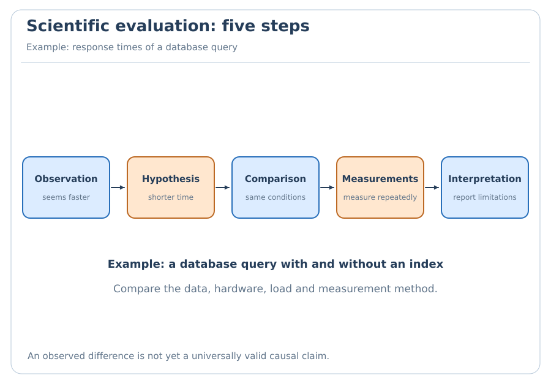

# M7-L1 – Scientific computer science: models, hypotheses and reasoning {#L1}

**Course area:** M7 – Master’s-oriented computer science

**Level:** Master’s orientation

**Prior knowledge:** [M1-L1](M1-L1.md) · [M1-L3](M1-L3.md) · [M8-L1](M8-L1.md) · [M9-L2](M9-L2.md)

## Overview: From ‘it works’ to ‘how can we justify it?’ {#S1}

The preceding modules M1–M6 described **how** computers, algorithms, databases, cloud services, artificial intelligence and robotics work. The scientific perspective goes further: **What exactly is being claimed? What assumptions apply? What has been measured or logically proved? What counterexamples are conceivable?**

A program might, for example, process 10,000 records in a few seconds. Initially, this is an observation under particular conditions. It does not readily follow that the program is ‘inherently fast’: we know neither the dataset nor the hardware, utilisation, cache state or a meaningful method of comparison. Another implementation may be slower for 10,000 records but faster for ten million.

**Scientific computer science** combines mathematical models, formal reasoning, controlled investigations and transparent interpretation. A result may explicitly state that a new technique offered no advantage or did so only under narrowly defined conditions. Its value lies in understanding those conditions.

This lesson covers models and abstractions, testable hypotheses, proofs and tests, scientific measurement, experimental design, causality, uncertainty, reproducibility, validity and concrete examples from databases, cloud operations and AI. The Master’s core is an **educational extension**, not a certificate of an academic Master’s degree.

## Three forms of knowledge in computer science {#S2}

Computer science is neither mathematics alone nor merely the craft of software development. In practice, at least three perspectives complement one another:

| Perspective | Guiding question | Typical evidence | Limitation |
| --- | --- | --- | --- |
| **Formal computer science** | Is a procedure correct under precise rules? | Definition, proof, invariant, counterexample | Does not prove real execution time on specific hardware |
| **Empirical computer science** | How does an implementation actually behave? | Observation, measurement, experimental comparison, statistics | Covers only the situations investigated |
| **Software and systems engineering** | Does the solution meet real operational requirements? | Tests, architecture review, monitoring, assessment of risks and costs | Operational experience is not a complete formal guarantee |

An algorithm may be formally correct but too slow in practice. A cloud service can respond very quickly on a test system but become unreliable during disruptions. A system that has operated without problems for years is not thereby mathematically proved correct for every future input.

Complex decisions therefore often require **several forms of evidence**. M7-L2 examines proofs and computability in more detail; M7-L3 the guarantees of distributed systems; M7-L4 architectural decisions; M7-L5 AI evaluation; and M7-L6 an integrated research and systems perspective.

## A model is not reality {#S3}

A **model** is a simplified representation of a process or system that can be used to answer particular questions. A model of a search algorithm can count the number of comparisons without having to consider processor temperature, the file system or network protocols.

Example: In a linear search through an unsorted list with `n` entries, `n` positions are examined in the worst case. A binary search can repeatedly halve the search range in a suitable sorted list with direct access. The model shows the difference in asymptotic cost. However, it does not directly determine how many milliseconds a particular implementation requires, since memory accesses, data types and hardware also play a role.

A useful model includes:

1.  **Subject:** What is represented – an algorithm, database, user behaviour or distributed system?
2.  **Assumptions:** What prerequisites apply, for instance sorted data or independent server failures?
3.  **Derived statement:** What may the model predict or justify?
4.  **Scope:** For which situations was the model designed?
5.  **Limitations:** Which simplifications might become relevant in real applications?

``` text
Real problem or system
           |
           v
Chosen question + observable properties
           |
           v
Assumptions and deliberate simplifications
           |
           v
         Model
          /  \
         v    v
    Logical  Measurable
  derivation prediction
         \    /
          v  v
Compare with observations and assumptions
           |
           v
  Retain, restrict or revise model
```

Different models can be useful simultaneously. A **descriptive model** may show the steps of a web request. A **predictive model** estimates response time as load increases. A **normative model** specifies which states an order may have. A normative business rule is not yet evidence that the software actually complies with it, however.

**When useful?** When the aim is to make complex systems understandable, compare them or examine their correctness. **When excessive?** When a small one-off procedure can be assessed sufficiently reliably through direct visual inspection. **Risk:** Forgetting the model assumptions confuses a useful simplification with unrestricted reality.

## Observation, question, hypothesis and operationalisation {#S4}

A typical line of reasoning begins with an observation:

{alt="Investigation flow diagram: observation, testable hypothesis, controlled comparison, measurements, critical interpretation."}

Research steps using a database index as an example: a fair comparison requires controlled conditions.

- **Observation:** ‘After introducing a database index, the search function seemed faster.’
- **Question:** ‘Does the index make this particular search query measurably faster under comparable conditions?’
- **Hypothesis:** ‘For a specified table and query size, mean response time with the index is lower than without it.’
- **Investigation:** ‘Response time is compared repeatedly with the same dataset, documented load and control of other factors.’

A **hypothesis** is a reasoned conjecture that is testable in principle. **Operationalisation** translates abstract concepts such as ‘fast’, ‘safe’, ‘reliable’ or ‘intelligent’ into measurable or otherwise testable characteristics.

| Claim | Measurable formulation | Crucial unresolved definition |
| --- | --- | --- |
| ‘Search is fast’ | Response time in milliseconds | From the client to the response, or only database execution time? |
| ‘The service is available’ | Proportion of successful requests per period | What counts as an error? |
| ‘The AI is more accurate’ | Error rate on clearly described cases | How were cases selected and labelled? |
| ‘The system scales’ | Throughput, latency, error rate and cost as load increases | Do hardware and budget remain constant? |

**Falsifiability** is often discussed in the philosophy of science: a testable claim should be incompatible with certain conceivable observations. ‘My technique is somehow better under all conditions’ hardly permits meaningful testing. ‘Under these documented conditions, version B halves mean latency’ can be refuted. Karl Popper's approach is an important tool, but not the only philosophy of science; real measurement errors and auxiliary assumptions complicate simple refutation by a single result \[1\].

### Null hypothesis and alternative hypothesis {#41-nullhypothese-und-alternativhypothese}

In statistical investigations, **$H_0$ (null hypothesis)** denotes, for example, the assumption that two methods do not differ in a particular population characteristic. **$H_1$ (alternative hypothesis)** assumes a difference or a particular direction. The test examines how compatible the available data are with $H_0$ under the test assumptions. A non-significant result does not normally mean that both methods are identical.

A carefully formulated question precedes the measurement. Anyone who repeatedly adapts the hypothesis to the best results after many trials risks producing an apparently precise explanation that arose precisely through the selection of the data.

## Four ways of justifying a claim – and what they really show {#S5}

### Mathematical proof {#51-mathematischer-beweis}

A **proof** derives a statement logically from specified premises. Example: A linear search examines a list position by position. After `k` unsuccessful checks, the desired value is not among the first `k` positions. This statement is a simple **loop invariant**. If the list has been completely and correctly examined, the result ‘not found’ means that no corresponding entry exists.

The proof applies to the specified procedure. It does not prove that a particular implementation is error-free, that every memory cell works or that the search will be fast enough on all hardware.

### Empirical test {#52-empirischer-test}

A test uses specific inputs and observes an actual result. It can reveal errors or support a hypothesis but cannot automatically cover every conceivable input. A test that succeeds a million times is no substitute for a formal proof of a universal property.

### Simulation {#53-simulation}

A **simulation** executes a simplified model. This makes it possible, for example, to compare many variants of network failures without having to shut down real servers. The results depend on the rules built into the model, however. A failure type that is absent from the simulation model cannot be discovered there either.

### Field observation {#54-feldbeobachtung}

A **field observation** investigates a system in actual operation. It can reveal unexpected interactions but is harder to control. If the error rate falls after a server update, user load, network quality or the dataset may have changed at the same time.

**Key principle:** Proofs require clear assumptions; experiments require fair comparisons; simulations require suitable models; field observations require cautious interpretation of causes.

## Correlation, causation and confounding factors {#S6}

**Correlation** means that two observed quantities change together. **Causation** means that a cause influences an effect. If lower latency is measured after a software update, a temporal relationship has initially been observed. This sequence alone does not establish a cause.

A **confounding factor (confounder)** may be related both to the change being investigated and to the outcome. Examples in a server benchmark:

- A full cache instead of a cold start.
- A different dataset or different popular search terms.
- Updates, background load or computer temperature.
- Different network delays, times of day or test locations.
- A different number of concurrent requests.
- Changed handling of errors and timeouts.

``` text
             New software version
                      |
                      v
                Response time
                      ^
                      |
    Cache / load / hardware / data / network
```

A sound comparison seeks to **control, distribute or disclose** alternative explanations. **Randomisation** refers to random assignment of conditions or participants. **Blocking** groups comparable conditions, such as different classes of hardware or measurement days, before the variants are compared within these groups. These traditional methods reduce possible bias; they do not guarantee absolute freedom from error \[2, 3\].

### Experiment or mere observation? {#61-experiment-oder-blosse-beobachtung}

An **observational study** examines something without completely determining the conditions. A **controlled experiment** deliberately changes one factor and keeps other relevant influences constant or distributes them appropriately. An **A/B test** compares two variants, often with random assignment. Studies involving real users raise questions of data protection, potential harm and an appropriate legal basis. Not every product optimisation justifies a live experiment.

## Experimental design – the real work starts before measurement {#S7}

An experiment needs a **research question**, a **baseline**, metrics and a transparent experimental plan. A baseline may be the old software version, a simple conventional method or an unchanged configuration.

An understandable experimental plan distinguishes between:

1.  **Object of investigation:** software version, dataset, configuration, hardware.
2.  **Factor changed:** for example, index on/off or caching on/off.
3.  **Metrics:** response time, error rate, throughput, energy and memory requirements.
4.  **Factors held constant:** input data, load, operating environment.
5.  **Repetitions and order:** to better assess chance and changes over time.
6.  **Evaluation rule:** predefined metrics, error handling and exclusions.

Always testing variant A before variant B can systematically favour the second variant: the cache is warm, the background load has changed or the computer is now in a different power mode. A randomised or appropriately alternating order helps limit such factors.

In a **factorial design**, several influencing variables are investigated in combination. A cache might, for instance, help under low load but perform worse under high concurrency. This interaction effect remains invisible if only one ideal condition is considered at a time. Factorial design requires additional trials; for simple decisions, a narrow but sound experiment is sometimes sufficient \[2\].

### Many measurements are not always many independent observations {#71-viele-messungen-sind-nicht-immer-viele-unabhängige-beobachtungen}

A hundred consecutive responses often share the same cache, connection and load phase. They are not necessarily **independent** observations. If the hypothesis is that a system is reliably faster on different days, several load phases or days may need to be considered. A large number of similar individual requests cannot remedy a poorly chosen sample.

## What do we measure – and what remains invisible? {#S8}

Even apparently simple technical terms require an unambiguous definition.

- **Latency:** elapsed time between two precisely identified events, for example sending a request and receiving the response at the client.
- **Throughput:** number of completed operations or processed bytes per unit of time.
- **Error rate:** proportion of specified errors within a defined set of operations.
- **Availability:** proportion of the period considered in which the service fulfils its defined function.
- **Resource consumption:** including CPU time, working memory, storage access, network transfer and electrical energy.

These quantities can conflict: a system processes twice as many requests per second while the response time of individual users increases. A new AI computes its results faster but makes more erroneous decisions. Doubling the server provision reduces certain failures but increases operating costs.

**This is why one must not present only an attractive metric.** The subject of the investigation determines which combination of metrics is actually relevant.

### Mean, median and the tails of a distribution {#81-mittelwert-median-und-rand-der-verteilung}

The **arithmetic mean** is the sum of all values divided by their number. The **median** is the middle value in an ordered series, or the mean of the two middle values when the number is even. A **percentile** describes a threshold of a distribution. The 99th percentile, often written **p99**, is approximately the boundary below which 99% of observed values fall; calculation methods may differ for finite samples.

**Constructed example:** The five response times `10, 11, 12, 13, 54` milliseconds give:

- Mean: $\frac{10+11+12+13+54}{5}=20\,\mathrm{ms}$.
- Median: `12 ms`.
- Four of the five responses take only 10–13 ms; the fifth significantly influences the mean.

From **only five** measurements, no reliable conclusions about rare p99 behaviour can be drawn. In distributed applications, precisely these slower tail regions are important: if an overall query has to wait for many partial responses, rare slow individual responses can dominate the total latency. This is explained in the scientific publication *The Tail at Scale* \[4\].

### Measurement uncertainty, calibration and measurement artefacts {#82-messunsicherheit-kalibrierung-und-messartefakte}

Measurements have a **resolution**, statistical variation and possibly systematic errors. A displayed value of `4,217384 ms` is therefore not automatically more accurate than `4,2 ms`. Accuracy depends on the measuring instrument and conditions, not the number of decimal places.

In metrology, **repeatability** describes whether measurements under conditions that are as similar as possible yield similar results. **Reproducibility in the metrological sense** considers partly changed conditions, such as instruments, operators or laboratories. These terms must be distinguished from *computational reproducibility*, described later \[5\].

The measurement itself can also place a load on the system: detailed logging, a profiler or database analysis requires resources. In PostgreSQL, `EXPLAIN ANALYZE` actually executes a query, shows the measured plan components and can **change data** when executing write commands. The measurement does not automatically capture the same overall latency that a user experiences through the network and user interface \[6\]. `EXPLAIN` without `ANALYZE`, by contrast, primarily shows planned, estimated execution costs; these should not be understood as milliseconds.

## Fully worked example: Does a database index bring an advantage? {#S9}

The following numbers are **entirely fictional and constructed for learning purposes**, not results of executed benchmarks. We imagine five comparable situations in which the same kind of search query is considered with and without an index.

| Situation | Without index (ms) | With index (ms) | Difference (ms) |
| --- | --- | --- | --- |
| 1 | 12 | 8 | 4 |
| 2 | 14 | 9 | 5 |
| 3 | 11 | 8 | 3 |
| 4 | 13 | 9 | 4 |
| 5 | 15 | 10 | 5 |
| **Sum** | **65** | **44** | **21** |
| **Mean** | **13,0** | **8,8** | **4,2** |

The absolute difference between the two means is $13{,}0-8{,}8=4{,}2\,\mathrm{ms}$. Relative to the initial value, this gives $\frac{4{,}2}{13{,}0}\times100\approx32{,}3\,\%$. The five paired differences are `4, 5, 3, 4, 5 ms`; their mean is also `4,2 ms`. This is mathematically expected for fully paired observations.

**What the numbers illustrate:** In these constructed example data, the selected query with an index is on average 4,2 ms faster, or about 32,3% shorter relative to the baseline. **What they do not show:** that every index always helps, that the effect is just as large for millions of records or that a generally valid statistical statement can already be derived from it. There are no actual random measurements and no uncertainty estimate.

An index uses storage space and must be maintained during writes. A small table may be read faster without an index. The database planner may choose different access paths depending on the filter, table statistics and data volume. A scientific comparison would therefore also have to consider **write costs, data size, query frequency and user requirements**.

An appropriate conclusion after a real, carefully documented experiment might read:

> Under the stated test conditions, the mean response time of this search query was lower with an index. Other data volumes, query types, load conditions and the costs of additional index maintenance were not comprehensively investigated in this comparison.

This is considerably more informative than the blanket claim ‘Indexes make databases 32% faster’.

## Statistical uncertainty: Precision is not an absolute degree of truth {#S10}

When real measurements vary, the observed difference may arise from a technical effect, chance, confounding factors or several causes. Statistics help describe uncertainty **under stated model assumptions**. They cannot magically undo methodological errors afterwards.

The **standard deviation** describes variation around a mean. If we repeatedly draw samples under the same model assumptions, a procedure with a confidence level of 95% includes the fixed parameter in approximately 95% of the intervals calculated in this way. The 95% describes the long-run coverage rate of the procedure. Whether a particular calculated interval contains the parameter is fixed, even if the answer is unknown to us.

A **p-value** describes, under the null hypothesis and the test assumptions, how unusual a result or a more extreme one would be. It is neither the probability that the null hypothesis is true nor proof that an effect is practically important. A large p-value does not prove that two variants do not differ.

Important complementary considerations are:

- **Effect size:** How large is the observed change?
- **Uncertainty:** How much can the estimate vary?
- **Practical relevance:** Does the change matter at all for costs, users or operations?
- **Sample selection:** Are the cases investigated representative?

A difference of 0,1 ms may be statistically clear after millions of measurements and still unimportant for a small web application. A difference of one second is more relevant to users, but may be based on an unreliable series of measurements. These two questions must be separated.

### Risk and effort are part of the evaluation {#101-risiko-und-aufwand-gehören-zur-bewertung}

Imagine a new software architecture that accelerates normal requests by ten milliseconds on average but raises the error rate from 0,2% to 2%. A failed request may cause considerably more work than the ten milliseconds saved. Whether the change is worthwhile then depends substantially on the evaluation of the consequences of errors. **All numbers are a thought experiment**, not a measured cloud service.

The scientifically interesting question is not only ‘Is B faster?’ but also: **‘Which benefits and side effects are relevant, and how certain are our figures?’**

## Validity: Are we actually investigating what we claim? {#S11}

**Validity** refers to the soundness of a measurement or inference for a particular question. Empirical research distinguishes several typical perspectives:

| Perspective | Guiding question | Example of a failure |
| --- | --- | --- |
| **Construct validity** | Does the metric capture the intended concept? | Lines of code as the sole measure of quality |
| **Internal validity** | Is the claimed influence actually the cause? | New index and new hardware introduced simultaneously |
| **External validity** | Does the result apply to other situations? | Laboratory result on a laptop as evidence for worldwide cloud operation |
| **Conclusion validity** | Do the data and analysis support the claim? | Too few or dependent observations; misleading evaluation |

An experiment can be very well controlled and yet have limited transferability. This is not a contradiction: control facilitates the investigation of causes, while real applications have more varied conditions.

### Sample selection and missing cases {#111-stichprobenauswahl-und-fehlende-fälle}

In database and AI investigations, the **selection of the data** is part of the evidence. Questions include: where do the datasets come from? Which time periods do they cover? Are there duplicate entries? Which cases were excluded? How many entries in fact belong to the same users or devices?

**Selection bias** may occur, for example, when only successful requests are considered in evaluating a web service. The slowest and failed calls are then missing from the response-time statistics. The result looks good even though the actual user experience is unreliable. A transparent report also documents timeouts, cancellations and the criteria for exclusions.

## Reproducibility, replicability and generalisability {#S12}

An important quality criterion for scientific work is the ability to independently retrace results. However, historically, the terminology has not always been used in the same way across disciplines. **This lesson explicitly uses the definitions from the 2019 report of the US National Academies** \[7\]:

- **Computational reproducibility:** Consistent results are obtained using the same input data, computational steps, methods, code and analysis conditions.
- **Replicability:** A new study examines the same scientific question, collects its own data and obtains consistent results within the expected uncertainty.
- **Generalisability:** The results can be transferred to further contexts or populations.

The **Association for Computing Machinery (ACM)** uses additional criteria for research artefacts and results validation. In its current badging rules, ‘Results Reproduced’ denotes main results obtained again by other people using at least some of the authors' artefacts; ‘Results Replicated’ refers to main results obtained independently without the authors' artefacts \[8\]. Such terms should always be understood in conjunction with their **explicitly named framework**.

``` text
                 Shared research question
                            |
                      Original study
                     /      |       \
                    v       v        v
               Same data  New data  Other context
                + steps   + study   / other users
                    |       |        |
                    v       v        v
              Reproduc- Replicability Generalis-
                ibility                 ability
```

The possibility of executing the same computation again does not demonstrate that a model produces the same effect on other hardware, in another language or in a different user group.

### What is a scientific artefact? {#121-was-ist-ein-wissenschaftliches-artefakt}

An **artefact** is a concrete product of an investigation: source code, test data, a simulation model, a configuration, an evaluation script, a measurement log or documented experimental apparatus. The ACM distinguishes, among other things, documented functionality, reusability and long-term availability in its artefact assessment \[8\]. Sharing such artefacts makes independent examination easier, insofar as rights and data protection permit.

A sufficiently transparent technical report identifies:

1.  The exact question and predefined success criteria.
2.  The version of the system investigated and relevant configurations.
3.  Selection, origin and quantity of measurement data.
4.  Hardware, operating system, environment, load and measurement technique.
5.  The number and order of investigations and documented deviations.
6.  The evaluation rules, including failures and outliers.
7.  The most important figures and known uncertainties – not just the best value.
8.  The limitations of transferability and competing explanations.

This is **not an instruction to set up anything yourself**. It explains why a technical claim is strengthened by documented assumptions. Personal data, secret access credentials and trade secrets must not be disclosed without protection because of a reproducibility objective. Anonymised data, controlled access or synthetic examples may be needed instead. Openness does not mean suspending security rules.

## Verification and validation – two different evaluation objectives {#S13}

**Verification** asks whether a system was implemented according to its specification: does the program calculate the intended formula? Does the database respect the specified uniqueness of a key? Does the parser follow the intended sequence of states?

**Validation** asks whether the specification or the system is suitable for its actual purpose: does image classification help real users? Does the measurement method capture the desired quality? Is the data structure useful for the actual workflows?

Software can pass every defined specification test and still solve the wrong problem. Conversely, a prototype may appear useful in practice even though its correctness in edge cases is unresolved. Scientific work makes clear **which kind of statement** was actually investigated in each case.

## Counterexamples, alternative explanations and negative results {#S14}

A testable claim should be examined against conceivable **counterexamples**. ‘This index improves the query’ does not imply ‘Every index improves every query’. A small table, a different filter or frequent writes may refute the blanket claim.

A **negative result** is also knowledge: a new caching strategy does not help, or a complex division into microservices increases maintenance effort. This may mean that the technology offers insufficient benefit under the current conditions. Unfavourable results should not be secretly discarded.

**Selective reporting** occurs when only the most favourable results are published after testing many variants. **Publication bias** means systematically favouring particular, often positive findings in publication. A predefined research question, transparent evaluation rules and documentation of unsuccessful trials also reduce such biases. However, they do not replace expert examination of the method.

## Three related practical examples {#S15}

### Local media archive: Text file or SQLite? {#151-lokales-medienarchiv-textdatei-oder-sqlite}

**Research question:** Does SQLite provide tangible advantages for a local media catalogue compared with a simple file?

**Model and criteria:** The software searches, filters and modifies entries. Relevant criteria are search time, effort required for relationships, correct modifications and maintenance requirements. A well-structured text format is the simple baseline, SQLite the comparison variant.

**Investigation idea:** The same records and queries are examined under comparable conditions. For modifications, it is additionally investigated whether the system remains in a consistent state when an operation is interrupted. Faster searches do not simultaneously prove better maintainability; that must be assessed separately.

**Limitation:** For a hundred rarely changed entries, a file may be entirely sufficient. A separate database server might then be even more excessive. The scientifically useful question is not ‘Which solution is more modern?’ but ‘Which solution meets the actual requirements with reasonable overall effort?’

### Cloud application: Two servers are not automatically highly available {#152-cloud-anwendung-zwei-server-sind-nicht-automatisch-hochverfügbar}

**Research question:** How does a second server instance change the reliability of a web application?

**Model:** A load balancer sends requests to two instances. Under the simplifying assumption of independent server failures, the probability of a simultaneous complete failure may be lower. However, this assumption is often too idealised: both instances could share the same database, a common load balancer, the same power failure or the same faulty software version.

``` text
                    User
                     |
                     v
                Load balancer
                 /       \
                v         v
            Server 1    Server 2
                \         /
                 v       v
                Shared database
```

**Investigation idea:** Response times, throughput and error rates are compared under different loads. The test plan distinguishes failure of a single instance from failure of the shared database or the load balancer. This shows which classes of failures redundancy actually helps with.

**Limitation:** Two servers increase operating costs and complexity. A successful failure scenario does not prove that all conceivable disruptions are covered. Later chapters M7-L3 and M7-L4 address these questions in more formal and architectural terms.

### AI classification: High accuracy but still unusable? {#153-ki-klassifikation-hohe-trefferquote-und-trotzdem-unbrauchbar}

**Research question:** Is a new model better suited to recognising rare critical support requests?

**Model:** In a constructed collection of 1,000 messages, only 10 are critical. A classifier that always says ‘not critical’ achieves $\frac{990}{1\,000}=99\,\%$ **accuracy** (overall proportion correct), but identifies **none** of the ten critical messages.

**Better metrics:** **Precision** describes the proportion of genuinely critical messages among those marked as critical by the model. **Recall** describes the proportion of recognised critical messages among all genuinely critical ones. The consequences of false alarms and missed cases must also be considered. A representative test collection separate from training is necessary.

**Confounding factors:** If almost identical documents occur in training and testing, **data leakage** can lead to overestimated performance. Different message types or language habits in later operation may worsen the results. High metrics do not automatically permit unsupervised use in decisions with significant consequences. M7-L5 discusses this evaluation in more detail.

## How should scientific results be expressed appropriately? {#S16}

The quality of a statement does not depend on how confident it sounds. The wording must match the kind of evidence:

| Evidence | Defensible wording | Unjustified overstatement |
| --- | --- | --- |
| Formal proof | ‘Under the specified assumptions, … holds’ | ‘Every actual implementation is error-free’ |
| Controlled measurement | ‘In these experiments, … was found’ | ‘This product is always faster’ |
| Observation following a change | ‘Afterwards, … was observed’ | ‘The change was unquestionably the cause’ |
| Simulation | ‘In the simulation model investigated, … occurred’ | ‘This is how every real installation behaves’ |
| No statistically notable difference | ‘A difference could not be reliably demonstrated’ | ‘The methods are identical’ |

Practical decisions must be made despite uncertainty. A solution can be chosen while also stating which reasons are proved, measured, estimated or merely assumed.

## Effort, benefit, responsibility and limitations {#S17}

**Rigorous scientific evaluation** is particularly useful when a decision is expensive, safety-critical, difficult to reverse or consequential for many people. Examples include a large database migration, new distributed infrastructure, software for medical use or automated decisions about people.

An elaborate measurement campaign might be **excessive** for a small one-off file converter whose results are directly visible and easily reversible. A concise, sound justification may be sufficient there. The important point is proportionality between **risk, uncertainty and investigation effort**.

Scientific transparency also has limits: raw data may contain personal information, source code may expose trade secrets, investigations may disrupt production systems. Reproducibility must therefore sometimes be made possible through synthetic data, documentation, controlled access or separate test environments. Openness does not mean overriding security rules.

## Decision guide {#S18}

| Initial question | First useful approach | Particular caution |
| --- | --- | --- |
| Is an algorithm correct? | Specification, invariants and proof | Assumptions about inputs and implementation |
| Is one variant faster? | Comparative measurement with a baseline | Measurement point, variation, cache and load |
| Is an architecture more reliable? | Failure model and failure experiments | Shared causes of failure |
| Can results be retraced? | Data, version and method logs | Reproducibility is not generalisability |
| Did a change cause the effect? | Controlled comparison and alternative explanations | Correlation is not causation |
| Is an AI useful in operation? | Representative evaluation and analysis of consequences of errors | Do not optimise just one metric |
| Which solution makes sense overall? | Consider benefit, evidence, costs and risks together | The technical maximum is not always the optimal overall system |

## Summary and transition to M7-L2 {#S19}

Scientific computer science starts with **clear questions and deliberately limited models**. A hypothesis needs testable terms, a measurement needs documented conditions and a conclusion needs an honest scope. **Proof, experiment, simulation and observation** provide different kinds of knowledge. Experimental design, repetition, control of confounding factors and transparent documentation improve the quality of empirical statements, but they do not completely eliminate uncertainty.

The basic methodological idea is: **not ‘Which technology looks the most modern?’ but ‘Which property do we need, how can we justifiably expect it, and when does the statement cease to apply?’**

**Continue reading in the completed core path:** [M7-L2 – Correctness, computability and analysis of complex methods](M7-L2.md). This explores formal specification, proofs, invariants, complexity limits and undecidability in greater depth. Further Master’s electives are optional specialist topics to be developed only after explicit selection.

## Place within the course-wide reading paths {#S20}

This chapter belongs to the **six-part Master’s core**, not the optional additional Master’s electives. Navigation: [next Master’s core lesson M7-L2](M7-L2.md); [reading paths and subject cross-references](pages/path.md); [course index](pages/index.md).


## Sources {#S21}


**Review date:** 05.11.2026. The following publications are scientific reference works, primary publications or official technical manuals. The example numbers in this lesson were explicitly constructed for teaching purposes and are not measurement results from those sources.

1.  [Stanford Encyclopedia of Philosophy – Karl Popper](https://plato.stanford.edu/entries/popper/) · Testable hypotheses, falsifiability and its methodological limitations · Last accessed: 2026-11-22
2.  [NIST/SEMATECH Engineering Statistics Handbook – Choosing an Experimental Design](https://www.itl.nist.gov/div898/handbook/pri/section3/pri3.htm) · Research objectives, randomisation, blocking, factorial designs · Last accessed: 2026-11-22
3.  [NIST/SEMATECH Engineering Statistics Handbook – Completely Randomized Designs](https://www.itl.nist.gov/div898/handbook/pri/section3/pri331.htm) · Random experimental arrangement and comparable conditions · Last accessed: 2026-11-22
4.  [**Jeffrey Dean and Luiz André Barroso**, *The Tail at Scale*, Communications of the ACM 56(2), 2013: Latency distributions and rare slow partial requests.](https://research.google/pubs/the-tail-at-scale/) · Thematic relevance to lesson: S8: What do we measure – and what remains invisible? (overview/metadata page) · Last accessed: 2026-11-22
5.  [NIST – Engineering Statistics Handbook, Chapter 2 – Measurement Process Characterization](https://www.nist.gov/publications/nistsematech-engineering-statistics-handbook-chapter-2-measurement-process) · Repeatability, stability and measurement uncertainty · Last accessed: 2026-11-22
6.  [PostgreSQL – Using EXPLAIN](https://www.postgresql.org/docs/current/using-explain.html) · Query plan, `EXPLAIN ANALYZE`, measurement limitations and actual execution · Last accessed: 2026-11-22
7.  [**National Academies of Sciences, Engineering, and Medicine**, *Reproducibility and Replicability in Science* (2019): Conceptual distinction between reproducibility, replicability and generalisability.](https://www.nationalacademies.org/read/25303/chapter/3) · Thematic relevance to lesson: S12: Reproducibility, replicability and generalisability · Last accessed: 2026-11-22
8. [ACM – Artifact Review and Badging – Current (v1.1)](https://prod-www.acm.bloomreach.cloud/publications/policies/artifact-review-and-badging-current) · Badging / Results Validated: general categories and definitions, relevance to S12: reproducibility and replicability · Last accessed: 2026-11-25
9. [ACM CCS 2025 – Call for Artifacts](https://sigsac.hosting.acm.org/ccs/CCS2025/call-for-artifacts/) · Evaluation Criteria and Badges: conference-specific example of ACM policy v1.1; relevance to S12: Reproducibility, replicability and generalisability; not the general policy text · Last accessed: 2026-11-25

**Further study within the course:** [M1-L1 – Computer science as a science](M1-L1.md) · [M1-L3 – Algorithms](M1-L3.md) · [M8-L1 – Logic and graphs](M8-L1.md) · [M9-L2 – Data analysis](M9-L2.md) · [M10-L2 – Database queries](M10-L2.md).
