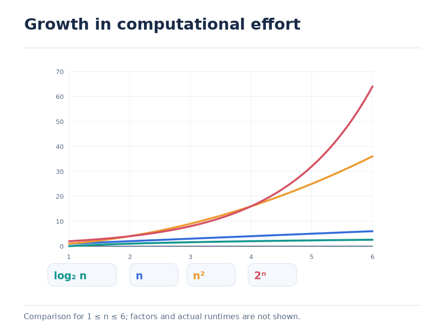

# M7-L2 – Correctness, computability and analysis of complex algorithms {#L2}

**Course area:** M7 – Master’s-oriented computer science

**Level:** Master’s orientation

**Prior knowledge:** [M7-L1](M7-L1.md) · [M1-L3](M1-L3.md) · [M8-L1](M8-L1.md) · [M8-L2](M8-L2.md) · [M8-L4 – Algorithms and data structures in depth](M8-L4.md)

## Overview: Three very different questions {#S1}

A search function may return the correct result for the sample data and still contain a fundamental error. An algorithm whose correctness has been proved mathematically may nevertheless take longer to run on large inputs than is practically acceptable. And for some tasks there is **no algorithm at all** that reliably decides a particular yes-or-no question for every possible input.

These distinctions are the subject of the second core Master’s lesson:

1. **Correctness:** Does a procedure produce the required results under its explicitly stated assumptions?
2. **Efficiency:** How do running time, memory requirements and, where applicable, communication grow as the input becomes larger?
3. **Computability:** Is the required general decision possible in principle using an algorithm?

There is also a fourth, practical question: **What kind of evidence do we actually need?** A small local search routine does not justify the same verification effort as a payment transaction or the control system of a safety-critical device.

The lesson builds on the distinction in M7-L1 between models, proofs, measurements and operational observations. It is not an instruction to execute the programs shown. The pseudocode is intended solely as a **readable conceptual model**.

## The specification must be clear before a proof can begin {#S2}

A program can only be described as correct or incorrect relative to a **specification**. A specification describes the expected behaviour without prescribing every internal computational operation. The instruction 'Find a video ID', for example, leaves important questions unanswered:

- Can the ID occur more than once, or is it unique?
- Should a successful search return any matching position or the first position?
- Is the list sorted? May the procedure modify it?
- What exactly does 'not found' mean?
- Are invalid inputs possible, and how should the program respond to them?

A condition called a **precondition** must hold before the call. A **postcondition** specifies what is guaranteed on normal return. Together they form a **contract**: anyone who satisfies the precondition may rely on the promised postcondition, provided the implementation is correct.

Example: A function accepts a sequence `a` and an identifier `x`, and returns an index `p`.

| Component | Precise statement |
| --- | --- |
| Precondition | The sequence is finite and accessible; `x` can be compared with its entries. |
| Postcondition for `p >= 0` | `p` is a valid position and `a[p] = x`. |
| Postcondition for `p = -1` | `x` does not occur anywhere in the sequence. |
| Not guaranteed | A particular matching position if `x` occurs more than once. |

The postcondition requires **more** than 'a value that is found is correct': a procedure must also not silently miss a value that is present. This second part is often forgotten in superficial tests.

### Specification, implementation and environment {#21-spezifikation-implementierung-und-umgebung}

``` text
Domain requirement
      |
      v
Specification with pre-/postconditions
      |
      v
Algorithm + correctness argument
      |
      v
Concrete implementation
      |
      v
Runtime environment, data, hardware, concurrency
```

A mathematical proof at the algorithm level does not automatically apply to an incorrectly programmed procedure or an unreliable environment. Conversely, an individual real application may operate without faults for a long time without thereby covering every theoretical input.

## Partial and total correctness {#S3}

In formal program analysis, two statements are distinguished:

- **Partial correctness:** *If* the program terminates normally and the precondition holds, its result satisfies the postcondition.
- **Total correctness:** The program satisfies the postcondition **and terminates** for every input satisfying its precondition, within the execution model used.

A function that remains in an infinite loop for certain inputs may be partially correct: in that case it produces no incorrect normal result. It is not totally correct.

The typical notation comes from **Hoare logic**:

``` text
{ P }  C  { Q }

P = precondition
C = program or program segment
Q = postcondition
```

The **Hoare triple** usually describes a statement about partial correctness: if `P` holds before `C` and `C` terminates normally, `Q` holds afterwards. For total correctness, termination must also be demonstrated. Exceptions, side effects and concurrency require appropriately extended models.

**Important distinction:** 'The loop terminates' and 'It produces the correct result' are **different** proof objectives. A program that stops quickly can be wrong; a program that works logically and carefully may never finish.

## Loop invariants: What remains true on every iteration {#S4}

An **invariant** is a statement that remains true at specified control points in a computation. For a loop, this is typically immediately before each evaluation of the loop condition.

Consider a linear search:

``` text
p := 0
while p < length(a):
    if a[p] = x:
        return p
    p := p + 1
return -1
```

A suitable invariant is:

> Before each further iteration, `0 <= p <= length(a)` holds, and the sought value `x` does not occur in any of the already examined positions `0` to `p-1`.

Why is this useful? The invariant divides the list into an already examined region and a region that has not yet been examined. This gives a complete argument in four steps \[1\]:

1. **Initialisation:** Before the first iteration, `p = 0`. No positions have yet been examined. The statement about the empty examined region is true.
2. **Preservation:** If `a[p]` equals `x`, a valid matching position is returned. If the entry differs, after `p := p + 1` the entire newly examined region still contains no `x`.
3. **Postcondition:** If the loop ends without a match, `p = length(a)` and every index has been excluded. Therefore `-1` is correct.
4. **Termination:** As long as there is no match, the non-negative remaining quantity `length(a) - p` decreases by one on each iteration. It cannot decrease strictly infinitely often.

This already constitutes a small argument for **total correctness**, provided the defined comparison and memory operations terminate normally.

### Worked execution trace {#41-durchgerechneter-verlauf}

Take `a = [4, 8, 13, 21]` and `x = 13`:

| Start of iteration | `p` | Already excluded entries | Next check |
| --- | ---: | --- | --- |
| 1 | 0 | none | `4 = 13`? No |
| 2 | 1 | `4` | `8 = 13`? No |
| 3 | 2 | `4, 8` | `13 = 13`? Yes |

The return value `2` is valid because `a[2] = 13`. For `x = 7`, the loop ends with `p = 4`; it is the invariant that justifies the return value `-1`.

**Limitation:** If a data source is modified without synchronisation during the search, the assumptions about an immutable sequence may no longer hold. A search algorithm that is correct on paper does not make concurrent writes safe.

## Binary search: A stronger argument for a faster algorithm {#S5}

**Binary search** uses an additional precondition: the sequence is **sorted in ascending order** according to the comparison ordering used. Each comparison can then exclude approximately half of the remaining region.

A particularly easy-to-verify variant uses a **half-open interval** `[left, right)`: the index `left` belongs to the search region, but `right` does not.

``` text
left  := 0
right := length(a)

while left < right:
    middle := left + (right - left) // 2
    if a[middle] < x:
        left := middle + 1
    else:
        right := middle

if left < length(a) and a[left] = x:
    return left
return -1
```

Here `//` denotes integer division rounded down. The procedure determines the **first index whose value is at least `x`**. This position is known as the *lower bound*. If `x` is actually present there, it is the **first** matching position; otherwise `x` does not occur in the sequence.

**Invariant:** All positions before `left` contain values less than `x`. All positions from `right` onwards contain values greater than or equal to `x`. Both statements follow from the ordering and are preserved at every step. The region `[left, right)` therefore contains all candidates not yet classified for the boundary position.

- If `a[middle] < x`, all positions up to and including `middle` also contain values below `x`: `left` may advance to `middle + 1`.
- If `a[middle] >= x`, `middle` belongs to the right-hand side: `right` may move to `middle`.
- As long as `left < right`, the interval length `right - left` becomes strictly smaller. This ensures loop termination.
- At the end, `left = right`. This position is the first position whose value is at least `x`, or the end of the sequence.

### Example with a repeated key {#51-beispiel-mit-mehrfach-vorkommendem-schlüssel}

For `a = [2, 5, 5, 5, 11, 18, 20, 30]` and `x = 5`, the following half-open search regions result:

| State | `[left, right)` | Middle | Comparison | New region |
| --- | --- | ---: | --- | --- |
| Start | `[0,8)` | 4 | `11 >= 5` | `[0,4)` |
| Continue | `[0,4)` | 2 | `5 >= 5` | `[0,2)` |
| Continue | `[0,2)` | 1 | `5 >= 5` | `[0,1)` |
| Continue | `[0,1)` | 0 | `2 < 5` | `[1,1)` |

The boundary position is `1`, the first of the three matches. A small change in detail – the decision `>=` rather than `>` – changes the guaranteed meaning of the result here.

### Why the running time grows logarithmically {#52-warum-die-laufzeit-logarithmisch-wächst}

After `k` successful halvings, approximately $\frac n{2^k}$ candidates remain. The region is reduced to a tiny remainder at the latest when `2^k` reaches approximately `n`, that is, when `k` is of the order of $\log_2(n)$. The search time is therefore **$O(\log  n)$** if index access has constant cost.

Example: With one million entries, about 20 halving steps are of the right order of magnitude, instead of up to one million linear comparisons. This is an **analytical statement about comparisons**, not a guaranteed time in milliseconds. If the list is not sorted or does not support efficient direct positional access, the specified method or running-time assumption does not apply unchanged \[2\].

## Recursion, induction and termination measures {#S6}

A **recursive** function calls itself on smaller instances of a problem. The proof often follows **mathematical induction**: if a procedure is correct for all sufficiently small subproblems and constructs a correct larger result from these correct results, it can also be correct as a whole.

Example: **Merge Sort**.

1. A sequence with zero or one element is already sorted.
2. A longer sequence is divided into two shorter subsequences.
3. Both subsequences are sorted recursively.
4. A merging procedure selects the smaller of the two leading elements each time until all elements have been output.

The essential **merge invariant** states that the output already produced is sorted and contains exactly the elements removed so far; its next possible value can only be at the head of one of the two remaining subsequences. This justifies the correctness of merging; induction justifies the correctness of the entire sorting procedure.

For termination, it is sufficient that recursive calls with input size $n > 1$ receive **strictly smaller** inputs and eventually reach the base case. More generally, this is called a **well-founded measure**: there must be no infinitely long sequence of strictly decreasing values. Besides natural numbers, suitable orderings over tuples or data structures are possible.

**Caution:** A call with 'almost the same' problem is not enough. If the partitioning occasionally produces a subproblem of the original size again, termination is not thereby proved.

## Time and space complexity: What grows with the input? {#S7}

**Asymptotic analysis** describes the growth of a resource cost `T(n)` with input size `n`. For this particular question, it disregards constant factors and smaller terms.



| Notation | Typical statement | Example |
| --- | --- | --- |
| $O(g(n))$ | Asymptotic upper bound | $T(n)\le c\cdot g(n)$ for sufficiently large `n` |
| $\Omega (g(n))$ | Asymptotic lower bound | $T(n)\ge c\cdot g(n)$ for sufficiently large `n` |
| $\Theta (g(n))$ | Upper and lower bounds of the same order of magnitude | `T(n)` grows proportionally to the order of magnitude of $g(n)$ |

The constants are positive in each case and apply from a suitable threshold in `n`. As an **upper bound**, $O(n^{2})$ does not mean that the cost necessarily grows quadratically: a linear algorithm also belongs to the set $O(n^{2})$. For a tight classification, `Θ(n)` would be more informative.

### Best case, average case and worst case {#71-best-case-average-case-und-worst-case}

Complexity depends on the input distribution under consideration:

- **Best case:** A particularly favourable input, such as an immediate match in a linear search.
- **Worst case:** The least favourable input of the size considered.
- **Average case:** The average over an **explicitly defined probability distribution** of inputs. Without this distribution, the average case is not precisely specified.

For an unindexed linear search, the best case is `Θ(1)` and the worst case is `Θ(n)`. If a sought entry is equally likely to occur at any of the `n` positions, the mean number of comparisons is $\frac{n+1}{2}$, hence `Θ(n)`. The distributional assumption is crucial.

### Memory is a separate resource {#72-speicher-ist-eine-eigene-ressource}

A procedure with good running time may require a great deal of memory. In a typical array implementation, for example, Merge Sort needs $O(n)$ additional memory for merging. Some in-place sorting methods require considerably less auxiliary memory but have different time or error requirements.

For network applications, bytes transferred, number of messages, database accesses, energy and waiting times also matter. A function that theoretically performs only $O(1)$ local computational work may trigger an expensive external database query on every operation.

## Two complete growth comparisons {#S8}

### $n^{2}$ versus $n\cdot \log_2(n)$ {#81-n²-gegenüber-nlog₂n}

Let us compare two idealised comparison counts without confusing them with real running times:

| Input size `n` | $n^2$ | $n\cdot\log_2(n)$ (rounded) |
| ---: | ---: | ---: |
| 1,000 | 1,000,000 | 9,966 |
| 1,000,000 | 1,000,000,000,000 | 19,931,569 |

The input becomes a thousand times larger. The quadratic expression grows by a factor of **1,000,000**, whereas the $n\cdot \log_2(n)$ expression grows by only about a factor of **2,000**.

This explains why an initially simple nested loop may become problematic as the amount of data grows. It does not prove that a particular existing $O(n \log  n)$ implementation is faster than another $O(n^{2})$ implementation at as few as 1,000 records: memory accesses and constants can dominate for small inputs.

### A recurrence step by step {#82-eine-rekurrenz-schritt-für-schritt}

For Merge Sort, we can make the simplifying assumption that `n` is a power of two and merging costs $c\cdot n$ time:

$$
\begin{aligned}
T(n)&=2\cdot T(n/2)+c\cdot n\\
T(1)&=d
\end{aligned}
$$

At the first level, `n` elements are merged; at the next level, there are again `n` elements in total across two subproblems; at every further level, there are likewise approximately `n`. There are $\log_2(n)$ such levels. Together, the leaves incur a linear base cost. It follows that:

$$
\begin{aligned}
T(n)&=c\cdot n\cdot\log_2(n)+d\cdot n\\
&=\Theta(n\log n)
\end{aligned}
$$

This calculation assumes correct partitioning and a linear-time merge procedure. If a real implementation uses slow data structures or creates additional copies, the costs must be analysed again.

## Lower bounds: Why some shortcuts are impossible {#S9}

Analysis can show not only how fast **a known** procedure is. Sometimes it can also be proved that **no procedure in a clearly defined class** can go below a certain bound.

For sorting `n` distinct elements using **only pairwise comparisons**, there are `n!` possible orderings. Each comparison has at most two outcomes; a binary decision tree needs a depth of at least $\log_2(n!)$ to distinguish `n!` terminal cases. This expression grows as `Ω(n log n)`.

Comparison-based sorting algorithms therefore require `Ω(n log n)` comparisons in the worst case. Procedures using $O(n \log  n)$ comparisons are asymptotically optimal with respect to this **model**.

**The restriction is essential:** Counting Sort or Radix Sort exploit additional structure of the keys and are not pure comparison sorts. They therefore do not refute the comparison lower bound. The statement 'Sorting can never be linear' would be technically incorrect.

## Amortised analysis: An expensive operation need not be expensive on average {#S10}

When its capacity is exhausted, a dynamic array can move to a larger memory region. An individual growth step may copy `n` elements and cost $O(n)$. Nevertheless, appending over **a sequence** of operations can be very inexpensive.

Assume an idealised **doubling** of capacity: when growing from 1 to 2, 2 to 4, 4 to 8 and so on, copying costs of approximately $1+2+4+\ldots$ are incurred. For up to `n` append operations this sum remains below a constant multiple of `n`. Including the actual `n` insertions gives $O(n)$ total cost, hence **amortised $O(1)$ per append**.

**Amortised** does not mean a random or empirically measured average time. It is a mathematical statement about the **entire sequence of costs**, even if individual operations are expensive. Anyone who needs to meet a hard response-time limit on each individual call cannot rely on this guarantee alone.

## Decision problems and optimisation problems {#S11}

Complexity theory often studies **decision problems** with a `Yes` or `No` answer. An optimisation problem, in contrast, seeks the best possible solution. This distinction facilitates precise statements.

Example of a route through a graph:

- **Decision:** 'Is there a round trip visiting every required stop and costing at most 100 cost units?'
- **Optimisation:** 'What is the cost of the shortest such round trip?'

The decision version may be used as a building block for studying the optimisation version. The two are related, but they do not express the same task. Input size must also be measured correctly: a number `N` requires only approximately $\log_2(N)$ bits in binary notation. An algorithm whose running time grows proportionally to the **numeric value** `N` is therefore not necessarily polynomial in the **bit length of the input**.

## P, NP, NP-completeness and NP-hardness {#S12}

**P** comprises decision problems for which a solution using a **polynomial** number of steps in the input length is known on a conventional deterministic theoretical model of computation. **NP** comprises decision problems whose yes-answers can be verified in polynomial time using a suitable polynomial-length **certificate**; the original formal definition uses nondeterministic computation. We have $P \subseteq  \mathrm{NP}$.

For example, for the question of whether a graph has a path visiting each vertex exactly once, a proposed path is easy to verify. However, no equally fast procedure for finding the path follows automatically from this.

| Class/concept | Precise interpretation | Common misconception |
| --- | --- | --- |
| **P** | Decidable in polynomial time | 'Always fast in practice' – high polynomial degrees can be impractical |
| **NP** | Yes-certificates can be verified in polynomial time | 'Non-polynomial' – this is precisely not what NP means |
| **NP-hard** | At least as hard as all problems in NP under the reductions used | Need not itself belong to NP |
| **NP-complete** | Belongs to NP **and** is NP-hard | Is not 'unsolvable' by definition |

The famous **P versus NP** problem asks whether every yes-solution that can be verified in polynomial time can also be found in polynomial time, or whether the decision problem can be solved in polynomial time. As of the **verification date 05.11.2026**, the Clay Mathematics Institute still lists it as **unsolved** \[3\]. In particular, it has **not been proved** that $P \ne  \mathrm{NP}$. The mere observation that no fast algorithm is known today is not a substitute for such a proof.

### How to establish NP-hardness by reduction {#121-wie-man-np-schwere-mittels-reduktion-begründet}

A **reduction** efficiently transforms every input of a problem `A` into an input of `B`, preserving the yes-or-no answer. The notation for a polynomial-time reduction is $A\le_p B$.

``` text
Instance of A
      |
      v
Polynomial-time transformation
      |
      v
Instance of B --> Answer by procedure for B
      |
      v
Corresponding answer for A
```

To show that `B` is NP-hard, a problem `A` **already known to be NP-hard** is reduced **to B**. If `B` could be solved quickly, `A` could then also be solved quickly. The direction of the reduction is important: accidentally reducing `B` to a hard `A` has not established NP-hardness of `B`.

**SAT** (*Boolean Satisfiability Problem*, the satisfiability problem for propositional logic) is a classic NP-complete starting point. A formula is satisfiable if there is an assignment of truth values that makes it true. A certificate is precisely such an assignment. Very powerful solvers often exist for practical SAT instances; NP-completeness does not mean that **every** particular formula is hard \[4\].

## What if the exact solution is too expensive? {#S13}

A theoretically hard class of problems does not make practical work pointless. Other objectives frequently suffice:

- **Special cases:** A problem becomes efficient under additional structural assumptions. Some graph classes permit considerably simpler procedures than arbitrary graphs.
- **Heuristics:** A procedure often provides useful solutions, but without a general quality guarantee.
- **Approximation algorithms:** Under specified assumptions, an algorithm guarantees a defined closeness to the optimum.
- **Parameterised algorithms:** Difficulty is additionally captured by a parameter `k`. In **fixed-parameter tractability (FPT)**, for example, the running time may be $f(k)\cdot n^c$; for small `k` this may be favourable in practice.
- **Branch and bound / bounded search:** Lower or upper bounds eliminate unpromising subregions. In the worst case the cost can nevertheless remain exponential.
- **Time limit with the best result so far:** If necessary, the procedure returns an incomplete or suboptimal solution explicitly labelled as such.

For route planning with ten destinations, an exact search may work well. For thousands of destinations and many constraints, a heuristic may be the more sensible operational decision. The quality of the result should be judged on the requirements and available checks, not merely on an impressive algorithm name.

## Computability: Even unlimited computing power cannot solve everything {#S14}

So far we have considered **hard** but in principle computable tasks. **Computability theory** asks the more fundamental question of whether a general mechanical decision procedure exists at all.

A **Turing machine** is an abstract model of computation with finite control and a potentially unbounded tape. It is not a construction guide for a modern computer. Various classical formalisations of mechanical computation lead to the same computable functions. The **Church–Turing thesis** connects these mathematical models with the informal concept of an effectively executable computational method. It is not a single mathematical equation, provable in the usual sense, between two independently formally defined concepts \[5\].

The important conceptual distinction:

- **Decidable:** There is an algorithm that halts on **every** permissible input and provides the correct yes-or-no answer.
- **Semi-decidable / recursively enumerable:** An algorithm can eventually confirm a yes-answer; in the no-case it may continue indefinitely.
- **Undecidable:** No comprehensive, always-terminating decision algorithm exists.

Undecidability does **not** mean 'too slow on current hardware'. It means a mathematically proved limit of the computational model used.

## The halting problem: A surprising counterexample {#S15}

The general **halting problem** asks:

> Given the description of any program `P` and any permissible input `x`: will `P` eventually halt on `x`?

Suppose a perfect checking program `HALT(P, x)` could always correctly report `YES` or `NO` for **every** such pair and always terminate itself. We then define a program `CONTRADICTION(Q)`:

``` text
if HALT(Q, Q) = YES:
    run forever
else:
    halt immediately
```

Now we ask what happens when `CONTRADICTION(CONTRADICTION)` is called:

1. If `HALT` says `YES` for this program, the definition of `CONTRADICTION` causes it to **run indefinitely**. The prediction would be wrong.
2. If `HALT` says `NO`, the definition causes it to **halt immediately**. This prediction would also be wrong.

Both possibilities lead to a contradiction. Therefore no such universal `HALT` algorithm can exist. This type of argument is called **diagonalisation** \[5\]. The proof assumes that the hypothetical checking program correctly handles arbitrary programs of the universal model considered, including the suitably constructed self-application.

### What this statement does not mean {#151-was-diese-aussage-nicht-bedeutet}

- For many **specific** programs, termination can indeed be proved, for example using a strictly decreasing natural number.
- Programming tools can often detect loop errors or verify termination for particular classes of programs.
- A test with a time limit can say: 'Has not terminated so far.' In general it cannot infer from that: 'Will never terminate.'
- If a known program call halts, the yes-answer can be observed by actually executing it. In a non-halting computation, however, there is generally no finite point at which a definitive no-answer can be inferred from waiting alone.

The limit is therefore precise: **No universally valid, always-terminating halting decision for all programs and inputs.** It by no means follows that ordinary software verification is useless.

## A map of the limits {#S16}

| Question | Example | Type of limit |
| --- | --- | --- |
| Is the procedure correct? | A search must not miss existing IDs | Proof/specification question |
| How much work does it require? | Sorting by comparisons | Complexity and modelling question |
| Is there an efficient general algorithm? | NP-complete decision problem | Open complexity question in general; special cases solvable |
| Is there a universal decider at all? | General halting problem | Proved undecidability |
| Will the system operate reliably on real computers? | Service during a network outage | Empirical and operational question in addition to theory |

This classification avoids a common error in reasoning: a very hard optimisation problem, a mathematically undecidable problem and a simply poorly programmed application are three different reasons for 'it does not work'.

## Formal methods in real development processes {#S17}

Not every correctness statement has to be proved by hand. Various techniques are available under the umbrella term **formal methods**, for example:

- **Contracts and assertions:** Preconditions and postconditions, as well as assumptions checked at runtime. An assertion can detect an error, but a runtime check does not automatically prove every possible execution.
- **Static analysis and type systems:** Examine code without complete program execution. Precision and guarantees depend on the particular method and its assumptions.
- **Model checking:** Systematically explores states and transitions of a formal model; finds counterexamples to specified properties if they are reachable within the model examined.
- **SAT/SMT solvers:** SAT solves propositional logic; **SMT** (*Satisfiability Modulo Theories*) additionally incorporates mathematical theories such as those of integers, bit vectors or equations.
- **Interactive proof systems:** Assist in constructing and machine-checking formal proofs. The proof holds relative to the formalisations, assumptions and trusted checking component.
- **Testing and runtime observation:** Examine specific cases or actual execution sequences. They complement formal methods but cannot replace their general guarantees without further arguments.

### A small state machine {#171-eine-kleine-zustandsmaschine}

An import job might have the states `new`, `waiting`, `running`, `finished` and `failed`.

``` text
[new] --> [waiting] --> [running] --> [finished]
                            |
                            +----------> [failed]
```

A formal model could require that a job is **never both** `finished` and `failed`. This is a **safety property**: 'Something bad never happens.' A **liveness property** could require that every accepted job is eventually completed under certain fairness and availability assumptions: 'Something good eventually happens.' This distinction is central to concurrent and distributed systems \[6\].

A model checker can systematically search possible sequences in a finite, fully represented state space. Large or infinite state spaces require abstraction, bounds or additional proof techniques. **Successful bounded checking is not an automatic proof for every infinitely large real execution.** For TLA+ and PlusCal, the documentation accordingly distinguishes model checking from formal proof \[7\].

## Three practical architectures with different proof objectives {#S18}

### Local media archive: No lost or duplicate records {#181-lokales-medienarchiv-keine-verlorenen-oder-doppelten-datensätze}

A local program reads files and writes corresponding entries to a media catalogue. The domain requirement is 'complete import without duplicates'.

``` text
Source files
    |
    v
Identifier check
    |
    v
Transaction --> new catalogue entry
    |                 |
    +--> Error -------+--> rollback / log
```

A **correctness invariant** might state that each external identifier occurs at most once in the target table. The database supports this rule with a unique constraint (*UNIQUE constraint*). The program must also decide how to handle an already imported record on a retry. The requirement for **idempotency** concerns the domain effect, not the number of incoming messages.

**What is proved?** Under assumptions about transactions, unique keys and error handling, the objective can be formally specified. **What remains open?** Whether files remain available, whether correct identifiers are assigned, and whether a crash before commit causes data loss in the source system. Such questions require further system models and recovery tests.

**When is it useful?** As soon as duplicate or missing entries would be costly to correct. **When is it excessive?** For a one-off catalogue of a few easily checked entries.

### A database transfer: 'All or nothing' {#182-eine-datenbanküberweisung-ganz-oder-gar-nicht}

Two accounts have balances `A` and `B`. A successful transfer of an amount `t` should result in $A'=A-t$ and $B'=B+t$. Assuming no fees are charged and no other operations access the accounts concurrently, the following **conservation invariant** holds:

$$
A'+B'=(A-t)+(B+t)=A+B
$$

This simple equation demonstrates the required domain consistency of the planned change. However, a system additionally needs rules for sufficient funds, rounding, concurrency, errors, retries, authorisation and durability. A database transaction supports atomic changes. It does not automatically prove that the entire user action – including, for instance, an external payment confirmation – is atomic.

**Operational consequence:** Correct locking or versioning strategies may reduce throughput; additional checks and auditable logs require development and maintenance. Real payment systems are also subject to security and regulatory requirements that this illustrative equation does not cover.

### Cloud job processing: Correct on retries, but eventually finished? {#183-cloud-auftragsverarbeitung-korrekt-bei-wiederholung-aber-irgendwann-fertig}

A web service accepts requests and places them in a queue. Several workers read and process them. Jobs can be delivered more than once in the event of outages or timeouts.

``` text
Web API --> Queue --> Worker
              |          |
              |          v
              +-- Retry --> Database
```

A **safety property** would be that at most one domain-level result entry is created for the same job identifier. A **liveness property** would be that a valid job that has been durably accepted is eventually processed. The second property requires assumptions about workers remaining available, fair scheduling and retries eventually succeeding. Without such assumptions, completion cannot be forced from infrastructure that continues to fail indefinitely.

**When is it useful?** When high reliability in the presence of repeated messages matters. **When is it unnecessary?** For a purely local script with no queue. **Cost of the guarantee:** Additional state management, monitoring, retry rules, storage, operation and fault diagnosis.

A more rigorous analysis of the distributed aspects follows in **M7-L3**. A local correctness proof cannot simply be interpreted as a guarantee for an entire system distributed across networks.

## Sources of error that can invalidate even good proofs {#S19}

A formally correct model is only as useful as the correspondence between its assumptions and the eventual system. Particularly important examples are:

| Hidden assumption | Possible consequence |
| --- | --- |
| Integers are unbounded | Overflow with fixed-width integer types |
| Comparisons are exact | Rounding errors with floating-point numbers |
| All inputs are valid | Crash or incorrect results with corrupt data |
| Data remains unchanged during computation | Race condition due to concurrent changes |
| Jobs arrive exactly once | Duplicate entries due to retries |
| Resources are unlimited | Timeout, memory exhaustion, outage |
| The model captures all important states | Undetected error outside the model |

Security is also a correctness question **under a threat model**: a correct function may work correctly for ordinary users and be vulnerable to deliberately malicious inputs. A mathematical proof about a sorting function is not a security assessment of the entire program.

## How much formality is appropriate? {#S20}

| Project | Sensible approach | Likely excessive |
| --- | --- | --- |
| Short local utility | Clear inputs, simple tests, comprehensible error cases | Complete formal proof of every helper routine |
| Large-scale data import | Unique keys, contracts, transactions, repeatability, recovery test | Complete theoretical analysis of the entire operating system |
| Demanding optimisation | Resource model, complexity estimate, benchmarks, approximation where appropriate | A universal exact solution at any cost |
| Distributed job processing | State model, safety/liveness properties, assumptions about outages and retries | Claim of absolute reliability without a failure model |
| Safety- or time-critical device | More rigorous specification, verifiable invariants, runtime bounds, independent assessment | Exclusive reliance on a few successful demonstrations |

**Cost question:** Formal methods require precise requirements, skilled work and continuous maintenance when changes occur. Their benefit increases with the consequences of an error and the difficulty of detecting errors retrospectively. Even a perfect formal specification may precisely prove the **wrong** domain objective; validation of the actual need as discussed in M7-L1 therefore remains necessary.

## Decision guide: Which evidence answers which question? {#S21}

``` text
What is to be demonstrated?
        |
        +--> "Always correct under assumptions?"
        |       -> Specification, invariant, proof
        |
        +--> "Does it terminate?"
        |       -> Termination argument, well-founded measure
        |
        +--> "How does the cost scale?"
        |       -> Complexity model + real measurements
        |
        +--> "Is it decidable in principle?"
        |       -> Computability theory, possibly reduction
        |
        +--> "Does the actual software work?"
                -> Implementation review, tests, operation
```

The strongest approach combines appropriate answers instead of declaring one method a universal solution. It is possible to prove that an algorithm computes the correct solution, derive a running-time upper bound and then check on real hardware whether the solution is suitable under actual load conditions.

## Summary and transition to M7-L3 {#S22}

**Correctness** starts with a precise specification. Preconditions, postconditions, loop invariants and termination measures justify why a procedure works and terminates. **Complexity analysis**, by contrast, describes resource costs as a function of input size. An asymptotic upper bound is not the same as an actual running-time guarantee. Finally, **computability theory** shows that even with unlimited idealised time and memory some general decisions – such as the halting problem – are not algorithmically possible.

Three principles connect these perspectives:

1. **A correct result is not the same as guaranteed completion.** Partial and total correctness differ.
2. **Hard does not mean impossible.** NP-completeness and undecidability describe different phenomena; P versus NP remains open.
3. **A proof proves exactly the modelled statement.** Real components, networks, security requirements and human expectations must also be considered.

**Continue reading in the completed core path:** [M7-L3 – Distributed systems as formal and practical system models](M7-L3.md). Network delay, the absence of a common clock, partial failures, replication, consensus and system guarantees are examined together there. The eight optional Master’s lessons remain organisationally separate and are developed only upon explicit selection.

## Position within the course-wide reading paths {#S23}

This chapter belongs to the **six-part Master’s core**, not the optional additional Master’s topics. Navigation: [previous Master’s core lesson M7-L1](M7-L1.md); [next Master’s core lesson M7-L3](M7-L3.md); [reading paths and subject-related cross-references](pages/path.md); [course index](pages/index.md).


## Sources {#S24}

**Last source check:** 05.11.2026

The following sources support the theoretical foundations and tools discussed. The data series, search examples, diagrams and three practical cases in this lesson are original **teaching examples**, not published measurements or research results. **Verification date: 05.11.2026.**

1. **Cornell University, CS 2110 – Loop Invariants (2026):** Initialisation, preservation, progress and termination of loops. [https://courses.cs.cornell.edu/courses/cs2110/2026fa/lectures/lec04/](https://courses.cs.cornell.edu/courses/cs2110/2026fa/lectures/lec04/)
2. **Cornell University, CS 2110 – Loop Invariants (2022):** Detailed proof framework for binary search with an invariant and a termination argument. [https://www.cs.cornell.edu/courses/cs2110/2022fa/lectures/loopinv/](https://www.cs.cornell.edu/courses/cs2110/2022fa/lectures/loopinv/)
3. **Clay Mathematics Institute – P versus NP:** The status of the problem is still listed as *Unsolved*; the question remains open. [https://www.claymath.org/millennium/p-vs-np/](https://www.claymath.org/millennium/p-vs-np/)
4. **MIT OpenCourseWare, 6.006 – Introduction to Algorithms, Syllabus:** Distinction between algorithm description, correctness argument and time/space analysis; [https://ocw.mit.edu/courses/6-006-introduction-to-algorithms-fall-2011/pages/syllabus/](https://ocw.mit.edu/courses/6-006-introduction-to-algorithms-fall-2011/pages/syllabus/)
5. **Stanford Encyclopedia of Philosophy – The Church-Turing Thesis / Entscheidungsproblem:** Effective computation, the Church–Turing thesis and limits of algorithmic decidability. [https://plato.stanford.edu/entries/church-turing/](https://plato.stanford.edu/entries/church-turing/) and [https://plato.stanford.edu/entries/church-turing/decision-problem.html](https://plato.stanford.edu/entries/church-turing/decision-problem.html)
6. **Leslie Lamport – Safety, Liveness, and Fairness (2019):** Mathematical distinction between safety and liveness properties. [https://lamport.azurewebsites.net/tla/safety-liveness.pdf](https://lamport.azurewebsites.net/tla/safety-liveness.pdf)
7. **Leslie Lamport – PlusCal Tutorial and TLA+ Tools:** Description of the translation from PlusCal into TLA+, model checking with TLC and its relationship to proof tools. [https://lamport.azurewebsites.net/tla/tutorial/intro.html](https://lamport.azurewebsites.net/tla/tutorial/intro.html) and [https://lamport.azurewebsites.net/tla/tools.html](https://lamport.azurewebsites.net/tla/tools.html)

**Context:** Sources \[1\] and \[2\] support the proof technique; the specific example programs are independently formulated here. \[3\] confirms the time-dependent research status, not a general statement about the practical difficulty of every NP instance. \[6\] and \[7\] explain formal tools but expressly do not establish that the three example systems have already been formally verified. The entire presentation is a reading course, not a software certificate.
