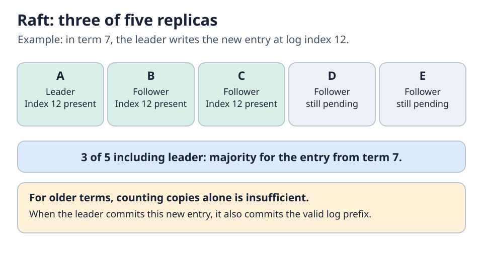

# M7-L3 – Distributed systems as formal and practical system models {#L3}

**Course area:** M7 – Master’s-oriented computer science

**Level:** Master’s orientation

**Prior knowledge:** [M2-L5](M2-L5.md) · [M3-L2](M3-L2.md) · [M3-L5](M3-L5.md) · [M4-L1](M4-L1.md) · [M7-L1](M7-L1.md) · [M7-L2](M7-L2.md)

**Note:** Objective: not merely to know that several computers can cooperate, but to identify precisely which ordering, consistency, availability and fault tolerance guarantees a design offers, and under what assumptions. The teaching diagrams and numbers are constructed examples, not measured performance figures.

## The real challenge: There is no shared instant {#S1}

A single program can often be described as follows: there is a current memory state, then one step takes place, then the next. In a distributed system, several processes cooperate with their own memories, clocks and failures. Messages take time; they can be delayed, reordered, duplicated or, depending on transmission and the type of failure, never delivered at all. Each process therefore sees only part of the entire system.

``` text
      Service A                 Service B
      own state                 own state
          |                         |
          | ---- Message 1 -------> |
          |      Delay?             |
          | <---- Message 2 ------- |
          v                         v
      local clock               local clock
```

‘Computer B is not responding’ is not yet an unambiguous diagnosis. B may have crashed; the connection may be disrupted; B may be working and merely lose its response; B may simply be slow. This distinction is not pedantry: the diagnosis determines whether repeating an operation duplicates data, whether another machine may take over, or whether a user temporarily receives no decision.

A **distributed system** is therefore not merely ‘an application on multiple servers’. It is a system in which **incomplete knowledge of other participants** itself becomes a design problem. The academic approach begins by explicitly defining observations, desired properties and permitted failures.

## From an architecture diagram to a verifiable model {#S2}

A diagram labelled ‘API → database → three replicas’ explains *which components* exist, not *how they behave in the event of failures*. A formal system model adds at least five details:

1.  **Participants:** for example, clients, three database replicas and a coordinator.
2.  **Local state:** data values, version numbers, jobs not yet acknowledged.
3.  **Transitions:** reading, writing, sending or receiving messages, restarting, crashing.
4.  **Environmental assumptions:** message delay, clocks, permitted failures, storage durability.
5.  **Properties:** What must never happen? What progress must eventually take place under which conditions?

A greatly simplified model of a replicated setting is:

``` text
State: value per replica, version number per replica
Actions: write attempt, replication message,
         receipt, read, failure, reconnection
Safety objective: No change declared committed may be lost
                  within the defined failure model
Liveness objective: With enough reachable replicas,
                    a permitted change can be committed
```

These objectives require additional precise definitions: what does ‘committed’ mean? How many replicas must respond? What happens if a replica crashes after receipt but before durable storage? An architecture diagram alone cannot decide this.

**Important:** A model may abstract. It need not contain every byte buffer or every CPU instruction. However, it must not omit precisely those failures about which it is meant to make a guarantee.

## Distinguishing safety and liveness properties {#S3}

Two terms come from M7-L2:

- **Safety (safety property):** Something prohibited never happens. Example: two simultaneously active leaders must not both establish conflicting binding values for the same log position.
- **Liveness (progress property):** Under specified conditions, something desirable eventually happens. Example: once enough healthy participants communicate reliably, a job can be completed.

The distinction explains an uncomfortable operational decision: a system can **stop** when the situation is unclear in order to prevent conflicting transactions. It then violates an availability requirement but preserves a safety requirement. Conversely, a system may provide responses from disconnected regions and thus remain available, but must later reconcile conflicting changes.

**A correctness proof is always conditional:** anyone wishing to show that a replicated system is safe must explicitly state its failure model and guarantees. The blanket claim ‘highly available and consistent’ is insufficient.

## Time, event ordering and ‘happened-before’ {#S4}

In 1978, Leslie Lamport showed why the order of distributed events cannot simply be read from the clocks of individual computers. The key is **causal ordering** (*happened-before*, written `a → b`):

- Two events in the same process are ordered according to its local execution order.
- Sending a message happens before receiving it.
- The relation is transitive: if `a → b` and `b → c`, then `a → c`.

``` text
Process A:  a1 --send M-- a2 -------- a3
                    |
                    | Message M
                    v
Process B:  b1 ---receive M--- b2 --- b3
```

Sending `M` causally precedes its receipt. By contrast, no causal relationship may be identifiable between `a1` and `b1`. Such events are considered **concurrent** in the model: neither `a1 → b1` nor `b1 → a1` need hold. This does not mean that their physical order could never be discovered, but that it cannot be inferred from the communication relations under consideration.

The event order is a **partial order**. There is normally no single global order immediately known to every participant. An artificial total order can be agreed upon technically; it is not automatically the actual causal order.

## Logical clocks and vector clocks {#S5}

A **Lamport clock** uses integers instead of system time. In simplified terms: before a local event, a process increments its counter; a message carries the current counter; on receipt, the recipient sets its counter to `max(local, received) + 1`.

``` text
A: Event (1) -- sends M(2) ----------> (further steps)
B: Event (1) ------ receives M ----->  max(1,2)+1 = 3
```

It follows that if `a → b`, the Lamport timestamp of `a` is less than that of `b`. **The converse does not hold.** Smaller timestamps do not prove that the events are causally related.

**Vector clocks**, by contrast, store one counter component per process considered. With two participants, A might carry `[1,0]` after a local event, and B independently carry `[0,1]`. These vectors are incomparable component by component: neither is less than or equal to the other in every component. This demonstrates the concurrency of the two events in the usual vector-clock model. After receiving a message sent by A, B would merge the components and increment its own component, for example to `[1,2]` – depending on the specific preceding sequence of events.

**Limitation:** Vector clocks require metadata and participant identities. Managing these is costly in very large or changing groups of participants. They also do not automatically resolve conflicts between two concurrently modified records; initially, they help to *detect* the conflict.

## Physical clocks are useful, but do not magically establish order {#S6}

Real systems need times for logs, expiry times, auditing and measurements. Yet clocks may differ because of synchronisation errors, drift, pauses or time jumps. Even an accurate clock cannot turn a network without guaranteed message delivery times into a position from which all participants can be reliably observed together.

A common mistake: ‘The change on server A has 10:00:00.100, and the change on B has 10:00:00.090; therefore B was first.’ This assumes that the clocks were synchronised more accurately than the time difference and that the timestamps actually capture the events of interest correctly. If the uncertainty is unclear, the order is not established.

Systems with tightly controlled clocks and explicit uncertainty intervals can build stronger time-related guarantees. This is a deliberately engineered architectural decision, not a property of ordinary server clocks. For most applications, a logically agreed sequence of changes or transactions is easier to justify than a supposedly perfect comparison of timestamps.

## Types of faults: Not every failure means the same thing {#S7}

| Failure model | Assumption | Design implication |
| --- | --- | --- |
| **Crash-stop** | A process fails and does not return during the execution considered | Other participants must be able to withstand its failure |
| **Crash-recovery** | A process restarts later | Volatile and durably stored state must be distinguished |
| **Omission** | Messages are not sent, received or processed | Retries and detection of missing messages may be necessary |
| **Delay / partition** | Communication takes unusually long or is interrupted between groups | Unreachability must not be equated with certain failure |
| **Byzantine** | A participant may behave arbitrarily, including inconsistently or maliciously | Requires other protocols and usually stricter trust assumptions |

A **network partition** means that parts of a network cannot reliably reach one another. It does not necessarily mean that the entire internet has failed. Even a single interrupted connection between data centres can split a cluster into groups.

A model of accidental crashes does not prove safety against compromised servers. Similarly, replication within the same data centre does not guarantee independence if the shared power supply fails. **Independence of failures is an assumption, not a property of the number ‘three’.**

## A timeout is a suspicion, not proof {#S8}

Consider a job that is to mark a file authoritatively as ‘archived’:

``` text
Client             Server
  | --- Job 42 -----> |
  |                   | processes 42
  |                   | stores result
  | <-- Response X ---|  (response is lost)
  |   Timeout         |
  | --- Job 42 -----> |  (retry)
```

From the client's perspective, a crashed server looks just like a lost response. Anyone who repeats the same job without control after the timeout may initiate a payment twice or create a duplicate record.

An **idempotent operation** is designed so that repeated equivalent requests have no additional unwanted business effect. Frequently, a unique *idempotency key* (operation identifier) is stored durably together with the result. The business operation and registration of the identifier must be atomic or otherwise protected for the relevant failure scenario. A mere list in RAM is not sufficient after a restart.

**‘Effect exactly once’ is not the same as ‘message delivered exactly once’.** Repeated transmission may be intentional; the correct effect is what matters. Effects on external systems also require a coordinated transaction or compensation strategy.

## Consistency is not a single property {#S9}

The term **consistency** can refer to different things: valid database rules, identical replication states, a defined ordering of concurrently executed operations or the view of a particular client. It therefore makes sense to specify the concrete **consistency model**.

| Model / guarantee | Intuition | Limitation |
| --- | --- | --- |
| **Linearizability** | Each operation takes effect at a point between invocation and response; completed operations are respected in real-time order | May prevent responses during partitions if no safely established current state is available |
| **Sequential consistency** | There is a common order that respects each participant's program order | This ordering need not represent the real-time order of non-overlapping operations |
| **Causal consistency** | Causally dependent changes appear in the correct dependency order | Independent concurrent changes need not be ordered identically everywhere |
| **Eventual consistency** | Without new changes and once communication is restored, replicas can eventually converge | No immediate freshness or fixed time guarantee follows from the term alone |

These terms refer to specifically defined objects and operations. A database may offer different consistency levels for different read or write operations. **ACID transactions** and **linearizability** are not synonymous either: ACID describes, among other things, transactional atomicity and isolation; the particular view across multiple nodes additionally depends on the protocol and its isolation.

### An illustrative timeline {#91-eine-anschauliche-chronologie}

``` text
Client A:  writes price = 20  ---- Response: success
Client B:                          reads price ---->  ?
```

If the write has been fully acknowledged before B starts its read invocation, linearizability for this object requires B to take that write or a *later* valid state into account. An earlier value `15` would not be permitted here, provided no more recent relevant change exists. By contrast, several legitimate orderings are possible for overlapping concurrent operations.

## Consensus: Many participants agree on a history {#S10}

**Consensus** is distributed agreement on a value or order of operations despite specified disruptions. An important special case is the **replicated log**: several servers agree on the order of entries and apply them to their local state.

``` text
                Client: ‘set X=7’
                        |
                      Leader
                     /      \
                 Replica 2  Replica 3
                     \      /
                    committed log entry
                          |
                    State machine: X=7
```

In **Raft**, these tasks are divided clearly for teaching purposes: leader election, log replication and safety rules. A committed entry is not simply ‘a message that someone received’. The protocol state, log position, majority acknowledgement and election rules are essential. A completed commit should not disappear from the valid history when the leader subsequently changes.

**Distinction:** Electing a leader alone does not establish safe consensus. An old leader can wake up after a pause and attempt to continue writing. A correct system must prevent obsolete permissions taking effect outside the agreed protocol, for example through term/epoch checks and, for external resources, appropriate *fencing tokens*.

## Majorities: A small, understandable model {#S11}



*Figure: Five voting servers and a new entry from the current term. The majority includes the leader. Raft commits an older entry through the committed log prefix when an entry from the current term is committed.*

Suppose a cluster has **five voting replicas**. A simple majority is $\left\lfloor\frac52\right\rfloor+1=3$. Two disjoint groups with three members each are impossible: with five participants, any two majorities of three must overlap in at least one replica.

This can be demonstrated by counting:

``` text
Majority A:   {1,2,3}
Majority B:   {3,4,5}
Intersection: {3}
```

The overlap is an important ingredient of safety, **but not yet a complete consensus proof on its own**. Participants must also follow correct rules for versions, election periods, log entries and the replacement of a leader.

With simple crash failures, a five-vote cluster can normally continue forming a majority of three with **up to two unavailable votes**, provided that the remaining participants communicate with one another and further protocol conditions are met. In a `2 | 3` partition, only the side with three votes can form a majority; the two-vote side should not commit new binding entries on its own. This is intentional protection against *split brain* (conflicting active states), not a defect of majority arithmetic.

A smaller system with three votes needs two. Majority quorums therefore change the possible failure scenarios, not automatically the maximum processing speed.

## The CAP theorem: What cannot be achieved simultaneously during a partition {#S12}

The **CAP theorem** (Consistency, Availability, Partition Tolerance) is often misunderstood as a choice of ‘two out of three’. The more precise question is: what happens **during a network partition** if both sides continue to receive requests?

In the classical formalisation:

- **C:** a strong consistency model, namely an atomic/linearizable view of the data under consideration;
- **A:** every request to a non-failed participant receives a valid response under the model;
- **P:** the system model permits loss of communication between groups of participants, and its promised properties must still be examined.

Under the assumptions of the original proof, a system in a partition cannot simultaneously guarantee the specified strong consistency **and** complete availability of all affected requests. One side may not know whether the other has already committed a new value. If it aims to serve every read and write request successfully without communication, it may produce a conflicting history.

The blanket statement ‘Database X is CP, database Y is AP, therefore X is always consistent and Y never is’ is **not valid**. Real systems have different operations, multiple failure models, temporarily unavailable functions and configurable guarantees. **Latency** and **durability** are additional independent design dimensions; the CAP theorem alone says nothing about normal response times or overall product quality.

## Why not every conflict requires consensus {#S13}

Some data need a **unique authoritative order**: bank transactions, permission assignments or the binding allocation of a resource available only once. Other data can be changed concurrently and merged later: counters for independent events, some collaborative notes or analytical metadata.

**CRDT** stands for *Conflict-free Replicated Data Type*: a replicated data structure with defined merge rules that can, under suitable conditions, merge independently made changes without a central decision on each one. A simple grow-only set, for instance, can form the union of the identifiers held on both sides. Deletion, limited resources or time-dependent ordering greatly increase the requirements.

CRDTs do not automatically eliminate network traffic, storage costs, access control or the need for unique decisions in all business operations. Their strength lies in making **the conflict mathematically manageable through the data structure**, rather than requiring every change to be approved by a global coordinator.

## FLP: A formal limit on agreement {#S14}

The result of **Fischer, Lynch and Paterson (FLP)** considers deterministic consensus protocols in a fully asynchronous system, where messages may be delayed arbitrarily long and even a single process may fail. Under these assumptions, there is no guarantee that every admissible execution **terminates** while achieving the required safe consensus decision.

This does **not** mean that consensus is impossible in real systems. Practical protocols work under additional assumptions, such as periods of sufficiently reliable communication, suitable timeouts or randomisation. They can preserve safety even during adverse phases, while the guarantee of progress depends on more favourable communication conditions.

The connection with M7-L2 is apparent here: **safety proofs and liveness proofs may have different assumptions.** A correct protocol may temporarily be unable to reach a decision. One must not infer either ‘defective’ or ‘guaranteed always available’ from this.

## Replicated state machine: Same command, same state? {#S15}

A widespread architectural principle is the **replicated state machine (RSM)**. The replicas start with the same state and apply the same specified sequence of deterministic commands.

``` text
Shared log: [ +5, -2, +7 ]
Replica A: 10 -> 15 -> 13 -> 20
Replica B: 10 -> 15 -> 13 -> 20
Replica C: 10 -> 15 -> 13 -> 20
```

This equality requires, among other things, that commands be interpreted **deterministically**. A state machine that spontaneously queries the local time or an uncoordinated random number on every execution can diverge. Where necessary, such inputs must be recorded as shared command data.

In a real cluster, replicas may temporarily know different prefixes of the log. What matters is which entries are binding and when a replica may apply them or use them to answer reads.

**Risk:** Replicated logs are no substitute for backups. Otherwise, an accidentally deleted record or a logically incorrect command is propagated very reliably to all replicas. Availability and independent recoverability are different goals.

## Clearly distinguishing three meanings of ‘synchronous’ {#S16}

In everyday usage, ‘synchronous’ refers to different things:

1.  **Synchronous call:** A client waits for a response rather than merely initiating the job.
2.  **Synchronous replication:** A write waits for specified acknowledgements from other replicas before it is acknowledged.
3.  **Synchronous system model:** There are specified upper time bounds for computation and message delivery.

These meanings are **not interchangeable**. An API can respond synchronously even though data are replicated only asynchronously. A Raft cluster can use majority acknowledgements without the network guaranteeing a hard upper bound on message delivery time. A system can be extremely fast in quiet periods but still depend on additional timing assumptions for its provable liveness guarantee.

## Latency, throughput and the cost of coordination {#S17}

A distributed architecture adds communication paths and coordination. This can be illustrated with **constructed numbers**:

A client makes three independent remote calls, waiting for each in turn. Each requires 25 milliseconds of network and processing time in this teaching model. Performed purely sequentially, these three steps take $3\times25\,\mathrm{ms}=75\,\mathrm{ms}$. If they can actually occur in parallel without hidden dependencies, the theoretical lower bound in the model would be approximately `max(25,25,25) = 25 ms` plus coordination costs. **These are not measurements.** Reality includes queues, variation in network timing, outliers and different response times.

**Throughput** means completed work per unit of time; **latency** is the duration of an individual request. Greater parallelism does not increase throughput without limit: shared resources and repeated failed attempts can become overloaded. Strong consistency requirements add round trips and durable writes; weaker guarantees may incur subsequent conflict-handling and data-correction costs.

### Averages versus tail cases {#171-mittelwert-gegen-randfälle}

A service may respond in 20 ms on average, while individual requests may take much longer. In an operation that requires many services simultaneously, even one slow component can limit the overall process. This is why, in addition to averages, percentiles such as **p95** or **p99**, error rates and queue lengths are often examined.

The joint distribution is crucial: individual p99 times must not simply be added together and reported as the p99 of the overall system. Without information about dependency, load and distribution, no reliable overall probability can be calculated from them.

## Retries, backoff and queues {#S18}

For short-lived transmission failures, a retry can help. Many simultaneous retries, however, can worsen the cause of a disruption. **Backoff** increases the interval between attempts; **jitter** spreads them over time so that not all clients return simultaneously. The Amazon Builders' Library documents this danger, including cascading retries across multiple service layers.

A **queue** decouples acceptance and processing, but without further rules guarantees neither ordering across multiple consumers nor an exactly-once effect. In a typical *at-least-once* delivery model, a message may be delivered repeatedly. Business identifiers, atomic state transitions, bounded retries and handling of jobs that fail permanently are therefore part of the design.

For financial or safety-critical operations, ‘we will simply try it again’ is not sufficient. The client must be able to determine whether the original job has already been authoritatively completed – through an operation identifier and a status query if necessary.

## Formal model checking: Possible executions instead of hope {#S19}

A distributed system can be formulated as a **state transition system**:

``` text
Initial state
  |       \
  |        \ message delayed
  v         v
State A    State B
  |          |
  +--> State C <--+
        |
        v
      State D
```

A model checker such as **TLC for TLA+** can examine possible interleavings in a *finite, specifically bounded model*: what happens if the leader crashes after a commit? What if a message arrives late? What if two clients claim the same resource?

Example of a model invariant: `never two different committed values for the same log position`. A discovered counterexample supplies an execution that, according to the model assumptions, leads to a violation. This is more valuable than hoping that such a special case will occur by chance during test operation.

**Limits of the result:** A successfully checked finite model instance does not automatically prove every arbitrarily large configuration. A model can contain incorrect assumptions or omit real implementation details. Implementation tests, fault injection, measurements, security reviews and – for more general statements – appropriate mathematical proofs are additionally necessary.

## Practical example 1: Media archive across two sites {#S20}

An application manages hundreds of thousands of media metadata records. Originally, a local SQL database is sufficient. Readers from two cities should now be able to search titles and tags quickly, while a central editorial team edits the data.

``` text
Editorial team -> primary database -> replication -> read replica at site B
                       |
                       +------> backups in separate protection domain
```

**Question about the model:** Must new tags be visible everywhere immediately, or may search results at site B lag behind by a few seconds? If a slight delay is acceptable, asynchronous read replication may make sense. A title that becomes visible a second later is usually less critical than an exclusive permission that is granted twice.

**Failure model:** If site B is only a read replica, it must not accept unchecked authoritative changes when disconnected. Otherwise, conflicts may arise during merging. If write availability at both sites is genuinely needed, a clear conflict-resolution or consensus mechanism is required.

**Economic consequence:** Two sites entail data transfer, additional monitoring, maintenance, security work and recovery tests. The mere existence of a replica does not automatically make the system safer than a properly secured single server. For small archives, a monolith with backups often remains the better architecture.

## Practical example 2: A job must be billed only once {#S21}

A user starts a paid image analysis. An API server accepts the job, a worker processes the image, and the billing system debits the balance. The connection can fail along the way.

``` text
Client -- POST /analyse (operation ID 4711) --> API
                  |
                  v
                Job record
                  |
                Job queue
                  |
                 Worker ------> Analysis result
                  |
                  v
              Billing action
```

A robust business rule is: **at most one binding debit of the balance for the same precisely defined operation ID and the same business job.** One possible design combines a unique key in a transactional database with a unique billing record. When the job is delivered again, the system recognises the already completed effect. If the transaction is carried out in a third-party service, the local database transaction alone is insufficient; the external interface must provide suitable idempotency or a reconciliation process.

The safety requirement ‘do not debit twice’ and the liveness requirement ‘eventually deliver a result when the system is healthy’ must be checked separately. Neither three workers nor a load balancer meets these rules by itself.

## Practical example 3: Control database for several workers {#S22}

A work platform uses five control replicas. They determine which worker is permitted to take on which task. A network fault separates two replicas from the other three.

``` text
           West site               East site
       [R1] [R2]          X       [R3] [R4] [R5]
         two votes                  three votes
         no majority              majority reachable
```

If the control logic uses an appropriate majority-consensus protocol, the group of two must not decide on a new binding leader entry. The group of three can continue if the other requirements are met. Existing workers must still check whether their previous permission remains valid; otherwise, they can make external changes despite a correct control log.

**Decision:** For a critical scheduler, temporarily making certain control operations unavailable can protect the correct state. For purely statistical telemetry, the same global majority coordination may be excessive. Different consistency models can therefore be chosen for different kinds of data even within *one* product.

## What can be proved, and what can only be measured? {#S23}

| Claim | Appropriate evidence | What this does **not** prove |
| --- | --- | --- |
| ‘Never two valid conflicting leader decisions’ | Specification, protocol invariant, formal proof/model checking | Absence of errors in a different implementation |
| ‘After at most two crash failures, the majority can continue working’ | Failure model and quorum analysis, additional liveness assumptions | Continuation under arbitrary network partitions and without timing assumptions |
| ‘p99 below 100 ms under a defined load’ | Controlled measurement with traceable load and measurement method | A mathematical guarantee for all future load peaks |
| ‘Repeated request debits the balance only once’ | Atomicity/uniqueness rules and targeted fault tests | Exactly-once network message delivery or a correct external payment service |
| ‘Replicas hold matching data’ | Explicit consistency definition and protocol proof | Independent protection against user error and malicious changes |

M7-L1 helps formulate hypotheses and measurement conditions. M7-L2 provides the foundations of correctness, invariants and undecidability. M7-L3 combines both: **a distributed architecture has only been properly assessed when it is clear what is guaranteed, what is probable under assumptions and what has merely been observed.**

## Decision guide: When is distribution worthwhile? {#S24}

| Situation | Often a useful starting point | Warning sign of additional complexity |
| --- | --- | --- |
| Private media catalogue, one user | Local file or SQLite with verified backup | Replication cluster without multi-user or failure tolerance requirements |
| Small web application | One well-operated server plus backup, monitoring and recovery plan | Untested division into numerous services |
| Large read-intensive platform | Caching, indexes, possibly read replicas | Unclear freshness requirements for copies |
| Critical shared control | Authoritative source of state, possibly consensus with a clear majority | Two independent ‘leaders’ both allowed to write |
| Independently mergeable events | Event log or suitable CRDT structure | Global lock for every non-critical change |
| Billing and access permissions | Unique business keys, transactions, reconciliation | ‘Exactly once’ as an unproven marketing promise |

The best distributed system is not the one with the most data centres, but the **smallest system that verifiably meets the required guarantees under realistic failure conditions**. Maintainability, data protection, costs and the human ability to diagnose disruptions also matter.

## Conclusion and transition to M7-L4 {#S25}

Distributed systems are demanding because no participant immediately knows the complete global state. Causal event ordering replaces naive sorting by clock time. Consistency models reveal which observations users may expect. Consensus orders binding decisions under defined failures. CAP and FLP mark limits – not as blanket prohibitions, but as statements under precise assumptions. Measurements complement formal models but do not replace them.

[M7-L4 – Data, security and architectural decisions](M7-L4.md) builds on this. It examines how competing quality objectives – correctness, availability, data protection, security, costs, latency and maintainability – can be explicitly weighed against one another and documented.

## Place within the course-wide reading paths {#S26}

This chapter belongs to the **six-part Master’s core**, not the optional additional Master’s electives. Navigation: [previous Master’s core lesson M7-L2](M7-L2.md); [next Master’s core lesson M7-L4](M7-L4.md); [reading paths and subject cross-references](pages/path.md); [course index](pages/index.md).


## Sources {#S27}

**Last source review:** 05.11.2026

The following original publications and technical texts were reviewed on **05.11.2026** for the terminology and limits of the models. They support the academic definitions; the case studies and figures in M7-L3 are constructed for teaching purposes and are not presented as findings of these sources.

1.  **Leslie Lamport (1978), ‘Time, Clocks, and the Ordering of Events in a Distributed System’:** Causal ordering and logical clocks. [https://lamport.azurewebsites.net/pubs/time-clocks.pdf](https://lamport.azurewebsites.net/pubs/time-clocks.pdf)
2.  **Maurice Herlihy / Jeannette Wing (1990), ‘Linearizability: A Correctness Condition for Concurrent Objects’:** Formal meaning of linearizability. [https://www.cs.cmu.edu/\~wing/publications/HerlihyWing90.pdf](https://www.cs.cmu.edu/~wing/publications/HerlihyWing90.pdf)
3.  **Seth Gilbert / Nancy Lynch (2002), ‘Brewer’s Conjecture and the Feasibility of Consistent, Available, Partition-Tolerant Web Services’:** Precise CAP failure model. [https://www.cs.princeton.edu/courses/archive/spr22/cos418/papers/cap.pdf](https://www.cs.princeton.edu/courses/archive/spr22/cos418/papers/cap.pdf)
4.  **Michael Fischer / Nancy Lynch / Michael Paterson (1985), ‘Impossibility of Distributed Consensus with One Faulty Process’:** Asynchronous consensus and liveness limits. [https://groups.csail.mit.edu/tds/papers/Lynch/jacm85.pdf](https://groups.csail.mit.edu/tds/papers/Lynch/jacm85.pdf)
5.  **Diego Ongaro / John Ousterhout (2014), ‘In Search of an Understandable Consensus Algorithm’:** Raft, leader election, log replication and safety arguments. [https://raft.github.io/raft.pdf](https://raft.github.io/raft.pdf)
6.  **Amazon Builders' Library, ‘Timeouts, retries and backoff with jitter’:** Partial failures, amplification of load and operational idempotency. [https://aws.amazon.com/de/builders-library/timeouts-retries-and-backoff-with-jitter/](https://aws.amazon.com/de/builders-library/timeouts-retries-and-backoff-with-jitter/)
7.  **Amazon Builders' Library, ‘Leader election in distributed systems’:** Lease limitations, stale leaders and modelling. [https://aws.amazon.com/de/builders-library/leader-election-in-distributed-systems/](https://aws.amazon.com/de/builders-library/leader-election-in-distributed-systems/)
8.  **Shapiro, Preguiça, Baquero, Zawirski (2011), ‘A comprehensive study of Convergent and Commutative Replicated Data Types’:** Principles and limits of applicability of CRDTs. [https://dsf.berkeley.edu/cs286/papers/crdt-tr2011.pdf](https://dsf.berkeley.edu/cs286/papers/crdt-tr2011.pdf)
9.  **TLA+ Wiki, ‘TLC Model Checker’:** State-space checking of finite models and its scope. [https://docs.tlapl.us/using%3Atlc%3Astart](https://docs.tlapl.us/using%3Atlc%3Astart)

**Course cross-references:** [M7-L1](M7-L1.md), [M7-L2](M7-L2.md), [M3-L2 – Replication](M3-L2.md), [M3-L5 – Distributed transactions](M3-L5.md), [M4-L1 – Distributed processing](M4-L1.md).
