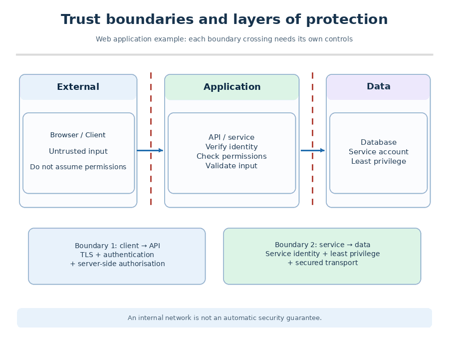

# M7-L4 – Data, security and architectural decisions {#L4}

**Course area:** M7 – Master’s-oriented computer science

**Level:** Master’s orientation

**Prior knowledge:** [M1-L4](M1-L4.md) · [M1-L5](M1-L5.md) · [M3-L2](M3-L2.md) · [M3-L6](M3-L6.md) · [M4-L2](M4-L2.md) · [M4-L4](M4-L4.md) · [M7-L1](M7-L1.md) · [M7-L2](M7-L2.md) · [M7-L3](M7-L3.md)

**Learning objective:** Understand architectural decisions as justified, verifiable trade-offs: which data must be preserved, and with what level of quality? What damage is plausible? Which protective measures are appropriate? How are correctness, maintainability, performance, availability, data protection and costs related?

The examples, scales and monetary amounts in this lesson are **explicitly constructed teaching scenarios**. They represent neither actual product prices nor measured probabilities of security incidents or failures. The references at the end identify the subject-matter foundations; an architectural proposal does not therefore constitute a security certification.

## An architectural question is not a product question {#S1}

When developing a system, people often begin by listing products: a particular database, a cloud provider, containers, an API gateway or a message broker. These are potential **answers**, however, not precise descriptions of the problem. A sound architectural decision begins with questions such as: who needs the application? What must never happen? How much delay is acceptable? Which data would be irretrievable if lost? Who could be harmed by unauthorised disclosure? Who will maintain the system in three years?

An architecture can therefore be described as a set of interrelated decisions. The data structure affects queries and changes. Data distribution alters consistency and failure behaviour. The chosen access boundaries determine possible security incidents. Operational and recovery requirements generate long-term costs.

``` text
Domain objective
     |
     v
Requirements + constraints + risks
     |
     v
Possible architectural alternatives
     |
     v
Trade-off -> decision -> observable operation
                 ^                |
                 +-- new evidence-+
```

**Principle:** An architecture is not good because it is particularly modern or elaborate, but because it meets its **stated requirements at acceptable risk and downstream cost**. A well-modularised monolith may be more appropriate than ten services. A local file may be more suitable than a database cluster. Conversely, a small system handling sensitive personal data may require strict security controls even though its load is low.

## Distinguishing functional and non-functional requirements {#S2}

A **functional requirement** describes a capability: users can upload an image; the application displays its title; a payment updates a balance. A **quality requirement** describes how reliably, quickly, traceably or securely that capability must be delivered. These are often called non-functional requirements; in practice, they determine a substantial part of the system design.

Examples of quality attributes are **correctness**, **reliability**, **security**, **performance**, **maintainability**, **usability**, **portability** and **recoverability**. Many of these goals are in tension. An additional security check may increase effort and response time. More replicas may absorb failures but increase costs, failure scenarios and attack surfaces. Extensive normalisation may prevent inconsistencies but make certain queries more complex.

The statement “should be fast” is insufficient for a verifiable design. A better example is: “Under an explicitly described load profile, 95 per cent of successful read requests should be answered within 300 milliseconds.” The **95th percentile (p95)** is a statistical threshold; it does **not** guarantee that every request remains below that time. The measurement method, period under consideration and definition of response time must be specified.

Likewise, “reliable” must be made concrete: is the concern the frequency of failures, the maximum tolerable interruption or the number of data changes that may be lost in the event of a total site failure? These are different requirements.

## Constraints, assumptions and invariants {#S3}

A **constraint** limits the permissible solutions: for example, legally required data processing, an existing budget, a lack of operations staff, offline use or a mandatory technical interface. An **assumption**, by contrast, is an assessment that has not yet been established and may prove wrong: “The application will never have more than one hundred simultaneous users.” Assumptions must remain visible so that they can be checked later.

An **invariant** is a rule intended to remain true across all permissible state changes. For example:

- A paid order must not simultaneously have the status “never paid”.
- A user must not be able to read another user's private file without corresponding authorisation.
- A confirmed amount must not be debited a second time through a repeated identical processing step.

These rules affect the data model, transactions, access control, interfaces and failure tests. M7-L2 introduced invariants as part of correctness reasoning. M7-L4 uses them as **design constraints**: an architectural alternative unable to preserve a required invariant is not chosen merely because it costs less.

## Understanding data first according to its domain meaning {#S4}

Before choosing a storage system, a **domain data model** is worthwhile: which objects exist? What relationships hold? Who is responsible for correctness? Which information can be changed or deleted? What must be logged immutably?

For a media catalogue, examples are `Medium`, `Quelle`, `Schlagwort` and `Zuordnung` (media item, source, keyword and association). A media item may have several keywords. A source may be associated with several media items. A separate model prevents the source and keyword from being incorrectly treated as fixed properties of a single large table row.

``` text
Source 1 ---- n Media item n ---- n Keyword
                    |
                    +--- Metadata
                    +--- File reference
                    +--- Rights / visibility
```

The **file reference** is not the file itself. A database entry may point to an object in the file system or object storage. This creates new questions about consistency: what happens if a database entry is deleted but the media file remains? What happens if the file upload succeeds but the database entry fails? A sound domain design explicitly addresses such states.

## Data classes and life cycles instead of treating everything alike {#S5}

Data differs in its confidentiality, integrity requirements, lifespan and recoverability:

| Class in the teaching example | Typical protection requirement | Practical design consequence |
|---|---|---|
| Public metadata | Correctness, availability | Indexing, simple recovery |
| Private account data | Confidentiality, access control | Authorisation, limited data disclosure |
| Billing events | High integrity, traceability | Transaction rules, auditable processes according to applicable obligations |
| Short-lived cache | Lower durability requirement | Reconstruction instead of elaborate backups |
| Access keys | Very high confidentiality | Specialised secrets management, rotation |

A **data life cycle** describes collection, processing, disclosure, retention, archiving and deletion. It prevents the common pattern: “We store everything forever; perhaps we will need it again.” Appropriate retention depends on the purpose, legal requirements and legitimate operational interests. The course is not a substitute for legal assessment of a specific project.

The EU General Data Protection Regulation (GDPR) includes, among others, purpose limitation, data minimisation, storage limitation and appropriate security as central principles (Article 5); Article 25 addresses data protection by design and by default. \[Q7\] The precise legal permissibility depends on the processing context.

## Which database suits which situation? {#S6}

A **relational database** with explicit tables, keys and transactions is appropriate when relationships and consistency rules matter. A **document store** may be useful for variable documents that are mostly processed independently. A **key-value store** is often suitable for simple accesses by key, such as certain cache applications. **Object storage** is particularly interesting for files or immutable binary objects. These are usage patterns, not mandatory product boundaries.

An application may combine different storage classes. Each additional storage type brings its own operational requirements, authorisation rules, backups, failure cases and possible data inconsistencies, however. The statement “We use the technically optimal database for each task” is therefore only a good decision if the extra benefit justifies the system complexity.

**Decision question:** Must a change to several related domain records occur as an indivisible unit? If so, the available transaction boundaries are particularly important. If information can be reconstructed from a reliable source in an emergency, its durability can be provided with less effort.

## Transactions are a domain decision, not just a technical decision {#S7}

A transaction is intended to perform or discard a defined set of changes together. Example: a paid order and its corresponding stock change must be consistent in domain terms. Whether they can lie within **one** database transaction depends on the system boundary. If they are distributed across different services, coordination and failure problems arise.

**ACID** describes atomicity, consistency, isolation and durability within the chosen database system and its configuration. Being “ACID-compliant” is not a complete guarantee that domain rules are modelled correctly, however. Even a technically correct transaction can calculate an impermissible price if the application logic is wrong.

``` text
Check order
    |
    +--> Create booking record
    +--> Change stock / entitlement
    |
  COMMIT -- only if rules are satisfied
    |
Confirmation to the user
```

If an external payment service is involved, however, a local database transaction is not enough to make all possible communication failures “magically” atomic. Domain states, reliable event matching, retry rules and reconciliation with the external system are needed. The desired invariant must be enforced at the correct system boundary.

## Distribution solves load problems and creates coordination problems {#S8}

M7-L3 showed that network partitions, delays and incomplete knowledge are inherent in distributed systems. A crucial principle follows for M7-L4: **an additional server instance is not a freely available copy of a single machine.** It changes failure and security models, synchronisation and operation.

For read-only, rarely modified media metadata, delayed replicas are often acceptable. For a binding reservation of the same unique resource by two users, a strongly coordinated decision may be needed. It is not sensible to treat every piece of information according to the same consistency model.

| Data operation | Typical desired property | Potential trade-off |
|---|---|---|
| Public search results | High read speed | Temporarily older results |
| Account balance after payment | Unambiguous domain booking | Availability during network partitions |
| Profile image preview | Rapid display | Delayed cache updates |
| Single-use voucher redemption | No double redemption | Additional coordination and database load |

No automatic technical prescription follows from this. An architectural decision must define **which** deviation is acceptable for **which** operation.

## Security goals: confidentiality, integrity and availability {#S9}

Three classical protection goals are:

- **Confidentiality:** Unauthorised parties must not learn information.
- **Integrity:** Information and system states must not be changed without authorisation.
- **Availability:** Authorised use must remain possible to the required extent.

An individual design may give these goals different priorities. A public image collection primarily needs reliable access and correct content. A private document collection requires considerably stronger confidentiality. A booking system may suffer greater damage from an incorrect duplicate booking than from a few minutes of unavailability.

Security therefore cannot meaningfully be described as a general score of “8 out of 10”. First the **assets** at risk and specific undesirable events must be identified. This explicitly includes keys, access rights, metadata, backups, audit trails and operations administration.

## Identifying trust boundaries {#S10}

A **trust boundary** exists where a new security assumption is intended to apply: from the browser to the server, between an external service and one's own application, or from the application process to the database. A connection over the internal network is not automatically trustworthy; the location of a device alone does not establish authorisation.

``` text
[Browser / untrusted input]
                 |
          TLS + API boundary
                 v
[Application / authenticated identity]
                 |
          Authorisation decision
                 v
[Data access with limited rights]
                 |
                 v
[Private records / separate backups]
```

Each boundary requires its own questions: how is identity established? Is the transmitted data structure valid? Is this person permitted to use the requested resource? Does an error response expose too much information externally? Can an input be treated as data rather than inadvertently as a command? **Encrypted transport** does not protect against an incorrect authorisation decision.



*Figure: Schematic **trust boundaries** of a web application. At the client boundary, identity, inputs and permissions are checked on the server; between the application service and database, separate service identities, least privilege and appropriate transport protection additionally apply. Internal network connections are not automatically trustworthy either.*

## Threat modelling: from abstract fears to concrete scenarios {#S11}

A **threat model** describes assets requiring protection, potential attackers or sources of error, entry paths and countermeasures. The OWASP guide to threat modelling recommends **STRIDE**, among other approaches, as a structuring aid for technical designs. \[Q2\]

| STRIDE category | Meaning | Example |
|---|---|---|
| Spoofing | Impersonating an identity | Using someone else's session token |
| Tampering | Modifying data without authorisation | Manipulating a file in transit |
| Repudiation | Denying an action | Critical change without a traceable audit trail |
| Information Disclosure | Disclosing information | Retrieving a private file using a guessed identifier |
| Denial of Service | Blocking a service | Expensive requests overload the server |
| Elevation of Privilege | Extending permissions | An ordinary role uses an administrator function |

STRIDE is not a complete list of all real attacks and does not replace domain-specific prioritisation. Additional perspectives are necessary for data protection risks: processing that is legally authorised may still be inappropriate, excessive or incomprehensible to the people affected. Accidental operating errors and technical faults must also be considered, even when no malicious attacker is involved.

## Risk: probability, impact and uncertainty {#S12}

A risk arises from a **scenario** and its possible **impact**, together with an assessment of whether and under what conditions the scenario can occur. NIST SP 800-30 provides a methodological framework for risk assessments. \[Q1\]

A useful teaching approximation is:

$\text{Expected loss}=\text{assumed event probability}\times\text{assumed magnitude of loss}$.

Suppose an explicitly fictional service values a particular data loss at **€12,000 in damages**, with an estimated probability of **2%** for the period under consideration. This gives a **calculated expected value of €240**. A second countermeasure that could lower the loss from such an incident to €3,000 would give **€60** at an unchanged probability. The apparent difference of **€180** is only as sound as the underlying assumptions.

The example explains the calculation principle, **not real actuarial mathematics**. Rare severe losses, uncertain probabilities, legal obligations and affected people cannot responsibly be reduced solely to a mean. A measure may be necessary even when its expected monetary value is uncertain. Risk decisions therefore require qualitative justification, sensitivity analyses and clear limits on acceptable consequences.

## Authentication, authorisation and identities {#S13}

**Authentication** answers: who or what is signing in? **Authorisation** answers: may this identity perform the concrete action on the concrete resource? A valid login is not permission to retrieve every file. **Accounting or auditing** records important events traceably, where appropriate and permitted.

A robust model checks permissions on the server against the actual resource. Merely checking the user interface (“the button is hidden”) does not constitute access control, because requests may reach the interface in other ways. In the OWASP Top 10:2025, **Broken Access Control** remains a central risk category; other categories concern, among others, configuration, software supply chains, cryptography, injection and authentication. \[Q3\]

The principle of **least privilege** means that a service receives only the permissions it needs for its task, preferably only for the required period. **Zero trust** does not assume trust merely because of an internal network location. NIST SP 800-207 describes this approach for identities, devices and resources. \[Q4\] Zero trust does not mean that every request must necessarily be sent through a new external login service; the specific control points depend on the architecture.

## Authorisation can be part of the data model {#S14}

For a platform with several independent customers (**tenants**), it is not sufficient to add a `tenant_id` column to every record. The decisive point is that **every** read and write operation enforces the correct tenant boundary – including searches, exports, background jobs and administrative functions.

``` text
Request: user U wants to read document D
    |
    v
Verify user identity
    |
    v
Check tenant + permission + resource D
    |
    +-- permitted ----> Read record
    |
    +-- not permitted -> Deny
```

A relational database system can restrict application access further. PostgreSQL, for example, supports **Row-Level Security (RLS)**, that is, policies for individual table rows. Such policies must be explicitly enabled and correctly configured; owners and privileged roles may have exceptions under certain conditions. RLS is therefore **an additional protective layer**, not an automatic replacement for a correct model of roles and permissions. \[Q8\]

Regardless of storage, search indexes, caches and export files should also respect tenant boundaries. A correctly protected SQL table is of little help if a shared cache delivers an already decrypted response to the wrong customer.

## Multiple protective layers and the limits of encryption {#S15}

**Defence in depth** means avoiding dependency on a single barrier. For a web system, several layers may work together: minimised public interfaces, TLS for transport connections, secure session management, server-side authorisation, restricted database roles, suitable encryption of data at rest, protected backups and informative logs.

Cryptography is necessary but not a substitute for correct design. **TLS** protects data in transit between the corresponding communication endpoints. **Encryption of data at rest**, depending on the threat model, protects against particular forms of access to storage media and backups. If a compromised application process is legitimately permitted to decrypt data, it may still misuse that data. **Passwords** in ordinary server authentication are not simply stored using reversible encryption, but verified with appropriate hash functions specially designed for passwords, together with individual salts.

**Key management** is itself an architectural task: who may issue keys? How are they rotated? What happens if they are lost? How can a compromised permission be revoked? An application that promises encryption but stores its keys openly in a source code repository has missed its central protection goal.

## Data protection by design and deletion {#S16}

Data protection should begin with the domain model. Is a precise home address required, or is the city sufficient? Must a date of birth be stored permanently if only a one-time age check is intended? Can a statistic be calculated without personal data? Are logs unnecessarily enriched with credentials, search terms or sensitive document content?

Deletion is a particularly difficult design question: the primary database may immediately remove a record, but what happens to search indexes, replicas, cache entries, exported copies and backups? A system should have traceable periods and technical procedures for these datasets. An existing backup does not make a deletion concept unnecessary; it needs its own recovery and retention procedure.

The GDPR is not a blanket prohibition on backups or logs, but requires legally sound, purpose-limited and proportionate processing. The specific design may depend on legal obligations and the circumstances. \[Q7\]

## Data durability, recovery and the difference between RPO and RTO {#S17}

A **backup** is a copy from which data can be restored to an appropriate state. **Replication** keeps copies synchronous or delayed for operation or failure tolerance. An accidental deletion may also be replicated; replication is not a substitute for an independent backup. Conversely, the existence of a backup file does not yet guarantee successful recovery.

Two metrics structure the planning:

- **Recovery Point Objective (RPO):** What data state must at least be recoverable after a failure? An RPO of one hour means a target maximum permitted window of lost changes of one hour – not a statement about the duration of recovery.
- **Recovery Time Objective (RTO):** Within what time after the event should a failed function become usable again? This is a target, not a commitment established without testing.

Example: a small catalogue permits **RPO = 24 hours** and **RTO = 12 hours**. Daily checked backups and documented recovery may be appropriate for this. A binding payment function with a much tighter RPO may require continuous logging, additional data durability and a different failure model. The numerical values in the example are purely hypothetical. Costs, operation and restore tests determine whether the target is realistically achievable.

**Particularly important:** recovery does not simply mean “extract a file”, but may also mean restoring keys, configuration, permissions, database versions, external identities and the order of dependent services to a functioning, consistent state.

## Modular monolith, services and operability {#S18}

A **modular monolithic application** combines different domain modules in one jointly deployed unit. This can simplify local transactions and troubleshooting. **Microservices** separate domain services together with their interfaces, often with independent ownership of data. They may facilitate independent changes and scaling, but increase network communication, logging, error handling, deployment coordination and the need for agreement.

``` text
Option M – modular monolith
  One service: [Users | Media | Rights | Billing]
                            |
                         Database

Option S – separate services
  [User service] <--> [Media services] <--> [Billing]
        |                    |                  |
     Own data             Own data           Own data
```

Neither representation is universally superior. A small team that releases infrequently may benefit more from a clearly modularised application than from a distributed system. If independent development teams, different load profiles or special isolation requirements exist, a separation may be sensible. The new boundary should create genuine organisational or domain benefit rather than merely making an architecture diagram more impressive.

**Operability** – the ability to operate, observe, modify and recover a system securely – is a quality attribute in its own right. Architectural decisions without responsible people, alerting paths and recovery knowledge are incomplete.

## A decision matrix: useful, but not a mathematical judgement {#S19}

Consider **two hypothetical alternatives** for a small online service: M (modular monolith) and S (multiple microservices). Five criteria are assigned weights that total 100%. The ratings from 1 (poor) to 5 (good) are **freely invented teaching assessments**, not measured data.

| Criterion | Weight | M | S |
|---|---:|---:|---:|
| Easy maintenance by a team of two | 30% | 5 | 2 |
| Independent scaling of individual functions | 20% | 2 | 5 |
| End-to-end transactions | 20% | 5 | 2 |
| Easy fault diagnosis | 20% | 4 | 2 |
| Independent releases | 10% | 2 | 5 |

For M, the weighted mean is $0{,}30\times 5 + 0{,}20\times 2 + 0{,}20\times 5 + 0{,}20\times 4 + 0{,}10\times 2 = 3{,}90$. For S, the same calculation is $0{,}30\times 2 + 0{,}20\times 5 + 0{,}20\times 2 + 0{,}20\times 2 + 0{,}10\times 5 = 2{,}90$.

**Conclusion only under these assumptions:** M is better suited to the constructed scenario. The scores are not objective. If team size, load profile or the separability of the domain changes, the weights and results may differ. A decision matrix transparently shows **which goals are preferred**; it does not prove that the preferences are correct.

**Exclusion criteria** come first: if an alternative cannot fulfil a mandatory data protection or correctness requirement, a good average score must not be allowed to compensate for it. A useful sensitivity check then asks how much the result changes if weights or ratings are shifted by one point.

## Understanding trade-offs as a Pareto question {#S20}

A **trade-off** is a conflict between goals: an improvement in one dimension may create disadvantages elsewhere. In simplified terms, **Pareto dominance** occurs when one alternative is at least as good in every criterion considered and better in at least one. If no such clear winner exists, priorities must be established.

A particularly instructive comparison is:

- A higher number of replicas may increase availability under particular failure assumptions, but raises costs and the attack surface.
- More security tests may slow releases, but reduce the probability of subsequent disruptions.
- Extensive logs facilitate troubleshooting, but may cause costs and data protection risks.
- Strong consistency may prevent incorrect domain bookings, but may also block certain writes during a partition.

Architecture guides such as the Microsoft Azure Well-Architected Framework explicitly treat reliability, security, cost, operational quality and performance as goals to be balanced against each other. These principles are generally understandable, even if the specific recommendations of one provider do not automatically apply to every other operator. \[Q5\]

## Architecture Decision Records: why a decision must be traceable {#S21}

An **Architecture Decision Record (ADR)** is a short, enduringly readable record of a decision. It documents not simply “We choose product X”, but the initial situation, alternatives considered, criteria, consequences and conditions for later reassessment. Without this justification, an architecture in two years often appears arbitrary or “historically evolved”.

A schematic decision record, **not intended to be executed**, might look like this:

``` text
ADR-04: Data storage for a private media catalogue
Status: accepted for the assumed single-user operation
Context: small dataset, local use, few writes
Decision: embedded relational database
Alternatives: CSV file, separate database server
Rationale: relationships and transactions without running a server
Consequences: backup routine, schema changes, limited concurrent write load
Reassess if: multi-user operation or a substantial increase in write volume
```

A decision need not remain correct forever. **Reversibility** is part of quality: can data be exported? Is the application decoupled through clearly named interfaces? Can security measures be extended? A cautious architecture commits where domain requirements are clear and avoids unnecessary commitments where uncertainty is high.

## Application scenario I: local media catalogue {#S22}

A local media catalogue manages around 20,000 video files and metadata for a single user. Typical requirements are reliable searches by date and keyword, easy correction of titles, recovery after a disk failure and no external Internet access. The number is assumed.

A suitable architecture might look like this:

``` text
Local interface
      |
      v
Catalogue logic ----> Embedded relational database
      |                          |
      +----> Media directory     +--> Independent backup
```

**Data decision:** An embedded relational database can manage relationships and transactions without requiring a server service. **Security decision:** The application exposes no public interface; access rights are based on the local user account and file system. **Operational decision:** The database and media directory are backed up using a verifiable, consistent procedure. **Limitation:** If several users are to write simultaneously from different computers, the access and synchronisation model must be reconsidered.

An unnecessary three-server cluster would increase effort here without better meeting an established requirement. The benefit of a simple architecture is precisely that risks, data flows and recovery remain manageable.

## Application scenario II: public media platform with user accounts {#S23}

A web platform permits uploads and public as well as private media. Several trust boundaries, data protection obligations and differing load profiles now arise. The system needs, for example, user identities, sharing rules, a metadata store, object storage and background processing for thumbnails.

``` text
Internet
   |
HTTPS / rate limit
   |
Web API -- identity / authorisation
   |                         |
   +--> Metadata database    +--> Audit event
   |
   +--> Object storage (private and public objects)
   |
   +--> Job queue --> Thumbnail workers
```

**Data decision:** Metadata and files can be managed separately. Public lists may be served from a cache or read replica; private access control must apply to every resource request. **Security decision:** A guessable file ID must not replace read permission; in particular, the provision of object URLs and thumbnails must be checked against the sharing status. **Operational decision:** Failed worker jobs require retry and idempotence rules. The delay between upload and availability of the preview is made apparent to users.

An initially modular application is often sufficient. Only when genuinely different scaling or organisational requirements arise is the benefit of independent services weighed against their operational consequences. Using a “cloud platform” does not automatically mean using every conceivable cloud product.

## Application scenario III: binding booking or credit balance system {#S24}

A binding booking system must distinguish more strictly between **displaying**, **provisionally reserving** and **legally binding confirmation**. A rapidly updated display may be incidental; a duplicate binding booking would, by contrast, be a domain error. Rules and a clear transaction boundary are necessary for each state transition.

``` text
Request with unique order ID
      |
Validate + check authorisation
      |
Transaction: reservation / booking rule
      |
Persist confirmed state
      |
Return receipt or unambiguously queryable status
```

**Data decision:** Unique keys and transactions prevent defined duplicate processing within the database boundary. **Security decision:** Bookings may only be initiated by authorised identities; critical changes must be logged traceably. **Architectural decision:** An external service or a second database system creates new failure and reconciliation cases. **Operational decision:** The recovery objective and treatment of jobs whose completion is unclear must be established before launch.

After a timeout, the state is not necessarily “failed”. The request may have been processed and only the receipt may be missing. The client must therefore not simply initiate a second independent booking. Instead, it can query the status of the same order ID. This is precisely where the uncertainties of distributed systems covered in M7-L3 affect a concrete architectural decision.

## Typical poor decisions and their causes {#S25}

**Technology before requirements:** Choose Kubernetes and microservices first, and look for a problem afterwards. This increases the risk of unnecessary complexity.\
**Relying on one protective mechanism:** A user account does not automatically constitute effective access control for every record.\
**Confusing a database replica with a backup:** Replication can propagate unintended changes.\
**Never deleting anything:** Permanent retention without purpose exacerbates data protection and security risks.\
**Spurious precision in metrics:** Risk matrices and availability percentages without data, time periods and failure models convey unwarranted certainty.\
**Unclear responsibility:** A complex system without maintenance time, documentation and a recovery plan cannot be operated sustainably.\
**Optimising prematurely:** Additional caches or services without a measured bottleneck create new consistency and failure scenarios.\
**Concealing trade-offs:** The statement “faster, cheaper and more secure” without stated assumptions is not a technical justification.

The common cause is not a lack of product knowledge, but an **unsubstantiated transition from objective, assumption and evidence to a final design decision**.

## How decisions remain verifiable {#S26}

A scientific approach can be derived from M7-L1: an architectural claim is formulated as a hypothesis. For example: “Under the expected read profile, a cache reduces p95 response time without violating the permissible data freshness.” This leads to two measures to be checked – response time and data age – and a description of the load and failure profile.

The formal aspect comes from M7-L2: “A private record may only be returned to authorised users” is a **security property** that must be examined in interface, database and application tests. The disruption dimension follows from M7-L3: what applies when a database response fails to arrive, a message is repeated or a replica is out of date?

No single method suffices on its own:

| Claim | Suitable evidence | Limitation |
|---|---|---|
| Domain rule is always preserved | Model, invariant, targeted tests | Implementation may differ from model |
| Request time under defined load | Reproducible benchmark procedure | Future load may differ |
| Unauthorised access is prevented | Threat model, permission tests, review | Unknown errors remain possible |
| Backup is usable | Recovery test | Not every conceivable disaster scenario is covered |
| Operation is economical | Full-cost model and sensitivity check | Costs and load change |

This does not “definitively prove” the architecture. It makes it **justifiable, verifiable and correctable in the light of new evidence**.

## Summary and transition to M7-L5 {#S27}

Data, security and architectural decisions are parts of the same problem. The data structure determines which consistency rules can be enforced easily. System boundaries define where permissions apply and which failures may occur. The failure model determines which availability and recovery commitments are realistic. Costs arise not only from servers, but also from maintenance, protection, monitoring and recovery.

A scientifically defensible architecture makes **requirements, assumptions, risks, alternatives, trade-offs and evidence** visible. It eliminates unnecessary complexity without downplaying mandatory correctness or protection requirements. It allows later revision when observations contradict original expectations.

**Connection within the course:** [M7-L1 – Scientific models](M7-L1.md) explains verifiable hypotheses; [M7-L2 – Correctness](M7-L2.md) formal guarantees; [M7-L3 – Distributed systems](M7-L3.md) failures and consistency among multiple participants. The subsequent [M7-L5 – Evaluating AI systems scientifically](M7-L5.md) applies these criteria to datasets, model quality, distribution shift, robustness and responsibility.

## Position within the course-wide reading paths {#S28}

This chapter belongs to the **six-part Master core**, not to the optional additional Master electives. Navigation: [previous Master core lesson M7-L3](M7-L3.md); [next Master core lesson M7-L5](M7-L5.md); [reading paths and subject-specific cross-references](pages/path.md); [course index](pages/index.md).


## Sources {#S29}

**Last source check:** 05.11.2026

The following sources establish the subject-matter principles; the architectures, figures and assessment matrices described are explicitly original **didactic constructions**.

- **\[Q1\] NIST SP 800-30 Rev. 1**, *Guide for Conducting Risk Assessments* (2012): [https://csrc.nist.gov/pubs/sp/800/30/r1/final](https://csrc.nist.gov/pubs/sp/800/30/r1/final)
- **\[Q2\] OWASP Cheat Sheet Series**, *Threat Modeling Cheat Sheet*: [https://cheatsheetseries.owasp.org/cheatsheets/Threat_Modeling_Cheat_Sheet.html](https://cheatsheetseries.owasp.org/cheatsheets/Threat_Modeling_Cheat_Sheet.html)
- **\[Q3\] OWASP Top 10:2025**, overview of web application risks: [https://top10.owasp.org/2025/](https://top10.owasp.org/2025/)
- **\[Q4\] NIST SP 800-207**, *Zero Trust Architecture* (2020): [https://csrc.nist.gov/pubs/sp/800/207/final](https://csrc.nist.gov/pubs/sp/800/207/final)
- **\[Q5\] Microsoft**, *Azure Well-Architected Framework*, quality pillars and trade-offs: [https://learn.microsoft.com/en-us/azure/well-architected/what-is-well-architected-framework](https://learn.microsoft.com/en-us/azure/well-architected/what-is-well-architected-framework)
- **\[Q6\] Microsoft**, *Cost Optimization Tradeoffs*, availability/security/operational consequences: [https://learn.microsoft.com/en-us/azure/well-architected/cost-optimization/tradeoffs](https://learn.microsoft.com/en-us/azure/well-architected/cost-optimization/tradeoffs)
- **\[Q7\] European Union**, *GDPR, Regulation (EU) 2016/679*, in particular Articles 5 and 25: [https://eur-lex.europa.eu/eli/reg/2016/679/](https://eur-lex.europa.eu/eli/reg/2016/679/)
- **\[Q8\] PostgreSQL**, *Row Security Policies* (current documentation): [https://www.postgresql.org/docs/current/ddl-rowsecurity.html](https://www.postgresql.org/docs/current/ddl-rowsecurity.html)

**Date of source consultation:** 05.11.2026. Technical product pages and regulatory legal conditions are subject to change and must be checked again for specific applications.
