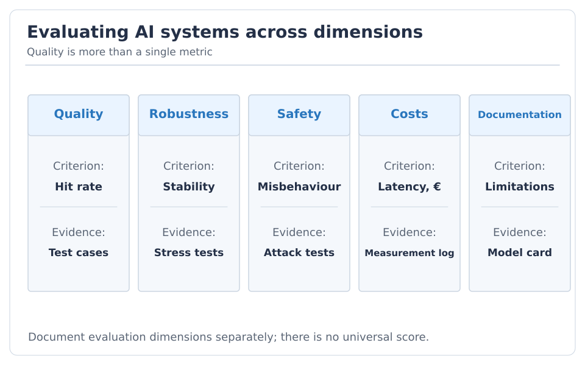

# M7-L5 – Scientific evaluation of AI systems {#L5}

**Course area:** M7 – Master’s-oriented computer science

**Level:** Master’s orientation

**Prior knowledge:** [M7-L1](M7-L1.md) · [M7-L2](M7-L2.md) · [M7-L4](M7-L4.md) · [M5-L2](M5-L2.md) · [M6-L6](M6-L6.md) · [M9-L2](M9-L2.md)

**Guiding question:** When is the statement 'This AI system is good, reliable or safe' actually justified, and when is it merely an insufficiently tested claim?

**Note on evidence:** All figures, measurement series, people and system examples in this lesson are explicitly **constructed for teaching purposes**. They do not come from actual benchmark studies. Verified technical concepts and methodological guidelines are supported by traceable references in the sources section. An illustrative calculation does not establish actual model performance.

## Starting point: What exactly is being evaluated? {#S1}

An AI model is initially a computational rule with learned parameters. An **AI system** encompasses more: preprocessing, data sources, the model, query interface, possibly search tools or a database, rules, user interface and the ways in which people handle results. For example, a powerful language model may exist whose application is nevertheless unreliable because it retrieves outdated documents or executes external actions without checking them.

{alt="Five columns covering quality, robustness, safety, costs and documentation, with example evaluation questions and evidence."}

AI evaluation requires distinct criteria and traceable evidence.

Three different statements must be distinguished:

1. **The model can solve a task under test conditions.** This can be substantiated for selected tasks using measurements.
2. **The entire application works reliably in a particular environment.** This includes data quality, operation and error handling.
3. **The application should be deployed in this environment.** This additionally requires an assessment of the consequences of errors, data protection and responsibility.

No single percentage answers any of these questions completely. Even the question of *which* inputs are considered typical is a domain-specific decision. The difference between an optional photo tagger and a system for reviewing medical findings is not only the difficulty of the data, but above all the significance of a wrong decision.

``` text
Application objective and risks
           |
           v
Test tasks + suitable data + reference answers
           |
           v
       Test AI system
           |
           v
Result quality + uncertainty + types of error
           |
           v
   Suitable for this specific use?
```

Scientific assessment is therefore not a ranking, but a limited, justified statement about the *system, task, data basis, time period and conditions*.

## From a marketing claim to a testable hypothesis {#S2}

'The new model understands our customers better' sounds convincing, but cannot be tested without verifiable terms. How is 'understands' recognised? Is the aim to classify incoming messages correctly, improve the quality of the generated text or determine which cases should be passed to people?

A testable statement might be: 'For German-language enquiries from our support archive, system B identifies the correct one of six agreed topic classes more often than system A, without increasing the number of serious misclassifications.' This at least makes the target group, basis of comparison and error type identifiable in principle.

For a robust evaluation, the following are documented in advance: **purpose, population, inclusions and exclusions, success measure, safety limits, comparison system, test design and decision rule.** Only then does testing begin. This reduces the risk of subsequently presenting only the figures that support the desired result.

**Context from M7-L1:** A hypothesis is not strong merely because it looks mathematical. It must be refutable on the basis of suitable observations. A correct calculation using unsuitable data does not yield a defensible conclusion.

**When is this excessive?** A research study would be unnecessary for privately organising a few non-critical photos. A small documented sampling procedure may suffice. **When is it indispensable?** Where errors may have legal, financial, medical or significant societal consequences.

## Evaluation is a comparison under specified conditions {#S3}

**Evaluation** means systematic assessment against justified criteria. A **metric** is a defined measure; a **benchmark** is a standardised comparison procedure with tasks, data and an evaluation specification. Neither a metric nor a benchmark is automatically objective for every purpose.

A good experiment distinguishes at least five levels:

| Level | Question | Possible weakness |
| --- | --- | --- |
| Target task | What should work? | Objective too vague or too narrow |
| Dataset | Which cases are represented? | Relevant cases missing |
| Reference | What is considered correct? | Disagreement or incorrect assessment |
| Metric | How much does each error count? | Important error costs remain invisible |
| Transfer | Will the result still apply later? | Different operation, users or data |

The scientific objective is not 'the largest possible number', but **the greatest possible explanatory value for the actual question**. An overall benchmark winner may lag far behind a smaller specialised model on an individual task.

The **Holistic Evaluation of Language Models (HELM)** research programme therefore emphasises evaluating language models across many scenarios and multiple dimensions, such as accuracy, calibration, robustness, fairness and efficiency. According to the project documentation, the associated open-source environment entered maintenance mode in June 2026; the methodological idea remains relevant independently of this \[Q4, Q5\].

## Population, sample and representativeness {#S4}

The **population** comprises the cases about which a statement is to be made. A **sample** contains cases that are actually examined. A model may work exceptionally well on 10,000 public sample texts and fail on 100 real, substantially different support enquiries.

Example: An image search is intended to organise private photo archives. Users have night photographs, old scanned paper photographs, blurred mobile phone images and digital illustrations. A test using exclusively bright, high-quality studio photographs would be convenient, but hardly representative. A greater number of similar studio images would not remedy this selection bias.

The origins of the data, the collection period, the languages or formats included, measurement errors, duplicate occurrences and missing cases must therefore be documented. A dataset **datasheet** records the motivation, composition, collection and recommended use \[Q6\]. Overlooked negative examples may be particularly important: a system for detecting damaged media files must also encounter rare codecs and edge cases.

**Representative** does not necessarily mean exactly proportional. Very rare, particularly dangerous cases may deliberately be overrepresented in safety tests. However, the actual error frequency of the overall population must not then be calculated from these test data without appropriate weighting.

## Training, validation and testing: Three different roles {#S5}

During **training**, model parameters are learned from examples. **Validation** supports the selection of settings and model variants. A previously held-out **test set** is intended to evaluate the selected solution finally on unseen cases. This separation only works if the test set does not indirectly become a training signal through many small adjustments \[Q7\].

``` text
Complete dataset
   |
   +--> Training: learn parameters
   |
   +--> Validation: select model and thresholds
   |
   +--> Test: predefined final assessment
```

A common error is **data leakage**, the improper inclusion of information that would not be available under subsequent deployment conditions. Duplicates, nearly identical passages or images from the same series can end up on both sides of a random split. A photograph from the same short burst is often less independent than a photograph from a completely different collection.

Depending on the task, a split by **person, device, building, document family or time** is therefore more appropriate than a purely random row split. For temporal predictions, future information must not appear unnoticed in training. Scaling or selecting features across all the data before splitting can also artificially improve test performance.

**Limitation:** With public language models, the exact composition of the training data is often not traceable. A publicly known test set may have appeared in pre-training, post-training or indirect optimisation loops. A high benchmark score alone is therefore no guarantee of unaffected generalisation.

## Reference answers are themselves a source of error {#S6}

A **label** is an assignment such as 'spam', 'not spam' or 'device damaged'. **Ground truth** denotes the reference taken to be correct. In some tasks, this is objectively verifiable, such as an exact calculation with clear assumptions. In other tasks there are legitimate differences of judgement: Is a summary complete? Is a comment ironic? Is an image 'aesthetically convincing'?

For difficult tasks, evaluation needs a **scoring rubric**: which properties must be present, which errors are critical, and when is an answer unclear or impossible to assess? Several knowledgeable evaluators can judge independently. Agreement between evaluators is itself an informative quantity, but not proof of truth. A shared erroneous rule may lead to high agreement and nevertheless to an incorrect reference.

When language-model responses are evaluated automatically, other language models are sometimes used as judges. This saves effort but can introduce **position, style, length or model preferences**. Such assessments should be calibrated against human judgements and checked by sampling important cases.

It is important to distinguish **objective agreement** from **domain usefulness**: two differently worded answers can be factually equivalent. Conversely, a linguistically similar answer can contain a decisive factual error.

## Classification: The confusion matrix {#S7}

For a model that distinguishes between two classes, the **confusion matrix** is a good starting point. Consider a **purely invented** test example: of 10,000 messages, 200 are actually unwanted and 9,800 wanted. A filter correctly flags 160 unwanted messages, misses 40 and incorrectly flags 196 wanted messages.

| Actual state | Flagged as unwanted | Not flagged | Total |
| --- | --- | --- | ---: |
| Unwanted | 160 true positives (TP) | 40 false negatives (FN) | 200 |
| Wanted | 196 false positives (FP) | 9,604 true negatives (TN) | 9,800 |
| **Total** | **356** | **9,644** | **10,000** |

**TP** stands for *true positive*, **FP** for *false positive*, **FN** for *false negative* and **TN** for *true negative*. These terms always refer to the previously defined 'positive' class. Positive does not mean good or desirable here, but simply the category sought.

Why is the matrix more valuable than a single rate? Because it shows **which** errors occur. Personal messages incorrectly flagged as unwanted might be considerably more disruptive than a few advertising messages that slip through. Another operation may weight exactly the same matrix in the opposite way.

## Accuracy, precision, recall and M7-L1 – fully worked {#S8}

Different quantities follow from the matrix:

- **Accuracy** (overall correctness): $\frac{\mathrm{TP}+\mathrm{TN}}N=\frac{160+9\,604}{10\,000}=97{,}64\,\%$.
- **Precision** (precision of positive predictions): $\frac{\mathrm{TP}}{\mathrm{TP}+\mathrm{FP}}=\frac{160}{356}\approx44{,}94\,\%$.
- **Recall** (sensitivity/detection rate): $\frac{\mathrm{TP}}{\mathrm{TP}+\mathrm{FN}}=\frac{160}{200}=80\,\%$.
- **Specificity** (detection rate of negative cases): $\frac{\mathrm{TN}}{\mathrm{TN}+\mathrm{FP}}=\frac{9\,604}{9\,800}=98\,\%$.
- **F1 score**, the harmonic mean of precision and recall: $\frac{2\mathrm{TP}}{2\mathrm{TP}+\mathrm{FP}+\mathrm{FN}}=\frac{320}{556}\approx57{,}55\,\%$.

The surprising result: a trivial solution that treats **every** message as wanted achieves **98% accuracy** in this dataset but detects **not a single** unwanted message. Our filter achieves 97.64% accuracy and is actually worse according to this measure, despite detecting a large proportion of unwanted messages.

The reason is the imbalanced **base rate**: positive cases are rare. For rare events, high overall accuracy is often not particularly informative. Precision answers 'How often is a positive flag correct?'; recall answers 'How many of the actual positive cases are detected?' Both respond differently to thresholds and frequencies.

**F1 is not a universal solution:** it accounts for neither true negatives nor the actual costs of different errors. It is only well suited if the desired balance between precision and recall matches the task. Medical decisions would require other requirements and domain-specific checks.

## Thresholds, base rates and the costs of incorrect decisions {#S9}

Many classifiers produce a score. A positive decision is triggered at a specified **threshold**. A high threshold may reduce false alarms but miss more genuine cases. The following figures are a second **invented** possible evaluation of the same 10,000-case test set:

| Setting | TP | FP | FN | TN | Precision | Recall |
| --- | ---: | ---: | ---: | ---: | ---: | ---: |
| Strict | 120 | 30 | 80 | 9,770 | 80.0% | 60.0% |
| Medium threshold | 160 | 196 | 40 | 9,604 | 44.9% | 80.0% |
| Lenient | 180 | 500 | 20 | 9,300 | 26.5% | 90.0% |

With a strict threshold, flags are more reliable, but 80 unwanted messages remain undetected. With a lenient threshold, recall increases, but 500 wanted messages are wrongly flagged. Which setting is appropriate cannot be deduced from the table alone.

Instead of automatic deletion, a system can therefore use three paths: let clearly unremarkable messages through, move moderately suspicious cases to a folder that can be reviewed, and automatically block only clearly harmful incoming messages. The **graduation of consequences** is part of the architecture, not merely a statistical optimisation.

A shift in the base rate also matters: the same sensitivity and specificity can lead to a different precision when unwanted messages occur at a different frequency. A test result must not be directly extrapolated to a new population without taking its distribution into account.

## Probabilities and calibration {#S10}

A model may output '80%'. This can mean different things: a genuine estimated probability, a rescaled internal measure or simply a verbal self-assessment. Only a defined measurement procedure and its verification make the number interpretable.

For probabilistic predictions, **calibration** means, in simplified terms, that of many cases with a predicted probability of 0.8, approximately 80% should experience the specified event under appropriate conditions. In a constructed group of 100 predictions, all at 0.8, of which 72 are correct, the observed proportion is 72%. This indicates possible overconfidence, but with only 100 cases it is not yet conclusive evidence of a systematic error.

A calibration chart known as a **reliability diagram** groups predictions by estimated probability and compares predictions with the observed proportion. Possible metrics are the **Brier score** or **log loss**; they assess probabilities, not merely hard class decisions. High classification accuracy does not imply good calibration.

Particularly important for generative AI: the verbal statement 'I am 90% sure' cannot automatically be equated with a calibrated probability. A model may answer incorrectly with great confidence; conversely, it may express a correct answer cautiously. Confidence statements must be tested separately on a clearly defined task distribution.

## Measurement uncertainty: Why 88% is not simply better than 86% {#S11}

Every finite test contains random fluctuations and possible systematic biases. Consider another **constructed** example: 350 correct predictions among 400 independent cases drawn in the same way give $\frac{350}{400}=87{,}5\,\%$.

For a binomial proportion, the simplified **standard error** is approximately $\sqrt{\frac{p(1-p)}n}$. Here: $\sqrt{\frac{0{,}875\times0{,}125}{400}}\approx0{,}0165$, or about 1.65 percentage points. Using the simple normal approximation, a rough 95% interval is $87{,}5\,\%\pm1{,}96\times1{,}65\,\text{percentage points}$, hence about **84.3% to 90.7%**.

This approximation assumes, among other things, independent observations with comparable distributions and appropriate sampling. For small counts, extreme proportions or dependent data, other procedures are more suitable, such as Wilson intervals or cluster-aware analyses. Under the commonly used frequentist interpretation, a 95% confidence interval does **not** mean that the unknown fixed parameter retrospectively lies within this particular interval with 95% probability.

For two models on the **same** cases, paired errors are particularly informative: which examples does only A solve, and which only B? A **paired comparison** is often more precise than two isolated proportions. If many variants are tried and only the best figure is published, the risk of an apparent improvement due to chance also increases. Predefined primary metrics and separate confirmation data help counter this.

## Generalisation: Good test figures are not a law of nature {#S12}

**Generalisation** refers to the ability to transfer learned behaviour to suitable, previously unseen cases. A dataset, however, is only a selection of possible inputs. If its context changes, performance may change as well.

Examples of distinctions include:

- **Covariate shift:** The distribution of inputs changes, for example different cameras or writing styles.
- **Label shift:** The frequencies of the target classes change, for example less spam.
- **Concept drift:** The relationship between input and target changes, for example new fraud patterns.

These concepts presuppose defined variables and tasks; in practice several effects can occur together. An old text-classification model does not automatically become unusable, but yesterday's benchmark does not guarantee quality next year.

**Out-of-distribution (OOD)** describes inputs that differ substantially from the tested data environment. These include malformed file formats, dialects, unusual lighting conditions or greatly changed user enquiries. A sensible system not only recognises as much as possible, but signals when it reaches its limits under unfamiliar conditions.

**When is it useful?** During extended operation, with changing data sources or decisions with consequences. **When is it of little help?** Constant retraining without demonstrated drift can generate unnecessary costs and new errors.

## Robustness: How does a model respond to small changes? {#S13}

A **robust** system preserves its desired properties as far as possible under relevant, foreseeable disturbances. A harmless rephrasing of the question, slight image compression or a typographical error should not cause completely different results, provided the domain meaning has not changed.

Robustness must be tested **against specific kinds of change**. A model may be insensitive to image noise but sensitive to an unfavourable crop. For texts, synonyms, sentence order, foreign languages, irony or deliberately misleading passages may be relevant.

There is a crucial distinction between **natural disturbances** and **targeted adversarial attacks**. In the latter case, someone actively tries to deceive a model. The NIST report on the security of machine learning distinguishes, among other things, evasion attacks, manipulation of training data and privacy attacks \[Q3\].

``` text
Original, correct input
       |
       +--> ordinary variant: spelling error, different light
       |
       +--> targeted variant: attack, false embedded instruction
       |
       v
Compare outputs: correct? safe? same meaning?
```

'Robust' must not be interpreted as a universal security guarantee. Measured resistance to five disturbance types proves nothing about a sixth, previously untested attack.

## Subgroups, fairness and concealed averages {#S14}

An overall metric can conceal structural differences. A transcription system may achieve a different error rate for clearly spoken standard German than for dialects or loud background noise. What matters is whether the affected groups are relevant to the intended use and whether the system works appropriately for them.

A **slice analysis** divides test results into meaningful, domain-relevant subgroups. In a purely instructional example, a model achieves 90% correct answers overall. For a group of 900 commonly represented standard cases, suppose 855 are correct (95%); for 100 rare special cases, only 45 (45%): together $\frac{855+45}{1\,000}=90\,\%$. The overall value conceals the very weak performance of the second group.

Subgroup results must not be casually interpreted as stable statements. With small case numbers, uncertainties are larger; many retrospective divisions may generate chance patterns. Sensitive characteristics and personal information also require careful legal and ethical handling. Some fairness criteria may mathematically conflict when groups have different base rates.

The scientifically meaningful question is not simply 'Is the model fair?', but: **Which relevant disadvantage is to be ruled out, using which data and criteria, with what uncertainty and under which trade-offs?** A high mean is no substitute for examining the consequences of errors.

## Language models: Why 'correct' is often difficult to measure {#S15}

A **large language model (LLM)** generates language sequences based on its trained parameters and a context. The inputs are open-ended, and there are often several good answers. Exact matching to a single model answer is therefore not always sufficient.

For a factual question, a rubric may require domain correctness, completeness, compliance with the instruction, properly acknowledging missing information and justified use of sources. For drafting text, readability, suitability and style become more important; for a software change, executable tests and verified boundary conditions may matter more than an attractive explanation.

Different tasks require different methods:

| Task | Useful assessment dimension | Typical blind spot |
| --- | --- | --- |
| Factual question | Factual correctness with verifiable evidence | Correct statement with incorrect evidence |
| Summary | Essential content, no inventions | Superficial word similarity |
| Code | Behaviour under tests, safety, maintainability | Syntactic validity only |
| Dialogue | Goal achievement, follow-up questions, uncertainty | Individual reply without conversation context |
| Tool use | Permitted and successful action | Success message without actual effect |

An LLM may perform well on multiple-choice questions and be unreliable when summarising long, unusual documents. Evaluation must therefore be tailored to the *intended workflow*.

## Hallucination, grounding and knowledge-supported systems {#S16}

In generative AI, a **hallucination** often refers to a factually unsupported but plausibly worded output. Because the term is imprecise, it is better in studies to distinguish concrete error classes: incorrect fact, unsupported claim, fabricated source, misleading conclusion or contradiction of the supplied material.

With **retrieval-augmented generation (RAG)**, text generation supplemented by document search, an additional chain of potential errors arises:

``` text
Question -> Document retrieval -> Retrieved passages -> Language model
                   |                     |                    |
              Wrong match         Relevant passage?     Used correctly?
                                                             |
                                                             v
                                                    Answer + evidence
```

An incorrect result may originate in retrieval, incomplete documents, the context window or actual answer formulation. Therefore **retrieval quality**, **faithfulness to evidence** and **answer usefulness** are evaluated separately. The mere formal presence of a citation does not constitute a correct justification. The cited passage must actually support the specific claim.

A useful example is an internal document assistant: it must answer a question about a fee rule using the currently valid document. An outdated but easily retrievable document must not silently take precedence. Metadata, versioning, search filters and the option to answer 'insufficient evidence' belong to the overall system under test.

## Prompt variants, randomness and fair comparison conditions {#S17}

In generative AI, the same question may elicit different answers on repeated attempts due to stochastic selection. In many language-model environments, **temperature** influences the dispersion of token selection; the concrete effects of parameters depend on the model and interface used. Context length, system instructions, available tools and the state of external knowledge sources also change results.

A fair comparison therefore documents at least the model designation and, if possible, exact version, date, input texts, system context, tools, output restrictions, sampling settings, prompt variants and cost conditions. One particularly successful answer is not a reliable measurement of quality.

**Repeated testing** may reveal variability. For expensive tasks, however, a decision is needed about how many repetitions justify the additional information gained. Identical seeds or deterministic settings sometimes improve reproducibility, but do not guarantee it for every backend and hardware configuration.

Rephrasing a prompt may strongly favour one model. This is not always manipulation – prompt design is part of actual applications. It becomes unfair if one model has been extensively optimised for the test set and the other candidate has not, or if this optimisation is concealed. The **overall process actually deployed in each case** should be evaluated, including prompting techniques and tool use.

## Model as judge: Useful, but not the final authority {#S18}

When hundreds of answers cannot be individually reviewed by experts, some evaluations use automated **LLM-as-a-judge** methods. A language model then judges other outputs according to a rubric. This is inexpensive and may be useful for clearly defined criteria.

The danger is that the judge prefers particular response styles, longer texts or its own model family. The order of two compared answers may also have an influence. The figure '8 out of 10' does not automatically become an objective measure of quality.

Careful application combines fixed scoring rules with **blinded ordering**, random variation of arrangement, independent human samples and checking which error types lead to systematic divergence in automated judgements. A particularly delicate edge case is judging answers from a domain in which the judge model itself frequently makes errors.

For unambiguous tasks, direct verification should take precedence wherever possible: an arithmetic result can be recalculated, a program tested, a supplied link opened and a database query run against defined sample data. A judge model can supplement such evidence but cannot replace it.

## Multimodal systems: Image, audio and video {#S19}

**Multimodal models** process different data types, such as text and image, sound and transcript, or video and description. A system may be strong in one modality and weak in another. For image models, for example, image quality, prompt alignment, preservation of specified details, robustness and possible biases are distinct dimensions \[Q8\].

A generator that produces beautiful images need not reliably follow a precise spatial instruction. A video model may capture a style well but change objects between frames uncontrollably. And an audio model that transcribes speech fluently may fail more often on proper names or numbers.

Possible test conditions include:

- **Image:** Count objects, compare colours and positions, assess image content in the target context.
- **Video:** Temporal consistency, motion sequences, object identity, transitions and physically relevant errors.
- **Audio:** Word error rate, language variations, background noise, changes of speaker and correct numbers.
- **Mixed systems:** Does a statement about an image remain grounded in actually visible features? Are inputs from different channels combined correctly?

Aesthetic assessment may be subjective; aesthetic judgements should therefore not automatically be used as factual statements about accuracy or safety.

## Security: The model is only part of the attack surface {#S20}

AI risks include unintended errors and deliberate attacks. Examples to consider are **prompt injection** (external texts attempting to introduce instructions into the system), harmful or manipulated training data (**poisoning**), deceptive inputs intended to bypass a detector (**evasion**), unwanted disclosure of private information and abusive tool calls \[Q3\].

A particularly important **trust boundary** separates an authorised user's instruction from the content of an external web page or file. A document may contain words such as 'Ignore all previous rules' without thereby becoming a legitimate control authority. For a tool-using agent, the evaluation should also test whether the system derives unauthorised actions from such text.

Isolated test environments are appropriate: restrict read permissions, prevent unwanted actions, log attempts and respect the limits of the evaluation system itself. A test that executes a critical action is no longer a harmless chat experiment.

**No security from benchmarks alone:** passing a known set of attacks does not mean that an application is immune to previously unknown attacks. Protection comes from system architecture, permissions, monitoring, secure standards and repeated checks, not from a blanket statement that 'the model is safe'.

## From model to ongoing operation: Drift, monitoring and fallback {#S21}

A one-off model test is a **snapshot**. In production, inputs, legal conditions, technical dependencies and the available document collection may change. Replacing the model endpoint, changing the retrieval configuration or introducing a new prompt template can also change results.

**Monitoring** should not merely observe response times and costs. Domain-relevant measures include the proportion of incorrectly assigned cases, manual corrections, frequency of missing evidence, differences between subgroups, unexpected tool actions and the proportion of cases in which the system justifiably makes no decision.

A **regression** means a deterioration of previously confirmed properties. A sensible regression test collection therefore contains precisely the difficult or frequently erroneous cases. However, it must not completely replace the independent test set: once development constantly optimises against the same error cases, the risk of overfitting increases.

For critical changes, a **phased rollout** may be appropriate: first observe only, then deploy in a limited number of non-critical cases, compare results and return to a verified state if significant errors occur. A fallback plan, human escalation and documented limitations are components of evaluation of the overall system.

## Effort, efficiency and environmental downstream costs {#S22}

A model may supply somewhat better answers but consume considerably more time, memory, energy or financial resources. **Efficiency** therefore belongs to evaluation as a distinct dimension. Relevant quantities include latency distributions (such as p50 and p95), throughput, memory requirements, cost per validly solved case and effort for human review.

A **didactic model calculation**, not a current provider price: system A solves 900 out of 1,000 cases correctly in domain terms at a total cost of 40 compute units; system B solves 930 correctly at 100 units. The pure computational cost per domain-correct case is $\frac{40}{900}\approx0{,}0444$ units for A and $\frac{100}{930}\approx0{,}1075$ units for B. B is somewhat more accurate, but in this example incurs more than twice the computational cost per correct case.

Which system is preferable depends on the cost of errors, human effort, speed and risks. For a free photo recommendation, a difference of three percentage points may be worth little; where the consequences of an error are serious, the same improvement may be very important. Moreover, large models can be integrated more efficiently through intelligent tool use, caching or tiered calls.

**Limitation:** Energy and cost figures depend heavily on hardware, utilisation, location, provider conditions and system boundaries. Blanket statements about environmental impact are unsuitable without a defined measurement method.

## Architecture example I: A local media catalogue {#S23}

A private media catalogue is intended to sort thousands of photographs and videos by subject, capture situation and technical properties. A small local model produces image tags; a search function combines these with file metadata.

``` text
File archive -> Metadata analysis ----+
                                     +--> Tag/search index --> Results list
             -> Image model ---------+
                      |
                      v
              Flag uncertain tags
```

Scientific testing asks for clear categories. 'Dog', 'cat' or 'car' can be tested relatively objectively; 'atmospheric' requires a different reference. The test should include not only attractive new photographs but also old scans, heavy compression and objects that are hard to recognise. Multiple images of the same scene should, where possible, be kept together in training or testing.

A useful assessment chain would be independent reference tags for a sample; precision and recall per category; error rates for old and new files; running time for large archives; and documented behaviour when results are uncertain. The system could provide suggestions without automatically deleting or renaming original files.

**When is the technology worthwhile?** When manually maintained tags are no longer practical for large archives. **When is it excessive?** For a few well-named folders or where a simple keyword search suffices. **Operational consequences:** Model updates, index recalculation, storage space and local data protection properties need to be considered.

## Architecture example II: A document-supported domain assistant {#S24}

A domain assistant answers questions exclusively on the basis of approved, versioned documents. Technically, it consists of document management, a retrieval component, a language model and an output layer that makes evidence visible.

``` text
Currently approved documents ---> Retrieval ---+
                                               +--> Language model --> Answer
Question --------------------------------------+                    +--> Evidence
                                                                      |
                                                                      v
                                                                  Verifiability
```

A deliberately small test set might contain four types: unambiguously supported answers; ambiguous questions; questions with conflicting document versions; and questions for which the archive contains no answer. A good system must **not only answer**, but **correctly qualify or decline** when the basis is lacking.

Separate measures would include the document retrieval hit rate, factual correctness, correct attribution of claims to sources, proportion of unjustifiably invented answers and behaviour when document texts have been manipulated. Access permissions must also be tested: a good answer that discloses confidential document content is operationally unacceptable.

**Central lesson:** A new model version may produce better wording while a poor search index keeps the overall assistant unreliable. The quality of the document-supported system therefore does not follow from a model benchmark.

## Architecture example III: Automatic preliminary ticket sorting {#S25}

An organisation receives numerous technical enquiries. A classification model proposes the responsible specialist group but does not itself decide about refunds, suspensions or financial actions. The task appears simpler than general dialogue, but has precise operational targets.

``` text
Incoming ticket
       |
       v
 Preliminary check -> Classification model -> Confidence + specialist group
                                                  |
                                  +---------------+--------------+
                                  |                              |
                           high confidence                  unclear/new
                                  |                              |
                           adopt suggestion                 human review
                                  +--------------+---------------+
                                                 |
                                          record corrections
```

Testing can examine a confusion matrix for each specialist group, particularly costly misrouting errors and the proportion requiring manual reworking. A random test set from a single week could be unsuitable if certain topics occur only rarely or seasonally. An additional sample from a later period would strengthen the conclusions.

**Limiting automation:** The specialist should be able to correct a suggestion without the system adopting their change unchecked as a new training label. Otherwise a feedback loop may develop: incorrect suggestions influence later data on which the next model is trained again.

**Architecture connection to M7-L4:** Roles, correction paths, monitoring, costs and human responsibilities are just as important as the classification rate. Good model performance is a necessary but insufficient condition for good operation.

## Documentation: What must a results report contain? {#S26}

A **model card** describes a model, its purpose, intended and unsuitable uses, data context, evaluation and known limitations. The basic idea was proposed as a systematic documentation approach \[Q9\]. Such a report is not a substitute for testing, but makes its scope more traceable.

A sound evaluation report specifies at least:

1. **System and version:** Model, prompt, tools, data sources, date and relevant configuration.
2. **Purpose and risk class:** What should be decided or generated, and what must not happen automatically?
3. **Data and reference:** Where do the cases come from, and how were they selected and assessed?
4. **Experimental procedure:** Independent tests, comparison baseline, repetitions, defined primary metrics.
5. **Results and uncertainty:** Error types, variation, subgroups and relevant failures.
6. **Operation:** Latency, costs, safety measures, update and fallback paths.
7. **Limitations:** Which statements are specifically **not** supported by the investigation?

A report with a precise error rate and stated limitations is scientifically more honest than the claim 'almost error-free', even if the latter sounds more professional. Traceable **negative results** are particularly valuable: they show which tasks the system should not be used for.

## NIST risk management: Evaluation throughout the system lifecycle {#S27}

The **National Institute of Standards and Technology (NIST)** has published the **AI Risk Management Framework (AI RMF)**, a voluntary framework for assessing and managing risks arising from AI systems. The functions **GOVERN**, **MAP**, **MEASURE** and **MANAGE** connect organisational responsibilities, context understanding, measurement and concrete risk treatment \[Q1\]. The generative AI profile **NIST AI 600-1** extends this perspective to the particular characteristics of generative systems \[Q2\].

In simple terms:

``` text
GOVERN: Who decides and bears responsibility?
   |
MAP: What can go wrong in which context?
   |
MEASURE: How do we measure performance, harms and uncertainty?
   |
MANAGE: Which safeguards and limits follow?
   |
   +------> reassess when changes occur
```

Important: A framework is **not a certification** of a particular model. A document headed 'NIST-compliant' is no evidence that a system is safe or suitable for a particular application unless the implementation has been checked and the scope is clear. According to NIST, the AI RMF is also being developed further; the reference point presented here is the publicly documented version 1.0 and the 2024 profile (source check 05.11.2026).

## Where scientific conclusions end {#S28}

Even a careful evaluation answers only a subset of all questions. It may show that system A performs better than B on a particular test set according to a particular criterion. It cannot automatically prove that A handles *all* conceivable inputs correctly, protects against *all* attacks or is the best societal choice.

Four kinds of statement should therefore be distinguished:

- **Directly measured:** 'In the defined test, 160 of the 200 positive cases were detected.'
- **Statistically estimated:** 'Under the stated assumptions, the detection rate in a larger comparable population is likely to lie approximately within this range.'
- **Plausibly transferred:** 'Similar operational data might lead to comparable results' – this transfer requires further testing.
- **Not established:** 'The system generally operates without errors, discrimination or security problems.'

Research can narrow limits and make doubts more precise, but cannot abolish uncertainty. Demanding computer science consists precisely in **making the scope of a statement explicit**. Under appropriate conditions, a responsible system may also output 'not decidable from the available information' or refer the case to a qualified person.

## Summary and bridge to M7-L6 {#S29}

M7-L5 connects the scientific methods of [M7-L1](M7-L1.md) with the limits of proof in [M7-L2](M7-L2.md) and architectural trade-offs in [M7-L4](M7-L4.md). The guiding conclusions are:

1. A **model** is not the entire **AI system**; good model scores do not guarantee good operation.
2. Informative tests start with **purpose, population, reference and consequences of errors**, not a ranking figure.
3. **Accuracy, precision, recall, F1 and calibration** answer different questions and must not be confused.
4. **Sampling errors, data leakage, drift, subgroup differences and attacks** limit transferability.
5. In generative and multimodal AI, **factual grounding, assessment criteria, tool behaviour and system consequences** must be explicitly tested.
6. Scientific rigour is demonstrated by clearly identifying **untested claims, uncertainty and lack of knowledge**.

**Continue reading in the completed core path:** [M7-L6 – Cross-system synthesis and research methods](M7-L6.md) connects parts M7-L1–M7-L5 into a reasoned approach to architecture and research decisions. M7-L6 is now available in full as a reading lesson.

## Position within the course-wide reading paths {#S30}

This chapter belongs to the **six-part Master’s core**, not the optional additional Master’s topics. Navigation: [previous Master’s core lesson M7-L4](M7-L4.md); [next Master’s core lesson M7-L6](M7-L6.md); [reading paths and subject-related cross-references](pages/path.md); [course index](pages/index.md).


## Sources {#S31}


**Verification date:** 05.11.2026. The links point to scientific publications or official project and institutional pages. The sources support concepts, methods and methodological limitations, **not** the invented table values in this instructional text.

- [\[Q1\] NIST – AI Risk Management Framework 1.0 (2023)](https://www.nist.gov/itl/ai-risk-management-framework) · Voluntary framework for GOVERN/MAP/MEASURE/MANAGE and evaluation tasks · Last accessed: 2026-11-22
- [\[Q2\] NIST – Generative AI Profile, NIST AI 600-1 (2024)](https://www.nist.gov/publications/artificial-intelligence-risk-management-framework-generative-artificial-intelligence) · Risk profile of generative AI · Last accessed: 2026-11-22
- [\[Q3\] NIST – Adversarial Machine Learning, AI 100-2e2025](https://www.nist.gov/publications/adversarial-machine-learning-taxonomy-and-terminology-attacks-and-mitigations-0) · Attack classes and security concepts · Last accessed: 2026-11-22
- [\[Q4\] Liang et al. – Holistic Evaluation of Language Models (arXiv, 2022)](https://arxiv.org/abs/2211.09110) · Abstract: evaluation of language models using multiple metrics and scenarios; preprint, not the 2023 OpenReview version · Last accessed: 2026-11-25
- [\[Q5\] Stanford CRFM – HELM project](https://crfm-helm.readthedocs.io/en/latest/) · Documentation, scenarios, metrics, maintenance mode since 01.06.2026 · Last accessed: 2026-11-22
- [\[Q6\] Gebru et al., Datasheets for Datasets (2021)](https://www.microsoft.com/en-us/research/publication/datasheets-for-datasets/) · Dataset documentation and usage context · Last accessed: 2026-11-22
- [\[Q7\] Google Machine Learning Crash Course – Training/Validation/Test](https://developers.google.com/machine-learning/crash-course/overfitting/dividing-datasets) · Separation of datasets and problems with repeated use of tests · Last accessed: 2026-11-22
- [\[Q8\] Lee et al. (2023) – Holistic Evaluation of Text-to-Image Models](https://proceedings.neurips.cc/paper_files/paper/2023/hash/dd83eada2c3c74db3c7fe1c087513756-Abstract.html) · Abstract: evaluation dimensions for image generators; NeurIPS conference publication, not the historical HEIM dashboard · Last accessed: 2026-11-25
- [\[Q9\] Mitchell et al., Model Cards for Model Reporting (2019)](https://research.google/pubs/model-cards-for-model-reporting/) · Transparent model documentation and limitations · Last accessed: 2026-11-22
- [\[Q10\] scikit-learn – Model Evaluation Guide](https://scikit-learn.org/stable/modules/model_evaluation.html) · Definitions and limits of classification metrics · Last accessed: 2026-11-22

**Limitation:** This is a scientifically oriented reading course, not an external model certification, a specific compliance assessment or an independently conducted empirical research project. Figures and processes are didactic models; actual system behaviour must be checked separately in each case.
