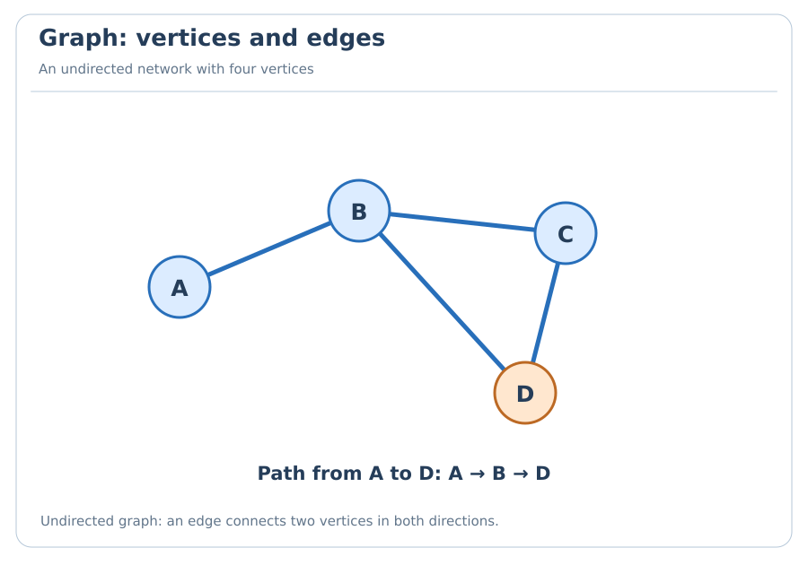

# M8-L1 – Discrete computer science: Logic, sets, relations and graphs {#L1}

**Course area:** M8 – Bachelor’s: Core areas

**Level:** Bachelor’s

**Prior knowledge:** No fixed prerequisites specified.

## Learning objective: Recognising the invisible mathematics behind software {#S1}

An application decides whether someone may read a file. A shop lists products in categories. A database links customers to orders. A navigation system searches for a route through a road network. At first, these tasks seem quite different. Yet they can all be described using a few shared ideas: **propositions with truth values**, **sets of things**, **relationships between things** and **networks of vertices and connections**.

*Discrete mathematics* deals with such structures. 'Discrete' here means that we consider distinguishable states, objects and steps – for example, a finite set of accounts or a graph with clearly named vertices. Its counterpart is the continuous perspective, such as a continuously changing speed. Both are important in computer science, but discrete models are especially pervasive: memory consists of distinguishable bit states, programs execute defined steps, and databases manage individual records.

**M8-L1 is an optional Bachelor's elective topic**, not an additional compulsory chapter of the 33-lesson main course. It extends the foundations from [M1-L1 – What is computer science?](M1-L1.md), [M1-L3 – Algorithms and data structures](M1-L3.md) and [M1-L5 – Data and databases](M1-L5.md). The lesson can be read without installing software, programming or completing exercises.

By the end, we can answer the question 'Which data structure or rule do I need?' more precisely: is it a logical expression, a set, a function, a relation or a graph? And where is a simple list entirely sufficient?

## Propositional logic: Turning clear conditions into clear decisions {#S2}

### What is a proposition? {#11-was-ist-eine-aussage}

A **proposition** is a sentence that, under a specified interpretation, is either **true** or **false**. 'The invoice has been paid', for example, can be true or false. 'Pay the invoice!' is a command, not a proposition with a truth value.

We can abbreviate propositions:

- `P`: The person is signed in.
- `Q`: The person has read permissions.
- `R`: The requested file may be opened.

For a simple access operation, the rule could be: $R=P\land Q$. This rule can be understood independently of any particular programming language.

The usual logical connectives are **negation** (`NOT P`), **conjunction** (`P AND Q`), **disjunction** (`P OR Q`) and **implication** (`P → Q`). With the customary *inclusive* meaning of OR, the connective is also true when both propositions are true. This differs from the 'either ... or' of everyday speech.

| P | Q | P AND Q | P OR Q | NOT P | P → Q |
| --- | --- | --- | --- | --- | --- |
| false | false | false | false | true | true |
| false | true | false | true | true | true |
| true | false | false | true | false | false |
| true | true | true | true | false | true |

The final column is often surprising: `P → Q` is false in classical propositional logic only when **P is true and Q is false**. Implication does not claim that P causes Q. It describes a logical condition. If P never occurs, the implication is not refuted under this definition.

### Three common errors in reasoning {#12-drei-typische-denkfehler}

1. **'If P, then Q' does not mean 'if Q, then P'.** If a premium account may use certain functions, it does not follow that every user of those functions must have a premium account. Administrators might have the same permissions.

2. **OR is not always exclusive.** 'The file is public OR the person has permission' allows both conditions to hold at the same time. A decision intended to be exclusive must be expressed differently.

3. **Missing information is not automatically false.** In a programming language, a Boolean variable may have two states. In SQL, however, conditions involving `NULL` may also yield a third truth value, *unknown*. The classical tables above explain two-valued logic; they cannot be applied uncritically to every database query. The meaning of `NULL` was introduced in main course lesson M1-L5.

### Negation and De Morgan's laws {#13-negation-und-die-de-morgan-regeln}

Consider the rule: 'A job may start if the service is available **and** there is sufficient credit.' The opposite is not 'the service is unavailable and credit is insufficient', but rather: **At least one of the two prerequisites is missing.**

``` text
NOT (P AND Q) = (NOT P) OR (NOT Q)
NOT (P OR Q) = (NOT P) AND (NOT Q)
```

These are **De Morgan's laws**. They help transform a complex condition into an equivalent form. They are especially useful in security checks: an incorrect negation can permit unauthorised access or block legitimate access.

A *logical equivalence* means that two expressions have the same truth value for every assignment of truth values to their constituent propositions. We can check this with a truth table. With very many variables, however, a complete truth table grows quickly: ten independent propositions would already permit $2^{10}=1\,024$ assignments.

### From an everyday rule to verifiable access control {#14-von-der-alltagsregel-zur-überprüfbaren-zugriffskontrolle}

The access rule of a small online archive is:

> A document is readable if it has been published **or** if the requesting person is signed in and has appropriate permission for that document.

``` text
                [Document published?] ── YES ────┐
                         │ NO                    │
                         ▼                       ▼
                  [Signed in?]                [Access]
                         │ YES                   ▲
                         ▼                       │
                 [Permission valid?] ── YES ─────┘
                         │ NO
                         ▼
                   [Access denied]
```

As a formula: `Readable = Published OR (SignedIn AND Permission)`. The parentheses are decisive. Without proper grouping, a different rule may result. In practice, such a check is performed on the server; simply hiding a button in the user interface is not an access restriction. Even a formally correct expression offers no protection if the underlying permission information is outdated or manipulated.

## Predicate logic: Propositions about individual objects {#S3}

Propositional logic treats whole sentences as true or false. Frequently, however, we want to speak more precisely about many objects: 'Every order belongs to exactly one customer' or 'There is at least one job with an error'.

A statement with a variable is called a **predicate**. `Paid(x)`, for example, can mean 'Order x has been paid'. Two important symbols are:

- `∀` – **for all**: `∀x` means 'for every x' in the agreed domain of discourse.
- `∃` – **there exists**: `∃x` means 'for at least one x' in the domain.

The statement `∀x: Paid(x)` is meaningful only if it is clear what x ranges over – for example, all orders in the daily report. The statement `∃x: Failed(x)`, by contrast, indicates that at least one failed job exists.

A particularly important difference concerns the order:

``` text
∀ customer k: ∃ support person s: Supports(s, k)
```

Every customer has at least one support person. This person may differ from one customer to another.

``` text
∃ support person s: ∀ customer k: Supports(s, k)
```

There is one support person who supports all customers. This is a much stronger requirement. The same symbols in a different order therefore describe a different operation.

In database systems, such ideas appear as filters, existence checks and constraints; in programs, as loop conditions or validation rules. At a more abstract level, they serve to formulate software requirements unambiguously. **Formal language does not automatically make a requirement true**, but helps expose ambiguities.

## Sets: Grouping things unambiguously {#S4}

### A set describes membership, not order {#31-eine-menge-zählt-zugehörigkeit-nicht-reihenfolge}

A **set** is a collection of distinguishable elements. In the set `{red, blue, green}`, the order is irrelevant. An element does not appear 'twice' in mathematical terms: `{red, red, blue}` is the same set as `{red, blue}`.

A photo archive contains the following collections:

``` text
A = {Photo1, Photo2, Photo4}     # Images tagged 'Nature'
B = {Photo2, Photo3, Photo4}     # Images tagged 'Evening'
```

Important operations:

| Operation | Notation | Result in the example |
| --- | --- | --- |
| Union | $A \cup  B$ | `{Photo1, Photo2, Photo3, Photo4}` |
| Intersection | $A \cap  B$ | `{Photo2, Photo4}` |
| Difference | `A \ B` | `{Photo1}` |
| Subset | $A \subseteq  C$ | Every element of A also occurs in C |
| Empty set | `∅` | No elements |

The **cardinality** `|A|` is the number of distinct elements in A. Here `|A| = 3`, `|B| = 3`, $|A \cap  B| = 2$ and $|A \cup  B| = 4$.

The calculation demonstrates an often overlooked rule:

$$
\begin{aligned}
|A\cup B|&=|A|+|B|-|A\cap B|\\
&=3+3-2\\
&=4
\end{aligned}
$$

We subtract the intersection once because its elements would otherwise be counted twice by simple addition. This **inclusion–exclusion rule** is useful for sets of users, search results, target groups and permission lists.

### Universal set, complement and filters {#32-grundmenge-komplement-und-filter}

A *complement* requires a clearly defined **universal set U**: `U \ A` consists of those elements of U that do not belong to A. Without U, 'all images that do not show nature' is ambiguous – does it also mean files not yet imported or deleted photos?

This is a practical database error: a report counts 'unpaid' orders without clarifying whether cancelled, never confirmed or archived orders are included. Set theory forces us to define the domain explicitly.

A database table is not simply a mathematical set. In many cases, SQL works with **multiple occurrences** of rows; a `SELECT` can output duplicates, and `DISTINCT` changes this semantics. Nevertheless, sets are a good conceptual model for unique identities and set operations.

### Cartesian product and the basis of relationships {#33-kartesisches-produkt-und-die-ausgangsbasis-von-beziehungen}

From two sets A and B we obtain the **Cartesian product** $A \times  B$: the set of all ordered pairs `(a, b)` in which a comes from A and b from B.

``` text
Customers = {K1, K2}
Packages = {P1, P2, P3}

Customers × Packages contains 2 × 3 = 6 possible pairs.
```

This does not mean that there are actually six delivery relationships. Initially, these are just **all conceivable combinations**. The actual relationships are a selection from these. This distinction leads us to relations.

The number of possible subsets of a set with n elements is `2^n` (including the empty set and the entire set). Ten different functions would therefore allow 1,024 possible activation combinations. Even simple configuration options can produce enormous test spaces. In practice, patterns, risk classes and representative combinations are therefore used rather than testing every case every time.

## Functions and relations: Which things belong together? {#S5}

### A function has exactly one output for every permitted input {#41-eine-funktion-hat-für-jede-erlaubte-eingabe-genau-eine-ausgabe}

A **function** `f: A → B` assigns **exactly one** element of the codomain B to each element of the input set A. Several inputs may have the same output, but several different outputs for a single input are not permitted in the same function model.

Example: `StorageLocation(Photo-ID)` returns the object path under which an image file is stored. If some photo IDs have no path, we either have a **partial function** or must extend the model with an explicit state such as 'not stored'.

Three useful properties:

- **Injective:** Different inputs always lead to different outputs. For example, a unique, one-off customer identifier must assign different IDs to different customers.
- **Surjective:** Every element of the chosen codomain is reached by at least one input. Whether this holds depends explicitly on what we define as the codomain.
- **Bijective:** A function is both injective and surjective; this allows an unambiguous inverse assignment.

A hash value used as a key is **not automatically injective**, because collisions are inevitable with a finite set of hash values and infinitely many possible inputs. Likewise, we must not assume without checking that a document ID's output remains unchanged forever: files can be moved, and the mapping must be maintained.

### Relations are permitted pairs {#42-relationen-sind-erlaubte-paare}

A **relation** between A and B is a subset of $A \times  B$. In the example, the relation `Owns(Customer, Package)` may consist of the pairs `(K1, P1)`, `(K1, P2)` and `(K2, P3)`. Customer K1 owns two packages; it is therefore not a function from *customer to package*. In the opposite direction, under suitable domain assumptions, each package could belong to exactly one customer – in that case, the mapping from package to customer would be a function.

This illustrates the difference between **1:n** and **n:m** relationships in databases:

``` text
[CUSTOMER] ─── places ───> [ORDER]
   K1                         B17
   K1                         B18
   K2                         B19
```

Whether an order belongs to exactly one customer, whether anonymous orders are permitted and whether several customers may order jointly are *business rules*. Mathematics does not replace these decisions; it makes their consequences verifiable.

### Properties of a relation on the same set {#43-eigenschaften-einer-relation-auf-derselben-menge}

For a relation R on a set A, we distinguish, among other things:

- **Reflexive:** For every x in A, `x R x` holds.
- **Symmetric:** `x R y` implies `y R x`.
- **Transitive:** `x R y` and `y R z` imply `x R z`.
- **Antisymmetric:** If `x R y` and `y R x`, then x and y must be identical.

**Symmetric and antisymmetric are not opposites.** For example, the equality relation on a set has both properties. A relation may also have neither.

An **equivalence relation** is reflexive, symmetric and transitive. 'Has the same account holder as' could be an equivalence relation under a clearly defined notion of account ownership. It partitions all accounts under consideration into **equivalence classes**: each account belongs to exactly one class of accounts with the same holder. If accounts can have several holders, the definition must be made more precise; mere partial overlap would not generally be transitive.

A **partial order** is reflexive, antisymmetric and transitive. 'Is a subset of' (`⊆`) is such an order. Not every pair of elements needs to be comparable: the sets `{A}` and `{B}` do not contain one another. This explains why some dependencies, permission roles or project tasks **do not fit into a single natural ranking**.

### What makes relations difficult in operation {#44-was-relationen-im-betrieb-schwierig-macht}

A sound domain data model still requires practical decisions: unique identities, foreign keys, deletion rules, indexes and transaction boundaries. If a record is deleted, a relation may point to a target that no longer exists. When distributing data across several servers, network failures and temporarily contradictory copies also arise. [M1-L5](M1-L5.md), [M3-L3](M3-L3.md) and [M3-L5](M3-L5.md) explore these topics further.

## How mathematical statements are justified {#S6}

Computer science sometimes needs not only plausible examples but a statement covering **all permitted cases**. This is the difference between 'my program worked in the test' and 'the method satisfies the required property under the stated assumptions'.

**Direct proof:** We start with known assumptions and derive the claim step by step. Example: if a number `n` is even, there is an integer k with $n = 2k$; therefore $n^{2} = 4k^{2} = 2\cdot (2k^{2})$ is also even.

**Counterexample:** A single permitted exception refutes a general statement. 'Every graph has a connection between all vertices' is false as soon as we give a graph with two disconnected vertices. A thousand connected examples, on the other hand, would not prove the general claim.

**Proof by contradiction:** We assume the opposite of a statement and show that an impossibility follows. This method is especially useful in theory and correctness proofs.

**Mathematical induction:** We first establish a statement for an initial value and then show: if it holds for n, it also holds for $n+1$. A simple example is the sum of the integers from 1 to n:

$$
1+2+\ldots+n=\frac{n(n+1)}2
$$

For $n=1$ we obtain $1=\frac{1\cdot2}{2}$. If the formula holds for n, then the sum up to $n+1$ is $\frac{n(n+1)}2+(n+1)=\frac{(n+1)(n+2)}2$. This establishes the next step. It is not a collection of individual samples but an inference about all positive integers n.

Such ways of thinking recur later in recursion, automata, protocols, security properties and algorithms. It remains important that a formally correct proof applies **only to the mathematical model and its assumptions**. Faulty hardware, poor input data or inappropriate modelling can still make the real result unusable.

## Graphs: Thinking of relationships as a network {#S7}

{alt="Undirected graph with four vertices A, B, C, D and edges AB, BC, BD, CD, a path from A via B to D."}

Graphs model relationships; A → B → D is one possible path here.

### Vertices and edges {#61-knoten-und-kanten}

A **graph** consists of a set of **vertices** (nodes) and **edges** between them. In a social network, people are vertices and contacts are edges. In a computer network, routers are vertices and connections are edges. In a software project, files can be vertices and dependencies can be directed edges.

In an **undirected** graph, an edge connects A and B in both directions. In a **directed** graph, `A → B` indicates a direction – for example, 'task A must be completed before task B'. A **weighted** edge carries a value such as distance, time or cost.

A simple example:

``` text
A --(2)-- B --(4)-- D
|         |         |
(5)      (1)       (2)
|         |         |
+---------C---------+
```

The sketch is deliberately schematic; for exact analyses, we would do better to use an **edge list**:

| Edge | Weight |
| --- | ---: |
| A–B | 2 |
| A–C | 5 |
| B–C | 1 |
| B–D | 4 |
| C–D | 2 |

We consider this graph to be undirected. The weights might be travel times in a fictitious unit.

### Paths, cycles and trees {#62-wege-zyklen-und-bäume}

A **path** is a sequence of connected vertices. A **cycle** leads back along edges to a previously visited vertex. A **tree** is a connected, undirected graph without cycles. With n vertices, such a tree contains exactly $n-1$ edges.

A tree structure can illustrate a file directory or a hierarchy. However, not every real file relationship is a tree: symbolic links, multiple assignments or shared components may produce additional connections and cycles. The choice of model is therefore important.

A **directed acyclic graph (DAG)** is a directed network without directed cycles. DAGs describe processing and build jobs, for instance:

``` text
[Load data] ──► [Validate data] ──► [Evaluate model]
                                      │
[Check permissions] ──────────────────┤
                                      ▼
                               [Release result]
```

The arrows here mean that the target step may only be performed after the preceding step. If several independent steps are possible simultaneously, their order does not have to be artificially specified. A directed cycle involving mandatory prerequisites would be problematic: A waits for B and B waits for A.

### How a graph is stored {#63-wie-ein-graph-gespeichert-wird}

Two classical representations are:

- **Adjacency list:** A list of neighbours is maintained for each vertex. This is often suitable for networks with relatively few edges.
- **Adjacency matrix:** A table describes for each pair of vertices whether a connection exists. It offers fast direct lookups, but with n vertices typically requires storage for $n^{2}$ possible pairs.

In a social network with one million people, not every person necessarily has contact with every other person. A dense matrix would be very large; a neighbour-oriented representation is often more economical in such cases. For small, dense graphs, a matrix may still be appropriate.

### Breadth-first search and depth-first search {#64-breitensuche-und-tiefensuche}

**Breadth-first search (BFS)** examines all immediately neighbouring vertices first, then their neighbours, and so on. Conceptually, it uses a queue. In an unweighted graph, it finds paths with the fewest possible edges.

**Depth-first search (DFS)** initially follows a reachable path further and then returns to alternatives not yet examined. Among other things, it is useful for investigating reachability, components and certain cycles.

With an adjacency list, BFS and DFS can traverse a graph with V vertices and E edges in time of order **$O(V + E)$**, assuming the usual access and marking operations. This means that the work grows roughly with the number of vertices and stored edges. The exact runtime also depends on storage structure, data distribution and environment.

### The difference between the fewest stops and the lowest cost {#65-der-unterschied-zwischen-wenigsten-stationen-und-geringsten-kosten}

Our example graph contains the following paths from A to D:

| Path | Number of edges | Total weight |
| --- | ---: | ---: |
| A–B–D | 2 | $2+4=6$ |
| A–C–D | 2 | $5+2=7$ |
| A–B–C–D | 3 | $2+1+2=$**5** |

An algorithm that minimises only the **number of edges** prefers a path with two edges – even though the three-step path via B and C is cheaper overall. A shortest path by **weight** here is `A–B–C–D`, with a cost of 5.

For nonnegative edge weights, **Dijkstra's algorithm**, for example, is an appropriate method for determining shortest paths from a starting vertex. Negative weights require particular care; the ordinary form of Dijkstra's algorithm provides no general guarantee of correctness for them. What 'optimal' means depends on the objective anyway: minimum time, low cost, few changes or particularly robust connections are different optimisation problems.

This small calculation shows why defining a **model and an objective** is often more important than choosing the best-known algorithm.

## Combinatorics: How many possibilities arise? {#S8}

**Combinatorics** deals with counting finite arrangements and choices.

With two independent decisions offering three and four possibilities respectively, we obtain $3 \cdot  4 = 12$ combinations. This is the **product rule**. If alternative cases do not overlap and there are five possibilities in the first and three in the second case, we have $5 + 3 = 8$ possibilities – the **sum rule**.

Order also makes a difference:

- Filling three different positions with three different objects: $3! = 3\cdot 2\cdot 1 = 6$ arrangements.
- Choosing two of four different objects, without regard to order: $\frac{4\cdot3}{2}=6$ selections.

The number of unordered selections of k distinct elements from n distinct elements is:

$$
C(n,k)=\frac{n!}{k!\cdot(n-k)!}
$$

When planning tests with five functions that can be switched on or off, there are $2^5 = 32$ possible assignments. With twenty functions there are already $2^{20}=1\,048\,576$. This **combinatorial growth** is sometimes figuratively described as an explosion. It is not proof that every combination must be tested; it illustrates why test cases should be selected according to risks and interactions.

Another principle is the **pigeonhole principle**: if $n+1$ objects are distributed among n compartments, at least one compartment must contain more than one object. Exactly this idea also explains why, when there are finitely many hash values and more possible inputs, two different inputs must eventually have the same hash value. However, it does not say *how frequently* such collisions occur with a particular hashing method.

## Modular arithmetic, invariants and states {#S9}

Sometimes we are interested not in the full numerical value but in its remainder on division by m. $17 \bmod  5 = 2$; $22 \bmod  5 = 2$. The numbers belong to the same **residue class modulo 5**. This is used when distributing data across a fixed number of storage areas, in cyclic counters and in many mathematical methods.

A simple sharding model might be:

``` text
shard = CustomerNumber mod 4
```

Customer numbers with remainder 0 then land in a different group from those with remainder 1, 2 or 3. However, the formula **does not automatically distribute them evenly**, and changing the number of shards alters many assignments. Real database systems are therefore more complex; [M3-L3](M3-L3.md) explains hotspots, routing and redistribution.

An **invariant** is a property intended to remain true throughout certain processes. Example: 'Stock levels must never become negative.' The statement may be mathematically simple, but enforcing it safely during concurrent transactions is difficult. A check of 'Is there still sufficient stock?' followed by an unprotected update can create a race condition. Logical rules and the transaction mechanisms from M3-L5 must work together.

A **state machine** specifies clearly defined states and permitted transitions:

``` text
[New] ──► [Paid] ──► [Dispatched]
   └───────────► [Cancelled]
```

An apparently harmless status list thus becomes a verifiable process description. One possible rule is 'Dispatch only after Paid'. Whether refunds or exceptional cases require new states is a decision for the domain specialists. The more detailed automata and compiler perspective is already developed in [M8-L2 – Formal languages, automata and compilers](M8-L2.md).

## Three practical examples: From the formula to the architecture {#S10}

### Local media archive with several attributes {#91-lokales-medienarchiv-mit-mehreren-merkmalen}

A media archive contains photos, videos and keywords. The question 'Which files show **nature AND evening**, but are **NOT deleted**?' can be expressed as intersection and difference. The tags form sets, and the assignment of a photo to several tags is a relation.

``` text
[Files] ──► [Photo ID / metadata]
                     │
                     ├──► [Tag: Nature]
                     ├──► [Tag: Evening]
                     └──► [Status: deleted?]
```

For a small local archive, an ordinary relational database with indexes is usually sufficient. A separate graph database would often be excessive. If we also connect image similarities, relationships between people and derivations, however, the graph perspective can facilitate analysis. **Privacy:** Relationships between images, places and people alone can reveal sensitive information; an apparently anonymous network need not remain anonymous.

### Online service with multiple roles {#92-online-dienst-mit-mehreren-rollen}

A paid online service has the roles 'guest', 'customer' and 'support'. Access is a logical rule; the assignment of people to roles is a relation. A customer can have several permissions, and a permission can belong to many customers. A role list alone does not yet define whether a specific data record is assigned to that person.

A secure model distinguishes at least:

``` text
[Identity established?] ─► [Role/permission?]
                                   │
                                   ▼
                         [Data object assigned?]
                                   │
                                   ▼
                          [Server-side decision]
```

**Assignment to the data object** must also be checked when a person generally has access to the service. This is decisive for multi-tenant applications. If these checks are missing, a correctly signed-in customer might read someone else's data. This security requirement was already explained in practical terms in M4-L3.

### AI processing job as a dependency graph {#93-ki-verarbeitungsauftrag-als-abhängigkeitsgraph}

An AI service is to transcribe a video, generate subtitles and then provide a summary. The steps form a DAG:

``` text
[Upload] ──► [Virus scan] ──► [Extract audio]
                                      │
                                      ▼
                                 [Transcribe]
                                      │
                           ┌──────────┴──────────┐
                           ▼                     ▼
                      [Subtitles]            [Summary]
                           └──────────┬──────────┘
                                      ▼
                                [Release package]
```

Subtitles and summary can run in parallel after transcription if their results are independent. Release waits for both. Computer science describes this using vertices and dependencies; actual execution requires queues, workers, error handling and authorisation, as explained in M4-L1 and M6-L4. Here a graph is a **planning model**, not yet a complete scheduler.

An unexpected failure may cause a subtask to be repeated. The process must then use stored states to recognise what has already been completed. It must also treat personal uploads confidentially, limit storage and provide suitable deletion processes. These are operational properties, not merely additional graph edges.

## When are these models useful – and when are they not? {#S11}

**Propositional logic** is especially useful for conditions, access rules and decisions where correctness is critical. It does not, however, replace domain approval or a security concept.

**Sets** are useful for assignments, intersections, search filters and unique identities. For ordered time series, recurring events or rankings, a purely set-based perspective is not sufficient.

**Relations** explain relationships and their properties; they help with data modelling and consistency rules. A real database system must additionally organise indexes, storage, access and transactions.

**Graphs** are suitable when connections, reachability or dependencies are central. For a simple list of products, a graph method is unnecessary. It does not follow that every dataset that *can* be modelled as a graph needs a specialised graph database.

Complexity has a cost: design, tests, maintenance, explainability and, for large networks, above all memory and computation time. Anyone who solves a simple problem with a large technical platform may create more sources of error than benefits. When in doubt, the smallest comprehensible model is often the best one.

**Data protection and security:** A mathematical model does not initially contain automatic access control. Vertices, relationships and search results involving personal data must be protected from unauthorised access. Connection data can allow sensitive inferences; for graph analyses, access logs, retention rules and deletion where necessary deserve particular consideration.

## Connection with the mathematics course and subsequent levels {#S12}

In the mathematics course, University M1-L1 introduces sets and propositional logic. School M1-L12 explores counting in greater depth, and University M2-L1 covers graphs and discrete structures. School M1-L18 complements the topic of functions, and University M2-L13 leads from logic to computability.

The following connections arise for the computer science course:

- **M1-L3** uses graphs and growth rates to understand algorithms.
- **M1-L5 / M3-L1 / M10-L2** use sets and relations for data models and queries.
- **M1-L6 / M2-L5 / M10-L1** use networks, logical validation rules and reachability.
- **M4-L1 / M6-L4** use directed dependency graphs for job processing and agent workflows.
- **M8-L2** (planned) explores state machines, formal languages and compilers in greater depth.
- **Possible Master's specialisations** concern algorithmic proofs and formal verification at Master's level.

Elective lessons that do not yet exist are deliberately **not** set up as functioning file links. If an actual mathematics module with a related topic is confirmed later, the two course archives can be updated separately and with version control to include mutual references.

## Summary {#S13}

Discrete computer science begins not with a complicated program, but with a precise question: **Which things exist, which propositions are true, which relationships exist, and what is to be computed?** Propositional logic formulates conditions. Sets describe membership. Functions assign unique outputs. Relations express arbitrary relationships. Graphs show connections and dependencies. Combinatorics explains the number of possible cases; proof techniques help justify statements about all permitted cases.

This completes M8-L1 as the **first optional Bachelor's elective lesson**. The next elective unit is **M8-L2 – Formal languages, automata and compilers**. The additional Master's electives and the Master's core M7 are neither automatically started nor counted among the 33 main lessons as a result.

## Place in the course-wide reading paths {#S14}

This is an **optional Bachelor's elective lesson**, not an additional main-course lesson. A thematic bridge leads, among other places, to [M7-L2 in the Master's core](M7-L2.md). Further routes: [course-wide reading paths](pages/path.md) and [course index](pages/index.md).


## Sources {#S15}


**Reviewed on 4 November 2026.** The following teaching and curriculum sources confirm the selection of subject material and the fundamental definitions. The numbers, figures, examples and domain applications of this lesson were created as original teaching representations; they are not unaltered exercises or graphics taken from the sources.

1.  [ACM / IEEE Computer Society / AAAI – Computer Science Curricula 2023](https://csed.acm.org/wp-content/uploads/2025/11/CS2023-Report.htm) · section 'Mathematical and Statistical Foundations', with logic, sets, relations, functions, combinatorics, proofs and graphs · Last accessed: 2026-11-22
2.  [**Massachusetts Institute of Technology (MIT) OpenCourseWare:** *Mathematics for Computer Science*, course 6.042J, course overview and teaching materials on logic, proofs, sets, relations, graphs and counting methods](https://ocw.mit.edu/courses/6-042j-mathematics-for-computer-science-fall-2010/) · Thematic relevance to lesson: S2: Propositional logic: Turning clear conditions into clear decisions · Last accessed: 2026-11-22
3.  [Stanford University, CS103 – Mathematical Foundations of Computing](https://web.stanford.edu/class/archive/cs/cs103/cs103.1172/) · thematic outline with set theory, propositional logic, predicate logic, functions, relations and graphs · Last accessed: 2026-11-22
4.  [Pat Morin – Open Data Structures](https://opendatastructures.org/newhtml/ods/latex/graphs.html) · section 'Graphs / Graph Traversal', derivation of breadth-first search and complexity $O(V+E)$ with adjacency lists · Last accessed: 2026-11-22

**Scope of the review:** These are static theoretical foundations. Current prices, specific vendor assurances or assessments of individual legal cases are not derived from these sources.
