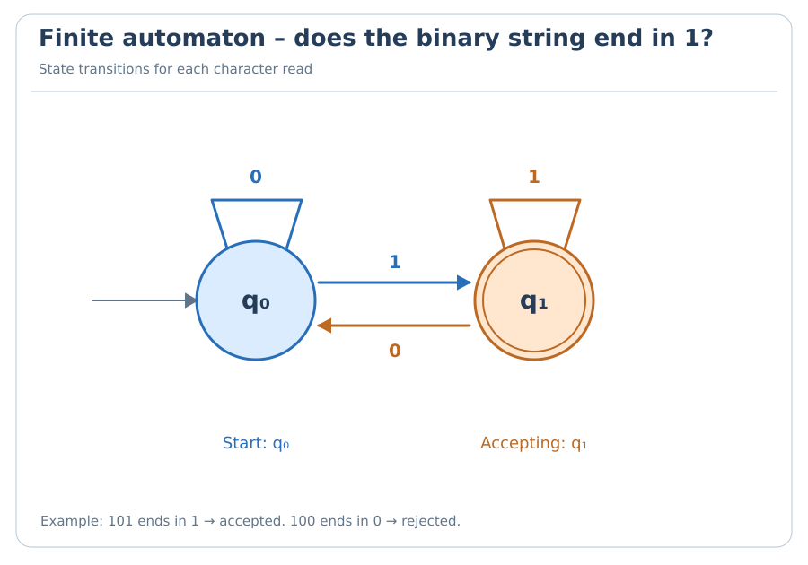

# M8-L2 – Formal languages, automata and compilers {#L2}

**Course area:** M8 – Bachelor’s: Core areas

**Level:** Bachelor’s

**Prior knowledge:** No fixed prerequisites specified.

**Bachelor's elective topic · independent reading lesson · no installation or programming exercise required**

## The guiding question: How does a computer recognise a language? {#S1}

A person reads `anzahl = 2 + 3 * 4` and suspects that a number is to be calculated and stored. For a computer, these are initially characters: letters, spaces, an equals sign, digits and arithmetic operators. How does this become an unambiguous instruction? And how does the machine recognise that `anzahl = + * 4` is not a valid calculation?

These questions lead to two interconnected fields: **formal languages** describe which sequences of characters are permitted. **Automata** are mathematical models of systems that process characters and make decisions. **Compilers** and **interpreters** use such ideas to check, understand and execute program text, or to translate it into a different representation.

This is not just about programming languages. We encounter the same basic ideas in search patterns, network protocols, configuration files, data formats, user input, dialogue states and controlled tool calls by AI agents.

The [Bachelor's elective lesson M8-L1](M8-L1.md) introduced sets, relations, graphs and logical conditions. M8-L2 uses these building blocks to specify precisely which inputs a system may accept and how it processes them. A possible additional Master's specialisation in formal verification could cover the topic at a higher level. This is a **preview of potential subject matter**, not a reference to an existing separate lesson.

## Alphabet, word and language: From characters to rules {#S2}

In theory, an **alphabet** is a finite set of symbols. It does not have to consist of human letters. The alphabet `Σ = {0, 1}`, for example, contains two symbols. A **word** over this alphabet is a finite sequence of those symbols: `0`, `101` or `00011`. The empty word is often denoted `ε` (epsilon). It contains no symbols and therefore has length zero.

A **formal language** is a set of such words. For example, the language `L` could consist of all binary words ending in `01`:

``` text
Alphabet Σ = {0,1}
L = {01, 001, 101, 0001, 1101, ...}

"101"  belongs to L.
"010"  does not belong to L.
"01"   belongs to L.
""     does not belong to L.
```

It is not necessary to write down every word. A much more elegant approach is a **rule** that determines for each possible word whether it belongs to the language. In everyday terms, we call this checking or validation. In theory, we investigate which kinds of rules a particular class of machines can recognise.

A language can contain infinitely many words even though its alphabet is finite. With two symbols, for example, sequences of arbitrary length produce an unlimited number of distinct words. This is the first important change of perspective: a short formal description can define an infinite set of permitted inputs.

A natural language such as German has ambiguities, exceptions and meanings that cannot be fully captured by a simple parser. In contrast, a formal language is **specified by a chosen definition**. A compiler does not have to guess what a permitted input is likely to mean.

## Regular languages and regular expressions {#S3}

A simple but important class is that of **regular languages**. They can be recognised by finite automata and described using regular expressions.

For our example binary language, an abstract regular pattern is:

``` text
(0|1)*01
```

The characters here mean that `0|1` permits a zero **or** a one; the asterisk `*` denotes zero or arbitrarily many repetitions of the preceding expression; `01` must follow at the end. With full-match checking, this expression recognises exactly the words ending in `01`.

**Important:** In the mathematical sense, a regular expression describes a regular language. The *regex engines* of real programming languages sometimes offer additional features, such as backreferences. Such extensions are not automatically explained by the same simple type of automaton. Regex dialects also differ in their treatment of line breaks, Unicode, ambiguity and searching for partial matches. In practice, 'regex' is therefore not exactly the same tool in every environment.

### Typical applications {#31-typische-anwendungen}

A regular pattern can, for example, check whether a simple internal identifier consists of three uppercase letters and four digits. It can also search log lines for particular prefixes or recognise keywords in source code. For a real email address field, a legal identity or a safety-critical file format, on the other hand, a few character classes and a single regex are often insufficient. Syntactic form proves neither the existence of an address nor authorisation to use it.

**Do not confuse these concepts:** *Matching the pattern* means **syntactically permitted**, not automatically *meaningful in the domain*, *authorised* or *safe*.

## The finite automaton as a state machine {#S4}

A **deterministic finite automaton (DFA)** reads a word symbol by symbol. It has a finite set of states, an initial state, a transition rule and a set of accepting final states. 'Deterministic' means that for a given state and input symbol the next state is uniquely determined.

For the ending `01`, we need only three states:

- `S0`: No relevant ending has been recognised yet.
- `S1`: The last character read was `0`; the desired ending may soon be complete.
- `S2`: The last characters read were `01`; **accepting**, provided the input ends now.

The transitions are:

| State | Next character `0` | Next character `1` | Accepting at end of input? |
| --- | --- | --- | --- |
| S0 (start) | S1 | S0 | No |
| S1 | S1 | S2 | No |
| S2 | S1 | S0 | **Yes** |

Schematically:

``` text
Input "101":
Start S0 --1--> S0 --0--> S1 --1--> S2
                                       ✓ End: valid

Input "010":
Start S0 --0--> S1 --1--> S2 --0--> S1
                                       ✗ End: invalid
```

This table is already a complete machine model. No trained neural network, large library or additional server is needed to understand or execute it. The real achievement lies in the **precise description of the state**.

### Why three states suffice {#41-warum-drei-zustände-genügen}

The automaton does not need to remember the entire word read so far. It needs only the information decisive for future recognition: does the sequence so far end in `0`, in `01` or in neither of these relevant patterns? A finite automaton stores this knowledge as one of finitely many states.

A **nondeterministic finite automaton (NFA)** conceptually permits several possible next states and, depending on the definition, transitions without an input symbol. This does not mean that a real computer has to make random guesses. An NFA can be converted to a DFA so that **both recognise the same language**. However, the DFA may require considerably more states in this conversion.

### State machines outside compilers {#42-zustandsautomaten-ausserhalb-von-compilern}

A download can go through the states `requested`, `downloading`, `completed` and `failed`. An order can go through the states `open`, `paid`, `dispatched` and `cancelled`. In a real application, additional rules for permissions, payment settlement and persistent storage apply. A formal state machine makes the permitted **control flow** visible; it does not replace the complete business logic or a database transaction.

## Where finite automata reach their limits {#S5}

Consider correctly parenthesised expressions:

``` text
()        valid
(())      valid
()()      valid
(()())    valid
(()       invalid
())       invalid
```

For arbitrarily deep nesting, we must know how many opening parentheses still have to be closed. A finite automaton has only finitely many states; in general, it cannot store this arbitrarily large count exactly. The language of **all correctly balanced parenthesis sequences** is therefore not regular.

Some real regex implementations offer recursion or other extensions; this does not change the statement about **classical regular languages**. With a fixed maximum nesting depth, the situation is different: a finite automaton could then represent the limited cases.

For unbounded nesting, we use a more powerful model: the **pushdown automaton (PDA)**. In addition to the finite control state, it has a **stack**. When it reads `(`, it pushes a symbol onto the stack; when it reads `)`, it pops one off. Closing without a matching opening parenthesis is an error; at the end, the stack must be empty again.

``` text
Character:     (   (   )   (   )   )
Stack height:  1   2   1   2   1   0
Result:                                    valid
```

This is not an actual depiction of how every language parser works, but a simple **theoretical model**. It explains why nested expressions have a different kind of structure from checking a fixed suffix.

## Grammars: How a sentence may be constructed {#S6}

A **grammar** describes the rules by which permitted words or programs may be generated. **Context-free grammars (CFGs)** are especially important. Among other things, they are suitable for describing nested arithmetic expressions.

A very simple grammar for correct parenthesis sequences is:

``` text
S → "(" S ")" S
S → ε
```

`S` is a **nonterminal**: a placeholder for a part that is still to be expanded. The characters `(` and `)` are **terminals**: symbols that actually appear in the result. `ε` stands for the empty sequence. The first rule generates a pair of parentheses with possible contents, followed by further permitted pairs. The second rule allows the derivation to end.

The notation `→` here means 'may be replaced by'. A set of grammar rules is not a machine instruction, but a **definition of all permitted structures**.

### The arithmetic language as a running example {#61-die-rechensprache-als-durchgehendes-beispiel}

For expressions involving `+`, `*`, numbers and parentheses, we use another small grammar:

``` text
Expression → Expression "+" Term | Term
Term       → Term "*" Factor | Factor
Factor     → NUMBER | "(" Expression ")"
```

`NUMBER` stands for a number token, not an arbitrary sequence of characters. The distinction between `Expression`, `Term` and `Factor` represents **operator precedence**: multiplication occurs within a `Term` and is grouped more tightly in the structure than addition.

The rules are deliberately left-recursive and serve a descriptive purpose here. A naive recursive-descent parser that immediately calls `Expression` again from `Expression` would not terminate. For certain parsing methods, the grammar must be transformed or a suitable operator-precedence algorithm used. The grammar and the specific parsing method are thus separate design decisions.

A simple **derivation tree** for `2 + 3 * 4` looks like this in simplified form:

``` text
                  Expression
                 /    |     \
           Expression +     Term
               |           / | \
              Term       Term * Factor
               |          |       |
             Factor     Factor    4
               |          |
               2          3

First: 3 * 4 = 12
Then:  2 + 12 = 14
```

This representation is simplified for teaching purposes. The complete concrete parse tree contains all intermediate rules; the **abstract syntax tree** commonly used in a compiler omits many of these purely grammatical intermediate nodes.

## From characters to tokens: The lexer {#S7}

A **lexer** (*lexical analyser*) reads the characters and groups them into **tokens**, units with a grammatical role. In the expression `anzahl = 2 + 3 * 4`, it could produce the following:

| Character sequence | Token type |
| --- | --- |
| `anzahl` | IDENTIFIER |
| `=` | ASSIGNMENT |
| `2` | NUMBER |
| `+` | PLUS |
| `3` | NUMBER |
| `*` | TIMES |
| `4` | NUMBER |

Spaces serve as separators here and are discarded unless a role is defined for them. In other languages, indentation, line endings or whitespace itself carries meaning. A lexer must therefore not simply ignore arbitrary characters.

For `23`, the lexer normally forms a number token from **two digits**; the two characters are not automatically understood as the numbers 2 and 3. In `gesamtpreis`, it can recognise an identifier rather than processing letters individually.

Lexical rules are frequently defined using regular patterns. A lexer can implement these patterns with efficient automata. Conflicts are possible: should `if` be a keyword or a permitted identifier? Many languages give keywords priority and, in other conflicts, select the longest matching sequence of characters. These are **language design decisions**, not universal laws of nature.

### Errors in this phase {#71-fehler-in-dieser-phase}

An unknown special character, an incomplete string literal or an invalid escape sequence may fail at the lexer stage. The parser has not yet had a chance to determine whether the entire instruction would have made sense in the domain. Good error messages should, where possible, identify the location and the expected character class.

## The parser and the abstract syntax tree {#S8}

The **parser** receives tokens and checks whether their arrangement matches the grammar rules. A mere sequence of symbols becomes a **structure**. For our arithmetic example, an abstract syntax tree (AST) results:

``` text
        ASSIGNMENT
        /       \
    anzahl      PLUS
                /   \
               2    TIMES
                   /   \
                  3     4
```

The tree expresses the following: first calculate `3 * 4`; then add `2`; assign the result to the identifier `anzahl`. The form is useful not only for execution. It enables error checks, optimisations, formatting, automatic documentation and more comprehensible error messages.

**Syntax is not semantics:** `anzahl = 2 + 3 * 4` has a plausible structure. But the sequence `anzahl = "Hallo" * 4` could be syntactically correct in a hypothetical language and still be semantically invalid if multiplying text is explicitly undefined. In some real languages, repeating strings *is* permitted. Whether something is a type error therefore depends on the **rules of the particular language**.

### Comparing parsing methods {#81-parsing-verfahren-im-vergleich}

In **top-down parsing**, the parser starts with an expected top-level rule and works its way towards the tokens. One common form is **recursive descent**. In **bottom-up parsing**, progressively larger structural units are built from the tokens until a complete start expression has been formed.

**LL parsers** typically work top-down; **LR parsers** work bottom-up. These abbreviations designate families of algorithms and particular grammatical requirements; not every context-free grammar is suitable for every method without modification. Parser generators such as **GNU Bison** can generate a parser from a suitable grammar. **Pratt parsing** is another, often intuitive method for expressions with different operator precedences.

For the reader, the distinction is particularly important: **the grammar describes what is valid. The parser is a method that recognises or constructs this structure.**

## Semantic analysis: More than valid punctuation {#S9}

In many compilers, **semantic analysis** follows syntax checking. It answers questions such as:

- Is `anzahl` known in the current scope?
- Does `anzahl` have an appropriate data type?
- Is a called function defined and supplied with suitable arguments?
- May a variable be overwritten at this point?
- Is a return value compatible with the function definition?

A **symbol table** maps names to their known properties, such as type, scope or storage location. A type checker can then detect invalid combinations. In dynamically typed languages, some checks occur only during execution; the division of work between compiler and runtime phases differs from one language to another.

An example: `ergebnis = unbekannt + 2` can satisfy all grammatical rules. However, if `unbekannt` is neither defined nor otherwise permitted, a **name or semantic error** results. It cannot be recognised solely from the character spacing or the presence of a plus sign.

Another limitation: a program can be lexically, syntactically and type-correct and still perform an incorrect calculation, expose private data or run in an infinite loop. **Formally valid** does not automatically mean **correct, appropriate or safe**.

## What a compiler generates next {#S10}

A **compiler** translates one representation of a program into another. The target can be machine code, bytecode or an **intermediate representation (IR)**. An **interpreter**, in contrast, usually executes instructions according to the semantics of a language, often on the basis of syntax trees or bytecode, without necessarily creating a standalone machine program in advance.

A typical, simplified compiler architecture:

``` text
Source code
   │
   ▼
[Lexer: characters → tokens]
   │
   ▼
[Parser: tokens → AST]
   │
   ▼
[Semantic analysis: names, types, rules]
   │
   ▼
[Intermediate representation (IR)]
   │
   ▼
[Optimisation / further checks]
   │
   ▼
[Code generator: target code]
   │
   ▼
[Runtime environment / operating system / hardware]
```

This is **not a mandatory uniform process**. Some environments execute intermediate code, others translate several languages into a common IR, and still others combine analysis and execution. Parsers can also generate an AST directly from characters without the lexer being visible as a separate program.

### Why use an intermediate representation? {#101-wozu-eine-zwischenrepräsentation}

The IR is a structured form between program source code and machine instructions. It facilitates connecting several source languages with different processor architectures. **LLVM** documents this approach using the small teaching language 'Kaleidoscope': the lexer and parser build a structure; LLVM IR is generated from it and can subsequently be used for further analysis, optimisation and code generation.

In simplified form, our calculation `2 + 3 * 4` could be converted into an abstract sequence:

``` text
t1 = 3 * 4
t2 = 2 + t1
anzahl = t2
```

This is **teaching pseudocode**, not correct LLVM IR syntax. It merely illustrates that a complicated expression can be broken down into smaller computational operations.

### Optimisation and its limits {#102-optimierung-und-ihre-grenzen}

If all operands are known constants, a compiler could already combine `2 + 3 * 4` into `14` during translation. This is called **constant folding**. In real programs, however, the compiler must observe the precise semantics of the language: integer overflow, rounding rules, side effects or exceptions may restrict apparently simple transformations.

'Optimisation' also does not mean that the code always becomes faster. Depending on the target hardware and usage, larger binaries, additional memory requirements or longer compilation times may result. An optimisation must therefore suit the intended runtime behaviour.

### Ahead-of-time compilation, just-in-time compilation and interpretation {#103-ahead-of-time-just-in-time-und-interpretation}

**Ahead-of-time compilation (AOT)** generates target code before subsequent use. **Just-in-time compilation (JIT)** translates parts of a program only during execution. **Interpretation** processes instructions according to runtime semantics. These methods are not always clearly separated: an environment can initially compile bytecode, interpret it and later additionally convert frequently used parts into machine code using JIT compilation.

For users, practical differences arise in startup time, execution speed, memory requirements, platform dependence, debugging and deployment. Neither 'compiled' nor 'interpreted' is universally the best or safest approach.

## The complete journey of a small program {#S11}

We combine the building blocks considered so far. Let the teaching language allow assignment, numbers and the operators `+` and `*`. Its rules specify that multiplication binds more tightly. Let the input be:

``` text
anzahl = 2 + 3 * 4
```

| Stage | Result | What was checked? |
| --- | --- | --- |
| Read characters | `a n z a h l ...` | Is there a text stream? |
| Lexical analysis | `IDENTIFIER`, `=`, `NUMBER`, `+`, `NUMBER`, `*`, `NUMBER` | Do the characters form permitted tokens? |
| Syntactic analysis | `Assignment(anzahl, Plus(2, Times(3, 4)))` | Do the tokens match the grammar? |
| Semantic analysis | `anzahl` is permitted and can hold a number | Is the meaning correct according to the language rules? |
| Compilation or interpretation | Multiplication before addition; then assignment | Which operations are executed? |
| Runtime | `anzahl = 14` | Result under the assumed arithmetic rules |

An important insight lies here: the computer does not have to guess the human intention behind `2 + 3 * 4`. The **formal definition of the language** determines unambiguously which structure and order are intended.

For comparison, let the input be `anzahl = (2 + 3) * 4`. Now the parentheses enforce a different grouping. Result: `20`. In both cases the characters are similar; the **syntactic structure** differs. If a system merely evaluated the expression from left to right and ignored the grammar, it could produce incorrect results.

## Limits of computability: Not everything can be decided {#S12}

A finite automaton knows only finitely many states. A pushdown automaton can additionally process nested structures using a stack. The **Turing machine**, which has modifiable storage and specified transition rules, serves as a still more general theoretical model. It helps define what a general computational method can actually accomplish.

A classical result of theoretical computer science is the **halting problem**: there is **no general method** that can always correctly decide, for every arbitrary program and every arbitrary input, whether the program eventually halts. This does **not** mean that we can never prove termination for a specific program. It means that there is no universal decision procedure that always succeeds for *all* programs.

It is equally important to distinguish **computability** from **computational cost**. A problem may be computable in principle, but solving it for very large inputs may require impractical amounts of time or memory. Questions about such complexity classes belong, among other areas, to complexity theory and subsequent Master's specialisations. A compiler can, for example, prove or disprove certain properties of a program, but cannot automatically decide every desired safety or termination property.

The practical benefit of this limitation is substantial: if a checking tool does not guarantee a property in general, this is not always a sign that the tool has been poorly programmed. Sometimes there is a fundamental mathematical limit.

## Three practical examples {#S13}

### A media archive accepts search filters {#131-ein-medienarchiv-nimmt-suchfilter-entgegen}

A local catalogue allows inputs such as `genre:science-fiction UND jahr>=2020`. First, it must be clear which syntax is actually permitted: keys, colon, comparison symbols, values and logical connectives.



A finite automaton recognises binary sequences ending in 1.

``` text
Search text
   ▼
[Lexer: keys, operators, values]
   ▼
[Parser: filter expression]
   ▼
[Check: known fields, valid comparisons]
   ▼
[Translation into parameterised database query]
   ▼
[SQLite / PostgreSQL]
```

A parser can prevent a search condition from accidentally being passed on as an unstructured character sequence. Nevertheless, for the database the application must use **parameter binding**, permitted field names and access restrictions. A custom-built parser alone does not protect against SQL injection; unchecked expressions must not simply be concatenated into SQL source code. With a few fixed filters, an ordinary form is simpler, less expensive and more maintainable than a custom query language.

**Failure case:** `jahr>=morgen` may be grammatically permitted, but is semantically wrong as a numerical year comparison. Good systems therefore report 'Year must be a number' rather than causing the entire search to fail incomprehensibly. The example assumes a locally operated archive; for an online service, user identity, rate limits and personal data are additional concerns.

### An online service processes configuration rules {#132-ein-online-dienst-verarbeitet-konfigurationsregeln}

A small service might read administrator rules such as `wenn rolle=redaktion dann darf=veroeffentlichen` ('if role=editorial then permission=publish'). Even a few unclear formulations can cause rights to be misunderstood. A limited formal grammar makes the permitted components explicit.

The process is similar to that of a compiler: read characters, form tokens, check the rule structure, compare role identifiers against existing roles and then create a controlled internal representation of permissions. A **state machine** can also govern when a rule may be created, checked, approved and activated.

``` text
[Draft] → [Syntax check] → [Domain review]
                                  │
                                  ▼
                              [Approval]
                                  │
                                  ▼
                               [Active]
```

**Operational limitation:** Even a completely correct parser cannot know whether the domain decision 'Editorial staff may publish' is organisationally permitted. Human approval, logging, permission checks and a way to revoke decisions remain necessary. For very few rules, a fixed, structured administrative interface is often safer than a freely editable rule language.

### An AI agent is to call tools in a controlled manner {#133-ein-ki-agent-soll-werkzeuge-kontrolliert-aufrufen}

A language model can interpret the request 'Create a summary and place it in the project folder'. However, the model's output is **not a trustworthy source of commands**. The application should accept a limited tool call with a clear schema, for example a `speichern` ('save') action with a permitted document identifier and a text field.

``` text
[User request] → [Language model]
                         │ Proposed tool call
                         ▼
                [Schema/type check]
                         ▼
               [Permission and path check]
                         ▼
            [Approval / execution boundary]
                         ▼
                [File service writes]
                         ▼
                  [Report result]
```

The schema ensures syntactic and simple structural requirements; the application additionally checks whether the target identifier actually belongs to the authorised project. A valid JSON object can request an unauthorised action. Prompt injection, abusive file paths and sensitive content therefore do not disappear through a grammar. Risky write or delete operations require appropriate confirmations and a clearly bounded execution environment.

The connection with [M6-L4 – AI with knowledge, tools and agents](M6-L4.md) is direct: **the model proposes; a controlled software component checks and executes.** The parser can help enforce this boundary, but it is only one layer of security.

## Security, maintenance, costs and failure behaviour {#S14}

A formally described input format facilitates testing and debugging. Anyone who knows the grammar can assemble examples of valid and invalid input for each rule. However, changes to the grammar are similar to API changes: configuration files that were previously permitted may suddenly be rejected after an update. **Versioning and backwards-compatible migration** are therefore part of operating a language in serious use.

**Runtime risks:** Some backtracking regex engines can take a disproportionately long time with unfavourable patterns and inputs; this problem is often called *regular expression denial of service* (ReDoS). Whether a pattern is problematic depends on the engine, pattern and input. Limiting input lengths, choosing patterns carefully, applying time limits where appropriate and using suitable deterministic implementations can help. Parser systems must also take into account excessively deep nesting, enormous tokens or resource-intensive error messages.

**Security limits:** Syntax checking does not replace authentication, authorisation, domain-level data validation, SQL parameter binding or isolation of executable third-party code. A language that permits file access or system commands requires a correspondingly restrictive security model.

**Data protection:** Logs containing rejected input may include access tokens, names, private search terms or document content. Logging should, where possible, capture only the necessary diagnostic information and have a suitable retention period. The fact that a parser 'only checks text' does not automatically make the processed content harmless.

**Costs and maintenance:** For simple text fields, a standardised library is almost always more appropriate than a custom language processor. A custom parser requires a specification, version management, tests, documentation and error handling. The advantage of a custom-defined language only arises when complex, recurring rules need to be described in a clear format.

## Connections to computer science, mathematics and Master's topics {#S15}

The mathematical prerequisites for this elective module are deliberately manageable: sets for alphabets and languages, functions for state transitions, relations and directed graphs for automata, and recursion and induction for grammars and their derivations. These concepts come from [M8-L1](M8-L1.md). An additional compulsory exercise or software installation is not necessary.

The separate **mathematics course** has thematic connections with set theory, logic, relations, induction, recursive definitions and proof methods. **The module names actually used there and their progress status are still not accessible.** For this reason, no specific mathematics lesson numbers are claimed here. The planned comparison is recorded in dokumentation/08-ABGLEICH-MATHEMATIK.md.

In the main course, M8-L2 particularly expands on [M1-L2 – Computers and software execution](M1-L2.md), [M1-L3 – Algorithms and data structures](M1-L3.md) and [M1-L7 – Further areas of computer science](M1-L7.md). The parser perspective also helps with APIs from M2-L2 and database queries from M1-L5.

The now completed [Master's core M7-L2](M7-L2.md) explores correctness, computability, complexity and formal methods in greater depth. Type theory or a complete specialist study of automata theory is not automatically covered as a result. The course is not an accredited degree programme.

## Summary: Six distinctions to remember {#S16}

A **formal language** is a set of precisely defined permitted sequences of characters. An **automaton** is a model that processes such sequences according to state rules. A **grammar** describes how valid structures are built. A **lexer** divides characters into tokens, and a **parser** recognises sentence structures from them and can produce a syntax tree. A **compiler** translates this representation further, whereas an interpreter implements defined execution semantics.

Three further distinctions are especially important: **regular patterns** are suitable for certain local character structures, whereas **context-free grammars** also handle arbitrarily nested forms. **Syntax errors** concern form; **semantic errors** concern meaning according to the rules of the language. And **valid source code** is not automatically a correct, safe or economically sensible program.

This establishes the first bridge between mathematical computer science and the actual structure of programming languages. The follow-on lesson [M8-L3 – Operating systems and concurrency in depth](M8-L3.md) has now also been completed, as have the further Bachelor's electives up to M10-L2 and the Master's core M7-L1–M7-L6. Additional Master's elective topics are developed only after the topics have been chosen.

## Place in the course-wide reading paths {#S17}

This is an **optional Bachelor's elective lesson**, not an additional main-course lesson. A thematic bridge leads, among other places, to [M7-L2 in the Master's core](M7-L2.md). Further routes: [course-wide reading paths](pages/path.md) and [course index](pages/index.md).


## Sources {#S18}

**Last source review:** 4 November 2026

**Reviewed on 4 November 2026.** The definitions and selection of topics are based on university teaching programmes and official documentation. Automata, example grammars, calculations, architectural diagrams and practical cases were designed independently for this reading course; no claim is made that specific university exercises were reproduced.

1.  **MIT CSAIL – Theory of Computation:** *6.045J Automata, Computability, and Complexity*, institutional course description covering finite automata, computability and theoretical limits: [https://toc.csail.mit.edu/node/193](https://toc.csail.mit.edu/node/193)
2.  **Stanford University – CS143 Compilers:** Official course overview covering lexical analysis, parsing, symbol tables, type checking, intermediate representation and code generation: [https://bulletin.stanford.edu/courses/1056721](https://bulletin.stanford.edu/courses/1056721)
3.  **Stanford University – CS143 Course:** Lecture outline from lexing and automata through top-down/bottom-up parsing to optimisation and JIT: [https://web.stanford.edu/class/cs143/](https://web.stanford.edu/class/cs143/)
4.  **LLVM Project:** *Kaleidoscope: My First Language Frontend*, official tutorial on lexer, parser, AST, LLVM IR and JIT: [https://llvm.org/docs/tutorial/MyFirstLanguageFrontend/](https://llvm.org/docs/tutorial/MyFirstLanguageFrontend/)
5.  **GNU Project:** *Bison Manual – Introduction*, parser generators and context-free grammars: [https://www.gnu.org/software/bison/manual/html_node/Introduction.html](https://www.gnu.org/software/bison/manual/html_node/Introduction.html)

**Context:** These sources substantiate the theory, compiler architecture and common methods. The examples are simplified models; they do not replace a complete language specification, security review or product-specific operating instructions. No claims are made regarding cloud prices, version guarantees or academic degrees.
