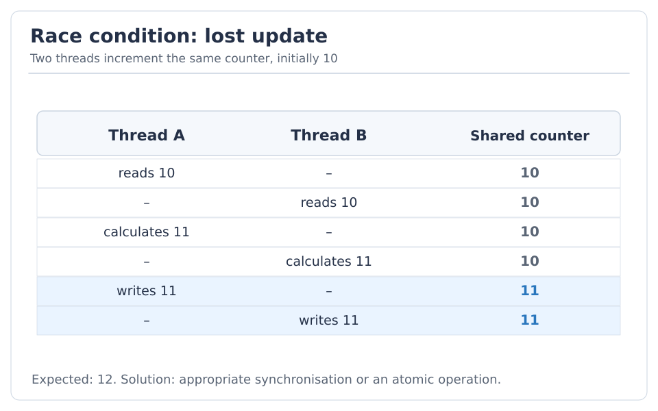

# M8-L3 – Operating systems and concurrency in depth {#L3}

**Course area:** M8 – Bachelor: Core areas

**Level:** Bachelor

**Prior knowledge:** No fixed prerequisites specified.

**Classification:** Optional Bachelor elective topic

**Learning objective:** Understand how an operating system manages several programs, why activities can *appear* simultaneous even on a single processor, how work is distributed across processing cores, how programs share memory and data safely, and why synchronisation errors often occur only sporadically. The lesson requires neither installation nor programming.

## Initial question: who decides what the computer does next? {#S1}

A computer runs music playback, a browser, image editing, file synchronisation and sometimes an AI application at the same time. All need processing time, main memory, files and network access. Without a coordinating entity, they would overwrite one another's memory, operate devices in an uncontrolled way or claim all the processing power. This coordinating entity is the **operating system** (OS), particularly its **kernel**: the privileged core of the system.

The kernel manages processes, threads, memory, devices, file systems and access permissions. It mediates between programs and hardware. An operating system, however, consists of more than the kernel: libraries, system services, user interfaces and administrative tools complement it. Strictly speaking, Linux initially refers to a kernel; a Linux distribution also contains the usable operating system. Windows likewise combines a kernel with numerous system components.

The crucial insight is that **concurrency is not the same as parallel execution.** A computer can coordinate several activities even if only one of them is actually performing computations at that moment. An operating system arranges many competing demands into a workable sequence.

``` text
User programs
  Browser    Music      File search     AI processing
      \        |           |             /
       \       |           |            /
        Operating system: kernel + services
        - Scheduler: who receives CPU time?
        - Memory management: who may access what?
        - File system and device drivers
        - Security and communication
                         |
              CPU / RAM / SSD / network
```

This basic picture helps explain why 'more threads' does not always mean 'faster', why a blocked process does not necessarily waste processing time and why an otherwise correct algorithm can still produce incorrect results under concurrent access.

## Programs, processes and threads: three different levels {#S2}

A **program** is initially stored code, for example an application on an SSD (*solid-state drive*). When it is started, at least one **process** is created: a concrete execution context with its own virtual address space, resources and access permissions. A process may have one or more **threads** (threads of execution). Threads are the units whose execution the operating system normally schedules.

A process typically has a process identifier, open files, a security identity, memory mappings and at least one thread. Each thread executes its own sequence of instructions and has, among other things, its own register values and stack. **Threads of the same process, by contrast, share the virtual address space** and other process resources. This facilitates joint data processing but creates new sources of error. Microsoft explicitly documents this distinction for Windows; the conceptual distinction also applies to ordinary Linux processes and threads \[1\].

``` text
Process: media application
  Shared virtual address space
  Shared open database/file connections

  Thread 1: user interface     own stack / registers
  Thread 2: compute preview    own stack / registers
  Thread 3: build search index own stack / registers
```

Why three threads? The user interface should respond to input while a large file is being read and a preview computed. An alternative would be three separate processes that communicate with each other through defined messages. This often isolates failures more effectively: if a helper process crashes, the main application may be able to continue. Data exchange is more involved, however, because memory and data structures cannot simply be written to jointly.

**Important distinction:** A thread is not a processor of its own, nor is it automatically a CPU core of its own. It is a sequence of work managed by the operating system. Several threads can take turns on one core or actually run in parallel on several cores. Some runtime environments also use lightweight user-level threads or coroutines, which a library maps onto fewer operating-system threads. These terms should not be confused.

## Concurrency, parallelism and asynchrony {#S3}

**Concurrency** means that several activities progress over overlapping periods of time and need to be coordinated. **Parallelism** means that several computations physically take place at the same time, for example on different CPU cores. **Asynchrony** describes a way of organising a program in which an invoked activity does not necessarily need to finish before the next activity begins; the result arrives later.

A single CPU core can interleave two threads over time:

``` text
Time  ----->
Core 1: [A computes] [B computes] [A computes] [B computes]
```

This is concurrent but does not compute simultaneously. With two cores, genuine parallelism can arise:

``` text
Time  ----->
Core 1: [A computes.......................]
Core 2: [B computes.......................]
```

An asynchronous application can perform other tasks during network access without having to provide an extra thread for each request. This reduces resource requirements when many connections are waiting. **Asynchronous code does not, however, automatically compute faster:** if a single thread performs minutes of CPU-intensive image analysis without interruption, an asynchronous interface alone does not help. Additional runnable threads, processes or computing resources are then needed.

An example of the distinction: a web server waiting for thousands of network responses primarily needs good input/output organisation. A video converter that performs many millions of operations on every frame is more likely to benefit from actual parallelisation, provided data transfer and memory do not become bottlenecks. A single long-running operation can therefore be *organised concurrently* without being split across several cores.

## Scheduling: which thread does the kernel give processing time to? {#S4}

The **scheduler** is the planning component of the operating system. It selects which runnable thread should execute next on a CPU core. This process is called **scheduling**. Different applications have different objectives: rapid response to a key press, a fair share of CPU time, high throughput, energy savings or the smallest possible delays in time-critical tasks.

In simplified terms, a thread is in one of these states:

``` text
                   Request fulfilled
   +-----------+  --------------------> +-----------+
   | Waiting   |                        | Ready     |
   | (blocked) | <--- Wait ------------ |           |
   +-----------+                        +-----------+
                                             |
                                        Scheduler selects
                                             v
                                         +---------+
                          Interruption   | Running |
                          ----------->   +---------+
                                back to Ready
```

The diagram abstracts real kernel states. The crucial distinction is between *ready* and *waiting*: a thread waiting for a file or network data is often not ready at that moment and does not occupy a core by actively computing. A thread in an unnecessary polling loop, by contrast, can continuously consume CPU time.

### Interruption and context switching {#41-unterbrechung-und-kontextwechsel}

With **pre-emptive scheduling**, the scheduler can take the processor away from a running thread, for example when a higher-priority task becomes ready. It saves the execution context of the previous thread – registers, program position and other relevant states – and resumes another. This is called a **context switch**.

Context switches take time: register and administrative states need to be handled, and the CPU cache may be less suited to the new task. A particularly high number of switches can therefore reduce performance. Nevertheless, they enable a responsive user interface and fairer distribution of resources. Too few interruptions, on the other hand, leave time-critical work waiting. **There is no single optimal time slice for all applications.**

### A numerical example of round robin {#42-ein-zahlenbeispiel-für-round-robin}

The **round-robin** method gives ready tasks a time slice in turn. For a deliberately simplified example, assume one core, three CPU-intensive threads A, B and C, all ready from the start, no input/output, no switching overhead and identical priorities. Each needs 6 milliseconds (ms) of pure CPU time. The time slice is 2 ms.

``` text
Time in ms      0  2  4  6  8 10 12 14 16 18
Core           | A| B| C| A| B| C| A| B| C|

Finished: A at 14 ms, B at 16 ms, C at 18 ms.
Total CPU work = 3 * 6 ms = 18 ms.
```

The computer does **no more total work** than with serial execution. The benefit is a more evenly distributed opportunity to respond: each thread receives a time window early on. If each of the **eight transitions between the nine time slices** requires an additional 0.1 ms in the simplified model, the total duration grows from 18.0 to **18.8 ms**. This still assumes that there is no additional start-up or completion overhead; actual context-switch costs are not constant. In real systems, additional factors such as priorities, waiting times, CPU affinity and cache behaviour determine the order. The times stated here are **purely didactic model assumptions**, not measurements of an operating system.

### Linux and Windows: same objective, different mechanisms {#43-linux-und-windows-gleiches-ziel-andere-mechanismen}

Under Linux, fair scheduling was long shaped by the **Completely Fair Scheduler** (CFS). The Linux kernel documentation describes the transition to **Earliest Eligible Virtual Deadline First** (EEVDF), which considers virtual runtime, lag relative to a fair share and virtual deadlines, among other things, for ready tasks \[2, 3\]. It would therefore be too imprecise to say that 'Linux simply uses the old CFS algorithm today'. Kernel version and scheduling class matter. In addition, this internal calculation method is **not a hard real-time guarantee**.

Windows works with priority levels for regular threads and can temporarily adjust a priority, for example so that a user interface responds quickly. High priority classes can displace other important system work; Microsoft advises particular restraint when using the highest real-time priority class \[4\]. This does not mean that Windows can generally be explained completely by a single rigid round-robin model: priority classes, dynamic boosts and different system states influence the actual decision.

The practical comparison is more important than the names of individual schedulers: both operating-system families aim to coordinate many competing activities in a usable way. Differences in scheduling algorithms, power management, drivers and application runtimes determine actual behaviour. As a user, one recognises the effects, for example, in responsive window operation despite ongoing background computation or in delays when cores are fully utilised.

## Memory: why each process receives its own view {#S5}

Physical **main memory** (*random access memory*, RAM) is a limited resource. Programs should be able to use it without knowing which physical memory location is currently free. The solution is **virtual memory**: a process sees addresses in its own virtual address space. The hardware's **memory management unit** (MMU) and **page tables** managed by the operating system translate these virtual addresses into physical memory areas.

``` text
Process A              Page tables                Physical RAM
Virtual address    ----> Translation / rights ----> Memory page X

Process B              Different mapping          Physical RAM
Virtual address    ----> Translation / rights ----> Memory page Y
```

The same numeric virtual address value can point to different physical memory pages in two processes. This protects processes from accidentally overwriting one another's data. Protection mechanisms also allow rules such as 'readable but not writable' or 'executable code rather than data'. Virtual memory management is thus **resource organisation and a security mechanism**, but not an absolute guarantee against every hardware and software attack.

### Memory pages and page faults {#51-speicherseiten-und-page-faults}

A **page fault** occurs when the processor raises an exception during memory access because the desired mapping is missing or does not permit the access. This can be completely normal, for example when a file is loaded into main memory only on its first access. It can also indicate an impermissible access. A harmless page fault that triggers loading must therefore be distinguished from a protection fault.

Linux documents demand paging, file mappings and virtual memory management, among other things \[5\]. In simplified terms, the kernel can provide a required memory page, load a file or trigger a process error in the event of an impermissible access. **Not every page fault means that data is read from the SSD.** Sometimes a page already present in RAM merely needs to be remapped.

### Page cache, swap and memory pressure {#52-page-cache-swap-und-speicherknappheit}

Operating systems often use unused RAM as a **page cache**, for example for file contents. This means the same file does not have to be fetched from storage on every read. High RAM usage due to caching is therefore not a memory problem in itself: the kernel can release many such pages when needed.

Under memory pressure, depending on configuration, the system can move less frequently used, pageable memory contents to an area on secondary storage. Under Linux this is often called *swap*; under Windows the paging file (*pagefile*) is part of the virtual memory system. **Swap does not extend physical RAM.** Costly continuous paging out and back in can slow processes dramatically; this is called **thrashing**. In cases of extreme shortage, operating systems can also terminate processes or reject memory requests. Operating-system version and settings determine the details.

A typical misconception is: 'The SSD is fast enough, so I need little RAM.' Although a fast SSD may reduce some waiting times, memory access through RAM remains fundamentally different from loading through secondary storage. AI inference adds graphics memory (VRAM), which has its own limitations. A model can appear small on storage and still require many intermediate buffers during operation.

### Why isolated processes can nevertheless cooperate {#53-warum-isolierte-prozesse-trotzdem-zusammenarbeiten-können}

Two processes can use the same physical memory through explicitly shared **shared-memory regions**. This is faster than repeatedly copying large quantities of data, but every shared mutable data structure must be correctly synchronised. Memory isolation is not 'switched off'; instead, the system sets up a controlled shared mapping.

For smaller quantities of data, **pipes**, local **sockets** or structured messages are often suitable. These methods are part of **interprocess communication** (IPC). They provide a defined interface through which programs cooperate instead of directly manipulating another program's memory. For Windows, Microsoft documents pipes, shared memory and remote procedure calls as IPC options, among others \[6\].

## Race conditions: when the order changes the result {#S6}

The greatest difficulty with shared data is that several threads can **read and change the same value**. A **race condition** occurs when the result depends on the order in which insufficiently coordinated operations occur. Not every timing-dependent sequence is automatically erroneous; a sequence is problematic when required correctness conditions are violated.

{alt="Two threads read the same counter value of 10 and both write back 11. The result of 11 is wrong because 12 is expected after two increments."}

Lost update: only one of two uncoordinated increments becomes visible.

Suppose a media archive stores a shared counter for fully analysed images. The counter initially stands at 10. Each of two threads is to complete exactly one image. The seemingly simple instruction 'increase the counter by one' can conceptually be broken down into three steps: read the value, add one and write the new value.

| Time | Thread A | Thread B | Shared counter |
| --- | --- | --- | ---: |
| 1 | Reads 10 | – | 10 |
| 2 | – | Reads 10 | 10 |
| 3 | Calculates 11 | – | 10 |
| 4 | – | Calculates 11 | 10 |
| 5 | Writes 11 | – | 11 |
| 6 | – | Writes 11 | 11 |

The final value is **11 instead of 12**. This is a *lost update*. Both threads have completed their work, but only one increment is visible. If the steps happen to be interleaved differently, the correct result of 12 can also occur. This is precisely why such errors are difficult to reproduce.

One solution is to protect the entire critical section against simultaneous changes:

``` text
Counter update as a protected section:
  Acquire lock
  Read current counter
  Calculate and write new counter
  Release lock
```

Alternatively, for suitable simple operations, there are **atomic operations** (*atomics*): mechanisms in which a change takes place as an indivisible operation from the perspective of other threads. The actual guarantees depend on the hardware, programming language and memory-ordering model. 'Atomic' neither automatically means 'arbitrarily large transaction' nor that several related fields are jointly updated correctly without further coordination.

For a database, a separate counter in main memory would often be the wrong solution anyway if the number must remain reliable and survive a restart. Database transactions and appropriate query operations are useful there, as described in [M3-L5 – Distributed correctness](M3-L5.md). Operating-system locks protect **local shared memory**, not automatically the state of a distributed database on several servers.

## The most important synchronisation mechanisms {#S7}

**Synchronisation** means deliberately coordinating timing dependencies and shared resources. The operating system and programming language provide various tools. They have similar objectives but different properties.

### Mutex – one at a time {#71-mutex-einer-zur-gleichen-zeit}

A **mutex** (from *mutual exclusion*) typically allows only one thread at a time to access a particular critical section. Other threads wait until the lock is released. The concept of **lock ownership** is important: a thread acquires and releases a mutex according to the rules of the respective programming interface.

A good mutex protects only the genuinely shared state and is held for as short a period as possible. If an application holds a lock during a network request lasting several minutes, of all times, it may block all other users of the same data structure. Locking is therefore a correctness mechanism, but also a potential bottleneck.

### Semaphore – a limited number of accesses {#72-semaphore-eine-begrenzte-anzahl-zugänge}

A **semaphore**, in simplified terms, manages a number of available permits. For example, this can allow at most four costly background tasks at the same time. Unlike a typical mutex, a counting semaphore need not have the same ownership semantics. The semaphore thus limits **concurrency**, but does not automatically guarantee the correctness of shared mutable data.

A common application is a small pool of scarce resources, such as four decoders or database connections. If the pool is full, further requests wait. This protects against overload as long as waiting work and queues are also bounded. Allowing an unlimited backlog merely shifts the problem.

### Condition variables and events {#73-condition-variables-und-ereignisse}

A **condition variable** allows threads to wait for a particular state to change, for example 'the queue contains a job'. It is often used together with a mutex that protects the associated condition. After waking up, the condition should be checked again, since other threads may have changed it in the meantime; apparently unexpected wake-ups are also possible in common interfaces.

**Events** or signals within an application address a similar organisational problem: there is something new to do. The exact guarantees differ, however. An event does not automatically indicate who owns a job or that it will be processed only once.

### Read/write locks and atomic variables {#74-readwrite-locks-und-atomare-variablen}

A **read/write lock** can allow several simultaneous readers but generally only one exclusive writer. This helps with data that is rarely changed and frequently read. With many write accesses or long reading phases, however, it may scale less well; fairness and possible starvation depend on the particular implementation.

**Atomic variables** are suitable for individual state values and certain coordination patterns. When several changes are linked, a mutex, a transaction or a carefully designed lock-free method may still be necessary. The term **lock-free** does not automatically mean faster or simpler: complex memory-ordering rules and memory reclamation problems can make maintenance more difficult.

The Linux kernel documentation distinguishes, for example, sleeping locks, spinning locks (*spinlocks*) and variants with special real-time properties \[7\]. A spinlock waits by initially checking repeatedly whether the resource is free – which can be useful for very short waits but costly when blocking for a long time. Application code should not invent its own synchronisation primitives without good reason.

## Deadlocks, livelocks and starvation {#S8}

A **deadlock** occurs when participants wait permanently for resources held by other participants and none can make progress.

Consider a file manager with two data structures: a metadata list and a preview list. Two threads need both locks, but in different orders.

``` text
Thread A                       Thread B
--------                       --------
Acquire lock M                 Acquire lock V
Request lock V -------+   +--- Request lock M
                      |   |
                      v   v
              A waits for B
              B waits for A
              => Deadlock
```

The simplified representation shows a cycle: A holds M and waits for V; B holds V and waits for M. Until someone releases a resource or an external cancellation intervenes, neither can progress. This is an example of the four classical conditions that together make deadlocks possible: a resource held exclusively, holding while additionally waiting, no forced pre-emption, and circular waiting.

**An effective preventive measure is a consistent lock acquisition order.** If both threads always acquire M first and V afterwards, this particular circular waiting situation cannot arise. Further measures are short critical sections, timeouts, controlled release on errors and, where appropriate, using one lock for closely related data. Timeouts help with cancellation but do not prove a complex system generally free of deadlocks.

Not everything that 'hangs' is a deadlock. In a **livelock**, threads constantly react to each other but make no meaningful progress. With **starvation**, one task receives too little access to a resource over a prolonged period even though other tasks continue. High priorities and one-sided lock preference can encourage this. The aim of scheduling and synchronisation is therefore not only high speed but also predictable progress.

### Priority inversion as a special case {#81-prioritätsumkehr-als-sonderfall}

A surprising kind of delay occurs when a low-priority thread holds a lock needed by a high-priority thread. If a third thread of medium priority intervenes, it can delay the release: the low-priority lock owner itself receives insufficient CPU time. This is called **priority inversion**.

**Priority inheritance** is a countermeasure: the lock owner temporarily receives the higher priority of the waiting thread so that it can finish its short task. Linux describes such mechanisms for special real-time mutexes \[8\]. They do not, however, resolve every form of unsuitable locking architecture.

## Interprocess communication: messages rather than uncontrolled access? {#S9}

Separate processes do not generally simply share their private variables. They exchange information through **interprocess communication (IPC)**. To choose a method, it helps to ask what is exchanged and what fault tolerance is required.

| Method | Typical idea | Advantage | Limitation |
| --- | --- | --- | --- |
| Pipe | A byte/message stream between processes | Relatively simple local coupling | Protocol and end of the stream must be defined |
| Local socket | Communication endpoint on the same computer | Good decoupling | Serialisation, buffers and permissions |
| Shared memory | Both processes see deliberately shared memory | Efficient for large data | Synchronisation, access protection, lifetime |
| Message queue | Jobs are stored or delivered in an ordered manner | Decouples processing steps | Duplicate messages, backlogs, failures |
| File or database | Exchange through persistent storage | Recoverable and traceable | Additional input/output, conflict rules |

A local message is not automatically stored **persistently**. Nor does a reliable queue necessarily guarantee that a domain action is performed exactly once. The limitations of repeated processing, acknowledgement and idempotency are explained in [M4-L1 – Distributed processing](M4-L1.md).

For small desktop programs, one process with a few threads may be sufficient. For an application that processes unstable image decoders or external file formats, an isolated helper process may be more appropriate. It creates a fault boundary: a faulty decoder should not bring down the entire main application. **Additional processes and IPC are architectural decisions with maintenance overhead**, not an automatic improvement in quality.

## Synchronisation and speed: why more threads can be slower {#S10}

Suppose the work that must be performed serially needs 30 per cent of the total computation time, while 70 per cent could ideally be parallelised. Under the simplified assumption of four equally fast cores, without additional overhead, the new runtime relative to the old one is:

$$
\begin{aligned}
\text{Serial fraction:}\quad&0{,}30\\
\text{Parallel fraction:}\quad&\frac{0{,}70}{4}=0{,}175\\
\text{Total runtime:}\quad&0{,}475\,\text{of the original time}\\
\text{Idealised speedup:}\quad&\frac{1}{0{,}475}=2{,}105\ldots
\end{aligned}
$$

This is an application of **Amdahl's law**: even four cores deliver at most approximately a **2.11-fold speedup** here, as long as the 30 per cent fraction remains unchanged and serial. Real programs often perform even worse owing to synchronisation, data copies, cache contention, scheduling and input/output. Conversely, a better data structure or a faster serial algorithm can achieve more than additional threads.

**Lock contention** means that many threads need the same lock and therefore wait. Increasing their number may cause queues or context switches to grow faster than the benefit. The question is therefore not 'How many threads can I start?', but 'What proportion of the work can be computed independently, and what resources limit progress?'

Important metrics would include CPU utilisation per core, waiting times, I/O throughput, memory usage, page faults and the duration of critical sections. A single overall CPU display is not reliable proof of efficient parallelism. All cores can be busy with useless waiting work while accomplishing little.

## Real time: the correct answer must arrive in time {#S11}

In everyday language, 'real time' often means 'very fast'. In computer science, **real time** instead means that a result must be available **within a specified deadline**. A calculation taking 5 ms may be unsuitable if the latest permissible time is 2 ms. A slower but reliably bounded process may be more appropriate for a control system than one that is very fast on average but occasionally suffers long delays.

- **Hard real time:** missed deadlines can make a system function unacceptable or dangerous. The actual safety requirements need to be assessed by qualified specialists.
- **Soft real time:** delays reduce quality, but do not constitute a complete failure in every individual case, for example with some media playback.

For time-critical systems, there are special scheduling methods, real-time operating systems (RTOS) and, under Linux, for example, the **PREEMPT_RT** approach to improving the predictability of response times \[9\]. Such methods reduce certain delays, but are **not a blanket guarantee of meeting every deadline**. The entire hardware, device drivers, memory accesses, task load, interrupts and failure cases must be considered for that.

A language model that formulates an action instruction during a robot movement is normally not the system that should regulate motor current with millisecond precision. Safe motion control belongs in a separately designed, suitable control path. [M6-L7 – Robotics](M6-L7.md) explains this separation.

## Three practical architecture examples {#S12}

### Local media archive with a responsive user interface {#121-lokales-medienarchiv-mit-flüssiger-benutzeroberfläche}

A private media archive has a search view and is to import large images, compute checksums and generate thumbnails. If all file accesses and calculations took place in the user-interface thread, the program might no longer respond to input during a large operation.

``` text
User interface (thread 1)
        |
        v
  Bounded job queue
        |
   +----+--------+
   |             |
Worker A      Worker B       (threads or processes)
  reads          decodes
  file           image
   |             |
   +----+--------+
        |
   Result message
        |
   Update UI
```

The waiting user interface processes results without blocking on decoders for a long time. Limiting the number of workers protects CPU, RAM and disk access from overload. If external media files are potentially faulty, critical decoders can be moved into separate processes. File results are coordinated through messages or a database instead of having all threads change the same collection without protection.

**When unnecessary?** For a small archive with a few files that can be read quickly, a simple background thread may suffice. An extensive process and message model may only make debugging harder. **Operation and data protection:** private file paths, preview images and log data remain local; unnecessary diagnostic logs should not reveal personal file names.

### Web analysis service on a virtual server {#122-analyse-webdienst-auf-einem-virtuellen-server}

A small web service accepts computation jobs. Network requests take little time, while the actual statistical calculation may take seconds. If each request is computed fully and directly in the web thread, it blocks other users.

``` text
User -> Web server (asynchronous input/output)
             |
             v
       Job database/queue
             |
       Bounded worker pool
             |
        Store result
             |
       Respond to request
```

Separating network requests from background work reduces blocking wait times. The worker pool should execute only as many CPU-intensive jobs simultaneously as is actually useful. On a VPS (*virtual private server*), processes share the allocated CPU and RAM resources; a hypervisor can also divide the available physical processing cores among several customers. This is another scheduling layer, not automatically a defect of the application.

**Failure questions:** what happens to partially processed jobs after a restart? A purely local in-memory queue may be lost. Persistent job data, retry rules and unique identifiers must be provided according to the reliability objective. **Costs:** more CPU cores or a larger server may reduce waiting times, but do not replace correctness when accessing shared data. **Data protection:** tenant data must remain separated logically and through permissions; a process boundary alone is not a complete tenancy model.

### Near-real-time control plus AI analysis {#123-echtzeitnahe-steuerung-plus-ki-analyse}

A mobile robot continuously collects sensor data, decides how to move and can additionally receive a description of its surroundings from an AI service. These tasks have different timing requirements.

``` text
Sensors -> Local time-critical control -> Motors
                 ^
                 |
       Fixed limits / emergency stop

Camera ----> Image analysis / AI worker ----> Suggestion
                                   |
                   Verified, slower planning module
```

The control system must not wait for a large image-analysis worker or a remote language model to respond. Such results can provide **verified planning indications**; immediate motion limits and safety shutdown must function separately. A low-priority logging service must not block a time-critical controller through unnecessary locks. Real-time operation, sensor fusion and safety architecture require more than setting a particularly high thread priority.

**When unnecessary?** For a pure simulation without physical effects, ordinary scheduling and measurement methods are often sufficient. **Operation:** real-time tasks require specified load limits, regular tests under overload and assumptions about failures. **Safety:** a software safety function is only as reliable as its complete design; this reading example is not approval for a real robotics control system.

## Decision guide: which architecture fits? {#S13}

| Initial situation | Check first | More suitable | Often unnecessary or problematic |
| --- | --- | --- | --- |
| A small local program | Where does the interface block? | One UI thread and a few background tasks | Many mutually dependent threads |
| Many waiting network connections | Waiting for I/O rather than computing? | Asynchronous I/O and bounded workers | A permanent CPU-intensive thread for every connection |
| CPU-intensive independent data work | Parallelisable fraction and data movement | Bounded thread/process pool | More workers than usable resources |
| Error-prone external components | How large does the fault boundary need to be? | Separate helper processes with IPC | Unprotected shared memory |
| Shared mutable data | Which invariants must hold? | Mutex, atomics or transactions depending on the layer | Simply hoping for the 'right' execution order |
| Time-critical machine | What deadlines and failure consequences apply? | Appropriate real-time/safety architecture | LLM answers directly used as motor controllers |

The table is not a substitute for measurement. It helps identify the **type of problem** first. High CPU usage can result from useful work, too many workers, a polling loop or poor memory access. Identical symptoms can have different causes.

### Costs, maintenance and security {#131-kosten-wartung-und-sicherheit}

Concurrent software is more demanding to test because the order of operations varies. **Timing-dependent bugs that occur rarely** may only become visible after a long period under high load. Monitoring and tests should therefore consider not only normal operation but also process termination, high memory load, interruptions, delayed device responses and errors when releasing locks.

An operating system manages security contexts, but an application itself must use correct permissions: who may access a pipe? What data ends up in shared memory? Are temporary files deleted? Was the process started with unnecessary administrator privileges? The resource advantage of a single process may be offset by the larger shared fault domain.

Moving work into many containers does not automatically make local race conditions less likely either. Containers are not separate hardware machines and under Linux usually use the same host kernel. An error in a shared database or external store remains a common problem across process and container boundaries. M8-L3 thus connects the operating-system layer with the later topics of distributed databases and cloud operation.

## Connection to the mathematics course and later study modules {#S14}

The formal background knowledge can be linked to three basic mathematical subjects: **propositional logic** describes conditions such as 'the lock is free', **state transitions** model a thread's behaviour, and **directed graphs** help represent waiting dependencies and possible deadlocks. In M8-L1, these tools were introduced conceptually. Simple fraction arithmetic is sufficient for Amdahl's law.

The connections to the independent *Mathematics Learning Course* project are **content suggestions** here. Its current roadmap and module identifiers were not consulted for this lesson; no allegedly matching mathematics files or progress figures are therefore asserted. Those who wish to explore the theory later can study state spaces, invariants, formal verification and scheduling proofs. Formal verification is earmarked as a possible additional Master-level advanced topic, but is not yet a separate elective lesson of this course.

## Summary and outlook {#S15}

An operating system mediates between competing programs and limited hardware. It provides progress through scheduling, organised address spaces through virtual memory management and controlled cooperation through interfaces. Threads facilitate joint processing of data, but create risks such as race conditions, deadlocks and unintended waits. More parallelism helps only if a significant part of the work can be performed independently and synchronisation and memory overhead do not consume the benefit.

The most important distinctions to take away are: **concurrency is not necessarily parallelism; blocked is not the same as CPU-busy; atomic is not automatically transactional; prioritised is not guaranteed real-time-capable.** These distinctions recur in desktop applications, web services, AI processing and robotics.

The already completed follow-up lesson [M9-L1 – User interfaces, accessibility and software ergonomics](M9-L1.md) moves from the internal workings of the operating system to human–computer interaction. The now fully developed Master core lessons [M7-L2](M7-L2.md) and [M7-L3](M7-L3.md) address correctness and distributed failure models; special Master elective topics have not been started.

## Placement in the course-wide reading paths {#S16}

This is an **optional Bachelor elective lesson**, not an additional main course lesson. Among other connections, it leads to [M7-L3 in the Master core](M7-L3.md). Further routes: [course-wide reading paths](pages/path.md) and [course index](pages/index.md).


## Sources {#S17}


**Subject-matter source check: 04.11.2026.** The following documentation supports definitions and operating-system-specific statements; numbers, diagrams and architecture cases are specially constructed didactic examples. Operating-system details may change between versions. The register at `../../quellen/QUELLEN-WAHLTHEMEN.md` lists the same sources with context.

1.  [Microsoft Learn, About Processes and Threads](https://learn.microsoft.com/en-us/windows/desktop/ProcThread/about-processes-and-threads) · processes, threads, address spaces and resources. · Last accessed: 2026-11-22
2.  [The Linux Kernel Documentation, EEVDF Scheduler](https://docs.kernel.org/scheduler/sched-eevdf.html) · virtual lag and deadline-based scheduling in fair classes. · Last accessed: 2026-11-22
3.  [The Linux Kernel Documentation, CFS Scheduler](https://docs.kernel.org/scheduler/sched-design-CFS.html) · historical fair Linux scheduler and its transition to EEVDF. · Last accessed: 2026-11-22
4.  [Microsoft Learn, Scheduling Priorities](https://learn.microsoft.com/en-us/windows/win32/procthread/scheduling-priorities) · priority levels and warnings against excessive thread priorities. · Last accessed: 2026-11-22
5.  [The Linux Kernel Documentation, Memory Management](https://docs.kernel.org/admin-guide/mm/) · virtual memory, demand paging and further memory management. · Last accessed: 2026-11-22
6.  [Microsoft Learn, Interprocess Communications](https://learn.microsoft.com/en-us/windows/win32/ipc/interprocess-communications) · pipes, file mapping, process communication. · Last accessed: 2026-11-22
7.  [The Linux Kernel Documentation, Lock types and their rules](https://docs.kernel.org/locking/locktypes.html) · mutexes, semaphores, spinlocks, locking under PREEMPT_RT. · Last accessed: 2026-11-22
8.  [The Linux Kernel Documentation, RT-mutex subsystem with PI support](https://origin.kernel.org/doc/html/latest/locking/rt-mutex.html) · priority inheritance and its limitations. · Last accessed: 2026-11-22
9.  [The Linux Kernel Documentation, Theory of operation (PREEMPT_RT)](https://docs.kernel.org/core-api/real-time/theory.html) · basic principles of real-time pre-emption. · Last accessed: 2026-11-22
