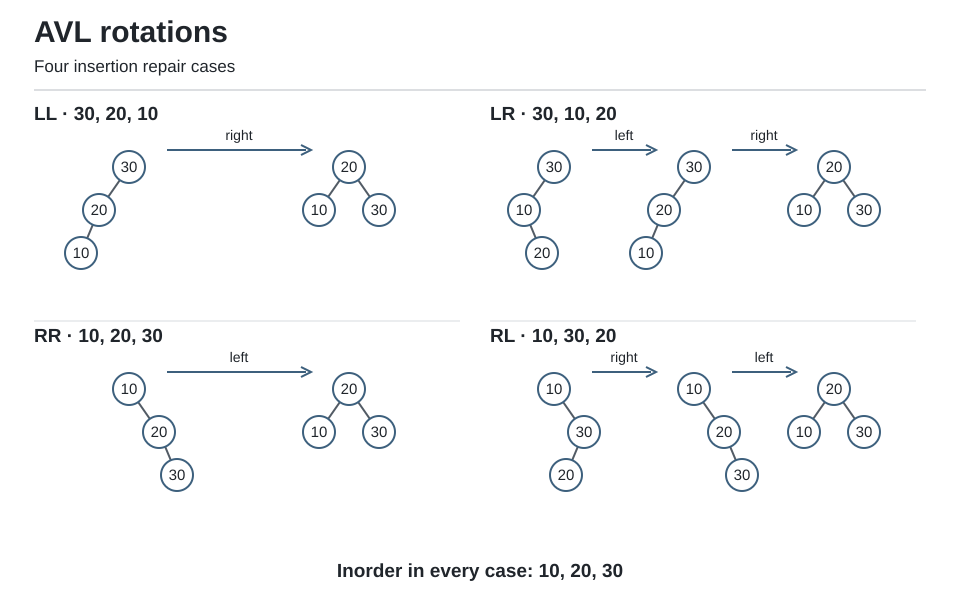
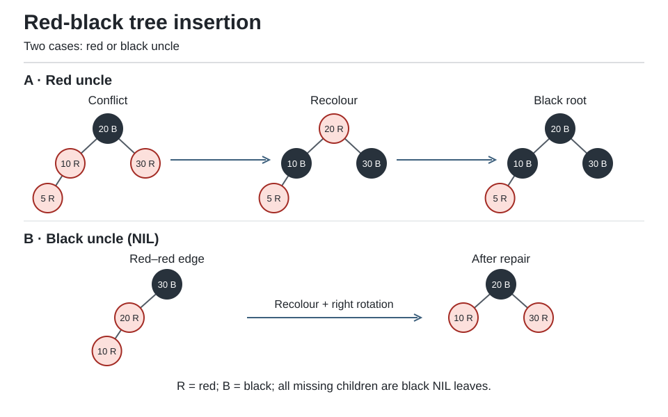
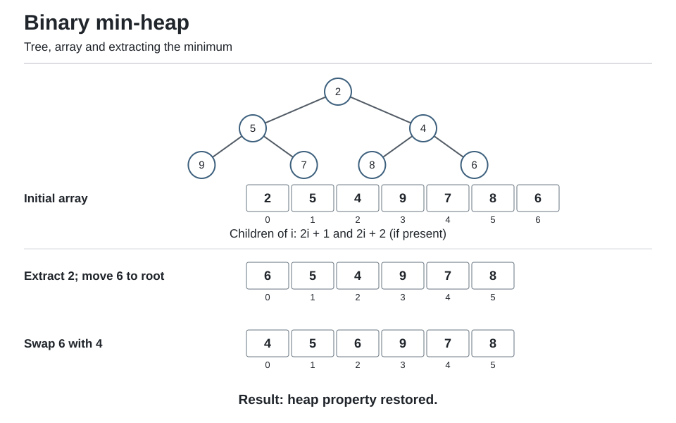

# M8-L4 – Algorithms and data structures in depth: balanced trees and heaps {#L4}

**Course area:** M8 – Bachelor: Core areas

**Level:** Bachelor

**Prior knowledge:** [M1-L3 – Algorithms and data structures](M1-L3.md) · [M8-L1 – Discrete computer science](M8-L1.md)

**Further study:** [M7-L2 – Correctness, computability and analysis of complex procedures](M7-L2.md) · [M3-L1 – A database on a server](M3-L1.md) · [M4-L1 – Distributed processing](M4-L1.md)

## Initial question: how can we guarantee a short search path? {#S1}

An application maintains a directory of jobs. New jobs arrive continuously, some are removed, and others must be found quickly by their identifier. In addition, the job with the smallest priority number must always be processed next.

A sorted sequence, a hash table and a search tree do not solve the same tasks equally well. In this lesson, we therefore consider not only the running time of an operation but also **the property of the data structure that guarantees this running time**, and the work required to maintain it when changes occur.

After reading, you should be able to interpret asymptotic bounds formally, justify a simple algorithm using a loop invariant, estimate the height of a search tree, follow rotations and distinguish between search trees, heaps and other structures. The pseudocode examples are intended as reading models; neither installation nor programming is required.

## Landau notation: from a conjecture to a mathematical statement {#S2}

The growth diagram in [M7-L2 – Time and space complexity](M7-L2.md#S7) illustrates the orders of growth.

Let $f,g$ be non-negative functions on the natural numbers, with $g(n)$ positive for sufficiently large $n$. We consider a specified quantity, such as the number of comparisons for inputs of length $n$.

**Upper bound:**

$$
f\in O(g)\iff \exists c>0\;\exists n_0\in\mathbb{N}\;\forall n\ge n_0:\quad f(n)\le c\,g(n).
$$

**Lower bound:**

$$
f\in\Omega(g)\iff \exists c>0\;\exists n_0\in\mathbb{N}\;\forall n\ge n_0:\quad f(n)\ge c\,g(n).
$$

**Asymptotically tight bound:**

$$
f\in\Theta(g)\iff \exists c_1,c_2>0\;\exists n_0\in\mathbb{N}\;\forall n\ge n_0:\quad c_1 g(n)\le f(n)\le c_2 g(n).
$$

The constants must not depend on $n$. The threshold $n_0$ allows us to exclude finitely many small inputs from the asymptotic statement. The notation $f(n)=O(g(n))$ is also common; set notation indicates more precisely that the right-hand side denotes a class of functions.

### A fully justified example

For $T(n)=3n^2+5n+7$ and $n\ge 1$, we have $5n\le 5n^2$ and $7\le 7n^2$. Hence

$$
3n^2\le T(n)\le 15n^2.
$$

With $c_1=3$, $c_2=15$ and $n_0=1$, we have proved $T\in\Theta(n^2)$. By contrast, $T\in O(n^3)$ would also be true but less informative. $T\in O(n)$ is false: $3n^2\le cn$ would imply, for all sufficiently large $n$, the impossible condition $3n\le c$.

**Important:** $O$ does not automatically mean worst case, and $\Omega$ does not automatically mean best case. First we specify the cost function under consideration, such as worst-case cost, and then its mathematical bound.

## Correctness: binary search with a proof {#S3}

We search for a key $x$ in a non-decreasingly sorted array $A$ of length $n$. If multiple matches exist, any matching index is sufficient. The result is either a valid matching index or `-1` if no match exists. Indices start at zero; the upper boundary of the search interval is excluded.

``` text
binarySearch(A, x):
    lo = 0
    hi = length(A)
    while lo < hi:
        mid = lo + floor((hi - lo) / 2)
        if A[mid] == x:
            return mid
        if A[mid] < x:
            lo = mid + 1
        else:
            hi = mid
    return -1
```

**Loop invariant:** Before each iteration, $0\le lo\le hi\le n$. No index outside the half-open interval $[lo,hi)$ can contain a match.

**Initialisation:** With $lo=0$ and $hi=n$, the interval contains all possible indices. This also holds for an empty array.

**Preservation:** If $A[mid]=x$, the procedure returns a valid match. If $A[mid]<x$, sorting ensures that all entries up to and including `mid` are smaller than $x$. If $A[mid]>x$, all entries from `mid` onwards are greater than $x$. In both cases, every possible match remains in the new interval.

**Postcondition:** When the loop ends normally, $lo=hi$. The interval no longer contains any index. By the invariant, no match can exist outside it either. Thus `-1` is correct.

**Termination:** The non-negative integer $hi-lo$ strictly decreases in each iteration that does not return. No infinite sequence of such decreases exists. Together with the postcondition, this establishes total correctness.

In each iteration, the interval length is reduced to at most half its previous value (rounded down). Assuming constant-cost array accesses and key comparisons, for $n\ge1$ there are at most $\lfloor\log_2 n\rfloor+1$ iterations. The worst-case order is $\Theta(\log n)$, the best-case order is $\Theta(1)$, and additional space is $\Theta(1)$. A proof does not replace implementation testing, but shows why the stated method works under its assumptions.

## Binary search trees: order does not imply balance {#S4}

In a binary search tree with distinct keys, all keys in the left subtree of each node are smaller and all keys in its right subtree are greater. This rule concerns the entire subtree, not just the immediate children. Equal keys require an additional representation, such as a list of records per key.

``` text
Balanced                   Degenerate after sorted insertion
       40                   10
     /    \                   \
   20      60                  20
  /  \    /  \                   \
10   30  50   70                  30
                                    \
                                     40 ... 70
```

We measure height $h$ in edges, with height $-1$ for the empty tree and $0$ for a leaf. In a non-empty tree, a search visits at most $h+1$ nodes. An ordinary search tree can reach height $n-1$ when keys are inserted in ascending order. A search tree with guaranteed height $O(\log n)$ avoids this degeneration.

An inorder traversal (left subtree, node, right subtree) outputs all keys in sorted order. It visits each node once and takes $\Theta(n)$ time. Searching, insertion and deletion do not necessarily visit every position.

## Rotations: preserving order whilst changing shape {#S5}

Consider a right rotation around node `y`. Its left child `x` takes over as the root of the affected subtree. The three subtrees `A`, `B` and `C` may be empty.

``` text
Before                    After
       y                       x
      / \                     / \
     x   C                   A   y
    / \                         / \
   A   B                       B   C
```

Both representations have the same inorder sequence: `A, x, B, y, C`. All key relationships are preserved. A rotation changes the links, not the keys. A left rotation is the inverse operation.

``` text
rotateRight(y):
    x = y.left
    y.left = x.right
    x.right = y
    updateHeight(y)
    updateHeight(x)
    return x
```

The prerequisite is that `y.left` exists. The caller must connect the returned node to its parent or the overall root. If parent pointers or other metadata are stored, they must also be maintained. If child heights are stored, `updateHeight` takes constant time. The structural change itself therefore costs $O(1)$.

## AVL trees: strict height balance {#S6}



*AVL rotations.*

An AVL tree is a binary search tree in which the balance factor of every node $v$,

$$
b(v)=h(v_{\mathrm{links}})-h(v_{\mathrm{rechts}})
$$

where the subscripts denote left and right, takes one of the values $-1,0,1$. After ordinary insertion, factors of $2$ or $-2$ can occur on the way back to the root. Rotations repair the relevant violation.

| Case at the unbalanced node | Direction of the heavier child | Correction |
| --- | --- | --- |
| left-left (LL) | left, child left-heavy or balanced | right rotation |
| left-right (LR) | left, child right-heavy | first left at the child, then right at the node |
| right-right (RR) | right, child right-heavy or balanced | left rotation |
| right-left (RL) | right, child left-heavy | first right at the child, then left at the node |

Inserting `30, 10, 20` produces the LR case. First rotate left at node `10`, then right at node `30`:

``` text
    30          30           20
   /           /            /  \
 10           20           10  30
   \         /
    20      10
```

After the double rotation, the sequence `10, 20, 30` is unchanged, but the root is now `20`.

### Why is the height logarithmic?

Let $N(h)$ be the minimum number of real nodes in an AVL tree of height $h$. We have $N(-1)=0$ and $N(0)=1$. At height $h\ge1$, one child must have height $h-1$ and the other at least height $h-2$. Therefore

$$
N(h)=1+N(h-1)+N(h-2).
$$

For $h=-1,0,1,2,3,4$, the sequence starts with $0,1,2,4,7,12$. It is related to Fibonacci numbers and grows exponentially in $h$. A concrete induction step: for $h\ge2$, we have $N(h)\ge2N(h-2)+1$. Starting from $N(0)=1$ and $N(1)=2$, repeated application yields $N(h)\ge2^{\lfloor h/2\rfloor}$. Thus, with $n\ge1$ nodes, the height can grow at most logarithmically in $n$. Search, insertion and deletion take $O(\log n)$ time in the worst case.

## AVL insertion: readable pseudocode {#S7}

We consider distinct keys; inserting the same key again does not change the set. For each node, we store its current height. `rotateLeft` is the mirror image of `rotateRight`.

``` text
height(v):
    if v == null: return -1
    return v.height

updateHeight(v):
    v.height = 1 + max(height(v.left), height(v.right))

balance(v):
    return height(v.left) - height(v.right)

rebalance(v):
    updateHeight(v)
    if balance(v) > 1:
        if balance(v.left) < 0:
            v.left = rotateLeft(v.left)
        return rotateRight(v)
    if balance(v) < -1:
        if balance(v.right) > 0:
            v.right = rotateRight(v.right)
        return rotateLeft(v)
    return v

insertAVL(v, k):
    if v == null: return newLeaf(k)  // height = 0
    if k < v.key:
        v.left = insertAVL(v.left, k)
    else if k > v.key:
        v.right = insertAVL(v.right, k)
    else:
        return v
    return rebalance(v)
```

The caller always adopts the returned root. During recursive descent, search-tree order holds; rotations preserve it. On the way back, each recursively processed subtree is balanced before its parent is checked. The four cases restore height balance at the affected node. For ordinary AVL insertion, at most one single or double rotation at the first violation encountered from below suffices; height maintenance continues. In deletion, a reduced height may trigger further violations towards the root. A complete deletion implementation is not required here; it starts with ordinary search-tree deletion and rebalances all affected ancestors.

## Red-black trees: balance through colour invariants {#S8}

A red-black tree is also a binary search tree. Rather than directly restricting the height difference at each node, it stores an additional colour per node. We use the classical variant with black virtual `NIL` leaves for missing children.

The rules are:

1. Every real node is red or black; `NIL` is black.
2. The root is black.
3. A red node has only black children.
4. All downward paths from any node to `NIL` contain the same number of black nodes (under a consistent counting convention).

Define the black height $b(v)$ as the number of black nodes on a path from `v` to `NIL`, excluding the starting node `v` and including the final `NIL` only if it is not itself `v`. Then a subtree rooted at `v` has at least $2^{b(v)}-1$ real nodes. Proof by induction on subtree height: For `NIL`, $b=0$ and there are no real nodes. The black heights of both children are at least $b(v)-1$. Their minimum node counts, together with `v`, therefore yield at least $1+2(2^{b(v)-1}-1)=2^{b(v)}-1$ nodes. On every root-to-`NIL` path, at most approximately half the nodes can be red because adjacent red nodes are forbidden. The length $H$ of this path in edges satisfies $H\le 2b(\mathrm{root})$ (the root is black). From $n\ge2^{b(\mathrm{root})}-1$ we obtain the familiar height bound

$$
H\le2\log_2(n+1).
$$

For a non-empty tree, the height measured in edges between real nodes is one less than the maximum path length to `NIL`. Insertions and deletions preserve the colour invariants through recolouring and rotations; search does not require colours. All three operations take $O(\log n)$ time in the worst case.

## Red-black insertion: when to recolour and when to rotate? {#S9}



*Red-black tree: insertion.*

The newly inserted node `z` is initially red, so the number of black nodes on a path remains unchanged. Only a red root or a red-red edge can violate the rules. If the parent is black, that edge needs no repair. If it is red, we call its sibling the uncle of `z`.

### Case A: red uncle

The parent and uncle become black, and the grandparent becomes red. Black heights remain unchanged; a new red-red edge may arise further up the tree. In that case, repair continues there.

``` text
Before                         After (local)
         20(B)                       20(R)
        /     \                     /     \
     10(R)   30(R)              10(B)   30(B)
     /                          /
   5(R)                       5(R)
```

`B` = black, `R` = red. If `20` is the overall root, we colour it black at the end.

### Case B: black uncle

If the new node is an inner child (triangular configuration), first rotate around its parent to produce an outer configuration. Then recolour the parent and grandparent appropriately and rotate around the grandparent. The mirrored cases apply in the same way. Example of the outer configuration (LL), with no right child of `30`:

``` text
Before                       After
       30(B)                     20(B)
      /     \                   /     \
   20(R)   NIL               10(R)   30(R)
   /
10(R)
```

All missing children represent black `NIL` leaves. The two local steps restore the colour invariants. In the classical insertion procedure, at most two rotations are required, whilst recolouring may continue all the way to the root. Deletion is more demanding: effectively removing a black node may cause one side to lose a black level. Repair restores black height through cases involving siblings. The full case analysis is left for further reading.

## Binary heaps: the smallest key first {#S10}



*Binary min-heap.*

A **min-heap** is a complete binary tree structure: all levels except possibly the last are filled, and nodes on the last level are positioned as far left as possible. Each parent's key is no greater than its children's keys. Therefore the root contains a minimum. This condition is weaker than search-tree order: there is no general sorting relationship between the left and right subtrees.

``` text
              2
           /     \
          5       4
        /   \    / \
       9     7  8   6

Array:  [2, 5, 4, 9, 7, 8, 6]
Index:   0  1  2  3  4  5  6
```

For index $i$ (zero-based), the possible children are at $2i+1$ and $2i+2$. A non-root node has parent index $\lfloor(i-1)/2\rfloor$. The children exist only if their indices are smaller than the array length. This allows compact storage without separate tree pointers.

Insertion: append the key to the array and swap upwards whilst it is smaller than its parent's key (*sift-up*). Extracting the minimum: move the last key to the root, shorten the array and swap the key downwards with its smaller child whilst the heap property is violated (*sift-down*).

``` text
siftDown(A, i):
    while 2*i + 1 < length(A):
        j = 2*i + 1
        if j + 1 < length(A) and A[j+1] < A[j]:
            j = j + 1
        if A[i] <= A[j]: return
        swap(A[i], A[j])
        i = j

extractMin(A):
    if length(A) == 0: error "empty heap"
    result = A[0]
    last = removeLast(A)
    if length(A) > 0:
        A[0] = last
        siftDown(A, 0)
    return result
```

Sifting down assumes that both child subtrees are already heaps. Swapping with the smaller child repairs the property at the old parent node; a violation can remain only at the new position. Height limits the number of steps, and downward movement guarantees termination.

## Priority queues and heapsort {#S11}

A priority queue is an abstract data type: it allows insertion, inspection and extraction of an element of highest priority. In a min-heap, the highest priority corresponds to the smallest key. Equal priorities are not stable without an additional rule; a sequential secondary key can preserve FIFO order in the event of a tie.

The minimum can be read in $O(1)$ time, whilst insertion and extraction take $O(\log n)$ time in the worst case (assuming sufficient array capacity already reserved; an individual dynamic-array expansion may incur additional linear copying costs). An arbitrary key, by contrast, may require a linear search without an auxiliary index. For `decreaseKey` in $O(\log n)$ time, the position must be known or retrievable via a maintained mapping.

A heap can be built bottom-up in $O(n)$ time: start at the last internal node and perform `siftDown` backwards to the root. Although an individual descent can be logarithmically long, many nodes are near the leaves. In a complete binary tree, at most $\lfloor n/2^k\rfloor$ nodes have height at least $k$. Summing, for each $k\ge1$, the nodes with at least $k$ possible downward steps counts each node exactly according to its height. Thus the sum of all maximum descent lengths is at most

$$
\sum_{k\ge1}\left\lfloor\frac{n}{2^k}\right\rfloor\le n\sum_{k\ge1}\frac{1}{2^k}=n.
$$

The loop over internal nodes costs an additional $O(n)$ time; in total, the result is $O(n)$. This differs from the coarse estimate $n\cdot O(\log n)$.

Heapsort usually uses a max-heap to sort in ascending order within the same array. After each step it places the maximum at the last still-unsorted position. Construction and $n$ extractions or relocations yield worst-case running time $O(n\log n)$. The standard iterative variant requires constant additional space and is not stable. Priority queues are also an important component of Dijkstra's shortest-path algorithm for non-negatively weighted edges, as well as event simulation and local job selection.

## Decision guide: which structure for which operation? {#S12}

The table describes typical worst-case time costs under a model of constant-cost key comparisons, direct array accesses and, where relevant, capacity already reserved. For AVL and red-black trees, logarithmic height is guaranteed. Let $k$ be the number of keys returned by a range query.

| Structure | Exact search | Insertion | Deletion of a known key | Minimum | Range reporting |
| --- | --- | --- | --- | --- | --- |
| Sorted array | $O(\log n)$ | $O(n)$ | $O(n)$ | $O(1)$ | $O(\log n+k)$ |
| Ordinary search tree | $O(n)$ | $O(n)$ | $O(n)$ | $O(n)$ | $O(n)$ |
| AVL tree | $O(\log n)$ | $O(\log n)$ | $O(\log n)$ | $O(\log n)$ | $O(\log n+k)$ |
| Red-black tree | $O(\log n)$ | $O(\log n)$ | $O(\log n)$ | $O(\log n)$ | $O(\log n+k)$ |
| Binary min-heap | $O(n)$ | $O(\log n)$ | $O(n)$ without a position index | $O(1)$ | $O(n)$ |

For empty structures, we use a constant-time check; asymptotic statements concern large inputs. In AVL and red-black trees, range reporting is possible by starting with a search and continuing with ordered traversal. With suitable hashing and controlled load, a hash table often offers expected constant-time exact key queries, but no guarantee of sorted traversal.

A B-tree or B+ tree optimises a different resource: block-based storage access. In databases, high branching factors reduce the number of pages that need to be read. For small local priority services, an array heap may be the simpler choice. Balanced search trees are suitable for continually changing ordered keys. However, asymptotic efficiency does not replace measurements of cache behaviour, memory consumption or implementation costs.

## Optional self-assessment with solutions {#S13}

The following questions are for independent reflection. They are not a compulsory exercise component.

**1. Bounds:** Is $T(n)=7n+20$ in $O(n^2)$, $\Theta(n)$ and $\Omega(n^2)$?

**Solution:** The first two statements are true. For $n\ge1$, we have $7n\le T(n)\le27n$. The third statement is false because $T(n)/n^2=7/n+20/n^2$ tends to zero.

**2. Search invariant:** In binary search, why is the assignment `hi = mid` rather than `hi = mid - 1` correct when $A[mid]>x$?

**Solution:** `hi` is excluded. The index `mid` is removed, whilst the still-possible index `mid-1` remains included. Choosing `hi = mid - 1` could skip a valid match.

**3. AVL:** Which rotation is necessary after inserting `10, 30, 20`?

**Solution:** RL: rotate right at `30`, then rotate left at `10`. The result is root `20` with children `10` and `30`.

**4. Red-black:** A black root has a red left child and a red right child. A red node is inserted under the left child. Which local repair is necessary?

**Solution:** The uncle is red. Both children of the root become black; the root is first coloured red and finally black. All root-to-`NIL` paths still have the same number of black nodes afterwards.

**5. Heap:** Extract the minimum from `[2, 5, 4, 9, 7, 8, 6]`.

**Solution:** `2` is returned. The `6` replaces the root; swapping with `4` leads to `[4, 5, 6, 9, 7, 8]`. The only child of `6` is `8`, and the heap property holds again.

**6. Architecture:** A service needs both ordered range reporting by customer number and the next element according to an independent deadline. Is a min-heap sufficient?

**Solution:** Not efficiently for both requirements. An ordered search index and a separate priority queue can be useful together. Both must be kept consistent when changes occur; additional structures increase maintenance and storage costs.

## Summary and further study {#S14}

The central insight is that every efficiency guarantee rests on assumptions. A search tree is logarithmic only when short height is guaranteed; rotations preserve sorted order. AVL trees strictly constrain height, and red-black trees balance through colour invariants. Heaps give up full search-tree order to manage an extremum efficiently. Formal bounds describe the order of growth of a precisely specified cost function, whereas correctness proofs establish that a specification is satisfied.

For formal verification, computability and recurrence analysis, continue with [M7-L2](M7-L2.md). [M3-L1](M3-L1.md) and [M10-L2](M10-L2.md) deepen the connection to database-oriented tree structures. Practical job processing and operating-system scheduling are covered in [M4-L1](M4-L1.md) and [M8-L3](M8-L3.md).

## Sources {#S15}

**Source review recorded in the German original:** 19 November 2026 (web pages and teaching overviews; no third-party illustrations reused).

1. **MIT OpenCourseWare, 6.006 – Introduction to Algorithms, Spring 2020:** undergraduate course, particularly lectures 6–8 on binary trees, AVL and binary heaps. [Lecture notes](https://ocw.mit.edu/courses/6-006-introduction-to-algorithms-spring-2020/pages/lecture-notes/)
2. **Freie Universität Berlin – Algorithms, Data Structures and Data Abstraction, winter semester 2018/19:** teaching overview of search trees, AVL rotations and red-black trees. [Course page](https://www.inf.fu-berlin.de/lehre/WS18/ALP3/)
3. **Princeton University, Sedgewick/Wayne – Algorithms, 4th Edition:** reference on asymptotic bounds, search trees, heaps and priority queues. [Algorithms and data structures cheatsheet](https://algs4.cs.princeton.edu/cheatsheet/)
4. **Yale University, James Aspnes – Notes on Data Structures and Programming Techniques, CPSC 223:** balanced search trees, red-black invariants and insertion repairs. [Lecture notes](https://cs.yale.edu/homes/aspnes/classes/223/notes.html)
