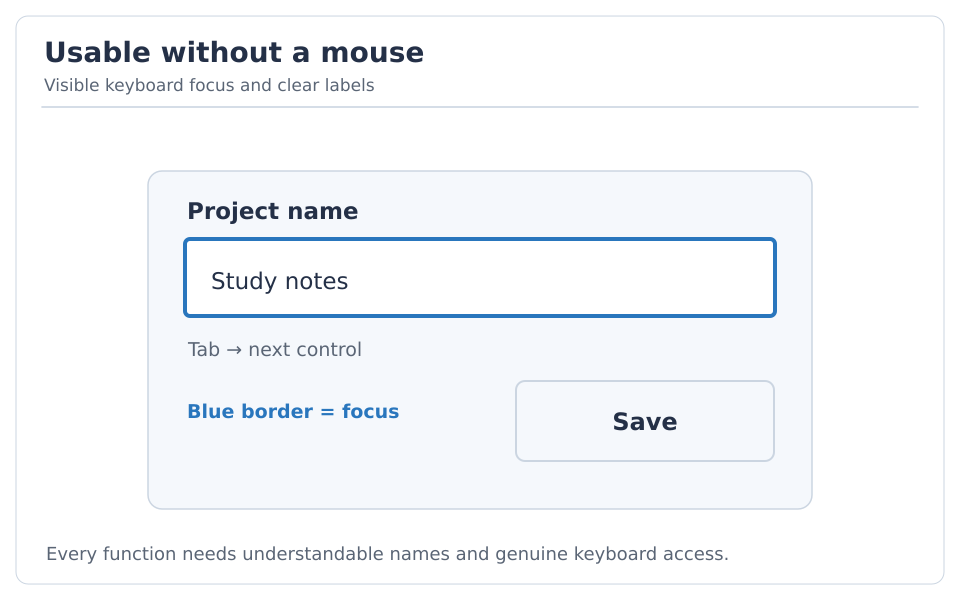

# M9-L1 – User interfaces, accessibility and software ergonomics {#L1}

**Course area:** M9 – Bachelor: Elective and practical areas

**Level:** Bachelor (elective / application)

**Prior knowledge:** No fixed prerequisites specified.

**Classification:** Optional Bachelor elective topic (M9-L1)

**Reading path:** M1-L4 (software engineering), M1-L7 (further areas of computer science), M4-L3 (security and data protection) and M6-L4 (AI agents) are helpful. However, this chapter can be understood on its own. It requires neither programming nor the installation of a design tool. For further statistical study, the relevant lessons in the mathematics course are School (German-language) M2-L16 and University M1-L7.

## Why the user interface is part of the system {#S1}

An application can be programmed correctly in technical terms and still fail to fulfil its purpose. A word processor that reliably saves documents is of little help if its users cannot find the Save button. An online service may scale extremely well and still lose orders because its forms are incomprehensible. An AI assistant may produce a good answer and nevertheless cause harm if the interface presents an assumption as a verified fact.

A **user interface** (UI) denotes the visible, audible or otherwise perceptible means through which people interact with a system: buttons, menus, text fields, messages, voice input or physical controls. **User experience** (UX) denotes the broader experience of use: expectations, understanding, success, effort and feelings before, during and after use. An aesthetically pleasing UI does not guarantee good UX; conversely, a simple interface can be exceptionally reliable to use.

**Human–computer interaction** (HCI) investigates the interplay of people, tasks and technology. **Usability** describes how well defined groups of people achieve their goals effectively, efficiently and satisfactorily in a particular context of use. **Accessibility** additionally asks whether people with different physical, sensory, cognitive or situational circumstances receive equal access to the functions. **Software ergonomics** investigates how work with software can be designed to suit people and their tasks.

These levels can be viewed separately:

``` text
Person with a goal and individual circumstances
       |
       v
Interface: navigation, input, feedback
       |
       v
Application logic: rules, permissions, processes
       |
       v
Database, services, external systems
       |
       v
Result + comprehensible feedback to the person
```

An improvement to the interface must not override the business logic. For example, a greyed-out menu item is **not** a substitute for a server-side access check. Likewise, a polite notice is not secure data deletion. Good design makes rules understandable; actually enforcing them remains the task of the system.

## From user goal to interaction sequence {#S2}

A poor starting question is: 'Which buttons should we build?' A better one is: 'What does the person want to achieve, under what circumstances, and how will they recognise success?' The difference seems small but changes the entire design.

Suppose someone wants to find all photographs from a particular year in a media library, select three of them and save them in a collection. The domain task consists of *searching, checking, selecting and saving*. A particular sidebar, icon colour or card view is not initially necessary for this. Another person may want to achieve the same goal with a keyboard, a screen reader or large text.

**Task analysis** describes the path from the starting state to the desired result. Four questions help: what does the person already know? What information is missing? What step do they expect? What are the consequences of errors? An occasional mistake when sorting is usually harmless; accidentally making a private album public can cause considerable harm.

A *usage scenario* describes a concrete process. A *persona* is a condensed, hypothetical description of a user group. Personas can structure conversations, but are **not empirical evidence** of actual needs. They must not replace real user research on the basis of stereotypes. Observed working steps, traceable complaints, support requests and conversations with members of the target group are more informative.

### Mental models and predictability {#21-mentale-modelle-und-vorhersagbarkeit}

People bring **mental models** with them: ideas about how software works. A recycle bin usually means 'recoverable later', a download icon means 'save file', and a back arrow means 'view the previous step'. If the application departs from these expectations, it must explain the difference clearly.

A consistent product uses the same words and symbols for the same action. If a button means 'archive' in one place and 'delete' elsewhere, unnecessary errors arise. Consistency also includes system conventions: keyboard shortcuts, Tab navigation, scrolling behaviour and dialogue boxes should be as predictable as possible.

In design, an **affordance** denotes the perceptible action possibility of an element; a clearly drawn switch suggests toggling. A **signifier** is a clue to that possibility, such as a label or visible handle. Both can be misleading: a blue underlined word looks like a link even though it may not be clickable. Good interfaces make the intended action apparent instead of forcing their users to guess.

## Orientation, navigation and information architecture {#S3}

For small applications, a single page is often sufficient. Larger systems need an **information architecture**: comprehensible groups, categories, search paths and hierarchies. Good navigation continually answers three questions: *Where am I? What can I do here? How do I get back?*

An example using a media library:

``` text
Library
 |-- All media
 |     |-- Search and filters
 |     +-- Detail view
 |-- My collections
 |-- Import jobs
 |     +-- Progress and errors
 +-- Settings
       |-- Data protection
       +-- Accessibility / display
```

Categories should be based on the users' perspective. 'Import jobs' may be appropriate for technical users; for a general audience, 'Add files' may be easier to understand. Sometimes an interface needs different labels in expert and simple views. Such decisions should be tested, not made purely according to taste.

**Progressive disclosure** means displaying advanced options only when they become relevant. A simple photo import could initially offer only 'Choose files' and 'Start'; technical options such as metadata strategy, hash checking or batch size remain in an 'Advanced settings' section. Hidden functions must remain discoverable; 'show less' must not mean 'withhold important information'.

A search function should explain **what** it searches. 'Search' without a clear meaning creates false expectations. Does it search file names, descriptions or also image content recognised by AI? Is there a filter for 'own collections only'? Hidden filters can cause someone to incorrectly believe their data has disappeared.

## Feedback, errors and safe decisions {#S4}

**Visibility of system status** is one of the usability principles described by Jakob Nielsen \[1\]. After an action, the person should understand as far as possible whether it has been accepted, is being processed, has been completed or has failed. This is especially important for cloud services: clicking 'Upload' may only initiate the submission of the job; processing and storage take longer.

A good workflow distinguishes the states:

``` text
Files selected
        |
        v
Upload in progress ---> Transfer error / retry
        |
        v
Upload completed
        |
        v
Processing in progress ---> Error report / retry
        |
        v
Collection updated / result visible
```

'Successful' should only be displayed when **the specified operation** has actually succeeded. 'Job accepted' and 'job fully completed' are different promises. This relates to M4-L1 and M4-L2: queues, workers and databases may be involved in the background.

### Comprehensible error messages {#41-verständliche-fehlermeldungen}

The message 'Error 500' identifies a technical symptom but does little to help the affected person. More useful is: 'The changes could not be saved. Your input is still available. Please try again.' A technical error code can additionally be provided so that support staff or administrators can identify the incident.

An error message should, where possible, state: *What happened? What effect does it have? What can I do?* For an excessively large file upload, 'File exceeds 50 MB' is more helpful than 'Invalid input'. Of course, the stated limit must correspond to the actual server configuration.

**Error prevention** is often better than a mere error message. If someone wants to permanently delete five collections, the interface can summarise their number and names, offer a recovery option or specifically warn of irreversible consequences. A dialogue box for every harmless action, on the other hand, becomes disruptive. The more serious and difficult to undo the consequence, the more appropriate an additional safeguard is.

An **undo function** reverses an earlier action as far as the domain allows. This is easy for local sorting, but limited for emails already sent or external payments. The interface must not promise 'Undo' if the original process has already become irreversible.

## Accessibility begins with different conditions of use {#S5}

Accessibility is often associated too narrowly with blindness or wheelchair use. In reality, people may have visual, hearing, mobility or learning impairments, among others; they may rely on voice input, magnification, keyboard control or simplified language. People without permanent disabilities also encounter barriers: a broken arm, bright sunlight, a poor internet connection, a noisy train compartment or a hand currently holding a child.

A functioning accessible interface offers **equivalent paths** to the same task. It is not enough for the home page to be operable with a keyboard if the crucial Save dialogue can only be reached with a mouse. All relevant workflows must be accessible: signing in, searching, selecting, paying, resolving errors and finding help.

For websites, the **Web Content Accessibility Guidelines (WCAG)** of the World Wide Web Consortium (W3C) are a central technical standard. **WCAG 2.2** defines verifiable *success criteria* at conformance levels A, AA and AAA \[2\]. AA is a common target in many projects, but the specific legal requirement depends on the service and jurisdiction. The criteria are minimum requirements for the respective level, not a guarantee that everyone can use everything without difficulty.

### Perceivable, operable, understandable, robust {#51-wahrnehmbar-bedienbar-verständlich-robust}

The four WCAG principles are:

1.  **Perceivable:** information and controls can be perceived through appropriate sensory channels, for example with text alternatives for informative images or captions for relevant videos.
2.  **Operable:** people can operate interactive elements, for example with a keyboard and a recognisable focus position.
3.  **Understandable:** content and workflows are comprehensible; controls behave as predictably as possible.
4.  **Robust:** the technical structure works with different browsers and assistive technologies, such as screen readers.

A fully automated test **cannot comprehensively demonstrate** these properties. The W3C explicitly emphasises that tools only assist and that knowledgeable human evaluation is necessary \[3\]. Wherever possible, testing with different users who are actually affected should be added.

## Concrete accessibility decisions {#S6}



Visible focus, clear labels and keyboard operation are concrete accessibility features.

### Typography, contrast and colour {#61-schrift-kontrast-und-farbe}

Text requires sufficient contrast against the background. At level AA, WCAG 2.2 generally requires a contrast ratio of **at least 4.5:1** for ordinary text and **at least 3:1** for large text, in each case with defined exceptions \[2\]. These figures refer to calculated luminance contrast, not perceived colour differences. Contrast is not a substitute for legible font sizes, sufficient line spacing and comprehensible wording.

**Example:** a light grey 'Save' label on a white background may look elegant but be difficult to recognise. A greater luminance difference improves legibility. If an error message can additionally only be recognised by red lettering, a second information channel is missing. Better: a warning symbol, meaningful heading, red accent and clear text together.

Colours can aid orientation, but must not carry the **only** information. A chart with 'green = passed, red = failed' should also label the values or use patterns. This helps with colour vision deficiencies, monochrome printing and situations with poor colour reproduction.

### Keyboard, focus and targets {#62-tastatur-fokus-und-ziele}

A person must be able to reach the controls in a sensible order with a keyboard. **Keyboard focus** indicates which element will receive the next key press. If a design removes its outline without replacement, the current position is often no longer recognisable. A fixed header must not completely obscure the currently focused button either; WCAG 2.2 has specific criteria for this \[2, 4\].

The WCAG 2.2 success criterion **2.5.8 Target Size (Minimum)** at level AA generally requires a pointer target to be able to **fully contain an axis-aligned square of $24\times24$ CSS pixels** \[2\]. A circular target with a diameter of only 24 pixels therefore does not automatically meet this size option. An important exception is **sufficient spacing**: for a target that is too small, an imaginary circle with a diameter of 24 pixels is centred on its bounding box; it must not intersect other targets or their corresponding circles. Other exceptions apply, among other things, to equivalent controls, inline links and unmodified browser controls. **$24\times24$ is not a general ergonomic optimum:** the separate WCAG 2.2 level AAA specifies **$44\times44$ CSS pixels** with exceptions (criterion 2.5.5), and generously sized controls beyond that may be useful. Actual conformance depends on size, shape, spacing and the specific context of use.

An interface that requires drag and drop generally needs an alternative means of operation without dragging for the functions concerned under WCAG 2.2 level AA, unless an exception applies. In a sortable list, for example, 'Move up' and 'Move down' could be alternatives.

### Labelling, forms and screen readers {#63-beschriftung-formulare-und-screenreader}

A **screen reader** reads a structured representation of the user interface aloud or presents it through a Braille display. For this, interactive elements need a comprehensible **role**, an accessible **name** and, where applicable, their current **state**. A checkbox, for example, should be recognisable as a checkbox with a label and state, not as a nameless symbol.

On the web, many native **HTML** elements (*Hypertext Markup Language*, the markup language for web pages) have such properties by default: `button`, `input`, `label`, headings and lists. The W3C recommendation for the use of **Accessible Rich Internet Applications (ARIA)** is, in essence, to prefer existing native HTML functionality before recreating it with custom ARIA roles \[5\]. ARIA adds semantics; it does not automatically create keyboard operation, focus management or correct behaviour.

A mere prompt within a field (*placeholder*) is not a reliable substitute for a persistent visible label. When errors occur, users should learn **which field** is affected and **how** to correct it. It is also important that the message is technically associated with the field and accessible to assistive technologies \[5, 6\].

### Motion, time limits and media {#64-bewegungen-zeitlimits-und-medien}

Uncontrolled animations can be distracting or affect health. Animations should have a functional justification; where there is substantial motion, users' preferences for reducing motion must be taken into account. Audio that starts automatically is often disruptive, especially when using a screen reader or working in an office.

Time limits can become a problem with long forms or slower interaction. Where possible, the application announces an impending session expiry, allows an extension and preserves input securely. Authentication and the security context impose limits: an expired session must not remain open indefinitely purely for convenience.

For videos, captions, audio descriptions or other alternatives are relevant depending on the content and applicable success criterion. A purely decorative background video does not require the same textual treatment as a technical tutorial. The specific assessment depends on the purpose of the content \[2\].

## Responsive design and different devices {#S7}

**Responsive design** means that a layout adapts to available display areas and input conditions. A large desktop table with 30 columns hardly works on a smartphone. A useful mobile layout might initially show the title, status and most important actions and open details on request.

Responsive design is more than shrinking every element. It accounts for text enlargement, portrait and landscape orientation, different densities and touch interaction. The order in the source code should still make sense even when columns are displayed visually side by side.

A typical error: on large screens, the application displays a side menu; on mobile it is turned into an icon without text that is neither discoverable nor understandable to screen readers. The space saved is then purchased at the cost of interaction problems. A brief visible label or a clearly recognisable menu may be better than an abstract icon.

**Offline and slow-network conditions** are also part of usability. A web interface should indicate whether an action is still pending, whether data is cached locally or whether a connection is required. It must not claim without verification that all changes have already reached the server.

## Design systems and technical architecture {#S8}

Growing software needs a shared vocabulary for controls. A **design system** describes, for example, typography, spacing, colours, buttons, form fields, status messages and states such as 'disabled', 'loading' or 'error'. This facilitates consistent use and saves subsequent maintenance work.

A design system, however, is only as good as its actual implementation. A centrally defined 'accessible dialogue box' is worthless if a special page uses its own inaccessible dialogue. Shared components can reduce typical errors, but their specific use must be tested: is the dialogue text understandable? Is focus correct? Can the dialogue be exited? Is data discarded on closing?

A conceptual architecture:

``` text
Shared design system
  |-- Navigation and headings
  |-- Forms and error messages
  |-- Status indicators and dialogues
  +-- Keyboard / screen reader behaviour
             |
             v
       Domain-specific pages
  |-- Media import
  |-- Collections
  +-- AI analysis
             |
             v
       API and business logic
  |-- Check permissions
  |-- Store operations
  +-- Provide accurate status
```

The architecture illustrates a boundary: a design system can promote visual and semantic consistency. **Confidentiality, transaction correctness or authorisation logic** do not arise automatically from it. These tasks remain with the downstream services (see M4-L3 and M3-L5).

## Measuring usability without reducing people to numbers {#S9}

Usability can be investigated systematically. Before a test, it should be established **which task** is being tested and **which success criterion** applies: for example, 'A person finds an uploaded document and can check the access permissions'. The task should not already reveal which button the person should use.

Important metrics are:

- **Task success:** how many people actually achieve the defined goal?
- **Completion time:** how long do people need for the same task?
- **Error rate:** how frequently do relevant errors occur?
- **Need for assistance:** how often must observers intervene or provide explanations?
- **Subjective assessment:** how comprehensible, demanding or reliable do people find the workflow?

A longer completion time is not always worse. If checking important permissions requires ten extra seconds but prevents dangerous accidental sharing, this can be worthwhile. For people who use assistive technology, direct time comparisons without context are especially likely to be misleading.

### Worked example {#91-durchgerechnetes-beispiel}

A fictional study considers ten people who are to create an image collection with restricted access permissions. In the first design, six people complete the task without assistance; in the revised design, nine do so.

| Metric | Design A | Design B |
| --- | ---: | ---: |
| Participants | 10 | 10 |
| Successful without assistance | 6 | 9 |
| Success rate | 60 % | 90 % |
| Difference | – | +30 percentage points |

The success rate is $\frac{\text{Successful participants}}{\text{Participants}}\times100$. For A, therefore, $\frac6{10}\times100=60\,\%$; for B, $\frac9{10}\times100=90\,\%$. The **relative improvement** is $\frac{90-60}{60}\times100=50\,\%$, whereas the **absolute improvement** is 30 percentage points. These two statements are not interchangeable.

**What follows from this?** B was more successful for these ten observed people. **What does not follow?** That B always works 50% better for everyone. Ten people are a small sample. The procedure, task order, previous knowledge, selection of participants and possible learning effects can influence the result. If the same people use both designs, the second may appear easier simply because of practice. Fair comparisons therefore use a justified test design, for example a balanced order.

This is the subject-matter link to statistics and experimental design in the mathematics course; **no** specific lesson number there is asserted without consulting it.

### Qualitative observation and quantitative measurement {#92-qualitative-beobachtung-und-quantitative-messung}

Numbers show **that** a task fails, but often not **why**. Observations and follow-up questions can reveal that people misunderstand the meaning of a word or confuse two different save functions. A good test combines focused observation with simple metrics. Standardised surveys can complement comparisons but should not replace observed tasks.

**Heuristic evaluation** means that knowledgeable people assess an interface using recognised design principles. Nielsen's ten heuristics include, among others, visibility of status, comprehensible terms, control/undo, consistency, error prevention and helpful error messages \[1\]. This is a low-cost initial assessment but not a complete evaluation with real users.

## Accessibility evaluation is not a single button press {#S10}

A useful evaluation process begins before programming: choose clear tasks and accessible standard components, think through keyboard navigation and design with comprehensible text. Technical and human checks follow in the running system.

1.  **Check structure:** are the heading hierarchy, field labels, alternative texts, error associations and keyboard order correct?
2.  **Check presentation:** does content remain readable and usable with enlarged text, on narrow screens and at high contrast?
3.  **Check operation:** can all critical paths be completed with a keyboard, screen reader and, where appropriate, voice control?
4.  **Check error cases:** what happens in the event of incorrect input, a lost connection or an interrupted upload?
5.  **Test with people:** observe people with different needs and take their feedback seriously.

Automated test programs are helpful, for example in discovering missing field names or certain contrast problems. However, they cannot determine whether a warning is understandable or an alternative action really fulfils the same purpose \[3\]. **'Scanner reports zero errors' therefore does not mean 'product is fully accessible'.**

Accessibility can also deteriorate after updates. A new menu structure, changed colours or an additional confirmation dialogue can make previously accessible paths inaccessible again. Recurring checks, documented responsibilities and opportunities for feedback therefore belong to ongoing operation.

## Legal context in Europe: distinguishing objectives and scope {#S11}

In European law, the **European Accessibility Act (EAA)**, Directive (EU) 2019/882, is important for certain products and services. These include certain digital devices, banking services and **e-commerce**, among others. The relevant provisions generally apply from **28 June 2025**; Member States transpose the directive into national law \[7, 8\]. In Germany, the Accessibility Strengthening Act (**Barrierefreiheitsstärkungsgesetz**, BFSG) is particularly relevant in this context.

It does **not** follow that every privately operated website or every piece of internal software must meet exactly the same obligations across the board. The scope depends on the service, contractual situation, provider, transitional rules and statutory exceptions. The directive provides exemptions for certain microenterprises that provide services; these are not equivalent to a general exemption for every small organisation \[7\]. Other provisions may apply to public bodies.

**WCAG 2.2 and the law are not identical either.** WCAG is a technical guideline, whereas legal obligations arise from the applicable legal acts and referenced standards. Anyone operating a real shop, banking application or public service must obtain expert clarification of the specific scope. This lesson teaches the technical concepts and does not provide individual legal advice.

Regardless of the legal minimum, accessibility often makes economic sense: a clear structure reduces queries, errors and support effort. At the same time, it can enable more people to use the service. No specific increase in revenue can be inferred from this without reliable data, however.

## Three practical scenarios {#S12}

### Scenario A: A local media archive on a private computer

The archive is to manage thousands of photos and videos. Frequent tasks include importing, searching, categorising and sorting out unwanted items. Technical processing can take place on a powerful local computer. However, the interface must remain responsive even when several files are being indexed in the background.

**Suitable workflow:** during import, the system separately displays the number and type of selected files, transfer progress into the archive, processing still in progress and possible errors. Search enables keyboard operation, readable filters and a clear indication if indexing is still incomplete. Before permanent removal, the person can identify whether only a catalogue entry is being deleted or the original file is being removed from storage.

**Accessibility:** previews receive meaningful file labels or, if reliable descriptions exist, additional image descriptions. Automatically generated AI tags are labelled as suggestions, not as guaranteed facts. Selecting many images must not be possible only by dragging with the mouse.

**Costs and limitations:** an elegant interface does not replace backups (see M3-L6). Elaborate animations and large preview renderings can place additional demands on CPU, GPU and RAM. The software should reserve computing capacity for the actual archive task.

### Scenario B: An online analysis service with customer accounts

A web service accepts documents, analyses them and displays a results dashboard. The system uses an API, a database and background workers. The user interface connects these components to customer expectations.

**Suitable workflow:** the customer sees a comprehensible 'Analysis started' message, followed by the actual progress status and finally the result with sources or explanations. If it fails, it is clear whether a retry may incur costs. A failed payment and a failed document analysis are treated as different operations.

**Accessibility:** forms have persistently visible labels and comprehensible error messages and can be reached in a logical order with the keyboard. Charts include textual information or tabular values in addition to coloured areas. Status changes are available in a form suitable for screen readers without continually interrupting the reading flow for every minor update.

**Security and data protection:** hiding an Export button is insufficient to restrict permissions. The server checks permissions, logs contain as little unnecessary personal content as possible, and analysis results are displayed only to the authorised account. For a commercial service, the actual legal classification concerning accessibility must also be checked.

### Scenario C: An AI assistant with tool calls

An assistant is to summarise documents, read a calendar and, after approval, possibly create an appointment. The critical question is how users distinguish an **AI suggestion**, an **executed action** and a **confirmed result**.

``` text
User: "Schedule the appointment for Friday."
                 |
                 v
AI: interprets request + formulates suggestion
                 |
                 v
Interface displays date, time, participants, access
                 |
         Person checks and confirms
                 |
                 v
Server checks permissions and executes action
                 |
                 v
Calendar returns actual success or error message
                 |
                 v
Interface displays confirmed status
```

**Comprehensibility:** the proposed appointment is not presented as 'scheduled' until the calendar API has confirmed execution. Uncertain data or outstanding questions remain visible. A misinterpreted time can be corrected before the final entry is made.

**Accessibility:** the confirmation dialogue works with a keyboard and a screen reader; information is available as text rather than solely through coloured highlighting. Voice control can complement these methods but must not be the only means of access. Multi-stage tasks need clear intermediate statuses and cancellation options.

**Security:** content from external documents must not provide hidden instructions for bypassing confirmations. Separate authorisation checks, precisely defined tool boundaries and human approvals help particularly against **prompt injection** and unauthorised actions (see M6-L4). Accessibility and security are not opposites here: a legible, verifiable confirmation can strengthen both objectives.

## When different levels of effort are appropriate {#S13}

Not every project needs a large UX team or an extensive design system. An application used privately on a one-off basis can manage with a few consistent pages. What matters is that its core tasks work comprehensibly and safely. As soon as many people, recurring business processes or dangerous erroneous actions are involved, the benefit of systematic usability and accessibility evaluation increases considerably.

| Situation | Useful focus | Often unnecessary effort |
| --- | --- | --- |
| Simple local note-taking application | Clear navigation, saving, retrieving | Large-scale design system without multiple products |
| Public form | Unambiguous fields, keyboard, error handling, data protection | Elaborate animations without purpose |
| Complex specialist dashboard | Information architecture, filters, status, accessible data views | Displaying all information simultaneously |
| AI agent with external actions | Transparent suggestions, approvals, result status | Automating decisions without comprehensible oversight |

**Maintenance and economics:** accessible standard components and consistent texts initially require some planning effort but can make subsequent errors and changes easier to handle. A wholly custom interaction system incurs ongoing costs for development, testing, documentation and maintenance. With a limited budget, well-supported standard techniques are often cheaper and more reliable than newly invented controls. Specific costs, however, require estimates for the actual project.

**Performance:** users experience even a technically fast application as slow when they receive no feedback. Conversely, a visible loading indicator can make waiting times easier to understand without physically shortening them. An animation must never conceal a failed operation.

**Data protection:** usage analytics can help discover stumbling blocks. They must, however, be designed to be minimal, purpose-bound and transparent. Recording individual keyboard events, sensitive form entries or complete chat messages indiscriminately for UX evaluation may be disproportionate. Aggregated statistics and voluntary feedback may be sufficient in many cases.

## Common misconceptions and the actual lessons {#S14}

**'Beautiful design is already good UX.'** Not necessarily. A visually impressive interface may neglect orientation, protection against errors and accessibility. Design is measured against concrete usage goals, not solely appearance.

**'Accessibility is a special mode for a few people.'** No. Accessible structures help many different people; the goal is equal participation. A special view added later may conceal problems in the actual application rather than solving them.

**'With ARIA, any element can be made accessible.'** ARIA describes roles and states, among other things; a custom-built button still requires keyboard operation, focus management and reliable behaviour. Native components are often the more robust starting point \[5\].

**'An automated scanner has passed everything.'** Scanners can identify relevant problems but cannot automatically assess all aspects. Actual usage paths and knowledgeable evaluation remain necessary \[3\].

**'WCAG 2.2 mandates 24 pixels for every button on every platform.'** The stated size belongs to a particular web success criterion at level AA, with exceptions and defined measurement rules. It is not a universal operating-system law and is not always a comfortable size \[2\].

**'A multilingual AI automatically understands all users.'** Language models can support understandable text but also produce unclear wording, incorrect translations or unsupported claims. The user interface must represent uncertainty, permit cancellation and independently validate critical actions.

**'An interaction restriction can be secured by hiding the button.'** No. An attacker can address the API directly. Security requires server-side checks (see M4-L3).

## Summary and subject-matter context {#S15}

User interfaces form a link between people, domain tasks and technical infrastructure. A good interface makes possible actions, system states and consequences visible. It helps prevent errors, provides safe correction options and avoids excluding anyone through unnecessary interaction barriers as far as possible.

**The central guiding question:** not 'Which interface would be impressive?' but 'Can a real person complete their task successfully, comprehensibly and safely under their actual circumstances?' This question makes navigation, status messages, contrast, keyboard operation, forms, testing methods and software architecture amenable to planning.

M9-L1 builds on M1-L4 (software design), M1-L7 (HCI), M4-L3 (security/data protection), M4-L2 (status monitoring) and M6-L4 (AI agents). For the planning and evaluation of user studies, School (German-language) M2-L16 and University M1-L7 in the mathematics course deepen the statistical foundations.

## Placement in the course-wide reading paths {#S16}

This is an **optional Bachelor elective lesson**, not an additional main course lesson. Among other connections, it leads to [M7-L1 in the Master core](M7-L1.md). Further routes: [course-wide reading paths](pages/path.md) and [course index](pages/index.md).


## Sources {#S17}

**Documented source status:** 04.11.2026

The following specialist and primary sources were cross-checked on **04.11.2026**. They substantiate the technical and didactic statements; the media archives, measured values and AI workflows mentioned are **specially constructed teaching examples**, not documented product investigations.

1.  **Nielsen Norman Group (Jakob Nielsen):** *10 Usability Heuristics for User Interface Design*, originally 1994, last reviewed 2024. [https://www.nngroup.com/articles/ten-usability-heuristics/](https://www.nngroup.com/articles/ten-usability-heuristics/)
2.  **World Wide Web Consortium (W3C):** *Web Content Accessibility Guidelines (WCAG) 2.2*, Recommendation; success criteria concerning contrast, keyboard, focus, target size and input. [https://www.w3.org/TR/WCAG22/](https://www.w3.org/TR/WCAG22/)
3.  **W3C Web Accessibility Initiative:** *Evaluating Web Accessibility Overview*. [https://www.w3.org/WAI/test-evaluate/](https://www.w3.org/WAI/test-evaluate/)
4.  **W3C WAI:** *What's New in WCAG 2.2*. [https://www.w3.org/WAI/standards-guidelines/wcag/new-in-22/](https://www.w3.org/WAI/standards-guidelines/wcag/new-in-22/)
5.  **W3C:** *Using ARIA* and *Accessible Rich Internet Applications (WAI-ARIA) 1.2*. [https://www.w3.org/TR/using-aria/](https://www.w3.org/TR/using-aria/) and [https://www.w3.org/TR/wai-aria/](https://www.w3.org/TR/wai-aria/)
6.  **W3C WAI ARIA Authoring Practices Guide:** *Providing Accessible Names and Descriptions*; native labels and comprehensible names. [https://www.w3.org/WAI/ARIA/apg/practices/names-and-descriptions/](https://www.w3.org/WAI/ARIA/apg/practices/names-and-descriptions/)
7.  **European Commission:** *European Accessibility Act (EAA)*, Directive (EU) 2019/882. [https://commission.europa.eu/strategy-and-policy/policies/justice-and-fundamental-rights/disability/european-accessibility-act-eaa_en](https://commission.europa.eu/strategy-and-policy/policies/justice-and-fundamental-rights/disability/european-accessibility-act-eaa_en)
8.  **EUR-Lex:** *Accessibility of products and services*, summary of scope, timing and exceptions. [https://eur-lex.europa.eu/EN/legal-content/summary/accessibility-of-products-and-services.html](https://eur-lex.europa.eu/EN/legal-content/summary/accessibility-of-products-and-services.html)

This lesson conveys technical foundations and general context; **it is not an individual legal compliance assessment**. Details of legal obligations must be checked against current provisions and the particular service.
