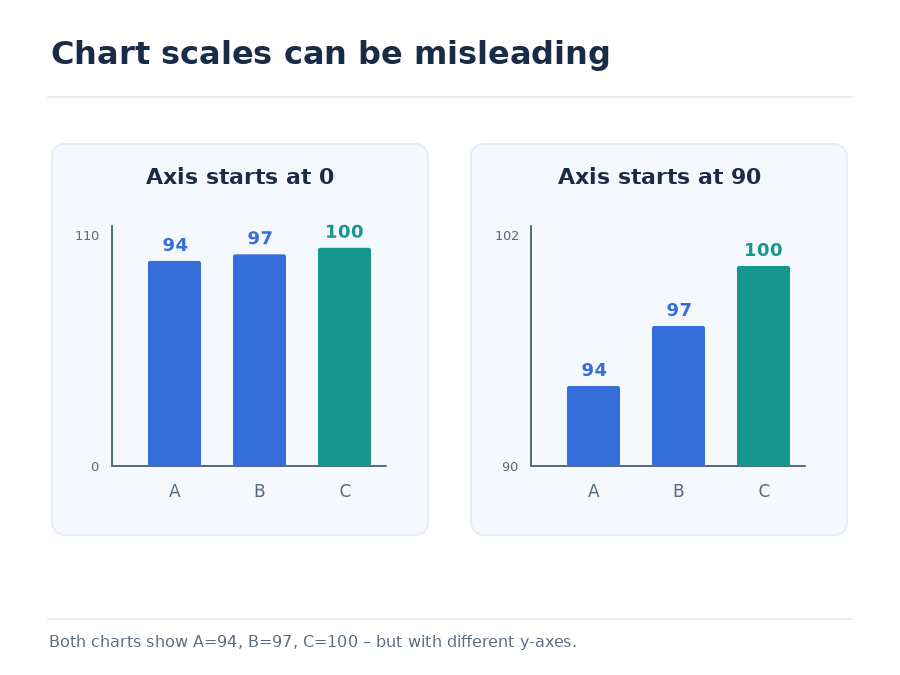

# M9-L2 – Data analysis, visualisation and statistical thinking {#L2}

**Course area:** M9 – Bachelor: Elective and practical areas

**Level:** Bachelor (elective / application)

**Prior knowledge:** No fixed prerequisites specified.

**Classification:** Optional Bachelor elective topic (M9-L2)

**Reading path:** M1-L5 (data and databases), M8-L1 (discrete structures), M9-L1 (usability) and M5-L3 (machine learning) are helpful. However, the lesson can be read on its own. It requires neither statistical software, programming nor exercises. In the mathematics course, School (German-language) M1-L6 introduces descriptive statistics. School M2-L16 and University M1-L7 explore random variables, samples and statistical tests in greater depth.

## Data does not automatically constitute knowledge {#S1}

A computer can record millions of rows and still deliver the wrong answer. A website reports 20,000 page views. Does this mean 20,000 people? Not necessarily: one person may load ten pages, a program may access the site repeatedly, and some accesses may be missed by the measurement. The number is technically plausible, but its meaning is unclear without a **definition**.

**Data analysis** means systematically examining, preparing, summarising and interpreting collected observations to answer a specific question. **Statistics** provides concepts and methods for describing patterns and assessing uncertainty. **Data visualisation** makes selected relationships visible. Above all, **statistical thinking** means asking *what* was measured, *among whom*, *under what conditions* and *what conclusion can legitimately be drawn*.

The entire chain can be understood as an architecture:

``` text
Real-world process (person, machine, event)
                 |
                 v
Measurement / collection / event log
                 |
                 v
Raw data + definitions + time of collection
                 |
                 v
Quality checks and traceable cleaning
                 |
                 v
Metrics / comparisons / statistical models
                 |
                 v
Chart + interpretation + uncertainty
                 |
                 v
Decision, observation or new question
```

Each transition may introduce errors. If a time zone change is overlooked, hourly usage figures may be grouped incorrectly. A duplicated data row can suddenly turn one job into two. Graphics software can make a tiny difference look dramatic. Data analysis is therefore not a one-off act of creating a chart, but a process that can be checked.

## A question determines the analysis {#S2}

Every calculation begins with a verifiable question. “How well is the application doing?” is imprecise. “How many of the import jobs started in the past seven days ended successfully?” can be checked. The second sentence specifies the *unit* (import job), *outcome* (successful completion), *population* (jobs started) and *period*.

Three questions should remain separate:

1.  **Description:** How many jobs were there, and how long did they take?
2.  **Explanation:** Are longer runtimes associated with file size or utilisation?
3.  **Question of effect:** Would an additional machine actually shorten the runtime?

The third question requires stronger evidence than the first. Two values may increase together without one causing the other. For example, both visits to a bathing area and sales of drinks increase on warm days. This does not mean that drink sales cause the number of visitors.

Before an analysis, it should also be clear *which decision* it is intended to support. If a report changes no action, a small overview may suffice instead of a permanent analytics cluster. Conversely, decisions with legal or safety implications may require several assessment methods.

## What exactly is a data row? {#S3}

A table appears unambiguous until we question its **unit of observation**. A record may represent a person, order, file, session, device measurement or processing step. Mixing these levels produces incorrect totals.

Consider a fictional media archive:

| File ID | Type | Size (MiB) | Import duration (s) | Outcome |
|---|---|---:|---:|---|
| M001 | Photo | 12 | 2 | Successful |
| M002 | Video | 240 | 18 | Successful |
| M003 | Photo | 8 | 3 | Successful |
| M004 | Audio | 70 | 7 | Failed |

Here **one row represents one import attempt**. If the same file is imported again, a new attempt with its own ID should be recorded. The total number of attempts is not the same as the number of distinct files.

The properties of a row are called **variables** or **features**. `Type` and `Outcome` are categorical features; `Size` and `Import duration` are quantitative features. An ID is not a meaningful number to average, even if it consists entirely of digits. A date field belongs on a timeline; free text can only be categorised after clear rules have been defined.

**Nominal categories** have no natural order, such as photo, audio and video. **Ordinal categories** have an order, such as low, medium and high; however, the distance between them is not automatically measurable. Quantitative values permit arithmetic statements if the unit and measurement scale are appropriate.

**Metadata** describes the data: measurement method, unit, source, time of collection, version, calculation and any filters. Without it, a number such as “75” is neither 75 milliseconds nor 75 euros nor 75 per cent. A good data model records the meaning even if other people read the report later.

## Data quality: checks precede calculations {#S4}

Typical problems include duplicated rows, missing values, inconsistent categories, invalid timestamps, mixed units and observations that do not belong to the specified population.

**Data cleaning** is the documented identification and handling of such problems. It should not secretly “smooth out” reality:

- An import duration of `-3 seconds` is physically implausible for a single completed process. It may indicate a clock error or an incorrect calculation.
- A missing price is **not** automatically a price of zero euros. `NULL`, “unknown” and `0` describe different states.
- The values `DE`, `Deutschland` and `Germany` may be assigned to the same country category; the decision belongs in a mapping table.
- Two identical rows may represent genuinely repeated events or a log that has been read more than once. Deletion is only appropriate once the **event ID** or collection procedure has been clarified.
- A surprisingly large value is not automatically a measurement error. Perhaps a rare large file really did occur.

Missing information may occur randomly, but it may also be concentrated systematically in particular groups. If users with slow connections frequently abandon their uploads and precisely those attempts are absent from the success report, average performance will be portrayed too positively. **Imputation** means replacing missing values with justified estimates. This is a modelling assumption and should remain visible rather than being confused with an actual measurement.

A practical procedure is to retain raw data unchanged, log checking steps, generate a separate cleaned table and flag questionable cases. Anyone who later makes a different cleaning decision can use this to reproduce the report.

## Descriptive statistics: what does a distribution look like? {#S5}

**Descriptive statistics** describes existing data. Its tools include frequencies, proportions, means, the median, dispersion, quantiles and graphical representations. Description does not yet justify drawing conclusions from one group about all people or future events.

### A fully worked example {#51-ein-vollständig-gerechnetes-beispiel}

In a fictional example, seven import jobs take the following numbers of seconds:

`2, 3, 3, 4, 5, 7, 18`

The **arithmetic mean** is the sum divided by the number of observations:

$\frac{2+3+3+4+5+7+18}{7}=\frac{42}{7}=6\,\text{seconds}$

The **median** is the middle value of the sorted list. Here the fourth position contains `4`, so **median = 4 seconds**. The **mode** is the most frequently occurring value: `3 seconds` (twice).

Why do the mean and median differ? The job taking 18 seconds pulls the mean upwards. If that value were excluded for a *separate* comparison, the mean of the remaining six jobs would be $\frac{24}{6}=4\,\text{seconds}$. Simply deleting that job would not be justified, however. It may be a rare, genuine heavy-load case that the operator particularly needs to understand.

The **range** is the largest minus the smallest value: $18-2=16\,\text{seconds}$. It is strongly affected by extreme values. **Quartiles** divide sorted values into sections. Under the convention explicitly used here, the median is excluded from the quartile calculation when the number of values is odd: the lower half `2, 3, 3` gives **Q1 = 3**, and the upper half `5, 7, 18` gives **Q3 = 7**. The **interquartile range** is $\mathrm{IQR}=7-3=4\,\text{seconds}$. Other statistical programs sometimes use different quantile conventions, so threshold values may differ slightly.

According to a commonly used *rule of thumb*, an upper outlier threshold is $Q_3+1{,}5\times\mathrm{IQR}=7+6=13\,\text{seconds}$. The value 18 would therefore **deserve flagging**, but would not automatically be wrong. The rule is an aid to investigation, not an instruction to delete data.

### Standard deviation and dispersion {#52-standardabweichung-und-streuung}

The **variance** averages squared distances from the mean; the **standard deviation** is its square root. It therefore has the unit seconds again. In our complete list of seven values, the mean is 6. The squared distances sum to:

$16+9+9+4+1+1+144=184\,\text{seconds}^2$.

If the seven jobs are treated as **the entire population under consideration**, the population variance is $\frac{184}{7}\approx26{,}29\,\text{seconds}^2$ and the population standard deviation is $\approx5{,}13\,\text{seconds}$. If the same list were analysed as a **sample** of a larger population, the simple unbiased sample variance under the usual assumptions would use the denominator $n - 1 = 6$ and give $\approx30{,}67\,\text{seconds}^2$, with a sample standard deviation of $\approx5{,}54\,\text{seconds}$.

The two calculations answer different questions; the denominators must not be exchanged without notice. A standard deviation alone does not indicate whether a distribution is symmetric or contains a few extreme cases. The median, quantiles and a distribution chart therefore often complement the mean usefully \[1\].

## Percentages, reference quantities and meaningful metrics {#S6}

A percentage must always make its **denominator** apparent. Out of 100 imports started, 90 succeed: a **90% success rate**. However, if 20 attempts are still running, the statement “90 out of 100 ultimately successful” would be premature. One could report the status as *90 successful, 10 failed, 20 pending* out of a total of 120 starts, or deliberately examine the completed jobs separately.

A **rate** relates events to a unit of time or quantity: for example, 30 import failures per 10,000 jobs, rather than simply “30 failures”. For time series, the measurement window must be included: 100 jobs in an hour represent a different load from 100 jobs in a day.

Percentages and **percentage points** are not the same. If a success rate rises from 60 to 75 per cent, the absolute increase is **15 percentage points**. Relative to the initial rate, this is $\frac{75-60}{60}=25\,\%$. Both descriptions are mathematically correct; however, simply stating “25% better” may easily sound exaggerated if the baseline is unclear.

### The weighted mean {#61-das-gewichtete-mittel}

An analytics report shows two job classes: 90 small jobs take an average of 1 second, and 10 large jobs take an average of 10 seconds. Simply averaging the class means gives $\frac{1+10}{2}=5{,}5\,\text{seconds}$, which is wrong for the **average duration of a randomly selected job**.

The **weighted mean** takes the different group sizes into account:

$\frac{90\times1+10\times10}{90+10}=\frac{190}{100}=1{,}9\,\text{seconds}$.

The number `5,5` would at most be the average *of two class means with equal class weighting* – a different question. Tables, charts and reports must therefore always disclose whether the weights are based on people, jobs, files or groups.

## Frequencies, distributions and probabilities {#S7}

A **frequency distribution** counts how often values or categories occur. Discrete categories can be counted directly; where many distinct numerical values exist, ranges are formed. The boundaries must be unambiguously specified, for example **$0 \le  t < 2$, $2 \le  t < 5$, $5 \le  t < 10$, $t \ge  10$ seconds**. Under this convention, a job taking exactly 2 seconds belongs to the second class and one taking exactly 10 seconds belongs to the last. The intervals do not overlap and leave no gaps in the non-negative measurement range. Other class boundaries are possible; their width changes the impression of the distribution.

**Probability** deals with a model of possible events, while **relative frequency** describes the observed proportion. If nine out of ten files were imported successfully, the observed success rate is 90%. This does not mean the next import has exactly a 90% probability of success. For that, conditions would need to be sufficiently stable and the sample informative.

**Conditional probability** means: how likely is an event *if* an additional condition holds? For example, the failure rate for videos may be higher than for photos. An overall rate conceals these differences. Conversely, small groups must be interpreted cautiously: one failure in two jobs gives 50%, whereas the same single failure in 2,000 jobs would give only 0.05%.

When assessing rare events, the **base rate** plays an important role. A fictional classifier is intended to identify 100 suspicious cases out of 10,000 events. It identifies 90 of the 100 genuinely suspicious cases (90% recall) and incorrectly flags 5% of the 9,900 non-suspicious cases: **495 false alarms**. It reports a total of $90 + 495 = 585$ suspicious cases. Only $\frac{90}{585}\approx15{,}38\,\%$ of these are genuinely suspicious. Although recall sounds high, a positive result is therefore usually a false alarm. **Precision** and **recall** answer different questions – a connection to M5-L3.

## Population, sample and selection bias {#S8}

The **population** is the set about which we want to make a statement: for instance, all customers, all requests this month or all videos to be processed in future. A **sample** is the observed subset. Not every sample represents the population.

A **random sample** uses a documented selection rule with known selection probabilities; under appropriate assumptions, this permits estimates of statistical error. A voluntary online survey, by contrast, may attract particularly satisfied or particularly dissatisfied people. More responses do not automatically eliminate this **selection bias**.

A distinction is made between **sampling errors**, differences arising from random selection, and **non-sampling errors**, such as incorrect questions, measurement errors, missing responses, incomplete coverage or erroneous processing. Even a census may contain non-sampling errors \[2\].

An example: of 100 randomly selected, independent cases, 60 are successful. The estimated proportion is $p = 0{,}60$. Under the assumptions of a simple binomial model, the estimated **standard error** is $\sqrt{\frac{0{,}6\times0{,}4}{100}}\approx0{,}049$, or approximately 4.9 percentage points. A rough normal approximation for a 95% **confidence interval** gives $60\,\%\pm1{,}96\times4{,}9\,\text{percentage points}$, or approximately **50.4% to 69.6%**. The exact limits depend on the chosen method.

This calculation is **not a guarantee** that the true proportion lies in this particular computed interval. In simplified terms, over very many repetitions of the same random sampling procedure, approximately 95% of the intervals constructed by this method would cover the fixed true parameter, provided the assumptions hold. The interval does not remedy systematic selection errors or poor measurement methods.

## Association is not causation {#S9}

**Correlation** describes how two quantities vary together. A positive correlation means that when one quantity is higher, the other also tends to be higher. A negative correlation means the opposite direction. The **Pearson correlation coefficient** `r` takes values between `-1` and `+1`; $r = 0$ means there is no *linear* relationship, but does not necessarily imply independence or the absence of non-linear relationships.

Three possible explanations for an observed association must be distinguished:

- **A causes B:** All else being equal, a larger file size can contribute to longer transfer times.
- **B influences A:** The reverse direction may also be plausible in other situations.
- **C influences A and B:** A third factor, such as high server utilisation, may increase both the failure rate and response time.

Chance, biased selection or a common trend over time are also possible explanations. **Causality** is a statement about cause and effect. Convincing causal claims require appropriate comparison groups, temporal ordering and control of possible confounders; randomised experiments are particularly informative in some situations, but are not always possible or ethically acceptable.

### Simpson’s paradox: better in every group – worse overall? {#91-simpsons-paradoxon-alle-gruppen-besser-insgesamt-schlechter}

A fictional test compares two algorithms. Algorithm B is more successful **within both difficulty groups**, but is used disproportionately for difficult cases:

| Difficulty | Algorithm A | Success rate A | Algorithm B | Success rate B |
|---|---:|---:|---:|---:|
| Easy | 81 out of 90 | 90% | 19 out of 20 | 95% |
| Difficult | 1 out of 10 | 10% | 16 out of 80 | 20% |
| **Overall** | **82 out of 100** | **82%** | **35 out of 100** | **35%** |

**B leads in every group**, yet A has the higher overall rate. The contradiction disappears when the **different composition** is considered: A handles predominantly easy cases, B predominantly difficult ones. This is called *Simpson’s paradox*. Without knowledge of group membership, a dashboard could suggest the wrong technical decision.

The right question is therefore not merely “Which rate is higher?”, but also “Are the cases comparable in both groups?” In turn, the grouping must not be arbitrarily chosen afterwards to produce a desired result.

## Time series, seasonality and changing systems {#S10}

A **time series** orders measurements by time. Daily website accesses, hourly GPU utilisation and weekly failure rates are typical examples. Such measurements have particular characteristics: weekly patterns, public holidays, growth, short-term outages and changes in measurement methods.

A **trend** is a longer-term direction, **seasonality** a recurring pattern and **noise** a short-term fluctuation. A **moving average** smooths values over a rolling time window. It may make a trend more apparent, but can conceal brief security incidents. An alert should not be based exclusively on a smoothed monthly average if outages lasting seconds are critical.

A distinction must also be made between **stock** and **flow**: “Storage contains 500 GiB” is a stock at a point in time; “20 GiB were uploaded today” is a flow over a time interval. The two cannot simply be summed using the same logic \[3\].

For cloud services, reports must account for the correct **time zone**, daylight saving changes, late-arriving events and repeated messages. Otherwise, apparent user growth may arise merely because a new log source was added. Comparable periods and consistent counting definitions are prerequisites for a sound analysis of change.

## Good data visualisation: which chart matches the question? {#S11}

A chart should clearly show a specific relationship. The UK **Office for National Statistics** (ONS) recommends making the choice according to the data type and purpose of the statement and using simple, familiar representations where possible \[3\].

{alt="Comparison of identical data with a full and a truncated y-axis"}


| Question | Suitable representation | Typical pitfall |
|---|---|---|
| Which category is larger? | Bar chart | Truncated zero baseline |
| How does something change over time? | Line chart | Treating unequal time intervals as equal |
| How are numbers distributed? | Histogram or box plot | Inappropriate class width |
| How are two numbers related? | Scatter plot | Interpreting correlation as causation |
| What share of the whole does a group account for? | Stacked bar or simple table | Cluttered pie charts with many categories |
| Where do events occur? | Map, if location is genuinely relevant | Comparing area rather than normalised rates |

**Bar charts** use length to represent quantities and should start at a zero baseline. If two bars for 98 and 102 units are drawn starting at 95 rather than zero, the difference looks enormous: the visible lengths would be 3 and 7 instead of 98 and 102. The numbers differ by only around **4.08%** ($\frac4{98}\times100$), not by more than a factor of two. For **line charts**, justified selections of the y-axis may be useful, provided labels and context make the selected range clear. This is different from a deceptively truncated bar chart \[4\].

**Histograms** differ from ordinary bar charts: their classes are intervals of numerical values. The choice of class width can create or hide two apparent peaks. **Box plots** show typical location and dispersion, but may obscure the precise shape of a multimodal distribution. Anyone looking for critical individual events needs additional information.

**Scatter plots** show pairs of values and help identify non-linear relationships or group differences. Overlapping points can conceal frequency; transparent points or aggregated densities may help. Coloured points must be distinguishable even without colour perception.

## Good charts are also accessible and traceable {#S12}

A visualisation needs a factual title, clear axes, **units**, time period, data source and, where necessary, notes about estimates or missing values. A title such as “Uploads by week, January to March 2026” is more informative than “Performance”.

**Accessibility** is part of this: sufficient contrast, distinction by more than colour alone, explanatory labels and a table or textual summary of the key values. A screen reader can extract little from a graphic alone without accessible information; the insight should therefore also be available in text form. This connects the elective to M9-L1 \[5\].

A **logarithmic axis** can display several orders of magnitude, but is harder for many readers to understand and should be explicitly labelled. Two y-axes with different scales may suggest a strong relationship that does not exist mathematically. A series of 2D charts is often easier to read than a decorative 3D representation.

On maps, the size of a region must not be confused with the frequency of an event. A large region may have more cases in absolute terms and still have a lower **rate per inhabitant** than a small region. A report should therefore often show both absolute numbers and normalised rates.

Before every publication, it is worth asking: *Which interpretation is the chart likely to suggest at first glance – and is that interpretation justified by the data?*

## Exploratory analysis, hypothesis tests and significance {#S13}

**Exploratory data analysis** (EDA) looks for structures and surprising observations. This is legitimate and useful, but an anomaly discovered afterwards should not be treated as if it had been predicted before examining the data.

A **hypothesis test** examines a clearly stated assumption using a statistical model. The **p-value** describes, under the assumed null hypothesis and model conditions, how unusual the data or more extreme results would be. It is **not** the probability that the null hypothesis is true, nor the probability that the finding is “just chance” \[6\].

The widely used threshold $p < 0{,}05$ is not a seal of truth. Trying a hundred charts or group comparisons and reporting only the most striking result encourages **multiple testing problems** and *p-hacking*. A sound presentation specifies the hypotheses investigated, selection rules, effect sizes, uncertainty and possible limitations. **Statistical significance** is not the same as **practical relevance**: a tiny improvement may stand out statistically in very large datasets and still yield less benefit than the operational and development costs.

For decisions, the following is often more important: how large is the estimated difference? What uncertainty remains? How costly is a wrong decision? Can the experiment be repeated? A good analysis may end with “The data is not yet sufficient for this.”

## From A/B testing to a reliable decision {#S14}

In an **A/B test**, groups that are as comparable as possible are randomly assigned to different variants. For example, users randomly see an old or a new import interface. Measurements cover not only how many click “Start”, but whether the task is actually completed successfully and whether errors or abandonments occur.

The outcome measure, target group, duration, planned comparison method and **stopping conditions** are specified in advance. Random assignment should be defined persistently per person or session so that the same person does not continually switch variants. If devices, countries or usage times are unevenly distributed, the results may be biased.

An often overlooked point: **the measurement must match the decision.** If variant B generates more clicks but fewer successful uploads, the higher click rate does not constitute success. Similarly, an improvement in average waiting time must not come at the expense of severe outages or poorer accessibility.

When looking at test results repeatedly each day, random fluctuations may be tempting. A test should not be stopped simply because a desired interim result briefly appears significant. An observational study can also be valuable, provided it is not falsely presented as a randomised experiment.

## Data analysis and artificial intelligence: the same problems, greater consequences {#S15}

An AI model processes the same types of data quality problems on a larger scale. A **training dataset** provides learning examples; a **validation dataset** supports model selection and tuning; a **test dataset** is intended to enable final evaluation on previously unused cases. The split must not allow information from the test dataset to leak into training.

This problem is called **data leakage**, or leakage between training and evaluation phases: if, for instance, the standardisation of a variable is calculated using the mean of all data, including the test cases, test information influences model preparation. This can artificially increase measured quality. The official scikit-learn documentation therefore recommends splitting the data correctly first and *learning* preprocessing only from the training data \[7\].

Even seemingly unambiguous model metrics depend on context. M5-L3 already showed how high overall accuracy can be misleading for rare events. When comparing two language models, it should additionally be clear whether the same tasks, identical assessment rules, model versions, output limits and random conditions were used. A change in data composition may improve the mean although the model performs worse in a subject-critical group.

**Data drift** describes changes in the distribution of input data, for example when small photos are suddenly replaced predominantly by high-resolution videos. **Concept drift** refers to a change in the relationship between inputs and the outcome to be predicted. Both can weaken a previously good model. Monitoring systems may flag notable changes, but must distinguish genuine problems, seasonal patterns and changes in logging.

A language model can formulate metrics or describe charts. However, it is **not a substitute for traceable calculations on data**. If numbers are mentioned in an AI response, they should come from verified data queries or calculation tools. An automatically generated management report therefore needs clear sources, dates, rounding rules and, where appropriate, human approval.

## Practical architecture 1: understanding the local media archive {#S16}

A private archive stores files, categories and import events. Its operator wants to know why importing large videos takes longer than importing small images. Cloud analytics is not necessarily needed.

``` text
Local files / import logs
             |
             v
SQLite or another local database
             |
             v
Checks: units, duplicate attempts, timestamps
             |
             v
Grouping by file type and size class
             |
             v
Median + quantiles + rare failure cases
             |
             v
Table / simple report / chart
```

The median import duration by file type shows typical runtimes, whereas high quantiles and extreme cases can point to bottlenecks. A single average might obscure the large video import. If the same file has been imported several times, the question determines whether each attempt or only the first successful import should be counted.

**Useful** when many files are processed and bottlenecks are no longer apparent from individual observations. **Unnecessarily elaborate** when there are only ten manually managed files. A local database with a regularly generated report may suffice; clusters, distributed data processing and GPU models would create more maintenance than insight. Private filenames and metadata need not be transferred to a third-party service merely for statistics.

## Practical architecture 2: an online service with honest metrics {#S17}

A paid online analytics service wants to know how many jobs arrive, how many are paid for and which actually end successfully. A typical process:

``` text
Website / API / billing
          |
          v
Events with a unique job ID
          |
          v
Job database / controlled event log
          |
          v
Cleaned periodic analysis
          |
          +--> technical metrics: failures, latency, load
          |
          +--> business metrics: paid, completed
          |
          v
Dashboard with period, denominator, source, filter
```

A payment event must not be counted three times because the payment service has sent the same notification repeatedly. Equally, a completed job does not automatically mean a satisfied customer. Technical success rates, revenue metrics and user satisfaction measure different things.

**Useful** metrics are small and traceable: the number of uniquely paid jobs, the completion rate per job started, the 95th percentile of runtime and clearly defined failure rates. A **percentile** indicates what proportion of values does not exceed a threshold – under an appropriate definition, approximately 95% are at or below the 95th percentile. The precise calculation conventions and measurement windows belong in the documentation.

**Operational risks:** A public dashboard may reveal trade secrets; small customer groups may potentially be identifiable. Access controls, deletion rules, data minimisation and the separation of raw data from aggregated reports are important. An additional analytics platform is only worthwhile when the volume of data, user needs and requirements for timely results justify it.

## Practical architecture 3: an AI service monitors its quality {#S18}

A document-based AI assistant answers questions using company documents. Operators want to know whether new versions become **more accurate** and how often they produce unsupported claims. A simple “Users gave it 4.6 stars” may reveal little about this: satisfied users may only be rating the friendliness of the wording, not factual correctness.

``` text
Versioned set of verified questions and evidence
                    |
                    v
Test run with model version A and model version B
                    |
                    v
Assessment: faithfulness to evidence, correctness,
            refusal, runtime, costs and problematic outputs
                    |
                    v
Comparison by question group and difficulty level
                    |
                    v
Interpretation + uncertainties + approval decision
```

The **evaluation data** should not also have been known as training answers and used to tune the model. In addition, high-risk subject-specific questions must not disappear in the average of a large number of easy questions. For example, average quality may rise while rare but important safety questions are answered incorrectly more often.

**Useful** measures include versioned test sets, defined assessment criteria, documented model parameters and human review of critical outputs. **It would not be sensible** to use a single overall score as the basis for sweeping safety claims. Sensitive original documents or user data should not be copied into public analytics services without examination. Computing and token costs increase with the frequency and scope of tests; a targeted selection of informative test cases is therefore often more economical than endless measurement.

## Costs, maintenance, data protection and accountability {#S19}

Analytics has **ongoing costs**: data collection, storage, cleaning, computing time, visualisation, checking, access management and later adjustments. Technical quality also depends on who defines a metric over the long term and who reviews changes to it.

A **data catalogue** or a concise **metrics handbook** can record the name, definition, numerator/denominator, units, filters, time window, data source, update frequency, responsible persons and outstanding limitations. Such an entry is often more important than an expensive dashboard whose numbers no one can reliably explain.

For personal information, the principles of the **General Data Protection Regulation (GDPR)** apply, including purpose limitation and data minimisation. Not every technical identifier is harmless: IP addresses, device identifiers or pseudonymous user IDs may relate to individuals. **Anonymised** does not simply mean “name removed”. Group statistics with very small case numbers can disclose individual information. Data retention and access should therefore be aligned with the legitimate purpose. Specific legal issues require separate assessment; this lesson is not a substitute for legal advice.

**Fairness** and **responsibility** also matter. An overall analysis can hide systematic disadvantages for particular user groups. At the same time, highly granular group analysis may itself create data protection problems. Good practice seeks a justified balance: detecting relevant problems without creating unnecessary personal profiles.

When data changes, comparability and **versioning** are crucial. If the definition of an “active user” has changed, a time series may need to be recalculated or clearly interrupted. An alarming jump in the chart may merely reflect the introduction of new tracking. A data analysis process should therefore accommodate audit logs, known limitations and follow-up questions.

## When is a table sufficient – and when is more needed? {#S20}

Not every data question requires machine learning, a central data lake or a complex dashboard. For a few hundred local records, an SQL query, a table and a carefully explained chart are often sufficient. An **SQL query** (*Structured Query Language*) can, for example, group and count jobs by state; however, the substantive question is independent of any programming language.

Larger analytics environments become interesting when data from many systems needs to be combined, changes must be tracked continuously or numerous reports have to be generated consistently. Data pipelines, scheduled processing, versioning and possibly distributed computing methods from M4-L1 then come into play. **Scaling** does not create correct definitions: a billion incorrectly classified events produce a very large report, but not automatically a correct one.

A sensible decision sequence is:

1.  Is there a clearly formulated question and a meaningful reference quantity?
2.  Are the data sufficiently complete and correctly defined?
3.  Which simple metric or table would answer the question?
4.  What can *not* be concluded from it?
5.  Does a graphic help, or is it merely decorative?
6.  Do the results need regular monitoring, checking and protection?
7.  Is the additional operational effort justified by the actual gain in knowledge?

## Classification, key principles and connections to mathematics {#S21}

**Data consists of measurements with an origin and a meaning.** The appropriate average depends on the question. A percentage is incomplete without a denominator. Outliers require investigation rather than reflexive deletion. Small samples produce greater uncertainty; systematic errors do not disappear even with very large samples. Correlation does not establish causation, and a statistically significant figure is not automatically important in practice.

**Good visualisation** makes comparisons readable, preserves proportions and states the source, period and uncertainty. **Good AI evaluation** accounts for representative test cases, data leakage, rare errors, different user groups and actual operational costs. The same critical perspective helps when reading news statistics, making product decisions and examining scientific publications.

For further mathematical study, School (German-language) M1-L12 on combinatorics, School M1-L22 on conditional probability and University M1-L5 on linear algebra are also suitable. Computer Science M8-L1 introduces sets and functions. This lesson focuses on data pipelines, system boundaries and the interpretation of results.

**Outlook:** M9-L3 applies computer science to embedded devices, sensors and microcontrollers. This creates a direct connection between measurement errors, sensor data and the data checks learnt in this chapter.

## Position within the course-wide reading paths {#S22}

This is an **optional Bachelor elective lesson**, not an additional main-course lesson. The conceptual bridge leads, among other places, to [M7-L5 in the Master core](M7-L5.md). Further routes: [course-wide reading paths](pages/path.md) and [course index](pages/index.md).


## Sources {#S23}

**Last source check:** 04.11.2026

**Checked on 04.11.2026.** The following original or official specialist sources support the concepts, basic rules and limits of interpretation. All numerical examples in this lesson are explicitly **original, fictional teaching data**, not measurements from these sources.

1.  **NIST / SEMATECH:** *Engineering Statistics Handbook*, “Measures of Location” (mean, median, mode). [https://itl.nist.gov/div898/handbook/eda/section3/eda351.htm](https://itl.nist.gov/div898/handbook/eda/section3/eda351.htm)
2.  **U.S. Census Bureau:** *Survey of Construction – How the Data are Collected*, section “Reliability of Data” (sampling and non-sampling errors). [https://www.census.gov/construction/soc/methodology.html](https://www.census.gov/construction/soc/methodology.html)
3.  **UK Office for National Statistics (ONS):** *Choosing a chart type* (relationship to the question, time series, stock/flow). [https://service-manual.ons.gov.uk/data-visualisation/chart-types/choosing-a-chart-type](https://service-manual.ons.gov.uk/data-visualisation/chart-types/choosing-a-chart-type)
4.  **ONS:** *Axes and gridlines* (zero baseline for bar charts, consistent scales, limitations of dual axes). [https://service-manual.ons.gov.uk/data-visualisation/guidance/axes-and-gridlines](https://service-manual.ons.gov.uk/data-visualisation/guidance/axes-and-gridlines)
5.  **ONS:** *Using colours in charts* (accessibility and comprehensible colour coding). [https://service-manual.ons.gov.uk/data-visualisation/colours/using-colours-in-charts](https://service-manual.ons.gov.uk/data-visualisation/colours/using-colours-in-charts)
6.  **American Statistical Association (ASA):** Wasserstein/Lazar (2016), *The ASA Statement on p-Values: Context, Process, and Purpose*, DOI: 10.1080/00031305.2016.1154108. [https://doi.org/10.1080/00031305.2016.1154108](https://doi.org/10.1080/00031305.2016.1154108)
7.  **scikit-learn:** *Common pitfalls and recommended practices* (data leakage in preprocessing and model evaluation). [https://scikit-learn.org/stable/common_pitfalls.html](https://scikit-learn.org/stable/common_pitfalls.html)

**Limits of the lesson:** The confidence interval calculation assumes a simple model; Simpson’s paradox is a didactic construction; no number describes real providers, users or system performance. Actual research requires study design, quality control and appropriate specialist statistical methods.
