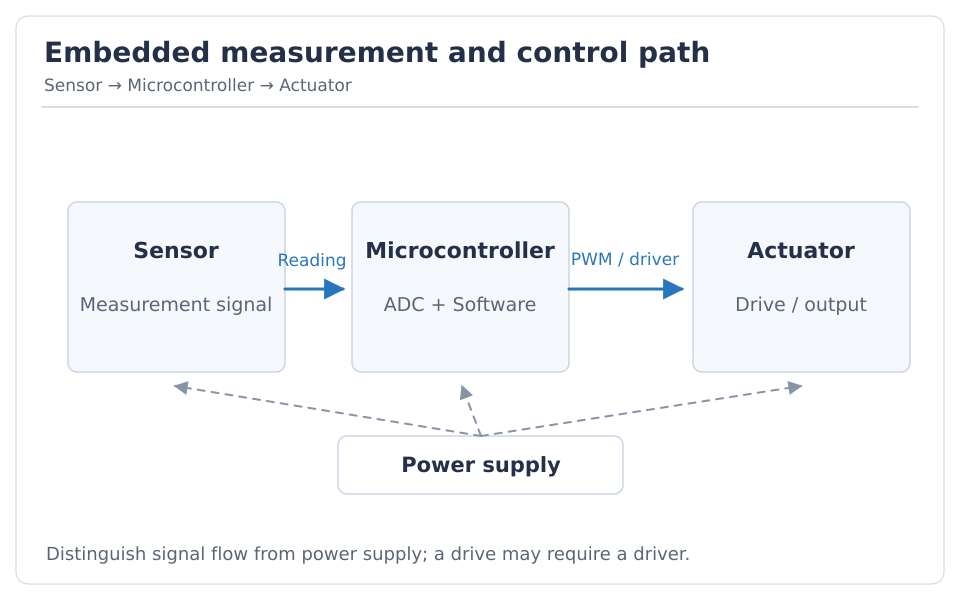

# M9-L3 – Embedded systems, sensors and microcontrollers {#L3}

**Course area:** M9 – Bachelor: Elective and practical areas

**Level:** Bachelor (elective / application)

**Prior knowledge:** No fixed prerequisites specified.

**Classification:** Optional Bachelor elective topic (M9-L3)

**Reading path:** M1-L2 (computer architecture), M1-L6 (networks), M8-L3 (operating systems and concurrency) and M6-L7 (robotics) are useful. However, the lesson can be read without these texts. It requires neither the purchase of electronics, programming exercises nor installation. The connection to mathematics concerns functions, quantities and units, vectors, simple rates of change and, later, differential equations. Specific module identifiers in the separate mathematics course have not been verified.

## A computer that is intended to perform a specific task {#S1}

A washing machine must control a motor and take water levels into account. A smoke detector must respond to a particular event. A digital camera must read its image sensor long before the image might be edited on another computer. Computer science is embedded in such devices, even if they have no desk, screen or web browser.

An **embedded system** is a computing system integrated into a larger technical device or process, where it performs specific tasks. The task limits which hardware and software are appropriate. Some embedded systems run for years on a few milliwatts; others process camera images on powerful chips. They therefore need not be small, but usually have more clearly defined tasks and constraints than a general-purpose PC.

The **microcontroller** is a common, but not the only, foundation for such systems. It combines a processor, working memory and many input/output functions on a single chip. A **sensor** measures a physical quantity such as temperature, light or movement. An **actuator** affects the environment, for example a motor, heater or valve. Between them are software, electrical interfaces, a power supply and often protective mechanisms.

``` text
Physical environment
       |                      ^
       v                      |
  Sensor / switch        Actuator / motor
       |                      ^
       v                      |
Measurement / input -> Microcontroller -> Control signal
                           |
                     Program state
                           |
                  optional: network / cloud
```

The most important perspective is **feedback**: not merely processing data, but dealing with consequences in the real world. If a computer outputs incorrect numbers, this is inconvenient. If it opens a valve at the wrong time, the damage may be physical. Fault states, power supply and safe shutdown therefore belong to the architecture, not merely to the documentation.

## Microcontrollers, microprocessors and single-board computers {#S2}

An ordinary desktop processor usually requires external memory modules, a complex chipset and an operating system. A microcontroller is more highly integrated. Its program can start directly when power is switched on, without a graphical interface. A **single-board computer** (SBC) such as a Raspberry Pi running Linux, by contrast, resembles a small, complete PC. Both can read sensors, but their strengths differ.

| Architecture | Typical strength | Common limitation |
|---|---|---|
| Microcontroller (MCU) | Low energy use, direct peripherals, readily controlled responses | Little RAM and computing power, restricted software environment |
| Microprocessor/SoC with Linux | Large applications, network services, image processing | More complex start-up, higher energy needs, usually no hard real-time guarantee |
| Specialised circuit | Very precise or fast individual task | Less flexible, more costly to modify |

**MCU** stands for *Microcontroller Unit*. **SoC** means *System on a Chip*, a chip integrating several computing and functional blocks. The terms overlap: some modern SoCs contain both powerful processor cores and small real-time cores. There is no rigid boundary.

The Raspberry Pi **RP2040** serves as a concrete, non-prescriptive product example. According to the official datasheet, it has two Arm Cortex-M0+ cores, 264 KiB of on-chip SRAM and hardware blocks for, among others, I²C, SPI, UART and PWM. The program is typically stored in external flash memory. The precise design of a board depends on its circuitry. These figures describe **this one product**, not all microcontrollers. [Source: Raspberry Pi, RP2040 specification, checked 04.11.2026](https://www.raspberrypi.com/products/rp2040/specifications/).

**When is a microcontroller unnecessary?** For an existing website that collects data and displays charts, a server often suffices. An additional sensor chip solves no problem there. Conversely, a complete Linux computer would often be unnecessarily complex for a single battery-powered door contact sensor.

## What is inside the chip? {#S3}

A microcontroller normally has a processor core, registers, working memory and various **peripheral blocks**. Peripherals are specialised functions that need not be executed as general-purpose program code. For example, a timer counts clock pulses while the processor does other things. A communication block transmits bits according to a specified protocol. An analogue-to-digital converter processes voltages.



The sensor, microcontroller and actuator form a measurement and control path.

``` text
                 MICROCONTROLLER
 +--------------------------------------------------+
 | CPU core(s)       RAM       Flash / flash access |
 |      |             |              |              |
 |      +---------- internal bus ----+              |
 |                         |                        |
 | GPIO    Timer/PWM    ADC    I²C/SPI/UART           |
 |  |         |          |        |                 |
 +--|---------|----------|--------|-----------------+
    |         |          |        |
 Switch     Motor      Analogue  Digital
 /LED       driver     sensor    sensor
```

**RAM** (*Random Access Memory*) is volatile working memory. **Flash** is non-volatile memory for programs and persistent data. Not every chip has internal program memory; on the RP2040 mentioned above, the code is usually stored in external flash. Some microcontrollers have additional non-volatile memory cells, others do not. Available RAM is often so small that buffering entire files without checking their size is not an option.

**Registers** are small, rapidly accessible storage locations. Particular registers control hardware: a bit can, for example, determine whether a pin is an input or an output. In practice, applications often use driver libraries for this purpose. The driver translates a general instruction such as “read sensor value” into the required register accesses and transmissions.

Software thus need not manage every electrical detail itself. Nevertheless, knowledge of hardware limits remains important: two pins may require the same internal function; a communication block may currently be busy; a memory buffer may be full. Such bottlenecks cannot be resolved simply by programming faster.

## Electrical signals: digital and analogue {#S4}

Computers calculate using discrete states. The physical world, by contrast, often changes continuously. A lamp can grow brighter, temperature rises gradually and a motor rotates at varying speeds.

A **digital input signal** is interpreted as a logical state, for example “0” or “1”. This does not necessarily mean exactly zero or another specific voltage. The chip distinguishes valid low and high levels using electrical thresholds. Ambiguous levels, excessive voltages or missing ground connections may cause malfunctions or damage. The limits are stated in the particular datasheet, not in a universally applicable 3.3-volt rule.

**GPIO** stands for *General-Purpose Input/Output*, meaning universally usable input/output pins. A GPIO can, for example, read the state of a button or set a digital signal. **Pull-up or pull-down resistors** establish a defined default state so that an unconnected input does not fluctuate randomly. A mechanical button may briefly “bounce” when pressed: its contact changes several times in a very short period. Software or additional circuitry can therefore **debounce** the signal.

An **analogue signal** may take many voltage values within a range. An **analogue-to-digital converter (ADC, Analog-to-Digital Converter)** converts it into a digital measurement code. It is limited by resolution, input range, sampling rate, noise and other characteristics. A converter with higher resolution does not automatically measure more accurately. Conversely, a digital temperature sensor can calculate its own measured value and transmit it via I²C; the main controller then does not need to read an analogue voltage.

The principle can be understood without hardware:

``` text
Temperature -> sensing element -> electrical quantity
                                      |
                      +---------------+---------------+
                      |                               |
                      v                               v
              Analogue voltage                  Digital sensor
                      |                               |
               ADC in controller                Measurement chip with its
                      |                         own conversion and protocol
                      +---------------+---------------+
                                      |
                                Measured value
```

A measured value becomes a physical statement only when its **unit, scaling and calibration** are known. “Value 1800” might be an ADC number, but not a temperature. Even correct software cannot magically improve a wrongly mounted, heated or poorly calibrated sensor.

## Numerical example: what does twelve-bit measurement resolution mean? {#S5}

Imagine an idealised ADC with **12 bits** and a reference range of **0 to 3.3 volts**. Twelve bits allow $2^{12}=4\,096$ different codes, usually from 0 to 4095. The calculated distance between adjacent quantisation levels is:

$\frac{3{,}3\,\mathrm{V}}{4\,096}=0{,}0008056640625\,\mathrm{V}$, or around **0.806 millivolts**.

If the converter measures code 2048, for example, a simple idealised mapping gives approximately:

$\frac{2\,048\times3{,}3\,\mathrm{V}}{4\,096}=1{,}65\,\mathrm{V}$.

The number 2048 therefore means *approximately half the reference voltage*. It is not proof that exactly 1.650000 volts are present at the input. In real ADCs, the **effective number of bits (ENOB)** may be lower than the nominal 12-bit resolution because of noise and distortion. ENOB is a metric of dynamic converter performance under particular measurement conditions, not simply the number of output bits; for precision measurements, further quantities such as noise and calibration must be considered separately. The actual conversion may be implemented differently according to the datasheet, calibration procedure, endpoint definition and circuitry; sensor and converter errors also apply. The example initially describes only a **theoretical resolution**, not a guaranteed **measurement accuracy**.

Three concepts here must not be confused:

- **Resolution:** How finely can the measurement range be subdivided digitally?
- **Accuracy:** How close is the measurement to the true value?
- **Precision/repeatability:** How much do repeated measurements vary under comparable conditions?

Noise, supply voltage, temperature drift, cable length, interference from a motor and quantisation may affect the measurement. Measuring several times and averaging can reduce random fluctuations, but does not automatically eliminate a systematic calibration error.

**Sampling rate** is the number of measurements per unit of time. A temperature sensor may need only one value per minute. Much more frequent measurements are necessary to analyse rapid oscillations. According to the Nyquist–Shannon sampling theorem, a suitably band-limited signal theoretically requires more than two samples per period of the highest frequency it contains to make complete reconstruction possible in principle. Practical systems also require suitable filters, sufficient quality and often a safety margin.

## Outputs, PWM and actuators {#S6}

A microcontroller pin can supply digital signals, but **cannot power arbitrary loads**. A motor, solenoid valve or powerful heater typically needs a suitable driver, a separate power stage and protective circuits. A motor connected directly to an unsuitable pin can damage the microcontroller. For a reading-only concept, it is enough to understand that necessary power electronics lie between “the software requests movement” and “the motor moves”.

**PWM** stands for *Pulse Width Modulation*. An output switches very rapidly between two states. The proportion of on-time within one period is called the **duty cycle**. With an ideal 25 per cent duty cycle, the output is on for one quarter of every period. With suitable circuitry and a suitable load, this can be used, for example, to influence the average energy supplied and thus the brightness of a light-emitting diode.

``` text
PWM period:    |---------|---------|
Signal on:     |██       |██       |
Signal off:    |  _______|  _______|
                20% on    20% on
```

The illustrated signal is for demonstration only. The duty cycle must correspond to the actual pulse width. For motors, the effect also depends on inductance, driver, load and feedback control. PWM frequency is a separate quantity: a 50 per cent duty cycle does not reveal whether there are a hundred or ten thousand periods per second.

**Closed-loop control** differs from simple open-loop control. In open-loop control, an output is specified. Closed-loop control additionally measures the effect and repeatedly adjusts the output. A thermostat compares temperature with a setpoint. A motor controller compares measured and desired rotational speed. If the sensor becomes implausible, the system must determine which reaction is safe. This differs according to the device and requires its own safety analysis.

## How devices communicate: GPIO, UART, I²C, SPI and CAN {#S7}

Many components are not useful as isolated units. A microcontroller must communicate with sensors, displays, memory chips and other control units. Electrical interfaces and **communication protocols** provide this: agreements on how bits are transmitted and understood.

**UART** means *Universal Asynchronous Receiver-Transmitter*. It is a widely used form of serial transmission without a shared transmitted clock line. Transmitter and receiver must use compatible settings, such as data rate and frame format. The UART electronics alone do not determine the meaning of a received byte.

**I²C** stands for *Inter-Integrated Circuit*. It is a shared bus with normally one data line and one clock line. A controller communicates with addressed devices. Several sensors can share the lines if their addresses, bus loading and electrical design are appropriate. The terms “Controller” and “Target” correspond to the current documentation; older texts often use “Master” and “Slave”.

**SPI** means *Serial Peripheral Interface*. Common variants use a clock, data lines and a select line for each addressed device. Many SPI connections are suitable for fast peripherals; however, they are not automatically suitable for long cables.

**CAN** stands for *Controller Area Network*. It is important in vehicle and industrial environments because several participants can communicate via a shared bus and prioritise messages. Separate specifications apply to physical connections, data integrity and error signalling. A CAN message is not inherently encrypted or authenticated against malicious participants.

| Interface | Broad strength | Typical limitation |
|---|---|---|
| GPIO | Direct, simple signal | No complete data protocol |
| UART | Straightforward point-to-point data | Framing and payload format must be agreed |
| I²C | Several peripheral devices on a shared bus | Addressing, electrical load and cable length must be considered |
| SPI | Often fast peripheral communication | Additional lines; precise characteristics depend on the device |
| CAN | Robust bus communication in the right environment | Interface hardware and higher-level protocols required |

The choice depends on the **sensor and environment**, not on a universal winning technology. Zephyr's official driver overview describes separate APIs for GPIO, ADC, I²C, SPI, CAN and PWM, for example. [Source: Zephyr Project, Peripherals, checked 04.11.2026](https://docs.zephyrproject.org/latest/hardware/peripherals/index.html).

## Polling, interrupts and DMA {#S8}

A program could check a hundred times per second: “Has the button been pressed?” This is called **polling**, or repeated querying. It is simple, but may consume computing time if poorly designed and may miss brief events. An **interrupt**, by contrast, is a request to interrupt the processor, for example when an input changes state or a timer expires. The CPU then executes an appropriate short **interrupt handler** and resumes its normal work.

``` text
Normal operation: evaluate readings ---> update memory
                              |
Button event -----------------+----> Interrupt
                                     |
                                     v
                                 Record event
                                     |
                                     v
                                 Resume normal work
                                     |
                                     v
                                 Handle event safely
```

It is important to distinguish **rapid response** from **extensive processing**. As a rule, an interrupt handler should remain short, save critical data and hand further work over to a normal part of the program or an operating system task. Long calculations or uncontrolled waiting times within an interrupt may block other events. The particular software environment determines which functions are permitted within an interrupt.

Many Arm Cortex-M processors use the **Nested Vectored Interrupt Controller (NVIC)** for this purpose. It supports the assignment of interrupt sources and priorities; details vary between Cortex-M variants. [Source: Arm CMSIS-Core, Interrupts and Exceptions, checked 04.11.2026](https://arm-software.github.io/CMSIS_6/main/Core/group__NVIC__gr.html).

**DMA** stands for *Direct Memory Access*: suitable hardware transfers data between peripherals and memory without the processor having to copy each byte individually. This can save computing time. However, it requires correct coordination of buffers, data consistency and transfer completion. DMA does not automatically make a faulty application safe.

## Time is not just speed: real time {#S9}

A system is not **real-time capable** merely because it usually responds quickly. In real-time computing, **time limits** within which a response is required are what matters. A measurement, for example, must be evaluated by a specified time at the latest. A poor response time may be more serious than an algorithm that is slower on average.

A **deadline** is such a time limit. **Latency** refers to the delay between an event and the response. **Jitter** is the variation in this delay. A distinction is often made between **hard real time**, where exceeding a deadline counts as system failure, and **soft real time**, where individual late results may be tolerated in some circumstances.

This can be distinguished on three temporal levels:

``` text
Sensor detects obstacle
        |
        v
Local interrupt / measurement  as short and bounded as possible
        |
        v
Local safety function           fixed requirements, independent of cloud
        |
        v
Motor control / driver         defined response chain
        |
        +----> optional: logging -> Wi-Fi -> cloud analytics
```

The cloud can collect states or recommend a route. For a machine with corresponding safety-critical requirements, however, it must not be the only entity responsible for stopping the machine when danger suddenly arises. Network delays and interruptions to wireless connections cannot be ruled out in principle. A language model likewise provides no universally guaranteed real-time response.

In practice, a maximum response time comprises several components: sensor detection, data transmission, scheduling, processing, output driver and mechanical effect. Even if the CPU responds within one millisecond, a moving mechanism may take considerably longer to stop. A real safety concept requires measurements, protective devices, assessment against standards and specialised professional expertise; this lesson provides **no** approval for real machine controls.

## Does a microcontroller need an operating system? {#S10}

Not always. A simple program can run in a main loop after power-on: it reads the sensor, updates states, controls outputs and begins again. This is often called **bare metal**, because the application runs directly on the hardware. A small **state machine** can already organise all relevant processes, for example `RUHE -> MESSEN -> PRUEFEN -> MELDEN` (idle, measure, check, report).

As soon as several activities require different response times, a **real-time operating system (RTOS)** may be useful. It manages tasks, priorities, timers and synchronisation mechanisms. Unlike a full desktop operating system, a small RTOS often focuses on readily controllable embedded tasks.

In its documented standard configuration on a single core, **FreeRTOS** uses pre-emptive priority scheduling and time slices for tasks with equal priority. This is configurable and differs in multicore variants. A high-priority task may starve others if it remains continuously ready instead of waiting for events. [Source: FreeRTOS, Task Scheduling, October 2026, checked 04.11.2026](https://github.freertos.org/Documentation/02-Kernel/02-Kernel-features/01-Tasks-and-co-routines/04-Task-scheduling).

**Zephyr** is another real-time operating system ecosystem with hardware abstractions, device drivers, network functions and power-saving mechanisms. Its APIs cover GPIO, ADC, I²C, SPI and sensors, among other things. It illustrates how software can support different hardware platforms through shared interfaces. [Source: Zephyr Project, API documentation, checked 04.11.2026](https://docs.zephyrproject.org/latest/doxygen/html/).

An RTOS does not relieve an application of every responsibility. **Race conditions**, locked resources, blocking drivers and inappropriate priorities may still occur. A task scheduler is not a formal proof that every deadline will be met either. Here M9-L3 links directly to M8-L3 on operating systems and concurrency.

## Power supply and sleep modes {#S11}

A power supply continuously powers a device; a battery-powered sensor, by contrast, must cope with a limited energy reserve. This leads to a different optimisation question: not necessarily “How fast does the processor calculate?”, but “How briefly can it remain awake?”.

A typical distinction is made between **active operation**, **idle**, **sleep** and deeper power-saving modes. During sleep, parts of the chip are switched off. A timer or an appropriate external signal may wake it later. Memory contents, wake-up sources and restart times must be considered. Some devices have a low-power coprocessor or a separate real-time clock.

The basic model is:

$\text{Average current}=\text{active fraction}\times\text{active current}+\text{sleep fraction}\times\text{sleep current}$

**Numerical example, explicitly fictional:** A sensor is active for one second every minute and requires 20 milliamperes (mA) while active. It sleeps for the remaining 59 seconds at 0.05 mA. This gives:

$I_{\mathrm{mittel}}=\frac1{60}\times20\,\mathrm{mA}+\frac{59}{60}\times0{,}05\,\mathrm{mA}$

$I_{\mathrm{mittel}}=0{,}3333\,\mathrm{mA}+0{,}0492\,\mathrm{mA}\approx0{,}3825\,\mathrm{mA}$.

An idealised battery with 2000 milliampere-hours (mAh) would give:

`2000 mAh / 0,3825 mA = approximately 5229 hours`, or **about 218 days**.

Actual operating time may differ considerably: batteries do not always deliver their nominal capacity in cold conditions, as they age or during high current peaks. A radio module, illuminated display, sensor heater or voltage converter may consume more energy than the microcontroller itself. Sleep and wake-up phases must also meet safety requirements. A device that must detect a dangerous event at any time cannot simply switch off the corresponding sensor.

**Important distinction:** Milliamperes (mA) measure current; milliampere-hours (mAh) describe a quantity of electric charge. A correct consideration of energy additionally requires the voltage and actual losses. The quotient of mAh and mA represents a duration of use only under the simplified assumptions given.

## State machines, timers and robust software {#S12}

Many embedded programs can be understood better as **state machines** than as a long list of commands. A water detector might have the states `NORMAL`, `VERDACHT`, `ALARM` and `STOERUNG` (normal, suspected event, alarm and fault). Each state defines what the system is permitted to do and how it responds to new events.

``` text
NORMAL -- unusual reading ----> VERDACHT
   ^                               |
   |                               | Reading confirmed
   |                               v
   +-- stable normal reading --- ALARM
                                   |
                                acknowledged?
                                   |
                                   v
                                NORMAL

Any state -- invalid sensor reading --> STOERUNG
```

The diagram is simplified for teaching; in a real alarm device, recovery from an alarm depends on the safety requirement. A missing sensor reading must not necessarily be interpreted as “everything is normal”. **Plausibility checks** can detect when a temperature jumps by a physically implausible amount, data is absent or two sensors strongly contradict one another.

Timers replace unreliable waiting loops. A **watchdog** is a monitoring mechanism that can detect a stalled program and trigger a restart. A watchdog does not prevent every fault, however. If a defective device performs the same incorrect action after every restart, restarting automatically is not a safe solution.

During a **brownout**, the supply voltage falls below a critical threshold. Appropriate undervoltage monitoring should prevent the processor from continuing to operate under impermissible conditions. Storage must also be considered: a power failure in the middle of writing may corrupt data. Strategies range from checksums and duplicated records to transaction-like storage patterns. Such measures must suit the particular flash memory and its limited write cycles.

A good design asks for every failure: **What does the user notice? What remains stored? What safe state is possible afterwards?**

## Sensor fusion and calibration {#S13}

A sensor provides an observation, not absolute truth. A light sensor reading depends on its viewing direction, contamination and lighting. An accelerometer measures, among other things, the effects of gravity and movement. A single distance measurement may be affected by reflections or obstructed surfaces.

**Sensor fusion** combines different information to estimate a system's state more reliably. In a moving device, for example, a gyroscope, accelerometer and wheel encoder may work together. A **gyroscope** senses rotational movements; an **encoder** can convert wheel or motor movement into count pulses. The mathematical combination ranges from simple weighted means to Kalman filters and non-linear techniques. These advanced methods are suitable for additional Master-level study of robotics and control engineering.

**Calibration** relates sensor values to known quantities. A temperature sensor may have a systematic offset; a measurement bridge may react to changes in supply voltage. More sensors only help if their errors are sufficiently independent and their installation conditions are appropriate. Two identically misinstalled sensors do not provide a reliable double check.

Even a simple distinction avoids many misunderstandings: **raw data** is the direct measurement codes; **measured values** are interpreted quantities with units; **state estimates** combine measurements and model assumptions; **control decisions** are conclusions with effects. These levels should remain separate in the documentation.

## Communication beyond the local device {#S14}

A microcontroller can work completely offline. If it is networked, however, it may be part of the **Internet of Things (IoT)**. This does not mean that every IoT device should be directly reachable from the public Internet. A local gateway is often a better solution: it translates device protocols, collects readings and provides only selected information to a server.

``` text
Sensors -> Microcontroller -> Local gateway
                                    |
                          Authenticated connection
                                    |
                                    v
                              Server / database
                                    |
                                    v
                                 Dashboard
```

Two paths must be distinguished: **telemetry** transmits measurements externally; **control commands** change the device. For a simple temperature history, occasionally sending data suffices. For heating or door controls, stricter rules are needed concerning who may issue commands, how old commands are recognised and what happens if the connection fails.

**MQTT**, for example, is suitable for device messages: a device publishes messages on a topic, and interested participants subscribe to that topic. Depending on the delivery level, the same message may arrive several times. The protocol replaces neither identity verification nor domain-specific plausibility checks. The principles of idempotence, sequence numbers and state reconciliation from the course lessons on distributed systems also apply here.

The assumption “If the server reports nothing, everything must be fine” is particularly dangerous. If the network fails, the device must know what it may continue doing locally. A smoke-detecting device must not depend on a cloud response to trigger a necessary local alarm function.

## Security, updates and data protection over the years {#S15}

Embedded devices often remain in use for a long time. This is their strength and also a security problem. A delivered device may still need bug fixes years later. **Firmware** here refers to software close to the hardware that is not usually replaced in everyday use like an ordinary desktop application.

A sound security concept considers not only the encrypted network connection, but also **device identities, secure configuration, protected credentials, update mechanisms, logging and physical access**. An outdated default password or openly accessible maintenance interface can undermine the other measures. Where the hardware supports them, secure boot and signed updates can help detect manipulated software; this does not mean that every chip automatically provides secure key storage.

**Over-the-air updates (OTA)** are software updates delivered via a connection. They must handle interrupted downloads, unexpected restarts and faulty packages. A device can use two firmware areas for this purpose, allowing it to revert to an earlier version following a faulty update. This technique requires memory and careful implementation. Critical applications additionally require approvals and controlled maintenance windows.

The US **National Institute of Standards and Technology (NIST)** describes in its IoT security baseline, among other things, device identification, configuration, data protection, logical access restrictions, updates and the observation of cybersecurity states. This baseline is a starting point, **not an automatic certification or a universal legal requirement**. [Source: NIST IR 8259A, 2020, checked 04.11.2026](https://csrc.nist.gov/pubs/ir/8259/a/final).

Data protection becomes relevant above all when devices collect personal information, such as presence, movement patterns, voices or imagery. Data volume can often be reduced: aggregate readings locally first, transmit only necessary events and limit retention periods. **Not every temperature signal is personal data**, but combined with a room, time and occupants, even an apparently harmless series of sensor readings may permit inferences. Specific legal duties depend on the application and jurisdiction.

## Practical architecture I: the local media archive and its environmental sensor {#S16}

A private media archive stores images, data carriers and possibly older electronics. Monitoring temperature in an equipment cabinet requires neither an AI model nor necessarily a cloud provider. A microcontroller with a temperature sensor can measure locally and activate a warning light or buzzer.

``` text
Temperature sensor
       |
       v
Microcontroller ----> Status LED / buzzer
       |
       +----> Optional local log
       |
       +----> Optional PC: display readings
```

**Why this architecture?** The microcontroller can run independently of the larger computer. It can also report when the archive PC is switched off. **When is it unnecessary?** If the archive consists exclusively of digital files and no physical risk is to be monitored, the additional sensor solves no relevant problem.

**Limitations:** A sensor in the warm airflow may not measure the temperature of all stored equipment. A dusty fan, absent power supply or broken cable remains possible. Safety-critical fire protection would require certified systems designed for that purpose. The home-built measurement sensor is **not a substitute for smoke detectors or safety systems**. Maintenance includes battery condition, sensor placement and occasional plausibility checks. With purely local data collection, data protection concerns are comparatively small; remote access increases them.

## Practical architecture II: a networked building sensor {#S17}

Temperature and humidity are to be monitored in several rooms of a larger building. One sensor device per room would be appropriate where cables are impractical and measurements are to continue autonomously for long periods. The devices do not send continuously, but for example transmit periodically aggregated values to a gateway.

``` text
Room A: Sensor + MCU --+
Room B: Sensor + MCU --+--> Local gateway
Room C: Sensor + MCU --+          |
                                  v
                           Database / analysis
                                  |
                                  v
                           Management view
```

**Why not simply put everything in the cloud?** A local gateway permits buffering when the Internet connection fails and separates internal devices from publicly accessible interfaces. At the same time, the gateway creates a new potential point of failure: its storage, backups and maintenance must be planned. The entire system should timestamp measurements, retain their traceable origins and display gaps as gaps rather than inventing undelivered values.

**Operation and costs:** Costs arise from devices, battery replacement, installation, networking and possibly remote maintenance. These operating costs may exceed the purchase price of a microcontroller. Data quality depends on the calibration and placement of the sensors. Access restrictions and a deletion policy are required for presence detection or room data histories that can be linked to individuals.

**Useful extension:** A local threshold alarm can work independently, while long-term analysis only takes place on the server. **Unnecessary extension:** A large AI cluster for predicting simple threshold violations would often be oversized.

## Practical architecture III: a mobile robot {#S18}

A mobile robot combines almost all the topics of the lesson. It needs sensors, local motor control, a power supply, navigation and perhaps higher-level AI. The tasks should be clearly separated:

``` text
Camera / LiDAR / task description
                 |
                 v
       Navigation / task planning
                 |
                 v
       Desired motion and limits
                 |
                 v
       Local real-time control <---- Encoder / IMU
                 |
                 v
       Motor drivers and motors
                 |
                 v
               Motion

Independent protective functions monitor the motion.
```

An **Inertial Measurement Unit (IMU)** measures motion quantities such as acceleration and angular velocity. **LiDAR** (*Light Detection and Ranging*) measures distances using light. Both help with orientation, but do not replace safe motion planning. A more powerful computer can create maps; a local microcontroller handles the control tasks closer to the motor.

**Why this division?** Navigation may require more computing time than an internal motor control loop. A language model could translate the task “Drive to the shelf” into a planned instruction; however, it should not determine motor current values directly from free text. If the network fails, a suitable local operating state must remain available.

**Risks:** Measurement errors, blocked wheels, unpredictable obstacles, mechanical inertia and battery problems. A simulation is useful, but does not replace testing on the actual device. **Costs:** Mechanics, safe sensor systems, tests and maintenance can far exceed the price of the microcontroller. Applicable safety standards and independent protective systems are also decisive for real mobile machinery. The example remains an architectural consideration, not a construction guide.

## Which approach is economically and technically suitable, and when? {#S19}

The decision can start with four questions: **Must the system respond physically? How quickly? How much energy is available? What happens in the event of failure?** The answer prevents an expensive mini PC being used where a low-power controller is enough, or conversely a chip with insufficient capacity being expected to perform complex image processing.

| Application | Often a sensible starting point | What might justify additional complexity |
|---|---|---|
| A single button with LED | Microcontroller without an operating system | Several time-critical tasks or remote administration |
| Periodic environmental sensor | MCU with sleep mode, local buffering | Networking many devices, long-term analysis |
| Small networked installation | MCU plus gateway | Shared administration, security updates |
| Video analysis on a machine | Powerful edge computer plus local control | High image throughput, complex ML models |
| Robot with navigation | Separate planning, feedback control and safety functions | Many sensors, demanding environments |

It helps to consider **purchase costs**, **development effort** and **life-cycle costs** separately. The cheapest controller need not be the cheapest overall solution if a reliable driver is missing or continuous maintenance is required. Conversely, a complex operating system creates new attack surfaces and update effort. Availability of spare parts, documentation and troubleshooting also belong to the long-term decision.

The distinction between “connected” and “dependent” is central: a sensor may be connected to a dashboard, but an important local protective function must not depend on the dashboard being accessible. This is the same architectural principle as separating transaction-critical database functions from downstream analytics.

## The mathematics behind embedded devices {#S20}

M9-L3 uses mathematics not as an end in itself, but to describe the real world. **Functions** map measured voltages to physical quantities. **Ratios and calculations with units** help with ADC resolution and battery life. **Means** reduce random measurement noise under suitable assumptions. **Rates of change** describe how quickly a temperature rises or a motor accelerates. **Vectors** are important in spatial sensing and robotics.

In advanced modules, rates of change lead to **differential equations** for dynamic systems. Control engineering describes how a system changes over time and which interventions maintain a stable state. **Probability** becomes important when sensors are noisy or several estimates contradict one another. M9-L3 is therefore a natural bridge to additional Master-level study of advanced robotics, control and sensor data fusion.

The precise comparison of subject matter and versions with the separate mathematics course remains outstanding. These are therefore **conceptually justified topic connections**, not confirmed mutual lesson recommendations.

## Summary and outlook {#S21}

An embedded system connects computer science to concrete properties of a machine or its environment. A microcontroller executes small, clearly bounded programs and uses hardware blocks for inputs and outputs. Sensors turn physical processes into measurements; drivers and interfaces transport these values. Actuators turn decisions into real effects.

The most important technical distinctions are: **digital is not analogue**, **resolution is not accuracy**, **an interrupt is not a real-time guarantee**, **open-loop control is not closed-loop control**, **cloud connectivity is not a safety function** and **automatic restart is not proof of safety**. A good design respects these limits and starts with actual requirements, not with the maximum possible number of components.

The examples have shown that simple local technology is often the most reliable starting point. Networking, operating systems and AI are sensible extensions when they solve a specific task better and their maintenance and security implications can be managed.

**Further computer science:** [M1-L2](M1-L2.md) (computer architecture), [M1-L6](M1-L6.md) (networks), [M8-L3](M8-L3.md) (concurrency), [M4-L3](M4-L3.md) (security) and [M6-L7](M6-L7.md) (robotics). **Next Bachelor elective lesson:** [M10-L1 – Networks and practical IT security](M10-L1.md). **Master bridge:** Robotics, control engineering and sensor data fusion; so far only planned.

## Position within the course-wide reading paths {#S22}

This is an **optional Bachelor elective lesson**, not an additional main-course lesson. The conceptual bridge leads, among other places, to [M7-L4 in the Master core](M7-L4.md). Further routes: [course-wide reading paths](pages/path.md) and [course index](pages/index.md).


## Sources {#S23}

**Last source check:** 04.11.2026

**Subject-matter comparison on 04.11.2026.** These are technical reference sources, not construction guides or product purchasing recommendations. The examples and numerical calculations in this lesson are independently formulated teaching models.

1.  Raspberry Pi: [RP2040 Specifications](https://www.raspberrypi.com/products/rp2040/specifications/) and [RP2040 hardware description](https://github.com/raspberrypi/documentation/blob/master/documentation/asciidoc/microcontrollers/microcontroller-chips/rp2040.adoc) – processor, memory, integrated peripherals and external flash.
2.  Arm: [CMSIS-Core – Interrupts and Exceptions (NVIC)](https://arm-software.github.io/CMSIS_6/main/Core/group__NVIC__gr.html) – interrupt architecture and exceptions.
3.  FreeRTOS: [Task Scheduling](https://github.freertos.org/Documentation/02-Kernel/02-Kernel-features/01-Tasks-and-co-routines/04-Task-scheduling) – scheduling, priorities, pre-emption and multicore configurations.
4.  Zephyr Project: [Peripherals](https://docs.zephyrproject.org/latest/hardware/peripherals/index.html), [GPIO](https://docs.zephyrproject.org/latest/hardware/peripherals/gpio.html), [ADC](https://docs.zephyrproject.org/latest/hardware/peripherals/adc.html), [I²C](https://docs.zephyrproject.org/latest/hardware/peripherals/i2c.html) and [API documentation](https://docs.zephyrproject.org/latest/doxygen/html/) – hardware abstraction and buses.
5.  NIST: [NIST IR 8259A – IoT Device Cybersecurity Capability Core Baseline](https://csrc.nist.gov/pubs/ir/8259/a/final) and [NIST IR 8259 Rev. 1 – Foundational Cybersecurity Activities for IoT Product Manufacturers](https://www.nist.gov/itl/applied-cybersecurity/nist-cybersecurity-iot-program/nistir-8259-series) – technical device security and long-term manufacturer responsibility.
